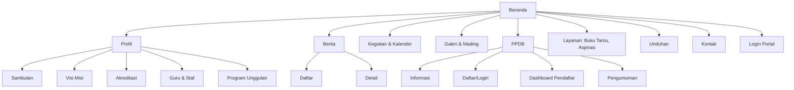
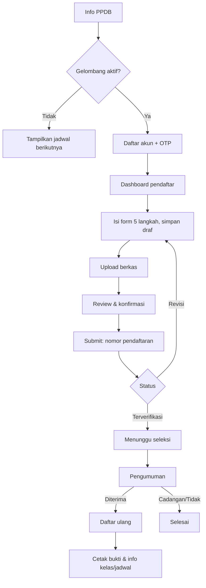

# 05. PRD Website Publik + Portal PPDB

Platform: Next.js (SSR/ISR) + Tailwind + shadcn/ui. Konsumsi: endpoint `/public/*` dan `/ppdb/*`.
Format ID: `WEB-{MODUL}-{NN}`.

## 1. Tujuan
Wajah digital sekolah: informatif, cepat, mudah ditemukan di Google, dan menjadi pintu pendaftaran PPDB serta gerbang login portal.

## 2. Pengguna
Tamu/masyarakat, calon siswa dan orang tua, alumni, pengguna internal (hanya untuk masuk ke portal).

## 3. Peta Situs

### Rute
| Rute | Halaman | Rendering |
|---|---|---|
| `/` | Beranda | ISR (revalidate 5 menit) |
| `/profil/{slug}` | Sambutan, visi-misi, akreditasi, program | ISR |
| `/guru-staf` | Direktori | ISR |
| `/berita`, `/berita/{slug}` | Daftar, detail | ISR + SSR detail |
| `/kegiatan` | Kalender publik | ISR |
| `/galeri`, `/galeri/{id}` | Album | ISR |
| `/mading` | Buletin/majalah digital | ISR |
| `/unduhan` | Pusat unduhan | ISR |
| `/layanan/buku-tamu` | Form tamu | CSR form |
| `/layanan/aspirasi`, `/layanan/aspirasi/lacak` | Form + lacak | CSR |
| `/kontak` | Kontak + peta | ISR |
| `/ppdb` | Info PPDB | ISR |
| `/ppdb/daftar`, `/ppdb/masuk` | Registrasi/login | CSR |
| `/ppdb/dashboard/*` | Area pendaftar | CSR (auth) |
| `/ppdb/pengumuman` | Cek hasil | CSR |
| `/verifikasi/{token}` | Verifikasi keaslian dokumen QR | SSR |
| `/masuk` | Pintu login portal terpadu (Siswa, Guru, Ortu, Admin/Staf) & tautan unduh APK Mobile | Statis / CSR |

---

## 4. Fitur Website

### WEB-HOME-01: Beranda [P0]
Komponen: hero slider (maks 5), sambutan singkat kepala sekolah, statistik (siswa, guru, prestasi, alumni), program unggulan, berita terbaru (3-6), agenda terdekat, banner PPDB dinamis (muncul bila gelombang aktif, dengan hitung mundur), galeri sekilas, CTA kontak.
AC: data dari `/public/site`, `/public/posts`, `/public/events`; skeleton saat memuat; LCP < 2,5 s.

### WEB-PRF-01: Halaman profil [P0]
Sambutan kepala sekolah (foto + teks), visi-misi, akreditasi (sertifikat gambar/PDF), sejarah, fasilitas, struktur organisasi, program unggulan.

### WEB-PRF-02: Direktori guru & staf [P0]
Grid kartu (foto, nama, jabatan, mapel), filter jabatan/mapel, pencarian nama. Tidak menampilkan NIP, kontak pribadi, atau data sensitif.

### WEB-NEWS-01: Berita [P0]
Daftar (filter kategori, pencarian, paginasi), detail (judul, tanggal, penulis, gambar, isi rich text, berita terkait, tombol bagikan), meta OG per artikel.

### WEB-CAL-01: Kalender kegiatan publik [P0]
Tampilan bulanan + daftar; filter kategori; hanya agenda berlabel publik.

### WEB-GAL-01: Galeri & mading digital [P1]
Album foto (lightbox, lazy load), video (embed), buletin/majalah (PDF viewer/flipbook sederhana).

### WEB-DL-01: Pusat unduhan [P1]
Daftar dokumen per kategori (brosur, panduan akademik, tata tertib) dengan ukuran file dan tombol unduh.

### WEB-GUEST-01: Buku tamu digital [P0]
Form: nama, instansi, no. HP, keperluan, tujuan (dropdown guru/pejabat), foto opsional (kamera), canvas tanda tangan digital tamu [P2 via BE-GUEST-03]. Captcha/honeypot. Sukses → halaman konfirmasi.
Catatan: juga dapat dipakai di tablet pos jaga (mode kiosk: layar penuh, reset otomatis setelah submit).

### WEB-ASP-01: Aspirasi & pengaduan [P0]
Form kategori, isi, lampiran, centang anonim; sukses menampilkan **kode tiket**. Halaman lacak: input kode → status & tanggapan.

### WEB-CT-01: Kontak [P0]
Alamat, peta (embed), telepon, email, jam layanan, tombol WhatsApp, tautan media sosial.

### WEB-VER-01: Verifikasi dokumen QR [P0]
Halaman publik memverifikasi QR e-progress report/rapor: tampil nama (disamarkan sebagian), periode, status keabsahan; tidak menampilkan nilai.

### WEB-AUTH-01: Pintu login portal terpadu (/masuk) [P0]
Halaman gerbang masuk terpadu civitas sekolah:
- Form login akun tunggal yang mendeteksi peran pengguna otomatis (Siswa, Guru, Orang Tua, Admin TU, Kepala Sekolah) dan mengarahkan langsung ke dashboard web perannya masing-masing (`/admin/dashboard`, `/portal/siswa`, `/portal/ortu`).
- Kartu informasi unduh Aplikasi Mobile Android Native (QR code scan & tautan unduh APK / Google Play Store) bagi pengguna smartphone (Siswa, Guru, Ortu).

### WEB-SEO-01: SEO & performa [P0]
Metadata dinamis, sitemap.xml, robots.txt, schema.org (`EducationalOrganization`, `NewsArticle`), gambar dioptimalkan (next/image, WebP), kompresi, cache header. Target Lighthouse ≥ 90 semua kategori utama.

### WEB-A11Y-01: Aksesibilitas & responsif [P0]
Mobile-first (≥ 360 px), kontras AA, navigasi keyboard, alt text gambar, label form.

### WEB-I18N-01: Dua bahasa [P2]
Struktur i18n (id default, en opsional).

---

## 5. Portal PPDB

### 5.1 Alur Pengguna

### WEB-PPDB-01: Halaman informasi [P0]
Jalur dan syarat (akordeon), kuota, jadwal (timeline), biaya, FAQ, alur pendaftaran (stepper visual), kontak panitia, tombol Daftar (aktif sesuai gelombang), widget cek pengumuman hasil mandiri publik, statistik pendaftar (opsional, bisa disembunyikan).

### WEB-PPDB-02: Registrasi & Login Calon Siswa [P0]
Alur pendaftaran mandiri calon siswa berbasis akun:
1. **Registrasi Akun Baru (`/ppdb/daftar`)**:
   - Kolom: Nama Lengkap Calon Siswa, Email Aktif, Nomor WhatsApp/HP, Password (minimal 8 karakter), dan Konfirmasi Password.
   - Pengecekan NIK unik (`POST /api/v1/ppdb/check-nik`) mencegah 1 anak memiliki 2 pendaftaran aktif.
   - Mengirim permintaan registrasi ke `POST /api/v1/ppdb/register`.
   - Mengirim kode OTP 6-digit (kedaluwarsa 15 menit, cooldown 60 detik).
2. **Verifikasi OTP**:
   - Input modal/halaman kode OTP 6-digit.
   - Mengirim ke `POST /api/v1/ppdb/verify-otp`.
   - Sukses → akun menjadi `active` dan menerbitkan token Sanctum (Bearer Token) serta profil pendaftar.
3. **Portal Masuk Pendaftar (`/ppdb/masuk`)**:
   - Mendukung **Multi-Identifier Login** (`POST /api/v1/ppdb/login`):
     - Masuk dengan **Alamat Email**,
     - Masuk dengan **Nomor WhatsApp / HP**,
     - Masuk dengan **Nomor Registrasi PPDB** (misal: `REG-2026-0001`).
   - Rate limiting: Maksimal 5 kali percobaan gagal per 15 menit untuk mitigasi brute force.
   - Sukses → redirect otomatis ke `/ppdb/dashboard`.

### WEB-PPDB-03: Dashboard Pendaftar [P0]
Area personal calon siswa (`/ppdb/dashboard`):
- **Kartu Ringkasan Status**:
  - Nomor Registrasi resmi, Jalur Pilihan, Gelombang Aktif.
  - Status badge: `draft` (Draf Belum Submit), `submitted` (Menunggu Verifikasi Berkas), `revision` (Perlu Revisi Berkas), `verified` (Berkas Valid / Siap Seleksi), `accepted` (Diterima), `waitlist` (Cadangan), `rejected` (Belum Diterima).
- **Progres Kelengkapan Formulir (Stepper 5 Langkah)**:
  - Langkah 1: Data Diri (Nama, NIK, NISN, TTL, Jenis Kelamin, Agama, Alamat).
  - Langkah 2: Orang Tua / Wali (Nama Ayah/Ibu/Wali, Pekerjaan, Rentang Penghasilan, Kontak).
  - Langkah 3: Asal Sekolah (Nama Sekolah, NPSN, Nilai Rapor / Ujian).
  - Langkah 4: Pilihan Peminatan & Data Prestasi (bila jalur prestasi).
  - Langkah 5: Unggah Dokumen Berkas Persyaratan (KK, Akta Kelahiran, Pas Foto, Rapor).
- **Panel Berkas & Catatan Revisi**:
  - Daftar dokumen yang diunggah beserta statusnya (`menunggu`, `valid`, `ditolak`).
  - Jika berkas ditolak, menampilkan alasan penolakan dan form unggah ulang berkas pengganti.
- **Cetak Bukti Pendaftaran**:
  - Tombol unduh / cetak lembar Kartu Tanda Peserta PPDB dengan QR Code verifikasi.

### WEB-PPDB-04: Form bertahap [P0]
| Langkah | Isi |
|---|---|
| 1. Data diri | Nama, NIK, NISN, TTL, JK, agama, alamat, foto, kontak |
| 2. Orang tua/wali | Ayah, ibu, wali (nama, pekerjaan, penghasilan, kontak) |
| 3. Asal sekolah | Nama sekolah, NPSN, tahun lulus, nilai rapor/ujian (sesuai jalur) |
| 4. Pilihan | Jalur, jurusan/peminatan, prestasi (bila jalur prestasi) |
| 5. Berkas | Unggah KK, akta, ijazah/SKL, rapor, foto, sertifikat sesuai syarat |
AC:
- Draf otomatis tersimpan setiap pindah langkah (`PATCH /api/v1/ppdb/applications/{id}/steps/{step}`).
- Validasi sisi klien (Zod) dan pesan error dari server ditampilkan per field.
- Tidak bisa submit jika berkas wajib belum lengkap.
- Layar konfirmasi merangkum seluruh data sebelum submit final (`POST /api/v1/ppdb/applications/{id}/submit`).

### WEB-PPDB-05: Upload berkas [P0]
Drag-drop, pratinjau, validasi tipe/ukuran di klien (PDF/JPG/PNG maks 2MB), progress bar, ganti berkas, status per berkas (menunggu/valid/ditolak + alasan).
Endpoint: `POST /api/v1/ppdb/applications/{id}/documents`.

### WEB-PPDB-06: Cek status & revisi [P0]
Status jelas dengan warna dan teks; bila revisi: berkas/kolom yang perlu diperbaiki disorot dengan peringatan khusus.

### WEB-PPDB-07: Pengumuman hasil [P0]
Form nomor pendaftaran + tanggal lahir → hasil (diterima/cadangan/tidak) dengan pesan dan langkah selanjutnya. Muncul hanya setelah waktu publikasi. Perlindungan rate limit + captcha. Endpoint: `POST /api/v1/public/ppdb/results/check`.

### WEB-PPDB-08: Daftar ulang [P0]
Konfirmasi kesediaan, unggah berkas tambahan, pilih jadwal verifikasi (bila ada), status konfirmasi. Endpoint: `POST /api/v1/ppdb/applications/{id}/re-register`.

### WEB-PPDB-09: Cetak bukti & kartu [P1]
Unduh PDF bukti pendaftaran (QR) dan bukti penerimaan. Endpoint: `GET /api/v1/ppdb/applications/{id}/receipt`.

### WEB-PPDB-10: Notifikasi [P1]
Email/WA otomatis: pendaftaran masuk, kode OTP, berkas ditolak, hasil seleksi, jadwal daftar ulang.

---

## 6. Komponen UI (design system web)
| Kategori | Komponen |
|---|---|
| Layout | Navbar (sticky, mobile drawer), Footer, Breadcrumb, Section container |
| Konten | Hero slider, Card berita, Card guru, Stat counter, Timeline, Accordion/FAQ, Tabs |
| Media | Image gallery + lightbox, Video embed, PDF viewer |
| Form | Input, Select, Textarea, Date picker, File uploader, Stepper form, Checkbox/Radio, OTP input, Captcha |
| Umpan balik | Toast, Alert, Skeleton, Empty state, Error page (404/500), Spinner |
| Navigasi | Pagination, Filter chip, Search box |
| Lain | Countdown, Status badge, Map embed, Share button, Cookie/pemberitahuan privasi |

Token desain: warna brand dari logo sekolah (primary/secondary/accent), tipografi (judul + isi, maks 2 keluarga font), radius, bayangan, jarak (skala 4 px). Dukungan dark mode: P2.

## 7. Kebutuhan Teknis Web
- Data fetching: Server Components + `fetch` dengan tag revalidate; klien memakai TanStack Query.
- Klien API memakai paket `api-client` hasil generate OpenAPI.
- Form: React Hook Form + Zod (skema dibagi dari `packages/shared`).
- Auth PPDB: cookie HttpOnly; middleware melindungi `/ppdb/dashboard`.
- Proteksi form publik: captcha (hCaptcha/Turnstile), honeypot, rate limit server.
- Analytics: Plausible/GA (patuh privasi), tanpa melacak data anak.
- Error tracking: Sentry.
- Pemberitahuan privasi dan persetujuan pemakaian data pada pendaftaran PPDB (wajib).

## 8. Kriteria Penerimaan Umum
- Lighthouse ≥ 90 (Performance, Accessibility, SEO, Best Practices) pada Beranda, Berita, PPDB.
- Seluruh halaman diuji di lebar 360, 768, 1280 px.
- Form PPDB lulus uji end-to-end (Playwright): daftar → submit → revisi → hasil.
- Tidak ada data sensitif di respons publik (diuji otomatis).
- Semua teks Bahasa Indonesia, tanpa typo pada UI utama.

## 9. Ketergantungan Backend
| Fitur web | Fitur backend |
|---|---|
| WEB-HOME/PRF/NEWS/CAL/GAL/DL | BE-CMS-01 s.d. 06 |
| WEB-GUEST-01 | BE-GUEST-01, BE-GUEST-03 |
| WEB-ASP-01 | BE-GUEST-02 |
| WEB-PPDB-01..09 | BE-PPDB-01..09, BE-FILE-01 |
| WEB-VER-01 | BE-GRD-03, BE-GRD-04 (verify token) |
| WEB-PPDB-10 | BE-NTF-02 |

## Changelog
- 1.0: Draf awal.
- 1.1: Pemisahan modul GUEST dari HUM, pembaruan ketergantungan verifikasi QR dokumen ke `BE-GRD-03/04`, penambahan dukungan tanda tangan canvas pada buku tamu digital (`BE-GUEST-03`).
