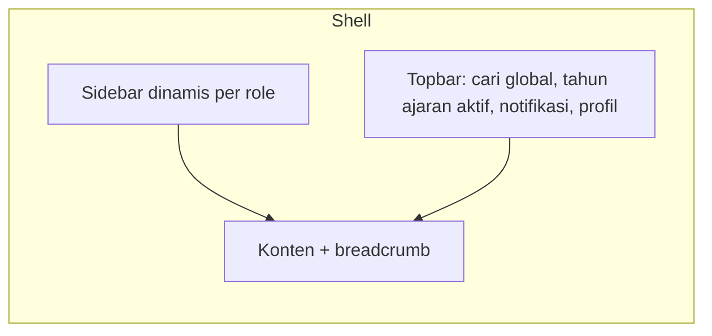

# 06. PRD Web Portal & Dashboard Terpadu (Admin, Guru, Siswa, Orang Tua)

Platform: Next.js/React + Tailwind + shadcn/ui + TanStack Query/Table. Pengguna: Admin TU, Kepala Sekolah, Guru/Walas, BK, Sarpras, Panitia PPDB, Pustakawan, **Siswa**, dan **Orang Tua/Wali**.
Format ID: `ADM-{MODUL}-{NN}` (Admin & Guru), `SIS-{MODUL}-{NN}` (Portal Siswa Web), `ORT-{MODUL}-{NN}` (Portal Ortu Web). Setiap fitur memetakan ke endpoint backend (`BE-*`).

## 1. Prinsip UX & Akses Multi-Role
1. **Menu & Shell Mengikuti Role & Permission**: Pengguna hanya melihat fitur dan antarmuka sesuai wewenang otentikasi.
   - Admin/Staf/Guru: Menggunakan Shell Dashboard Manajemen (`/admin/*`).
   - Siswa: Menggunakan Shell Portal Siswa (`/portal/siswa/*`), dioptimalkan untuk pengerjaan CBT di komputer lab/laptop dan pengumpulan tugas LMS.
   - Orang Tua: Menggunakan Shell Portal Orang Tua (`/portal/ortu/*`) dengan pemilih anak (multi-anak switcher) untuk memantau kehadiran dan e-rapor.
2. Pekerjaan harian efisien: entri presensi & nilai cepat, akses CBT sekali klik dengan token.
3. Tabel data seragam: cari, filter, sort, paginasi server-side, ekspor, aksi massal.
4. Operasi berat (cetak massal, import) tampil sebagai **job** dengan progres dan notifikasi selesai.
5. Aksi destruktif selalu minta konfirmasi; data penting memakai soft delete.
6. Responsif: Desktop dan laptop (target utama CBT lab dan administrasi), ramah tablet (guru di kelas).

## 2. Layout & Navigasi

Struktur menu (grup):
| Grup | Isi |
|---|---|
| Dashboard | Ringkasan sesuai role |
| Master Data | Tahun ajaran, siswa, guru/staf, ortu, kelas, mapel, ruang |
| PPDB | Konfigurasi, pendaftar, verifikasi, seleksi, daftar ulang |
| Akademik | Jadwal, jurnal, presensi, nilai, karakter, progress report, rapor, modul ajar |
| CBT | Bank soal, ujian, ruang & token, monitor, koreksi, analisis, remedial |
| Kesiswaan | Poin, ekskul, lomba, study trip |
| BK | Kasus, sesi, deteksi dini |
| Sarpras | Booking, aset, tiket, perpustakaan, alat lab |
| Humas | Buku tamu, aspirasi, MoU, alumni |
| Konten (CMS) | Berita, galeri, agenda, halaman, unduhan, pengaturan situs |
| Laporan | Rekap & ekspor |
| Pengaturan | User, role, template notifikasi, log audit, backup, konfigurasi umum |

## 3. Komponen Bersama
| Komponen | Spesifikasi |
|---|---|
| DataTable | Kolom dapat diatur, sort server-side, filter, pencarian, paginasi, pilih baris, aksi massal, ekspor |
| FormBuilder | RHF + Zod; tata letak 1-2 kolom; error per field; unsaved-changes warning |
| Wizard | Langkah bertahap dengan validasi per langkah |
| FileUploader | Presign upload, pratinjau, progress, validasi |
| RichTextEditor | Tiptap; gambar; sanitasi HTML |
| ImportDialog | Unggah Excel → pratinjau → laporan error per baris → konfirmasi |
| JobCenter | Daftar job latar belakang (PDF, import) dengan status & unduh hasil |
| ConfirmDialog | Untuk aksi destruktif |
| Chart | Garis, batang, donat, progress ring (Recharts) |
| Calendar/Timetable | Grid jadwal drag-and-drop |
| StatusBadge | Warna konsisten per status |
| PermissionGate | Sembunyikan elemen sesuai permission |
| NotificationBell | Inbox + realtime |
| Timeline/AuditView | Riwayat perubahan entitas |

---

## 4. Dashboard

### ADM-DASH-01: Dashboard per role [P0]
- **Admin TU:** total siswa/guru, pendaftar PPDB terbaru, tugas tertunda (verifikasi, tiket), pengumuman.
- **Guru/Walas:** jadwal hari ini + tombol cepat Jurnal & Presensi; antrean koreksi esai; progres input nilai bulanan dengan tenggat; tombol pinjam ruang & lapor kerusakan; status kelas perwalian.
- **BK:** kasus aktif, peringatan dini, jadwal konseling.
- **Sarpras:** tiket menurut status, booking hari ini, aset butuh perhatian.
- **Panitia PPDB:** jumlah pendaftar per status/jalur, antrean verifikasi.
Backend: BE-RPT-02.

### ADM-DASH-02: Dashboard eksekutif kepala sekolah [P0]
| Widget | Isi |
|---|---|
| CBT Live Monitor | Siswa aktif per ruang secara real-time |
| Ketercapaian | Penyelesaian silabus, % guru tuntas nilai bulanan, rerata nilai per angkatan |
| Disiplin & presensi | % hadir guru/staf/siswa hari ini, kasus kesiswaan butuh tindak lanjut |
| Sarpras | Fasilitas kritis/rusak dalam antrean |
| Persetujuan | Antrean ACC progress report/rapor |
Aksi cepat: ACC dari dashboard.

---

## 5. Master Data

### ADM-MST-01: Tahun ajaran & semester [P0]
Daftar, tambah, aktifkan (dengan konfirmasi dampak), tutup.

### ADM-MST-02: Siswa [P0]
Tabel + filter kelas/status/angkatan; form tambah/ubah (tab: biodata, alamat, wali, riwayat kelas, dokumen); import/ekspor Excel; ubah status (keluar/pindah/lulus) dengan alasan; kartu pelajar QR (cetak).

### ADM-MST-03: Guru & staf [P0]
CRUD, penugasan mapel/kelas, pembuatan akun otomatis, import.

### ADM-MST-04: Orang tua/wali [P0]
CRUD, tautan ke anak (multi-anak), buat akun massal, kirim kredensial awal (WA/email).

### ADM-MST-05: Kelas & rombel [P0]
Pengelolaan kelas, wali kelas, penempatan siswa (drag-drop / pilih massal), pindah kelas.

### ADM-MST-06: Mata pelajaran & penugasan [P0]
Mapel, kelompok, matriks penugasan guru × kelas.

### ADM-MST-07: Ruang & fasilitas [P1]
Ruang, kapasitas, tipe, perlengkapan.

### ADM-MST-08: Kenaikan kelas & kelulusan [P1]
Wizard: pilih periode → pratinjau → aturan pengecualian → eksekusi → laporan.

---

## 6. PPDB (Admin)

### ADM-PPDB-01: Konfigurasi [P0]
Gelombang, jalur, kuota, syarat berkas, rumus skor per jalur (editor formula sederhana + simulasi), template pengumuman.

### ADM-PPDB-02: Daftar pendaftar [P0]
Tabel dengan filter status/jalur/jurusan/tanggal; detail pendaftar (biodata, berkas, riwayat status, catatan).

### ADM-PPDB-03: Verifikasi berkas [P0]
Layar split: pratinjau berkas di kiri, tombol valid/tolak + alasan di kanan; navigasi pendaftar berikutnya (keyboard shortcut); aksi massal.

### ADM-PPDB-04: Seleksi & ranking [P0]
Jalankan ranking, lihat daftar peringkat per jalur, tandai diterima/cadangan sesuai kuota, kunci hasil, jadwalkan publikasi. Semua aksi tercatat di audit.

### ADM-PPDB-05: Daftar ulang & penempatan kelas [P0]
Verifikasi daftar ulang, konversi ke siswa (massal), pembagian kelas otomatis (acak seimbang/berdasarkan nilai/JK) + penyesuaian manual.

### ADM-PPDB-06: Laporan PPDB [P1]
Statistik per jalur/asal sekolah/wilayah, ekspor Excel/PDF.

---

## 7. Akademik

### ADM-ACD-01: Jadwal pelajaran [P0]
Timetable grid per kelas/guru/ruang, drag-drop, peringatan bentrok real-time, cetak/ekspor, salin dari semester lalu.

### ADM-ACD-02: Jurnal mengajar [P0]
Dari dashboard guru: pilih sesi hari ini → isi materi/metode/catatan → presensi siswa dalam satu layar. Rekap jurnal oleh kepala sekolah/TU.

### ADM-ACD-03: Presensi [P0]
Presensi per sesi kelas, presensi gerbang harian (input/scan), edit dengan alasan, rekap bulanan/semester, ekspor.

### ADM-ACD-04: Izin/sakit [P0]
Antrean pengajuan untuk walas: lihat surat, setuju/tolak, catatan.

### ADM-ACD-05: Presensi guru & staf [P1]
Rekap kehadiran, koreksi, laporan.

### ADM-ACD-06: Bank modul ajar [P1]
Unggah/versi/kategori; pencarian; tautkan ke tingkat & mapel.

### ADM-ACD-07: Tugas & materi [P1]
Buat tugas/materi, daftar pengumpulan, penilaian cepat.

---

## 8. GRD: Penilaian & Rapor (Admin)

### ADM-GRD-01: Buku nilai bulanan [P0]
Grid siswa × komponen (seperti spreadsheet): navigasi keyboard, tempel dari Excel, validasi, simpan otomatis, indikator kelengkapan, kunci periode (admin).

### ADM-GRD-02: Catatan karakter [P0]
Form per siswa per bulan (skala + catatan), tampilan massal per kelas.

### ADM-GRD-03: E-Progress Report [P0]
Pilih kelas/bulan → generate (job) → pratinjau → ajukan ACC → kepala sekolah ACC (satuan/massal) → terbitkan; cetak massal; unduh PDF; status per siswa.

### ADM-GRD-04: E-Rapor [P0]
Pengaturan komponen & template deskripsi → hitung nilai akhir → periksa kelengkapan → kunci → pengesahan → cetak massal/ZIP → arsip. Pembukaan kunci memerlukan alasan.

---

## 9. CBT

### ADM-CBT-01: Bank soal [P0]
Daftar & filter (mapel, bab, CP, level, tipe), editor soal per tipe (rich text, gambar, audio, rumus), pratinjau tampilan siswa, import dari Word/Excel (template), duplikasi, status draft/final.

### ADM-CBT-02: Pembuatan ujian [P0]
Wizard: informasi → pilih soal (manual/acak per aturan) → pengaturan (durasi, acak, paket A/B, KKTP, lihat hasil) → peserta & ruang → jadwal → tinjau & terbitkan.

### ADM-CBT-03: Ruang, token, kartu ujian [P0]
Plotting peserta ke ruang/sesi, penugasan pengawas, generate & tampil token (layar besar), cetak kartu ujian massal.

### ADM-CBT-04: Monitor live [P0]
Grid siswa per ruang dengan status warna, progres %, pelanggaran, sisa waktu; filter; aksi: reset login, tambah waktu, paksa selesai, buka kunci (konfirmasi + alasan). Pembaruan via WebSocket; indikator koneksi.

### ADM-CBT-05: Koreksi uraian [P0]
Antrean per soal (menilai satu soal untuk semua siswa) atau per siswa; rubrik; skor & komentar; progres koreksi.

### ADM-CBT-06: Hasil & analisis [P1]
Rekap nilai, distribusi, tingkat kesukaran & daya pembeda tiap soal, rekap per CP, ekspor; kirim ke buku nilai.

### ADM-CBT-07: Remedial & pengayaan [P1]
Daftar siswa di bawah KKTP → buat ujian remedial dalam beberapa klik.

### ADM-CBT-08: Berita acara [P1]
Isi catatan pengawas → PDF.

---

## 10. Kesiswaan

### ADM-STD-01: Poin pelanggaran & prestasi [P0]
Master jenis poin, input cepat (cari siswa → pilih jenis → simpan), akumulasi per siswa/kelas, aturan tindak lanjut otomatis, riwayat.

### ADM-STD-02: Ekstrakurikuler [P1]
Master ekskul, pendaftaran daring (persetujuan), jurnal kehadiran, nilai untuk rapor, repositori proposal/laporan.

### ADM-STD-03: Lomba & prestasi [P1]
Pendaftaran delegasi, hasil, galeri piala.

### ADM-STD-04: Study trip [P2]
Rencana, rute, peserta, status izin ortu, ekspor daftar. Rincian biaya hanya dicatat sebagai teks catatan non-keuangan.

---

## 11. BK (akses ketat)

### ADM-BK-01: Kasus & konseling [P0]
Daftar kasus (hanya milik BK), catatan sesi terenkripsi, jadwal, rujukan dari guru, riwayat pembinaan. Banner "Data rahasia: akses dicatat".

### ADM-BK-02: Peringatan dini [P1]
Daftar siswa berisiko (kehadiran/nilai/poin), tindak lanjut, penyesuaian ambang.

---

## 12. Sarpras & Perpustakaan

### ADM-SAR-01: Booking fasilitas [P0]
Kalender ketersediaan, form pengajuan, antrean persetujuan, bentrok ditolak otomatis.

### ADM-SAR-02: Aset & inventaris [P1]
Registrasi aset, generate & cetak label QR, stok opname via kamera/scan, riwayat kondisi.

### ADM-SAR-03: Helpdesk [P0]
Papan Kanban (Pending/Diproses/Selesai), detail tiket, disposisi, bukti foto, SLA indikator.

### ADM-SAR-04: Perpustakaan & alat lab [P1]
Katalog, peminjaman/pengembalian (scan), jatuh tempo, denda opsional.

---

## 13. GUEST: Buku Tamu & Aspirasi

### ADM-GUEST-01: Buku tamu [P0]
Daftar tamu hari ini, checkout, pencarian, pratinjau tanda tangan digital [P2], ekspor data tamu.

### ADM-GUEST-02: Aspirasi/pengaduan [P0]
Antrean tiket aspirasi, penugasan ke unit kerja, tanggapan resmi, perubahan status; pengaduan anonim tidak menampilkan identitas pelapor.

### ADM-GUEST-03: Verifikasi tanda tangan digital buku tamu [P2]
Pratinjau visual dan audit tanda tangan digital pengunjung pada detail data buku tamu.

---

## 14. HUM: Humas & Kemitraan

### ADM-HUM-01: MoU & pertukaran [P1]
Daftar MoU dengan masa berlaku & pengingat; program pertukaran dan peserta.

### ADM-HUM-02: Alumni & tracer [P1]
Direktori alumni, kuesioner tracer (builder sederhana), rekap hasil.

---

## 15. CMS

### ADM-CMS-01: Pengaturan situs & profil [P0]
Form pengaturan identitas, visi-misi, sambutan, akreditasi, kontak.

### ADM-CMS-02: Berita & pengumuman [P0]
Editor, kategori, status, penjadwalan, pratinjau, target publik/internal.

### ADM-CMS-03: Galeri, mading, agenda, unduhan [P1]
Kelola album/media, buletin, agenda publik/internal, dokumen unduhan.

---

## 16. Laporan & Pengaturan

### ADM-RPT-01: Pusat laporan [P0]
Daftar jenis laporan, filter, pratinjau, ekspor PDF/Excel (via JobCenter).

### ADM-SET-01: Pengguna & role [P0]
CRUD user, reset password, aktif/nonaktif, assign role, **matriks permission** (role × permission) yang dapat diedit.

### ADM-SET-02: Template notifikasi & pengumuman massal [P0]
Editor template dengan variabel (`{{nama_siswa}}`), uji kirim, kirim pengumuman ke target (semua/kelas/role), lihat statistik dibaca.

### ADM-SET-03: Log audit [P0]
Pencarian log, filter pengguna/entitas/tanggal, tampilan diff.

### ADM-SET-04: Backup & sistem [P1]
Status backup terakhir, picu backup manual, status job, versi aplikasi.

### ADM-SET-05: Konfigurasi umum [P1]
Hari libur, jam pelajaran, ambang peringatan dini, batas edit jurnal, template rapor.

---

## 17. Portal Web Siswa (`SIS-*`)

Portal Siswa di Web dirancang untuk diakses via PC lab komputer sekolah atau laptop/Chromebook pribadi siswa (`/portal/siswa/*`), dengan fokus utama kenyamanan pengerjaan ujian digital (CBT layar lebar), pengumpulan tugas berkas besar (LMS), dan akses rapor berkala.

### SIS-DASH-01: Dashboard Siswa Web [P0]
- Ringkasan widget terpadu:
  - Kartu selamat datang + status kehadiran hari ini (hadir/belum absen).
  - Jadwal pelajaran hari ini (mapel aktif, ruang, jam, guru pengampu).
  - Banner Ujian CBT aktif atau terjadwal hari ini (dengan tombol langsung ke `/portal/siswa/cbt`).
  - Daftar tenggat tugas LMS yang belum diselesaikan.
  - Pengumuman sekolah terbaru & pesan wali kelas.
- Backend: `GET /dashboard/student`.

### SIS-CBT-01: Web CBT Exam Workspace (Komputer Lab / Layar Lebar) [P0]
- **Tampilan Khusus Ujian (Distraction-Free Mode)**:
  - Header: Nama ujian, mata pelajaran, identitas siswa, indikator status koneksi (Online/Reconnecting), countdown timer sinkron waktu server, status simpan otomatis (*Semua jawaban tersimpan*).
  - Area Soal (Kiri/Tengah): Teks soal rich-text (dukungan KaTeX formula matematika, audio listening, gambar resolusi tinggi, tabel perbandingan), 6 model soal:
    1. Pilihan Ganda (Single Choice)
    2. Pilihan Ganda Kompleks (Multi Choice Checkbox)
    3. Benar / Salah (True / False Grid)
    4. Menjodohkan (Matching Pair Drag/Select)
    5. Isian Singkat (Short Answer Text)
    6. Uraian / Esai (Rich Textarea)
  - Panel Navigasi Butir Soal (Kanan): Grid nomor soal dengan 3 penanda warna status: *Belum Dijawab* (Abu-abu), *Sudah Terjawab* (Biru/Hijau), *Ragu-Ragu* (Kuning/Amber). Tombol checkbox *Ragu-ragu* di bawah soal.
  - Navigasi Cepat: Tombol *Sebelumnya*, *Selanjutnya*, dan *Kumpulkan Ujian*.
- **Mekanisme Keamanan Web (Anti-Cheat Web)**:
  - Masuk ujian menggunakan Token Sesi Ruang (`POST /exams/{id}/start-session`).
  - Autosave debounce 500ms idempotent ke `POST /exams/{id}/save-answer`.
  - Deteksi perpindahan tab atau jendela (`document.visibilitychange`, `window.onblur`) dan tombol keluar fullscreen: memicu peringatan modal dan mencatat log pelanggaran ke `POST /exams/{id}/log-violation`.
  - Pencegahan inspect element, disable klik kanan (`contextmenu`), dan shortcut copy-paste.
  - Dialog konfirmasi berlapis sebelum *Submit* (`POST /exams/{id}/finish-session`) menampilkan ringkasan jumlah soal yang belum dijawab.
- Backend: `POST /exams/{id}/start-session`, `GET /exams/{id}/session-questions`, `POST /exams/{id}/save-answer`, `POST /exams/{id}/log-violation`, `POST /exams/{id}/finish-session`.

### SIS-ACD-01: Jadwal & Kalender Akademik Siswa [P0]
- Tampilan kalender mingguan dan bulanan jadwal mata pelajaran kelas siswa, agenda ujian tengah/akhir semester, libur sekolah, dan kegiatan kurikuler.

### SIS-ACD-02: Modul Ajar & Pengumpulan Tugas LMS [P1]
- Daftar materi/modul pembelajaran per mata pelajaran (unduh slide, PDF bahan ajar, link video).
- Daftar tugas sekolah dengan filter: *Aktif*, *Sudah Dikumpulkan*, *Dinilai*.
- Formulir pengumpulan tugas: unggah berkas dokumen (PDF, Word, ZIP, foto) via presigned URL atau kirim tautan Google Docs/Drive; menampilkan catatan umpan balik dan nilai dari guru.

### SIS-GRD-01: E-Progress Report & E-Rapor Siswa [P0]
- Pratinjau capaian nilai bulanan dan nilai akhir semester per mata pelajaran.
- Unduh dokumen resmi PDF E-Progress Report dan E-Rapor lengkap dengan barcode/QR verification yang telah disahkan Kepala Sekolah.

### SIS-STD-01: Poin Pembiasaan & Ekskul Siswa [P1]
- Buku catatan poin disiplin dan poin prestasi siswa secara transparan.
- Informasi pendaftaran ekstrakurikuler sekolah dan jadwal pertemuan mingguan.

### SIS-BK-01: Konseling Siswa & Bantuan Privat [P1]
- Formulir permohonan janji temu konseling tatap muka dengan Guru BK (privat & terenkripsi).
- Tautan pengaduan perundungan / whistleblowing anonim (mengarah ke modul GUEST publik).

---

## 18. Portal Web Orang Tua (`ORT-*`)

Portal Orang Tua di Web (`/portal/ortu/*`) dirancang agar wali murid dapat memantau perkembangan akademik dan kehadiran anak secara komprehensif melalui komputer, laptop, maupun peramban web lainnya.

### ORT-DASH-01: Multi-Anak Switcher & Dashboard Orang Tua Web [P0]
- **Multi-Child Selector Card/Dropdown**: Jika akun orang tua terhubung ke lebih dari 1 siswa di sekolah (`student_guardians`), header menampilkan pemilih anak aktif dengan informasi foto, nama anak, NISN, dan kelas.
- Ringkasan Terpadu Dashboard Anak:
  - Kartu Status Kehadiran Hari Ini: Menampilkan jam tap gerbang datang, absensi di ruang kelas, atau status izin/sakit.
  - Ringkasan Jadwal Pelajaran Hari Ini untuk anak yang dipilih.
  - Pengumuman penting sekolah & agenda rapat wali murid terdekat.
  - Notifikasi penting: pengingat penerbitan rapor baru atau konfirmasi surat izin.
- Backend: `GET /dashboard/guardian/{studentId}`, `GET /guardians`.

### ORT-ACD-01: Riwayat Presensi & Log Gerbang Anak [P0]
- Kalender presensi bulanan lengkap dengan rekapitulasi persentase kehadiran: Hadir, Sakit, Izin, Alpa, Terlambat.
- Rincian jam masuk gerbang sekolah harian.

### ORT-ACD-02: Pengajuan Surat Izin & Sakit via Web [P0]
- Formulir permohonan ketidakhadiran anak:
  - Pilih tanggal mulai dan tanggal selesai ketidakhadiran.
  - Jenis permohonan: *Sakit* atau *Izin Kepentingan Keluarga*.
  - Catatan/keterangan alasan permohonan.
  - Unggah lampiran bukti (foto surat dokter / surat izin bertanda tangan orang tua, format PDF/JPG/PNG).
- Pelacakan status permohonan secara realtime (*Menunggu Konfirmasi Walas*, *Disetujui*, *Ditolak*).
- Backend: `POST /leave-requests`, `GET /leave-requests`.

### ORT-GRD-01: E-Progress Report & E-Rapor Semester Anak [P0]
- Tampilan grafik radar/batang perkembangan kompetensi belajar anak per mata pelajaran.
- Unduh berkas E-Progress Report bulanan dan E-Rapor semester berformat PDF resmi ber-QR Code keaslian dokumen.

### ORT-STD-01: Buku Poin Sikap & Prestasi Anak [P1]
- Pemantauan catatan poin perilaku positif (penghargaan/prestasi) dan pelanggaran disiplin anak.
- Notifikasi peringatan dini jika akumulasi poin pelanggaran anak mendekati batas pemanggilan orang tua ke sekolah.

### ORT-FIN-01: Informasi Administrasi & Biaya Sekolah (Informatif) [P1]
- Halaman informasi transparan mengenai status pembayaran administrasi sekolah (SPP bulanan, uang kegiatan, study trip) yang tercatat di Tata Usaha.
- Bersifat catatan informatif tanpa modul payment gateway perbankan.

### ORT-BK-01: Janji Temu Konseling Wali Murid [P1]
- Formulir pengajuan konsultasi atau diskusi pendampingan anak bersama Guru BK atau Wali Kelas.

---

## 19. Matriks Hak Akses Ringkas (Web Portal Multi-Role)
| Menu / Modul | Admin | Kepsek | Guru | Walas | BK | Sarpras | Panitia | Siswa | Ortu |
|---|:-:|:-:|:-:|:-:|:-:|:-:|:-:|:-:|:-:|
| Dashboard | ✅ | ✅ eksekutif | ✅ | ✅ | ✅ | ✅ | ✅ | ✅ (`/portal/siswa`) | ✅ (`/portal/ortu`) |
| Master data | ✅ | lihat | lihat kelas | lihat kelas | - | - | - | - | - |
| PPDB | ✅ | lihat | - | - | - | - | ✅ | - | - |
| Jadwal | ✅ | lihat | lihat | lihat | - | - | - | lihat sendiri | lihat anak |
| Jurnal & presensi | konfig | rekap | input | input+izin | lihat | - | - | riwayat hadir | riwayat + ajukan izin |
| Nilai & rapor (GRD) | cetak/kunci | ACC | input | input+karakter | - | - | - | lihat + unduh | lihat + unduh |
| CBT Exam | review | live monitor | buat/atur | buat/atur | - | - | - | ✅ kerjakan ujian | - |
| LMS / Tugas | konfig | pantau | buat tugas | buat tugas | - | - | - | kumpul tugas | pantau tugas |
| Poin siswa (STD) | konfig | rekap | input | input | lihat | - | - | lihat poin | lihat poin anak |
| BK | sistem | laporan | rujuk | rujuk | ✅ | - | - | ajukan konseling | ajukan konseling |
| Sarpras | disposisi | pantau | pinjam/lapor | pinjam/lapor | - | ✅ | - | - | - |
| Buku tamu / aspirasi | ✅ | pantau | - | - | - | - | - | lapor aspirasi | lapor aspirasi |
| Biaya/Admin (FIN) | kelola TU | pantau | - | - | - | - | - | - | catatan informatif |
| Pusat Laporan (RPT) | ✅ | ✅ | rekap mapel | rekap kelas | rekap kasus | rekap sarpras | rekap PPDB | - | - |
| Pengaturan | ✅ | - | - | - | - | - | - | - | - |

Sumber otoritatif tetap tabel permission di backend; matriks ini sebagai acuan routing shell dan visibilitas komponen UI web.

## 20. Kriteria Penerimaan Umum Web Portal
- Menu dan tombol hanya tampil sesuai permission; akses langsung via URL tanpa izin → halaman 403.
- Shell Web memisahkan konteks manajemen (`/admin/*`), siswa (`/portal/siswa/*`), dan orang tua (`/portal/ortu/*`).
- Ujian CBT Web di Lab Komputer bebas distorsi, fullscreen, autosave otomatis, dan mendeteksi perpindahan tab secara akurat.
- Orang tua dengan multi-anak dapat beralih konteks anak seketika tanpa kehilangan sesi login.
- Semua tabel mendukung paginasi server-side (tidak memuat semua data sekaligus).
- Form menampilkan error validasi dari server pada field terkait (Zod + React Hook Form).
- Operasi berat (> 5 detik) berjalan sebagai background job dengan notifikasi.
- Uji E2E untuk alur kritis: verifikasi PPDB, input nilai → progress report → ACC, pengerjaan ujian CBT siswa → submit.

## Changelog
- 1.0: Draf awal.
- 1.1: Pemisahan modul GRD dari ACD (ADM-GRD-01..04), pemisahan modul GUEST dari HUM (ADM-GUEST-01..03 dengan audit tanda tangan tamu), penyelarasan modul RPT, dan pembaruan matriks menu hak akses.
- 1.2: Perluasan menjadi Web Portal Terpadu Multi-Role: penambahan Portal Web Siswa (`SIS-*`, termasuk Web CBT Exam Workspace di lab/laptop), Portal Web Orang Tua (`ORT-*`, termasuk multi-anak switcher dan perizinan), serta pembaruan matriks akses 9 peran pengguna.
