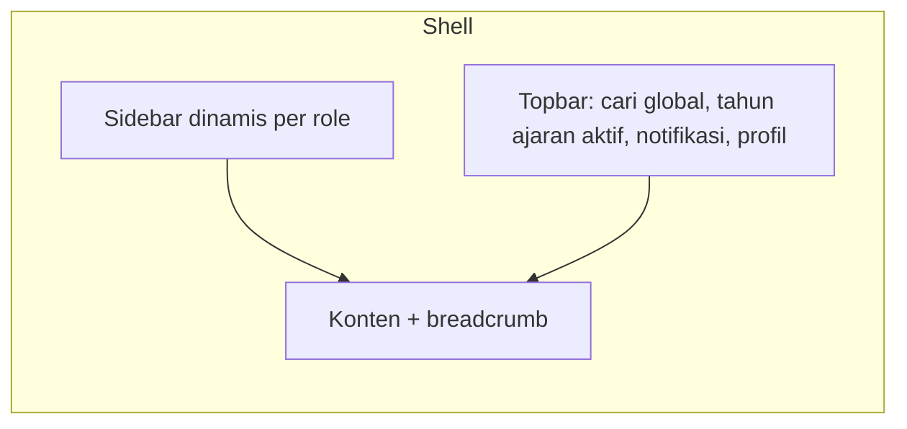

# 06. PRD Sistem Admin (Web Dashboard)

Platform: Next.js/React + Tailwind + shadcn/ui + TanStack Query/Table. Pengguna: admin TU, kepala sekolah, guru/walas, BK, sarpras, panitia PPDB, pustakawan.
Format ID: `ADM-{MODUL}-{NN}`. Setiap fitur admin memetakan ke fitur backend (`BE-*`).

## 1. Prinsip UX
1. Menu **mengikuti permission**: pengguna hanya melihat menu yang boleh diakses.
2. Pekerjaan harian harus ≤ 3 klik (presensi, input nilai, buat tiket).
3. Tabel data seragam: cari, filter, sort, paginasi, ekspor, aksi massal.
4. Operasi berat (cetak massal, import) tampil sebagai **job** dengan progres dan notifikasi selesai.
5. Aksi destruktif selalu minta konfirmasi; data penting memakai soft delete.
6. Responsif sampai tablet (guru memakai tablet di kelas); mobile kecil bukan target.

## 2. Layout & Navigasi

Struktur menu (grup):
| Grup | Isi |
|---|---|
| Dashboard | Ringkasan sesuai role |
| Master Data | Tahun ajaran, siswa, guru/staf, ortu, kelas, mapel, ruang |
| PPDB | Konfigurasi, pendaftar, verifikasi, seleksi, daftar ulang |
| Akademik | Jadwal, jurnal, presensi, nilai, karakter, progress report, rapor, modul ajar |
| CBT | Bank soal, ujian, ruang & token, monitor, koreksi, analisis, remedial |
| Kesiswaan | Poin, ekskul, lomba, study trip |
| BK | Kasus, sesi, deteksi dini |
| Sarpras | Booking, aset, tiket, perpustakaan, alat lab |
| Humas | Buku tamu, aspirasi, MoU, alumni |
| Konten (CMS) | Berita, galeri, agenda, halaman, unduhan, pengaturan situs |
| Laporan | Rekap & ekspor |
| Pengaturan | User, role, template notifikasi, log audit, backup, konfigurasi umum |

## 3. Komponen Bersama
| Komponen | Spesifikasi |
|---|---|
| DataTable | Kolom dapat diatur, sort server-side, filter, pencarian, paginasi, pilih baris, aksi massal, ekspor |
| FormBuilder | RHF + Zod; tata letak 1-2 kolom; error per field; unsaved-changes warning |
| Wizard | Langkah bertahap dengan validasi per langkah |
| FileUploader | Presign upload, pratinjau, progress, validasi |
| RichTextEditor | Tiptap; gambar; sanitasi HTML |
| ImportDialog | Unggah Excel → pratinjau → laporan error per baris → konfirmasi |
| JobCenter | Daftar job latar belakang (PDF, import) dengan status & unduh hasil |
| ConfirmDialog | Untuk aksi destruktif |
| Chart | Garis, batang, donat, progress ring (Recharts) |
| Calendar/Timetable | Grid jadwal drag-and-drop |
| StatusBadge | Warna konsisten per status |
| PermissionGate | Sembunyikan elemen sesuai permission |
| NotificationBell | Inbox + realtime |
| Timeline/AuditView | Riwayat perubahan entitas |

---

## 4. Dashboard

### ADM-DASH-01: Dashboard per role [P0]
- **Admin TU:** total siswa/guru, pendaftar PPDB terbaru, tugas tertunda (verifikasi, tiket), pengumuman.
- **Guru/Walas:** jadwal hari ini + tombol cepat Jurnal & Presensi; antrean koreksi esai; progres input nilai bulanan dengan tenggat; tombol pinjam ruang & lapor kerusakan; status kelas perwalian.
- **BK:** kasus aktif, peringatan dini, jadwal konseling.
- **Sarpras:** tiket menurut status, booking hari ini, aset butuh perhatian.
- **Panitia PPDB:** jumlah pendaftar per status/jalur, antrean verifikasi.
Backend: BE-RPT-02.

### ADM-DASH-02: Dashboard eksekutif kepala sekolah [P0]
| Widget | Isi |
|---|---|
| CBT Live Monitor | Siswa aktif per ruang secara real-time |
| Ketercapaian | Penyelesaian silabus, % guru tuntas nilai bulanan, rerata nilai per angkatan |
| Disiplin & presensi | % hadir guru/staf/siswa hari ini, kasus kesiswaan butuh tindak lanjut |
| Sarpras | Fasilitas kritis/rusak dalam antrean |
| Persetujuan | Antrean ACC progress report/rapor |
Aksi cepat: ACC dari dashboard.

---

## 5. Master Data

### ADM-MST-01: Tahun ajaran & semester [P0]
Daftar, tambah, aktifkan (dengan konfirmasi dampak), tutup.

### ADM-MST-02: Siswa [P0]
Tabel + filter kelas/status/angkatan; form tambah/ubah (tab: biodata, alamat, wali, riwayat kelas, dokumen); import/ekspor Excel; ubah status (keluar/pindah/lulus) dengan alasan; kartu pelajar QR (cetak).

### ADM-MST-03: Guru & staf [P0]
CRUD, penugasan mapel/kelas, pembuatan akun otomatis, import.

### ADM-MST-04: Orang tua/wali [P0]
CRUD, tautan ke anak (multi-anak), buat akun massal, kirim kredensial awal (WA/email).

### ADM-MST-05: Kelas & rombel [P0]
Pengelolaan kelas, wali kelas, penempatan siswa (drag-drop / pilih massal), pindah kelas.

### ADM-MST-06: Mata pelajaran & penugasan [P0]
Mapel, kelompok, matriks penugasan guru × kelas.

### ADM-MST-07: Ruang & fasilitas [P1]
Ruang, kapasitas, tipe, perlengkapan.

### ADM-MST-08: Kenaikan kelas & kelulusan [P1]
Wizard: pilih periode → pratinjau → aturan pengecualian → eksekusi → laporan.

---

## 6. PPDB (Admin)

### ADM-PPDB-01: Konfigurasi [P0]
Gelombang, jalur, kuota, syarat berkas, rumus skor per jalur (editor formula sederhana + simulasi), template pengumuman.

### ADM-PPDB-02: Daftar pendaftar [P0]
Tabel dengan filter status/jalur/jurusan/tanggal; detail pendaftar (biodata, berkas, riwayat status, catatan).

### ADM-PPDB-03: Verifikasi berkas [P0]
Layar split: pratinjau berkas di kiri, tombol valid/tolak + alasan di kanan; navigasi pendaftar berikutnya (keyboard shortcut); aksi massal.

### ADM-PPDB-04: Seleksi & ranking [P0]
Jalankan ranking, lihat daftar peringkat per jalur, tandai diterima/cadangan sesuai kuota, kunci hasil, jadwalkan publikasi. Semua aksi tercatat di audit.

### ADM-PPDB-05: Daftar ulang & penempatan kelas [P0]
Verifikasi daftar ulang, konversi ke siswa (massal), pembagian kelas otomatis (acak seimbang/berdasarkan nilai/JK) + penyesuaian manual.

### ADM-PPDB-06: Laporan PPDB [P1]
Statistik per jalur/asal sekolah/wilayah, ekspor Excel/PDF.

---

## 7. Akademik

### ADM-ACD-01: Jadwal pelajaran [P0]
Timetable grid per kelas/guru/ruang, drag-drop, peringatan bentrok real-time, cetak/ekspor, salin dari semester lalu.

### ADM-ACD-02: Jurnal mengajar [P0]
Dari dashboard guru: pilih sesi hari ini → isi materi/metode/catatan → presensi siswa dalam satu layar. Rekap jurnal oleh kepala sekolah/TU.

### ADM-ACD-03: Presensi [P0]
Presensi per sesi kelas, presensi gerbang harian (input/scan), edit dengan alasan, rekap bulanan/semester, ekspor.

### ADM-ACD-04: Izin/sakit [P0]
Antrean pengajuan untuk walas: lihat surat, setuju/tolak, catatan.

### ADM-ACD-05: Presensi guru & staf [P1]
Rekap kehadiran, koreksi, laporan.

### ADM-ACD-06: Buku nilai bulanan [P0]
Grid siswa × komponen (seperti spreadsheet): navigasi keyboard, tempel dari Excel, validasi, simpan otomatis, indikator kelengkapan, kunci periode (admin).

### ADM-ACD-07: Catatan karakter [P0]
Form per siswa per bulan (skala + catatan), tampilan massal per kelas.

### ADM-ACD-08: E-Progress Report [P0]
Pilih kelas/bulan → generate (job) → pratinjau → ajukan ACC → kepala sekolah ACC (satuan/massal) → terbitkan; cetak massal; unduh PDF; status per siswa.

### ADM-ACD-09: E-Rapor [P0]
Pengaturan komponen & template deskripsi → hitung nilai akhir → periksa kelengkapan → kunci → pengesahan → cetak massal/ZIP → arsip. Pembukaan kunci memerlukan alasan.

### ADM-ACD-10: Bank modul ajar [P1]
Unggah/versi/kategori; pencarian; tautkan ke tingkat & mapel.

### ADM-ACD-11: Tugas & materi [P1]
Buat tugas/materi, daftar pengumpulan, penilaian cepat.

---

## 8. CBT

### ADM-CBT-01: Bank soal [P0]
Daftar & filter (mapel, bab, CP, level, tipe), editor soal per tipe (rich text, gambar, audio, rumus), pratinjau tampilan siswa, import dari Word/Excel (template), duplikasi, status draft/final.

### ADM-CBT-02: Pembuatan ujian [P0]
Wizard: informasi → pilih soal (manual/acak per aturan) → pengaturan (durasi, acak, paket A/B, KKTP, lihat hasil) → peserta & ruang → jadwal → tinjau & terbitkan.

### ADM-CBT-03: Ruang, token, kartu ujian [P0]
Plotting peserta ke ruang/sesi, penugasan pengawas, generate & tampil token (layar besar), cetak kartu ujian massal.

### ADM-CBT-04: Monitor live [P0]
Grid siswa per ruang dengan status warna, progres %, pelanggaran, sisa waktu; filter; aksi: reset login, tambah waktu, paksa selesai, buka kunci (konfirmasi + alasan). Pembaruan via WebSocket; indikator koneksi.

### ADM-CBT-05: Koreksi uraian [P0]
Antrean per soal (menilai satu soal untuk semua siswa) atau per siswa; rubrik; skor & komentar; progres koreksi.

### ADM-CBT-06: Hasil & analisis [P1]
Rekap nilai, distribusi, tingkat kesukaran & daya pembeda tiap soal, rekap per CP, ekspor; kirim ke buku nilai.

### ADM-CBT-07: Remedial & pengayaan [P1]
Daftar siswa di bawah KKTP → buat ujian remedial dalam beberapa klik.

### ADM-CBT-08: Berita acara [P1]
Isi catatan pengawas → PDF.

---

## 9. Kesiswaan

### ADM-STD-01: Poin pelanggaran & prestasi [P0]
Master jenis poin, input cepat (cari siswa → pilih jenis → simpan), akumulasi per siswa/kelas, aturan tindak lanjut otomatis, riwayat.

### ADM-STD-02: Ekstrakurikuler [P1]
Master ekskul, pendaftaran daring (persetujuan), jurnal kehadiran, nilai untuk rapor, repositori proposal/laporan.

### ADM-STD-03: Lomba & prestasi [P1]
Pendaftaran delegasi, hasil, galeri piala.

### ADM-STD-04: Study trip [P2]
Rencana, rute, peserta, status izin ortu, ekspor daftar.

---

## 10. BK (akses ketat)

### ADM-BK-01: Kasus & konseling [P0]
Daftar kasus (hanya milik BK), catatan sesi terenkripsi, jadwal, rujukan dari guru, riwayat pembinaan. Banner "Data rahasia: akses dicatat".

### ADM-BK-02: Peringatan dini [P1]
Daftar siswa berisiko (kehadiran/nilai/poin), tindak lanjut, penyesuaian ambang.

---

## 11. Sarpras & Perpustakaan

### ADM-SAR-01: Booking fasilitas [P0]
Kalender ketersediaan, form pengajuan, antrean persetujuan, bentrok ditolak otomatis.

### ADM-SAR-02: Aset & inventaris [P1]
Registrasi aset, generate & cetak label QR, stok opname via kamera/scan, riwayat kondisi.

### ADM-SAR-03: Helpdesk [P0]
Papan Kanban (Pending/Diproses/Selesai), detail tiket, disposisi, bukti foto, SLA indikator.

### ADM-SAR-04: Perpustakaan & alat lab [P1]
Katalog, peminjaman/pengembalian (scan), jatuh tempo, denda opsional.

---

## 12. Humas

### ADM-HUM-01: Buku tamu [P0]
Daftar tamu hari ini, checkout, pencarian, ekspor.

### ADM-HUM-02: Aspirasi/pengaduan [P0]
Antrean, penugasan, tanggapan, perubahan status; pengaduan anonim tidak menampilkan identitas.

### ADM-HUM-03: MoU & pertukaran [P1]
Daftar MoU dengan masa berlaku & pengingat; program pertukaran dan peserta.

### ADM-HUM-04: Alumni & tracer [P1]
Direktori alumni, kuesioner tracer (builder sederhana), rekap hasil.

---

## 13. CMS

### ADM-CMS-01: Pengaturan situs & profil [P0]
Form pengaturan identitas, visi-misi, sambutan, akreditasi, kontak.

### ADM-CMS-02: Berita & pengumuman [P0]
Editor, kategori, status, penjadwalan, pratinjau, target publik/internal.

### ADM-CMS-03: Galeri, mading, agenda, unduhan [P1]
Kelola album/media, buletin, agenda publik/internal, dokumen unduhan.

---

## 14. Laporan & Pengaturan

### ADM-RPT-01: Pusat laporan [P0]
Daftar jenis laporan, filter, pratinjau, ekspor PDF/Excel (via JobCenter).

### ADM-SET-01: Pengguna & role [P0]
CRUD user, reset password, aktif/nonaktif, assign role, **matriks permission** (role × permission) yang dapat diedit.

### ADM-SET-02: Template notifikasi & pengumuman massal [P0]
Editor template dengan variabel (`{{nama_siswa}}`), uji kirim, kirim pengumuman ke target (semua/kelas/role), lihat statistik dibaca.

### ADM-SET-03: Log audit [P0]
Pencarian log, filter pengguna/entitas/tanggal, tampilan diff.

### ADM-SET-04: Backup & sistem [P1]
Status backup terakhir, picu backup manual, status job, versi aplikasi.

### ADM-SET-05: Konfigurasi umum [P1]
Hari libur, jam pelajaran, ambang peringatan dini, batas edit jurnal, template rapor.

---

## 15. Matriks Hak Akses Ringkas (menu)
| Menu | Admin | Kepsek | Guru | Walas | BK | Sarpras | Panitia |
|---|:-:|:-:|:-:|:-:|:-:|:-:|:-:|
| Dashboard | ✅ | ✅ eksekutif | ✅ | ✅ | ✅ | ✅ | ✅ |
| Master data | ✅ | lihat | lihat kelas sendiri | lihat kelas sendiri | - | - | - |
| PPDB | ✅ | lihat | - | - | - | - | ✅ |
| Jadwal | ✅ | lihat | lihat | lihat | - | - | - |
| Jurnal & presensi | konfigurasi | rekap | input | input + izin | lihat | - | - |
| Nilai & karakter | cetak/kunci | ACC | input | input + karakter | - | - | - |
| CBT | review | live monitor | buat/atur | buat/atur | - | - | - |
| Poin siswa | konfigurasi | rekap | input | input | lihat | - | - |
| BK | sistem | laporan | rujuk | rujuk | ✅ | - | - |
| Sarpras | disposisi | pantau | pinjam/lapor | pinjam/lapor | - | ✅ | - |
| Humas & aspirasi | ✅ | pantau | - | - | - | - | - |
| CMS | ✅ | lihat | - | - | - | - | - |
| Pengaturan | ✅ | - | - | - | - | - | - |

Sumber otoritatif tetap tabel permission di backend; matriks ini hanya acuan awal seed.

## 16. Kriteria Penerimaan Umum
- Menu dan tombol hanya tampil sesuai permission; akses langsung via URL tanpa izin → halaman 403.
- Semua tabel mendukung paginasi server-side (tidak memuat semua data).
- Form menampilkan error validasi dari server pada field terkait.
- Operasi > 5 detik berjalan sebagai job dengan progres.
- Input nilai 40 siswa × 5 komponen dapat diselesaikan tanpa pindah halaman.
- Uji E2E untuk alur kritis: verifikasi PPDB, input nilai → progress report → ACC, buat ujian → monitor.

## Changelog
- 1.0: Draf awal.
