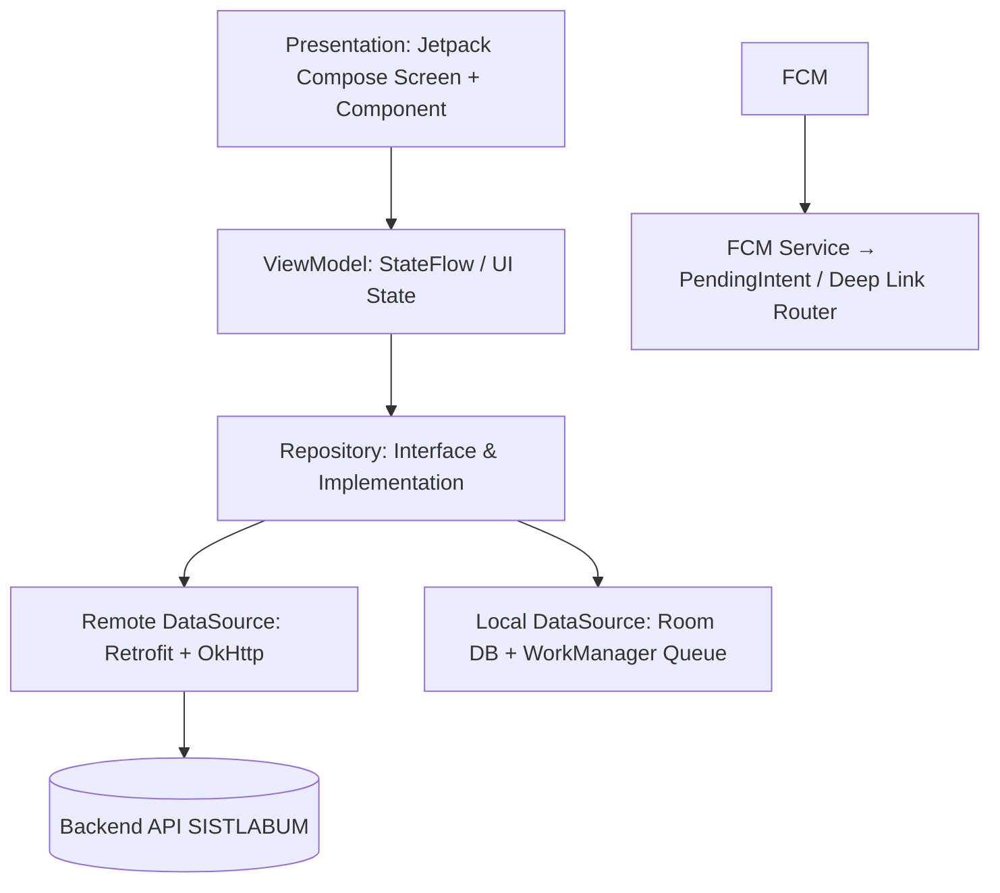
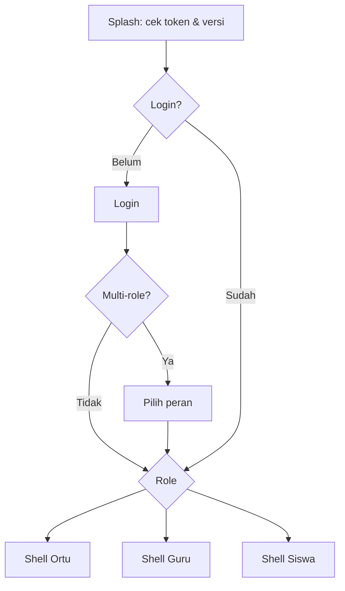
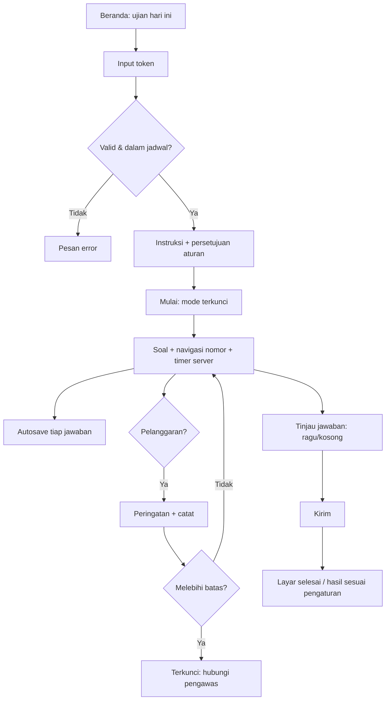

# 07. PRD Aplikasi Mobile

Platform: Android Native (Kotlin 2.x, Android 8.0+ / API 26+), Jetpack Compose, Retrofit + OkHttp, Coroutines & StateFlow, Room, Hilt, Firebase Cloud Messaging. Satu aplikasi, tiga role: **Orang Tua, Guru, Siswa**. Kepala sekolah (ringkasan + ACC) sebagai P2.
Format ID: `MOB-{MODUL}-{NN}`. Role-nya: `ORT` (ortu), `GRU` (guru), `SIS` (siswa), `CBT`, `UMM` (umum).

## 1. Prinsip
1. Satu login, tampilan menyesuaikan role (jika multi-role, ada pemilih peran).
2. Tugas harian selesai ≤ 3 ketukan (presensi, cek nilai anak, kerjakan ujian).
3. Data inti tersedia offline (baca); input guru bisa antre saat offline.
4. Notifikasi push membawa deep link langsung ke halaman terkait.
5. Layar ringan dan hemat kuota; gambar di-cache dan dikompres sebelum unggah.

## 2. Arsitektur Aplikasi

- Router: Navigation Compose (`androidx.navigation.compose`) dengan guard auth/role.
- Penyimpanan token: `EncryptedSharedPreferences` (Android Keystore); cache data: Room (SQLite) untuk jadwal, nilai, presensi.
- Antrean offline: tabel Room `pending_actions` dengan retry otomatis (`WorkManager`) dan idempotency key.
- Konfigurasi flavor: `dev`, `staging`, `prod`.
- Force update: cek versi minimum dari `/app/config`.

## 3. Alur Navigasi

Bottom navigation per role:
| Role | Tab |
|---|---|
| Ortu | Beranda · Akademik · Izin · Pesan/Kontak · Akun |
| Guru | Beranda · Jadwal · Nilai · Pengumuman · Akun |
| Siswa | Beranda · Jadwal · Ujian · Nilai · Akun |

---

## 4. Fitur Umum

### MOB-UMM-01: Login [P0]
Input username/NIS/NIP/email + password, tampil/sembunyi password, lupa password (OTP/link), pesan error jelas, opsi biometrik setelah login pertama.

### MOB-UMM-02: Ganti password wajib saat pertama [P0]
Akun baru diarahkan ke layar ganti password.

### MOB-UMM-03: Profil & pengaturan [P0]
Lihat/ubah foto & kontak, ganti password, pilih bahasa (P2), kelola notifikasi, keluar (cabut sesi perangkat), versi aplikasi, kebijakan privasi.

### MOB-UMM-04: Pengumuman & berita [P0]
Daftar (filter: semua/sekolah/kelas), detail, tandai dibaca, lampiran.

### MOB-UMM-05: Kalender akademik [P0]
Bulanan + daftar; agenda sekolah, ujian, libur.

### MOB-UMM-06: Inbox notifikasi [P0]
Daftar, badge belum dibaca, ketuk → deep link; tandai semua dibaca.

### MOB-UMM-07: Pemilih peran & anak [P0]
Ortu dengan >1 anak dapat berpindah profil anak lewat header; pilihan diingat.

### MOB-UMM-08: Push & deep link [P0]
Registrasi token FCM saat login, hapus saat logout; tipe notifikasi: pengumuman, nilai terbit, rapor terbit, ujian dimulai, izin disetujui, tiket berubah, tamu tiba.

### MOB-UMM-09: Mode offline & sinkronisasi [P1]
Jadwal, nilai, pengumuman terakhir tersedia offline; indikator "terakhir diperbarui"; antrean aksi guru terkirim saat online.

---

## 5. Orang Tua (ORT)

### MOB-ORT-01: Beranda anak [P0]
Kartu ringkasan: foto & kelas anak, grafik kehadiran bulan ini, status administrasi, catatan karakter terbaru dari walas, pengumuman penting, tombol aksi cepat ("Unduh Rapor Kemajuan Bulanan (PDF)", "Hubungi Wali Kelas/Guru BK").
Backend: BE-RPT-02 (guardian), BE-ACD-*.

### MOB-ORT-02: Presensi anak [P0]
Kalender kehadiran berwarna, rekap bulan/semester, detail per hari (sesi mana yang tidak hadir).

### MOB-ORT-03: Nilai & progress report [P0]
Daftar nilai per mapel/komponen, grafik tren, daftar E-Progress Report bulanan (status terbit), pratinjau & **unduh PDF**, bagikan.

### MOB-ORT-04: E-Rapor semester [P0]
Daftar rapor terbit, unduh PDF.

### MOB-ORT-05: Poin pelanggaran & prestasi anak [P1]
Total poin, riwayat, status tindak lanjut.

### MOB-ORT-06: Pengajuan izin/sakit [P0]
Form: tanggal mulai/selesai, jenis, alasan, foto surat (kamera/galeri), kirim; daftar & status (menunggu/disetujui/ditolak).
AC: pengajuan terkirim saat offline menunggu sinkronisasi dengan tanda jelas.

### MOB-ORT-07: Hubungi walas / guru BK [P0]
Tombol membuka WhatsApp (nomor resmi yang diatur sekolah) atau membuat **tiket pesan** di aplikasi; riwayat tiket. (Chat real-time: di luar v1.)

### MOB-ORT-08: Izin study trip & kegiatan [P2]
Lihat info kegiatan, setuju/tolak izin digital.

### MOB-ORT-09: Administrasi/tagihan [P2]
Menunggu keputusan modul keuangan; v1 hanya status administrasi (lunas/belum) bila data tersedia.

---

## 6. Guru (GRU)

### MOB-GRU-01: Beranda guru [P0]
Jadwal mengajar hari ini (tombol cepat Jurnal & Presensi), antrean koreksi esai CBT, progres input nilai bulanan (tenggat), pengumuman, aksi cepat: pinjam ruang lab, lapor kerusakan.

### MOB-GRU-02: Jadwal mengajar [P0]
Tampilan harian/mingguan, detail sesi, kelas, ruang.

### MOB-GRU-03: Jurnal & presensi cepat [P0]
Pilih sesi → isi materi/catatan → daftar siswa dengan **tap cepat** (default hadir; ketuk untuk ganti izin/sakit/alpa/terlambat; tahan untuk catatan) → simpan. Bisa offline → antre.
AC: presensi kelas 36 siswa selesai < 60 detik; indikator pending-sync.

### MOB-GRU-04: Input nilai [P0]
Pilih kelas/mapel/komponen → daftar siswa → input angka (keyboard numerik, pindah otomatis) → simpan; indikator kelengkapan; kunci periode ditolak dengan pesan jelas.

### MOB-GRU-05: Catatan karakter (walas) [P0]
Daftar siswa kelas perwalian → form penilaian & catatan bulanan.

### MOB-GRU-06: Persetujuan izin (walas) [P0]
Daftar pengajuan, lihat surat, setujui/tolak + catatan; notifikasi ke ortu.

### MOB-GRU-07: Poin siswa [P1]
Cari siswa → pilih jenis pelanggaran/prestasi → simpan (+ foto bukti opsional).

### MOB-GRU-08: Koreksi uraian CBT [P1]
Antrean jawaban, beri skor + komentar, progres.

### MOB-GRU-09: Pengawas ujian ringan [P1]
Lihat status peserta ruang, tambah waktu/reset sesi (jika punya permission).

### MOB-GRU-10: Pengumuman ke kelas [P1]
Buat pengumuman untuk kelas yang diampu.

### MOB-GRU-11: Booking ruang & helpdesk [P1]
Ajukan peminjaman ruang/alat (kalender ketersediaan), lapor kerusakan (lokasi, foto, deskripsi), pantau status tiket.

### MOB-GRU-12: Absensi guru [P2]
Check-in/out dengan GPS (radius sekolah) dan/atau selfie.

### MOB-GRU-13: Materi & tugas [P2]
Unggah materi, buat tugas, lihat pengumpulan.

---

## 7. Siswa (SIS)

### MOB-SIS-01: Beranda siswa [P0]
Widget **Ujian berlangsung hari ini** (dengan input token), jadwal besok, rekap kehadiran bulan berjalan, menu cepat (Unduh Rapor Bulanan, Kartu Ujian, Riwayat Poin).

### MOB-SIS-02: Jadwal pelajaran [P0]
Harian/mingguan.

### MOB-SIS-03: Nilai & kehadiran [P0]
Nilai per mapel, tren, kehadiran, unduh progress report & rapor.

### MOB-SIS-04: Kartu pelajar digital & kartu ujian [P0]
Kartu dengan QR (identitas, kelas, foto) dan kartu ujian (ruang, sesi, jadwal).

### MOB-SIS-05: Riwayat poin [P1]
Poin prestasi dan disiplin milik sendiri.

### MOB-SIS-06: Tugas & materi [P2]
Lihat tugas, kumpulkan (foto/file), unduh materi.

### MOB-SIS-07: Permintaan konseling [P2]
Ajukan permintaan ke BK secara privat.

---

## 8. CBT di Mobile (CBT)

### 8.1 Alur

### MOB-CBT-01: Token & mulai ujian [P0]
Validasi token, cek jendela waktu, tampilan instruksi, persetujuan aturan.

### MOB-CBT-02: Layar pengerjaan [P0]
Tampil soal (teks, gambar, audio, rumus), komponen per tipe (PG, PG kompleks, B/S, menjodohkan, isian, uraian), navigasi nomor (terjawab/kosong/ragu), tombol sebelumnya/berikutnya, penanda ragu, timer (sinkron waktu server), zoom gambar.

### MOB-CBT-03: Autosave & pemulihan [P0]
Setiap perubahan jawaban dikirim idempotent; indikator status simpan; jika koneksi putus, jawaban antre dan sesi dilanjutkan saat tersambung (sisa waktu dari server).

### MOB-CBT-04: Mode terkunci & anti-cheat [P0]
Android: screen pinning / `FLAG_SECURE` (cegah screenshot), deteksi app ke background, deteksi split-screen/floating; iOS: Guided Access dianjurkan + deteksi lifecycle. Setiap kejadian dilaporkan ke server. Batas pelanggaran dan kunci sesuai pengaturan ujian.
Catatan: keterbatasan platform didokumentasikan; ujian bergengsi (STS/SAS) disarankan di perangkat sekolah/lab bila diperlukan.

### MOB-CBT-05: Tinjau & kirim [P0]
Ringkasan soal terjawab/kosong/ragu, konfirmasi kirim, auto-submit saat waktu habis.

### MOB-CBT-06: Hasil & pembahasan [P1]
Tampil sesuai pengaturan ujian (nilai langsung/setelah dirilis, pembahasan).

---

## 9. Daftar Layar (inventaris)
| Kelompok | Layar |
|---|---|
| Umum | Splash, Login, Lupa password, Ganti password, Pilih peran, Pilih anak, Pengumuman (list/detail), Kalender, Notifikasi, Profil, Pengaturan |
| Ortu | Beranda anak, Presensi, Nilai, Detail mapel, Progress report, Rapor, Poin, Form izin, Riwayat izin, Hubungi walas/BK, Riwayat pesan |
| Guru | Beranda, Jadwal, Detail sesi, Jurnal+Presensi, Input nilai, Karakter, Persetujuan izin, Poin, Antrean koreksi, Detail koreksi, Pengumuman kelas, Booking ruang, Lapor kerusakan, Status tiket |
| Siswa | Beranda, Jadwal, Nilai, Kehadiran, Kartu pelajar, Kartu ujian, Riwayat poin |
| CBT | Input token, Instruksi, Pengerjaan, Tinjau, Selesai, Terkunci |

## 10. Komponen UI (design system mobile)
Tema (light, dark P2) dengan token warna/typografi dari brand sekolah; komponen: AppBar, BottomNav, SummaryCard, StatChip, AttendanceCalendar, LineChart/ProgressRing, ListTile data, StatusBadge, SegmentedButton, DatePicker, ImagePicker + kompresi, PdfViewer, QRView, SearchField, PullToRefresh, EmptyState, ErrorState (dengan tombol coba lagi), SkeletonLoader, Snackbar/Dialog, OTPField, TimerBar, QuestionNavigator.

## 11. Kebutuhan Non-Fungsional Mobile
| Aspek | Target |
|---|---|
| Startup | Cold start < 3 s di perangkat menengah |
| Ukuran APK | < 40 MB |
| Crash-free | ≥ 99,5% sesi |
| Kompatibilitas | Android 8.0+ (API 26+) |
| Keamanan | Token di secure storage, TLS, certificate pinning (P1), root/jailbreak warning untuk CBT (P1) |
| Aksesibilitas | Teks mengikuti ukuran sistem, kontras AA |
| Analytics | Crash (Crashlytics), event dasar tanpa data pribadi |

## 12. Rilis
- Distribusi: Google Play Store (Internal Testing → Closed Testing → Production) & Distribusi Internal APK Sekolah.
- Versioning semver; `minSupportedVersion` dari server.
- Signing key & keystore disimpan aman di luar repo.

## 13. Kriteria Penerimaan Umum
- Semua layar punya state loading/empty/error.
- Role tidak dapat melihat data role lain (uji: ortu A tidak bisa mengakses anak ortu B).
- Presensi offline benar-benar terkirim saat online tanpa duplikat.
- CBT: pemulihan setelah mematikan Wi-Fi 60 detik tanpa kehilangan jawaban; timer tidak bisa dimanipulasi lewat jam perangkat.
- Uji integrasi untuk alur: login → beranda → unduh PDF; presensi cepat; kerjakan ujian.

## 14. Ketergantungan Backend
| Mobile | Backend |
|---|---|
| MOB-UMM-* | BE-AUTH-*, BE-NTF-*, BE-CMS-02/04 |
| MOB-ORT-* | BE-ACD-03/04, BE-GRD-01/03/04, BE-STD-01, BE-RPT-02 |
| MOB-GRU-* | BE-ACD-01..05, BE-GRD-01/02, BE-STD-01, BE-CBT-07, BE-SAR-01/03 |
| MOB-SIS-* | BE-ACD-*, BE-GRD-*, BE-STD-01, BE-CBT-03 |
| MOB-CBT-* | BE-CBT-04/05/06/12 |

## Changelog
- 1.0: Draf awal.
- 1.1: Pembaruan ketergantungan backend merujuk modul nilai `BE-GRD-*` dan fitur anomali ujian `BE-CBT-12`.
- 1.2: Penyesuaian platform mobile menjadi Android Native (Kotlin 2.x + Jetpack Compose) sesuai fokus target pengguna Android sekolah tanpa merubah fitur.
