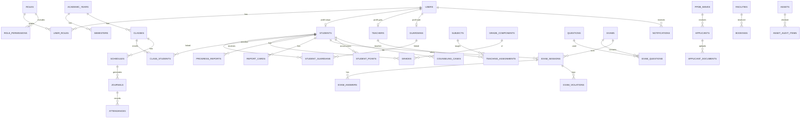

# 08. Skema Database (Konseptual)

PostgreSQL 16 + Prisma. Dokumen ini adalah acuan entitas & aturan; definisi final berada di `schema.prisma`.
Bila berbeda, **kode + migrasi menang**, lalu perbarui dokumen ini.

## 1. Konvensi
| Aturan | Nilai |
|---|---|
| Nama tabel | `snake_case`, jamak (`students`) |
| Primary key | `id` UUID v7 |
| Kolom umum | `school_id`, `created_at`, `updated_at`, `created_by`, `updated_by`, `deleted_at` (soft delete data penting) |
| Waktu | `timestamptz` (UTC) |
| Uang | integer (satuan terkecil) |
| Enum | Enum Postgres/Prisma, nilai `snake_case` huruf kecil |
| FK | `{entitas}_id`, `ON DELETE RESTRICT` (default) |
| Index | Pada semua FK, kolom filter utama, dan kombinasi unik bisnis |
| Data sensitif | NIK, catatan BK, nomor HP: enkripsi kolom/aplikasi |

## 2. Peta Domain (ERD tingkat tinggi)

## 3. Daftar Tabel per Domain

### 3.1 Identitas & Akses
| Tabel | Kolom penting | Aturan |
|---|---|---|
| `users` | email, username, phone, password_hash, status, last_login_at, must_change_password | username/email unik; status: active/suspended/locked |
| `roles` | code, name, is_system | code unik |
| `permissions` | code (`modul.resource.aksi`), description | |
| `role_permissions` | role_id, permission_id | PK gabungan |
| `user_roles` | user_id, role_id, scope (opsional: class_id) | scope untuk wali kelas |
| `refresh_tokens` | user_id, token_hash, device_id, expires_at, revoked_at, replaced_by | Rotasi |
| `devices` | user_id, platform, fcm_token, last_seen_at | |
| `password_resets` | user_id, token_hash, expires_at, used_at | |
| `audit_logs` | actor_id, action, entity, entity_id, old_value, new_value, ip, user_agent | Append-only |

### 3.2 Master Data
| Tabel | Kolom penting | Aturan |
|---|---|---|
| `academic_years` | name, start_date, end_date, is_active | satu aktif |
| `semesters` | academic_year_id, name, start_date, end_date, is_active | satu aktif |
| `students` | user_id, nis, nisn, nik_enc, full_name, gender, birth_place, birth_date, religion, address, photo_file_id, status, entry_date, graduated_at | nis, nisn unik |
| `student_status_history` | student_id, status, reason, effective_date | |
| `guardians` | user_id, full_name, phone, occupation, address | |
| `student_guardians` | student_id, guardian_id, relationship, is_primary | unik (student, guardian) |
| `teachers` | user_id, nip, nuptk, full_name, position, status, photo_file_id | |
| `staff` | user_id, full_name, position, unit | |
| `grade_levels` | name, order | |
| `majors` | name | opsional (SMA/SMK) |
| `classes` | academic_year_id, grade_level_id, major_id, name, homeroom_teacher_id, capacity | unik (year, name) |
| `class_students` | class_id, student_id, joined_at, left_at | satu kelas aktif per siswa per tahun |
| `subjects` | code, name, group | |
| `teaching_assignments` | semester_id, class_id, subject_id, teacher_id, hours_per_week | unik (semester, class, subject) |
| `rooms` | code, name, type, capacity | |

### 3.3 CMS & Profil Publik
`site_settings`, `posts` (slug unik, status, published_at, category_id, author_id, cover_file_id, views_count), `post_categories`, `albums`, `media_items`, `bulletins`, `events` (visibility: public/internal), `downloads`, `pages`, `files`.

### 3.4 PPDB
| Tabel | Kolom penting |
|---|---|
| `ppdb_waves` | name, open_at, close_at, status, result_publish_at |
| `ppdb_tracks` | wave_id, code, name, quota, score_formula (JSON) |
| `ppdb_requirements` | track_id, document_type, is_required, description |
| `applicants` | wave_id, track_id, user_id, registration_no, nik_enc, full_name, birth_date, status, score, rank, decision, step_data (JSONB) |
| `applicant_parents` | applicant_id, type, name, occupation, income, phone |
| `applicant_documents` | applicant_id, document_type, file_id, status, reject_reason, verified_by |
| `applicant_status_history` | applicant_id, from_status, to_status, note, actor_id |
| `ppdb_re_registrations` | applicant_id, confirmed_at, status, notes |
Aturan: `registration_no` unik; unik (wave_id, nik) untuk pendaftaran aktif; konversi → `students` idempoten via `applicants.student_id`.

### 3.5 Buku Tamu & Pengaduan (GUEST)
`guests` (name, institution, phone, purpose, destination_user_id, check_in_at, check_out_at, signature_data, photo_file_id), `complaints` (ticket_code unik, is_anonymous, status, category, content), `complaint_events`.

### 3.6 Akademik (ACD)
| Tabel | Kolom penting |
|---|---|
| `time_slots` | name, start_time, end_time, day_type |
| `schedules` | semester_id, class_id, subject_id, teacher_id, room_id, day_of_week, time_slot_id |
| `journals` | schedule_id, date, topic, method, notes, teacher_id |
| `attendances` | journal_id (nullable), student_id, date, status, source, note, recorded_by |
| `leave_requests` | student_id, type, start_date, end_date, reason, attachment_file_id, status, decided_by |
| `staff_attendances` | user_id, date, check_in, check_out, lat, lng, status |
| `teaching_materials` | type (modul/ATP/silabus/P5), grade_level_id, subject_id, version, file_id |
| `learning_materials` | LMS ringan materi pembelajaran |
| `assignments`, `assignment_submissions` | LMS tugas & pengumpulan |
Aturan: `attendances` unik (student, journal) dan (student, date, source=gate).

### 3.7 Penilaian & Rapor (GRD)
| Tabel | Kolom penting |
|---|---|
| `grade_components` | subject_id, semester_id, code, name, weight, class_id (opsional) |
| `grades` | student_id, component_id, value, source (manual/cbt), exam_id, period (bulan), locked_at |
| `grade_periods` | semester_id, month, status (open/locked), locked_by |
| `character_notes` | student_id, month, scale_data (JSONB), homeroom_note, author_id |
| `report_description_templates` | subject_id, grade_level_id, min_score, max_score, template_text |
| `progress_reports` | student_id, month, data_snapshot (JSONB), file_id, status, approved_by, verify_token |
| `report_cards` | student_id, semester_id, data_snapshot (JSONB), file_id, status, locked_at, approved_by, verify_token |
Aturan: `grades` unik (student, component, period); snapshot rapor menyimpan data saat generate agar tidak berubah setelah terbit.

### 3.8 CBT (Ujian Digital)
| Tabel | Kolom penting |
|---|---|
| `question_banks` | subject_id, grade_level_id, owner_id, name |
| `questions` | bank_id, type, body (JSONB/HTML), media, cp_code, cognitive_level, difficulty, weight, explanation, version, status |
| `question_options` | question_id, label, body, is_correct, match_key |
| `exams` | title, type, subject_id, duration_min, start_at, end_at, passing_grade, shuffle_questions, shuffle_options, package_mode, show_result_mode, status, created_by |
| `exam_questions` | exam_id, question_id, order, weight_override, package |
| `exam_rooms` | exam_id, room_id, session_no, token, token_expires_at, proctor_id |
| `exam_proctor_actions` | room_id, proctor_id, action_type, student_id, reason, created_at |
| `exam_participants` | exam_id, student_id, exam_room_id, package |
| `exam_sessions` | exam_id, student_id, status, started_at, deadline_at, submitted_at, seed, score, locked_reason, extra_minutes |
| `exam_answers` | session_id, question_id, answer (JSONB), is_flagged, answered_at, score, graded_by |
| `exam_violations` | session_id, type, occurred_at, meta (IP / device anomaly) |
| `exam_item_analysis` | exam_id, question_id, difficulty_index, discrimination_index, distractor_stats |
Aturan: unik (exam_id, student_id) untuk sesi aktif; jawaban unik (session, question) — upsert idempoten; soal terpakai tidak boleh diedit (versi baru).

### 3.9 Kesiswaan (STD) & Bimbingan Konseling (BK)
| Tabel | Kolom penting |
|---|---|
| `point_types` | kind (violation/achievement), name, points, severity |
| `student_points` | student_id, point_type_id, date, notes, evidence_file_id, recorded_by |
| `point_thresholds` | min_points, action, notify_roles |
| `extracurriculars`, `extracurricular_members`, `extracurricular_journals`, `activity_documents` | Manajemen ekskul & dokumen |
| `competitions`, `competition_entries`, `achievements` | Lomba & prestasi |
| `trips`, `trip_participants`, `trip_consents` | Outing/study trip (biaya hanya teks catatan) |
| `counseling_cases` | student_id, counselor_id, category, status, summary_enc |
| `counseling_sessions` | case_id, date, notes_enc, follow_up |
| `counseling_referrals` | student_id, referred_by, reason, status |
| `counseling_requests` | student_id, requester_role, preferred_date, reason, status |
| `early_warnings` | student_id, rule_code, severity, data, status, handled_by |
Aturan: kolom `*_enc` terenkripsi; baca BK menulis `audit_logs`.

### 3.10 Sarpras & Perpustakaan (SAR)
`facilities`, `bookings` (resource, start_at, end_at, status, purpose; constraint exclusion untuk cegah tumpang tindih disetujui), `booking_items`, `assets` (code QR unik, room_id, condition), `asset_audits`, `asset_audit_items`, `tickets` (reporter, location, description, priority, status, assignee), `ticket_events`, `library_books`, `loans`, `lab_equipment`, `lab_loans`.

### 3.11 Humas & Kemitraan (HUM)
`partnerships`, `exchange_programs`, `exchange_participants`, `alumni`, `tracer_surveys`, `tracer_responses`.

### 3.12 Notifikasi (NTF)
`notifications` (user_id, type, title, body, data, read_at), `announcements` (target_type, target_ids, published_at), `announcement_reads`, `notification_templates`, `notification_logs` (channel, status, provider_ref, error).

### 3.13 Berkas & Sistem (SYS)
`files` (owner_type/id, bucket, key, mime, size, visibility, checksum), `jobs` (type, status, progress, result_file_id, requested_by), `app_config` (key, value JSONB), `holidays`.

## 4. Index & Performa Penting
| Tabel | Index |
|---|---|
| `attendances` | (student_id, date), (journal_id) |
| `grades` | (student_id, period), unik (student, component, period) |
| `exam_answers` | unik (session_id, question_id) |
| `exam_sessions` | (exam_id, status), unik aktif (exam_id, student_id) |
| `applicants` | (wave_id, status), (track_id, rank), unik registration_no |
| `notifications` | (user_id, read_at, created_at desc) |
| `audit_logs` | (entity, entity_id), (actor_id, created_at) |
| `bookings` | GiST exclusion (resource_id, tstzrange) |
| `posts` | (status, published_at desc), unik slug |

## 5. Seed Data Wajib
Role bawaan + permission, pengaturan situs dasar, jam pelajaran contoh, komponen nilai default, jenis poin contoh, template notifikasi, akun super admin awal (password wajib diganti), data demo (hanya environment non-produksi).

## 6. Retensi Data
| Data | Retensi |
|---|---|
| Data siswa aktif/alumni | Sesuai kebijakan sekolah (default: selamanya, anonimisasi atas permintaan sah) |
| Pendaftar PPDB tidak diterima | 1 tahun lalu anonimisasi |
| Jawaban CBT | Selama masa ajaran + 1 tahun |
| Audit log | Minimal 2 tahun |
| Notifikasi | 1 tahun |
| Backup | 30 hari harian + 12 bulanan |

## Changelog
- 1.0: Draf awal.
- 1.1: Penambahan kolom `views_count` pada `posts`, pemisahan domain tabel ACD (jadwal/jurnal/presensi/LMS) dan GRD (nilai/karakter/rapor), pemisahan modul GUEST dari HUM, penyelarasan eksplisit 116 tabel sesuai dengan `12_ERD.md` (termasuk `counseling_requests`, `exam_proctor_actions`, dan `report_description_templates`).
