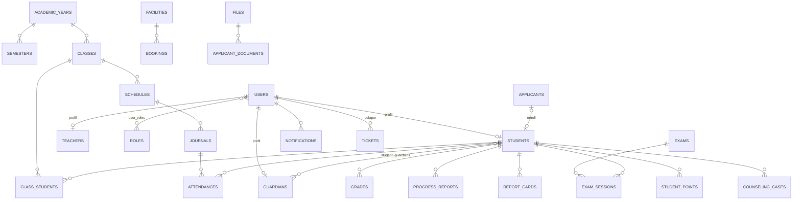
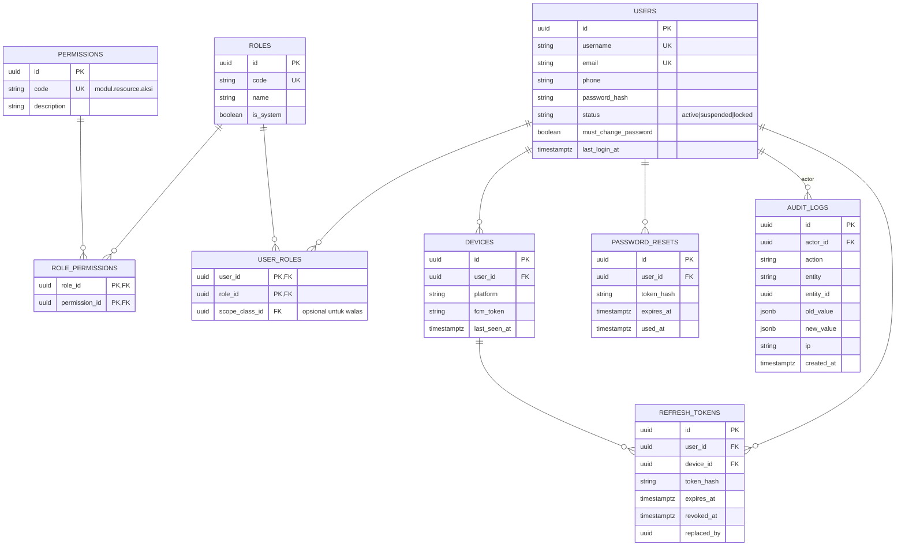
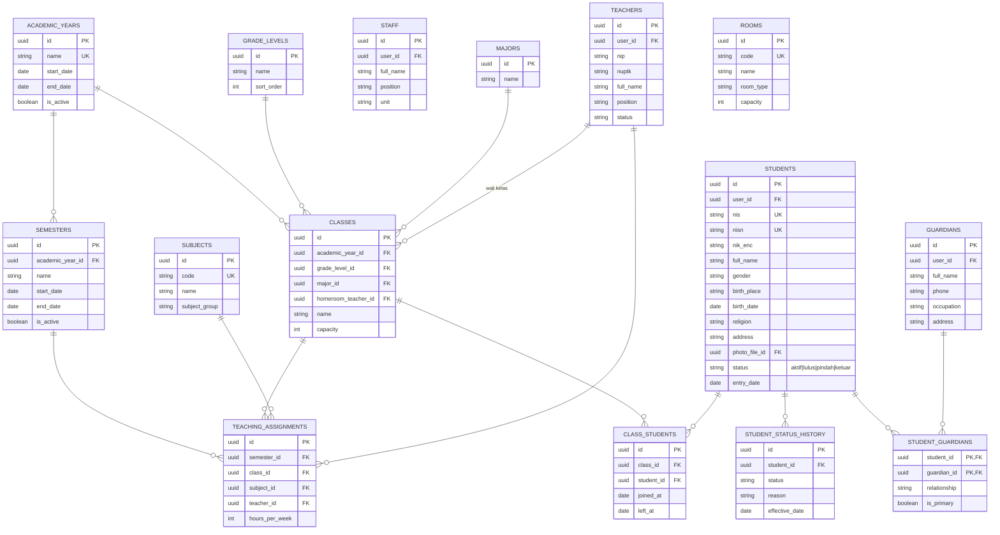
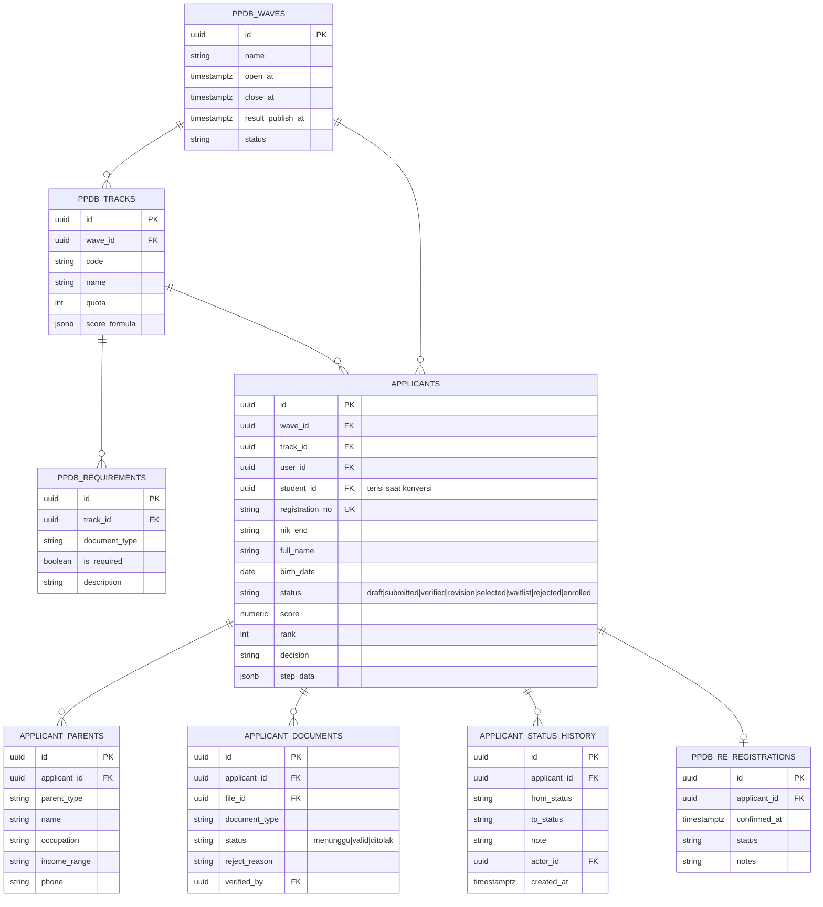
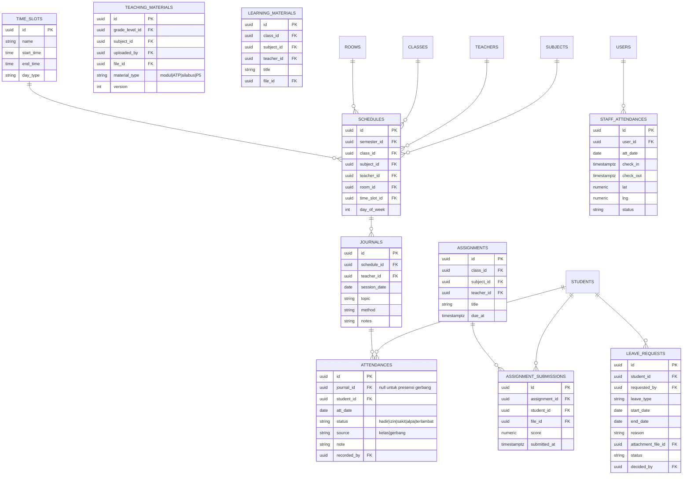
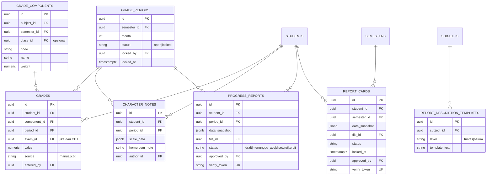
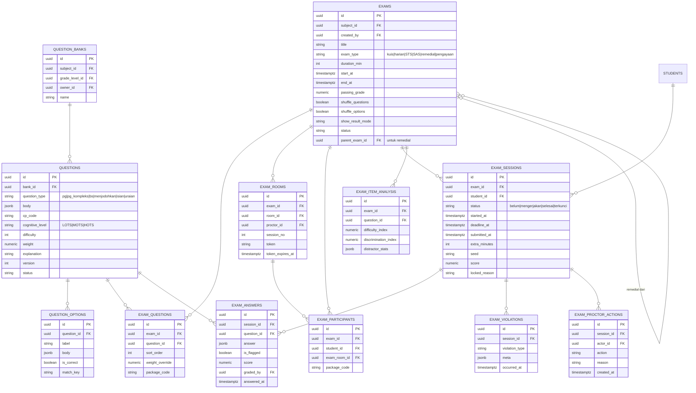
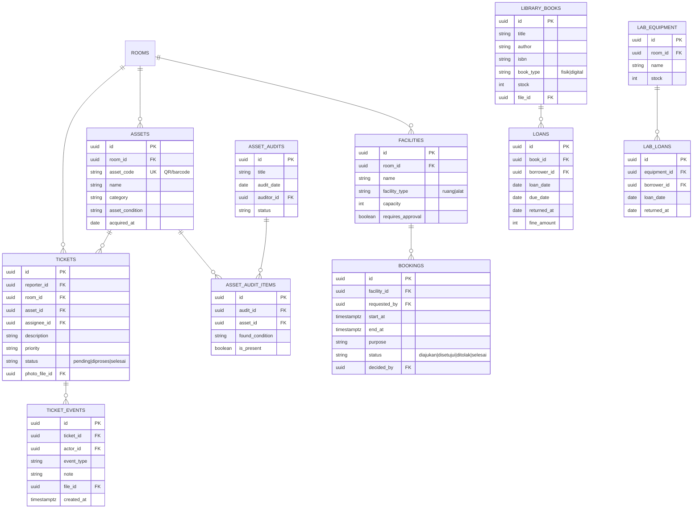

# 12. ERD Database Portal Sekolah

Pelengkap `08_DATABASE_SCHEMA.md`. Diagram memakai **Mermaid** (render di GitHub, GitLab, VS Code, Obsidian, mermaid.live).
Dipecah per domain agar terbaca. Kolom umum (`school_id`, `created_at`, `updated_at`, `deleted_at`) tidak digambar ulang di tiap tabel.

Legenda: `PK` primary key · `FK` foreign key · `UK` unique. Relasi: `||` tepat satu, `o|` nol/satu, `o{` nol atau banyak, `|{` satu atau banyak.

---

## 0. Gambaran Besar (relasi antar domain)

---

## 1. Identitas, Role & Audit

---

## 2. Master Data (siswa, guru, kelas, mapel)

---

## 3. PPDB

---

## 4. Akademik I: Jadwal, Jurnal, Presensi, Izin

---

## 5. Akademik II: Nilai, Karakter, Progress Report, Rapor

---

## 6. CBT (Ujian Digital)

---

## 7. Kesiswaan & BK

```mermaid
erDiagram
  POINT_TYPES {
    uuid id PK
    string kind "pelanggaran|prestasi"
    string name
    int points
    string severity
  }
  STUDENT_POINTS {
    uuid id PK
    uuid student_id FK
    uuid point_type_id FK
    uuid recorded_by FK
    uuid evidence_file_id FK
    date point_date
    string notes
  }
  POINT_THRESHOLDS {
    uuid id PK
    int min_points
    string action
    jsonb notify_roles
  }
  EXTRACURRICULARS {
    uuid id PK
    uuid coach_id FK
    string name
    int quota
  }
  EXTRACURRICULAR_MEMBERS {
    uuid id PK
    uuid extracurricular_id FK
    uuid student_id FK
    string status
    string final_grade
  }
  EXTRACURRICULAR_JOURNALS {
    uuid id PK
    uuid extracurricular_id FK
    date session_date
    string activity
    jsonb attendance
  }
  ACTIVITY_DOCUMENTS {
    uuid id PK
    uuid extracurricular_id FK
    uuid file_id FK
    string doc_type "proposal|laporan"
  }
  COMPETITIONS {
    uuid id PK
    string name
    string level
    date held_at
  }
  COMPETITION_ENTRIES {
    uuid id PK
    uuid competition_id FK
    uuid student_id FK
    string result
    uuid achievement_id FK
  }
  ACHIEVEMENTS {
    uuid id PK
    uuid student_id FK
    string title
    string rank_level
    date achieved_at
  }
  TRIPS {
    uuid id PK
    string title
    date depart_date
    jsonb route
    uuid guide_file_id FK
  }
  TRIP_PARTICIPANTS {
    uuid id PK
    uuid trip_id FK
    uuid student_id FK
  }
  TRIP_CONSENTS {
    uuid id PK
    uuid trip_participant_id FK
    uuid guardian_id FK
    string decision
    timestamptz decided_at
  }
  COUNSELING_CASES {
    uuid id PK
    uuid student_id FK
    uuid counselor_id FK
    string category
    string status
    string summary_enc "terenkripsi"
  }
  COUNSELING_SESSIONS {
    uuid id PK
    uuid case_id FK
    date session_date
    string notes_enc "terenkripsi"
    string follow_up
  }
  COUNSELING_REFERRALS {
    uuid id PK
    uuid student_id FK
    uuid referred_by FK
    string reason
    string status
  }
  COUNSELING_REQUESTS {
    uuid id PK
    uuid student_id FK
    uuid requested_by FK
    string topic
    string status
  }
  EARLY_WARNINGS {
    uuid id PK
    uuid student_id FK
    string rule_code
    string severity
    jsonb data
    string status
    uuid handled_by FK
  }
  POINT_TYPES ||--o{ STUDENT_POINTS : ""
  STUDENTS ||--o{ STUDENT_POINTS : ""
  EXTRACURRICULARS ||--o{ EXTRACURRICULAR_MEMBERS : ""
  STUDENTS ||--o{ EXTRACURRICULAR_MEMBERS : ""
  EXTRACURRICULARS ||--o{ EXTRACURRICULAR_JOURNALS : ""
  EXTRACURRICULARS ||--o{ ACTIVITY_DOCUMENTS : ""
  COMPETITIONS ||--o{ COMPETITION_ENTRIES : ""
  STUDENTS ||--o{ COMPETITION_ENTRIES : ""
  STUDENTS ||--o{ ACHIEVEMENTS : ""
  ACHIEVEMENTS o|--o{ COMPETITION_ENTRIES : ""
  TRIPS ||--o{ TRIP_PARTICIPANTS : ""
  STUDENTS ||--o{ TRIP_PARTICIPANTS : ""
  TRIP_PARTICIPANTS ||--o| TRIP_CONSENTS : ""
  STUDENTS ||--o{ COUNSELING_CASES : ""
  COUNSELING_CASES ||--o{ COUNSELING_SESSIONS : ""
  STUDENTS ||--o{ COUNSELING_REFERRALS : ""
  STUDENTS ||--o{ COUNSELING_REQUESTS : ""
  STUDENTS ||--o{ EARLY_WARNINGS : ""
```

---

## 8. Sarpras & Perpustakaan

---

## 9. Humas, CMS, Notifikasi, File & Sistem

```mermaid
erDiagram
  GUESTS {
    uuid id PK
    uuid target_user_id FK
    string full_name
    string institution
    string phone
    string purpose
    uuid photo_file_id FK
    timestamptz check_in
    timestamptz check_out
  }
  COMPLAINTS {
    uuid id PK
    uuid reporter_user_id FK "null jika anonim"
    string ticket_code UK
    string category
    string content
    boolean is_anonymous
    string status
    uuid assigned_to FK
  }
  COMPLAINT_EVENTS {
    uuid id PK
    uuid complaint_id FK
    uuid actor_id FK
    string event_type
    string response_text
    timestamptz created_at
  }
  PARTNERSHIPS {
    uuid id PK
    string partner_name
    string scope
    date valid_from
    date valid_until
    uuid mou_file_id FK
  }
  EXCHANGE_PROGRAMS {
    uuid id PK
    uuid partnership_id FK
    string name
    date start_date
    date end_date
  }
  EXCHANGE_PARTICIPANTS {
    uuid id PK
    uuid program_id FK
    uuid student_id FK
    string status
  }
  ALUMNI {
    uuid id PK
    uuid student_id FK
    int graduation_year
    string next_institution
    string occupation
    string contact
  }
  TRACER_SURVEYS {
    uuid id PK
    string title
    jsonb questions
  }
  TRACER_RESPONSES {
    uuid id PK
    uuid survey_id FK
    uuid alumni_id FK
    jsonb answers
  }
  POSTS {
    uuid id PK
    uuid category_id FK
    uuid author_id FK
    uuid cover_file_id FK
    string slug UK
    string title
    string content
    string status "draft|terbit|arsip"
    string visibility "publik|internal"
    timestamptz published_at
  }
  POST_CATEGORIES {
    uuid id PK
    string name
    string slug UK
  }
  ALBUMS {
    uuid id PK
    string title
    uuid cover_file_id FK
  }
  MEDIA_ITEMS {
    uuid id PK
    uuid album_id FK
    uuid file_id FK
    string media_type
    string caption
  }
  BULLETINS {
    uuid id PK
    string title
    uuid file_id FK
    uuid cover_file_id FK
  }
  EVENTS {
    uuid id PK
    string title
    string category
    string visibility "publik|internal"
    timestamptz start_at
    timestamptz end_at
  }
  DOWNLOADS {
    uuid id PK
    string title
    string category
    string visibility
    uuid file_id FK
  }
  SITE_SETTINGS {
    uuid id PK
    string setting_key UK
    jsonb setting_value
  }
  NOTIFICATIONS {
    uuid id PK
    uuid user_id FK
    string notif_type
    string title
    string body
    jsonb data
    timestamptz read_at
  }
  ANNOUNCEMENTS {
    uuid id PK
    uuid author_id FK
    string title
    string body
    string target_type "semua|kelas|tingkat|role"
    jsonb target_ids
    timestamptz publish_at
  }
  ANNOUNCEMENT_READS {
    uuid announcement_id PK, FK
    uuid user_id PK, FK
    timestamptz read_at
  }
  NOTIFICATION_TEMPLATES {
    uuid id PK
    string code UK
    string channel
    string template_text
  }
  NOTIFICATION_LOGS {
    uuid id PK
    uuid user_id FK
    uuid template_id FK
    string channel
    string status
    string provider_ref
    string error
  }
  FILES {
    uuid id PK
    uuid owner_id
    string owner_type
    string bucket
    string object_key
    string mime_type
    bigint size_bytes
    string visibility "publik|privat"
    string checksum
  }
  JOBS {
    uuid id PK
    uuid requested_by FK
    uuid result_file_id FK
    string job_type
    string status
    int progress
  }
  APP_CONFIG {
    string config_key PK
    jsonb config_value
  }
  HOLIDAYS {
    uuid id PK
    date holiday_date
    string name
  }
  COMPLAINTS ||--o{ COMPLAINT_EVENTS : ""
  PARTNERSHIPS ||--o{ EXCHANGE_PROGRAMS : ""
  EXCHANGE_PROGRAMS ||--o{ EXCHANGE_PARTICIPANTS : ""
  TRACER_SURVEYS ||--o{ TRACER_RESPONSES : ""
  ALUMNI ||--o{ TRACER_RESPONSES : ""
  POST_CATEGORIES ||--o{ POSTS : ""
  ALBUMS ||--o{ MEDIA_ITEMS : ""
  ANNOUNCEMENTS ||--o{ ANNOUNCEMENT_READS : ""
  NOTIFICATION_TEMPLATES ||--o{ NOTIFICATION_LOGS : ""
  FILES ||--o{ MEDIA_ITEMS : ""
  FILES ||--o{ DOWNLOADS : ""
```

---

## 10. Catatan Relasi Lintas Domain
| Relasi | Aturan |
|---|---|
| `FILES` dirujuk banyak tabel via `file_id` | Hanya satu tabel `files`; `owner_type`/`owner_id` untuk penelusuran |
| `USERS` dirujuk `created_by`, `recorded_by`, `author_id`, dll. | FK ke `users.id`, tidak digambar ulang agar diagram bersih |
| `APPLICANTS.student_id` → `STUDENTS.id` | Terisi saat konversi; unik agar konversi idempoten |
| `GRADES.exam_id` → `EXAMS.id` | Nilai otomatis dari CBT; `source = cbt` |
| `ATTENDANCES.journal_id` nullable | Null untuk presensi gerbang harian |
| `BOOKINGS` | Constraint exclusion GiST pada (facility_id, rentang waktu) untuk booking disetujui |
| `COUNSELING_*` | Kolom `*_enc` terenkripsi; baca wajib menulis `audit_logs` |
| `PROGRESS_REPORTS` / `REPORT_CARDS` | `data_snapshot` membekukan data saat terbit |

## Changelog
- 1.0: ERD awal per domain, selaras dengan `08_DATABASE_SCHEMA.md`.
