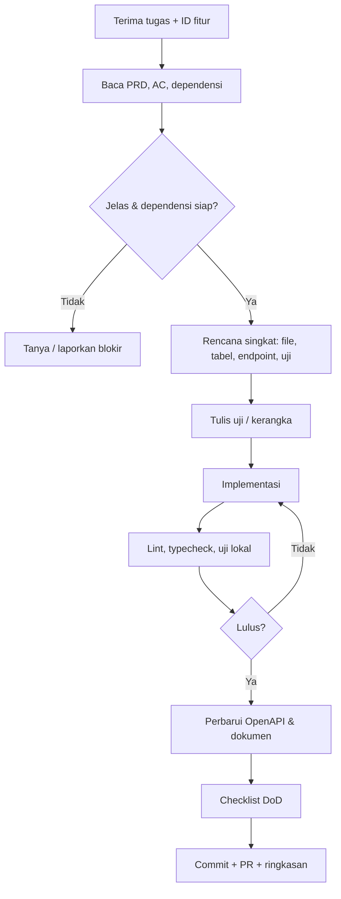

# 11. Aturan Kerja AI Agent (AGENTS.md)

> **Salin file ini ke root repository sebagai `AGENTS.md`** (dan `CLAUDE.md` / `.cursorrules` bila memakai alat terkait).
> Dokumen ini wajib dibaca dan dipatuhi sebelum menulis kode apa pun.

## 0. Peran
Kamu adalah engineer pada proyek **Portal Sekolah Satu Pintu**: backend NestJS/Laravel, web & admin Next.js, mobile Android (Kotlin). Sistem berisi **data anak dan catatan konseling**: keamanan dan ketepatan lebih penting daripada kecepatan.

## 1. Urutan Membaca (setiap sesi baru)
1. Dokumen ini.
2. `00_README.md` (konvensi ID, prioritas).
3. Dokumen PRD sesuai tugas (`04` backend, `05` web, `06` admin, `07` mobile).
4. `08_DATABASE_SCHEMA.md` bila menyentuh data.
5. `09_SECURITY_PRIVACY.md` untuk setiap tugas.
6. `10_TESTING_QA.md` untuk Definition of Done.
7. `02_TECH_STACK.md` untuk struktur dan standar kode.

Jika tugas tidak jelas atau PRD bertentangan dengan kode, **berhenti dan tanya**, jangan menebak.

## 2. Aturan Emas
1. **Satu tugas = satu ID fitur** (contoh `BE-PPDB-03`). Jangan mencampur fitur yang tidak berkaitan dalam satu perubahan.
2. **Jangan menambah fitur di luar PRD.** Usulan baru ditulis sebagai catatan, bukan diimplementasi.
3. **Kerjakan sesuai prioritas & dependensi.** Jangan memulai fitur yang dependensinya belum selesai; laporkan dependensi yang hilang.
4. **Kontrak API adalah hukum.** Ubah kontrak hanya lewat pembaruan OpenAPI + dokumen PRD + persetujuan, dan beri tahu semua klien terdampak.
5. **Keamanan tidak dinegosiasikan** (bagian 6).
6. **Jangan mengarang** nama tabel/endpoint/kolom yang sudah ada. Periksa kode lebih dulu.
7. **Perubahan kecil, mudah ditinjau.** Pecah pekerjaan besar menjadi beberapa commit/PR logis.
8. **Selalu tulis uji** untuk logika baru (bagian 5).
9. **Jujur soal status.** Jika sesuatu belum diuji/gagal, katakan; jangan klaim selesai tanpa bukti.

## 3. Alur Kerja per Tugas


**Rencana singkat (tulis sebelum coding, 5-10 baris):** fitur & AC yang dikerjakan · file yang akan diubah/dibuat · perubahan DB · endpoint/layar · uji yang akan ditulis · risiko/asumsi.

## 4. Standar Kode
### Umum
- Ikuti struktur di `02_TECH_STACK.md`. Jangan membuat pola baru bila sudah ada pola serupa di kode.
- TypeScript `strict`; tanpa `any` kecuali dijustifikasi dengan komentar.
- Fungsi kecil, nama jelas, tanpa kode mati/komentar sisa debugging.
- Tidak ada angka/teks ajaib: pakai konstanta/enum/konfigurasi.
- Identifier & komentar teknis Bahasa Inggris; **teks UI & pesan error untuk pengguna Bahasa Indonesia**.
- Penanganan error eksplisit; jangan menelan exception.

### Backend (NestJS)
- Pola: `Controller` (tipis) → `Service` (bisnis) → `Repository` (data). Tidak ada query di controller.
- Semua input lewat DTO + `class-validator`; `whitelist` aktif.
- Setiap endpoint: `@Permissions(...)`, dokumentasi Swagger (`@ApiTags`, `@ApiResponse`), kode error baku (dokumen 04 bagian 1.2).
- Cakupan data (kelas/anak/kepemilikan) diperiksa di service, bukan hanya permission.
- Operasi multi-tabel memakai transaksi. Operasi berulang harus idempoten (gunakan `Idempotency-Key`).
- Pekerjaan berat → queue (BullMQ), jangan blok request.
- Migrasi: `prisma migrate dev`, **jangan mengedit migrasi lama**, tambahkan migrasi baru. Perubahan harus kompatibel mundur satu versi.
- Aksi penting menulis `audit_logs`.
- Daftar harus berpaginasi; hindari N+1 (gunakan `include`/`select` terarah).

### Web & Admin (Next.js)
- Server Components untuk data publik; Client Components hanya bila perlu interaksi.
- Data fetching lewat `api-client` yang digenerate; **jangan menulis `fetch` manual ke endpoint yang sudah ada di klien**.
- Form: React Hook Form + Zod; tampilkan error server per field.
- Setiap halaman/komponen data punya state **loading, kosong, error**.
- Permission UI via `PermissionGate`; ingat bahwa backend tetap sumber otoritas.
- Aksesibilitas: label, alt, fokus keyboard, kontras.
- Jangan simpan token di `localStorage`.

### Mobile (Android Kotlin)
- Arsitektur fitur: `data / domain / presentation`; UI dengan Jetpack Compose, state dengan ViewModel + StateFlow.
- Panggilan API lewat Retrofit/OkHttp; interceptor menangani refresh token, correlation ID `X-Request-Id`, dan error parser kanonis.
- Semua layar punya state loading/kosong/error; tombol coba lagi.
- Tulis aksi yang dapat antre offline dengan `Idempotency-Key` via Room database & WorkManager.
- Token hanya di `EncryptedSharedPreferences` (Android Keystore).
- Jangan hardcode URL/kunci; pakai `BuildConfig` / flavor environment (`dev`, `staging`, `prod`).

## 5. Pengujian
- Ikuti `10_TESTING_QA.md`. Nama uji berawalan ID fitur.
- Minimal: happy path, validasi gagal, 401, 403, dan satu aturan bisnis batas per fitur.
- Jalankan sebelum commit: `lint`, `typecheck`, `test` (dan `build` bila perubahan struktural).
- Jika uji gagal dan penyebabnya bukan perubahanmu, laporkan; **jangan menghapus/menonaktifkan uji** agar lolos.
- Jangan menurunkan coverage.

## 6. Keamanan & Privasi (WAJIB)
1. **Jangan pernah** menaruh rahasia (kunci, token, password, DSN) di kode, commit, log, atau contoh. Pakai env + `.env.example` tanpa nilai asli.
2. **Jangan menulis data pribadi nyata** (nama siswa, NIK, nomor HP) ke kode, fixture, log, atau uji. Gunakan data fiktif.
3. Setiap endpoint **deny-by-default**: tanpa guard permission = tidak boleh dirilis.
4. Periksa **kepemilikan/cakupan** pada setiap akses berdasarkan ID (cegah IDOR). Ortu hanya anaknya; guru hanya kelasnya.
5. Data BK dan pengaduan anonim: ikuti dokumen 09 (enkripsi, akses terbatas, audit baca). Jangan masukkan isinya ke log atau notifikasi.
6. Kunci jawaban CBT **tidak boleh** dikirim ke klien.
7. Isi notifikasi push/WA tidak memuat nilai atau detail sensitif.
8. Validasi & sanitasi semua input; unggahan dicek tipe/ukuran/magic bytes.
9. Jangan menonaktifkan fitur keamanan (CORS, CSRF, rate limit, validasi) demi memperlancar pengembangan.
10. Jangan menambah dependency tanpa alasan; pilih paket yang aktif dipelihara, catat di PR.

## 7. Git & Rilis
| Aturan | Nilai |
|---|---|
| Branch | `feat/<ID>-<slug>`, `fix/<slug>`, `chore/<slug>` dari `develop` |
| Commit | Conventional Commits: `feat(be-ppdb-03): tambah simpan draf form bertahap` |
| PR | Judul memuat ID fitur; isi: tujuan, AC yang dipenuhi, perubahan DB/API, cara uji, risiko, checklist DoD |
| Ukuran PR | Idealnya < 500 baris perubahan bermakna |
| Dilarang | Push langsung ke `main`/`develop`, `--force` pada branch bersama, commit file `.env`, commit hasil build |
| Merge | Setelah CI hijau + review manusia |

## 8. Hal yang HARUS Ditanyakan, Bukan Diputuskan Sendiri
- Rumus seleksi PPDB, aturan nilai/rapor, bobot poin, ambang peringatan dini (datang dari sekolah).
- Perubahan kontrak API yang memengaruhi lebih dari satu klien.
- Penambahan/penggantian teknologi utama atau dependency besar.
- Perubahan skema yang menghapus/mengubah tipe kolom berisi data.
- Aturan privasi atau retensi data.
- Fitur di luar PRD atau berstatus "menunggu keputusan" (keuangan, chat real-time, Dapodik).

## 9. Hal yang Dilarang
- Mengarang data/regulasi (misal format rapor resmi) tanpa sumber dari sekolah.
- Menghapus data produksi, menjalankan migrasi destruktif, atau mengubah env produksi.
- Melewati uji/lint dengan `--no-verify`, `@ts-ignore`, `eslint-disable` tanpa alasan tertulis.
- Mengubah file `*.lock`/migrasi yang sudah dirilis tanpa alasan.
- Menyalin kode dengan lisensi tidak jelas.
- Membuat dokumentasi/kode fiktif seolah-olah sudah berjalan.

## 10. Definition of Done untuk Agent
Sebelum menyatakan tugas selesai, centang semua (lihat detail di dokumen 10, bagian 6):
- [ ] AC fitur terpenuhi satu per satu (sebut AC mana yang diuji)
- [ ] Lint, typecheck, test, build lulus
- [ ] Uji ditambahkan & nama berawalan ID
- [ ] OpenAPI/klien/dokumen diperbarui
- [ ] Permission + cakupan data + audit diterapkan
- [ ] Tidak ada rahasia/data pribadi
- [ ] State UI lengkap (bila ada UI)
- [ ] Ringkasan PR siap

## 11. Format Laporan Akhir Tugas
Setiap kali selesai, balas dengan:
```
## Hasil: {ID fitur} {nama}
Status: Selesai | Sebagian | Terblokir

### Yang dikerjakan
- ...
### File utama yang berubah
- path: alasan
### Perubahan DB / API
- ...
### Cara uji
- perintah + hasil
### AC
- AC1 ✅ ... AC2 ✅ ...
### Catatan, asumsi, risiko
- ...
### Pertanyaan / langkah berikutnya
- ...
```

## 12. Template Prompt Tugas (untuk manusia)
```
Kerjakan {ID-FITUR} dari docs/prd/{file}.md.
Konteks: dependensi {ID...} sudah selesai.
Batasan: jangan ubah {modul/file}.
Hasil yang diharapkan: {AC yang harus lulus}.
Ikuti AGENTS.md. Tulis rencana singkat dulu, tunggu persetujuan sebelum coding.
```

## 13. Template Prompt Peninjauan (code review oleh agent)
```
Tinjau perubahan pada branch {nama} terhadap {ID-FITUR}.
Periksa: kesesuaian AC, keamanan (IDOR, permission, data sensitif),
uji memadai, performa query (N+1), kompatibilitas migrasi, kerapian,
dan pelanggaran aturan AGENTS.md. Beri temuan berurutan severity.
```

## 14. Eskalasi & Kondisi Berhenti
Berhenti dan minta arahan manusia bila:
- PRD ambigu atau saling bertentangan.
- Dependensi fitur belum ada.
- Perubahan akan menyentuh data produksi atau konfigurasi keamanan.
- Uji yang tidak terkait perubahanmu gagal berulang.
- Kamu perlu mengambil keputusan pada daftar bagian 8.

## Changelog
- 1.0: Draf awal.
