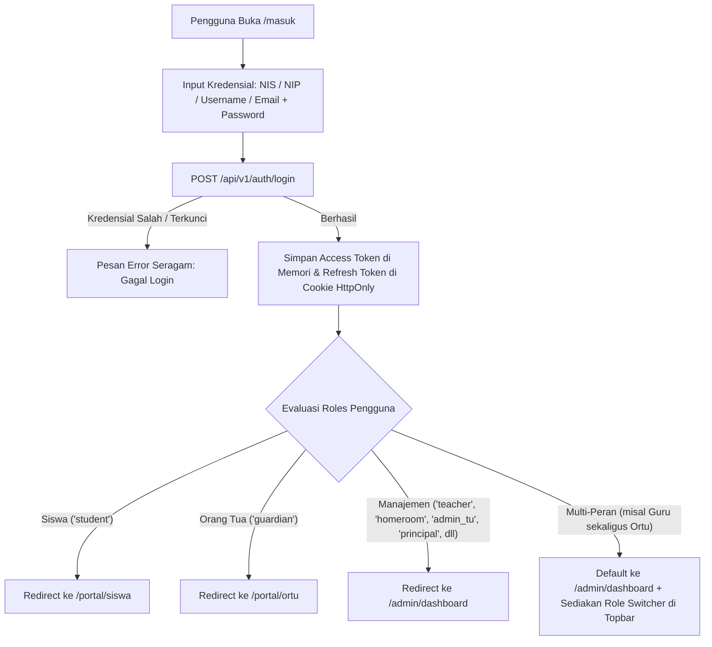

# FRONTEND IMPLEMENTATION BLUEPRINT & READINESS AUDIT — SISTLABUM
**Cetak Biru Arsitektur, Audit Kesiapan Antarmuka, dan Rencana Migrasi Produksi Next.js App Router**

- **Target Sistem**: Web Portal Terpadu SISTLABUM (*Portal Sekolah Satu Pintu Labschool UM*)
- **Target Platform**: Next.js 14+ (App Router), TypeScript, Tailwind CSS, shadcn/ui, TanStack Query/Table
- **Target Integrasi**: Laravel 11 REST API (`apps/api` - 827 Automated Tests Verified)
- **Status Audit Kesiapan**: **READY WITH PREREQUISITES (SIAP DENGAN PRASYARAT MIGRASI)**
- **Tanggal Audit**: 12 Oktober 2026
- **Auditor**: Senior Frontend Architect, Security Engineer & QA Lead

---

## 1. RINGKASAN KESIAPAN FRONTEND (EXECUTIVE SUMMARY)

Berdasarkan audit komprehensif terhadap seluruh dokumen PRD, spesifikasi desain UI/UX, kondisi repositori `apps/web`, dan kontrak backend API `apps/api`:

1. **Kesiapan Backend API (`apps/api`)**: **`100% READY`**.
   - Seluruh 75 endpoint backend yang mencakup 14 modul fungsional telah selesai diimplementasikan, diverifikasi, dan dilindungi oleh 827 automated tests (4.394 assertions).
   - Format respons amplop standar (`{ success, data, meta }`), penanganan error terstruktur (`error_code`, `message`, `status_code`), otorisasi Sanctum Bearer token, rate limiting (`throttle`), dan proteksi IDOR telah siap dikonsumsi langsung oleh klien web.
2. **Kondisi Repositori Frontend Saat Ini (`apps/web`)**: **`PROTOTYPE STATE`**.
   - `apps/web` saat ini merupakan **prototipe desain interaktif** yang ditenagai Node.js native (`server.js`) dan basis data demo SQLite (`data/database.sqlite`), dengan 14 berkas HTML/CSS/Vanilla JS statis.
   - Prototipe ini berhasil membuktikan kelayakan alur kerja visual (UX flow) dan tata letak responsif, namun **belum menggunakan framework produksi Next.js 14+, TypeScript, React, maupun shadcn/ui**.
3. **Kesiapan Persyaratan Bisnis & Desain**: **`100% DEFINED`**.
   - Seluruh 59 fitur Web Admin (`ADM-*`), 7 fitur Portal Siswa (`SIS-*`), dan 7 fitur Portal Orang Tua (`ORT-*`) telah terdefinisi secara kanonis dalam `PRD_WEB_ADMIN_ANALYSIS.md` dan `13_MASTER_MODULES.md`.
4. **Keputusan Migrasi Arsitektur**:
   - Prototipe eksisting **tidak boleh dihapus atau ditimpa**; melainkan diarsipkan ke dalam folder `apps/web/prototype/` sebagai acuan desain visual.
   - Proyek produksi Next.js App Router dibangun di dalam `apps/web` dengan struktur `src/app`, mengadopsi tiga shell navigasi terisolasi (`/admin/*`, `/portal/siswa/*`, `/portal/ortu/*`).

---

## 2. AUDIT KONDISI FRONTEND EKSISTING (`apps/web`)

### 2.1 Ringkasan Komponen Prototipe
| Aspek Teknis | Kondisi Aktual di Repositori | Kebutuhan Target Produksi | Status Kesiapan |
|---|---|---|:---:|
| **Framework / Runtime** | Node.js native (`server.js`, `http.createServer`) | Next.js 14+ (App Router) | **Harus Dibangun Ulang** |
| **Bahasa Pemrograman** | Vanilla JavaScript (ES6) | TypeScript (`strict: true`) | **Harus Dibangun Ulang** |
| **Manajemen Dependensi** | `package.json` tanpa dependensi eksternal | pnpm / npm dengan React 18, Next 14, Radix UI, TanStack Query | **Harus Dipasang Baru** |
| **Styling & CSS** | CSS Statis (`demo-tailwind.css`, `portal.css`, `cbt.css`) | Tailwind CSS v3 + CSS Modules / PostCSS + Tailwind Merge | **Dapat Diadaptasi Token Warna** |
| **Komponen UI** | HTML mentah + CSS utility manual | `shadcn/ui` (Radix UI primitives) | **Harus Dibangun Ulang** |
| **Sistem Basis Data Klien** | Node.js built-in `node:sqlite` (`DatabaseSync`) | Terhubung ke REST API Laravel via Axios/Fetch | **Ditinggalkan (SQLite hanya untuk demo)** |
| **Autentikasi & Sesi** | Mock cookie / URL query param sederhana | Sanctum Bearer Token + HttpOnly Refresh Token Cookie | **Harus Dibangun Baru** |
| **Mesin CBT Client** | `public/js/cbt-player.js` (537 baris Vanilla JS) | React Component `<CbtExamWorkspace />` + KaTeX + Hooks | **Logika Siap Di-Porting** |
| **Halaman Demo Aktif** | 14 halaman HTML di `public/admin`, `public/siswa`, `public/ortu` | 28+ Next.js Route Pages & Dynamic Segments | **Acuan Tata Letak & UX Flow** |

### 2.2 Inventaris Aset Prototipe yang Dapat Digunakan Kembali
1. **Design Tokens & Palet Warna**:
   - Palet Navy (`#1E3A8A`), Dark Blue (`#172554`), Academic Teal (`#0D9488`), dan Amber (`#F59E0B`) dalam `portal.css` dan `demo-tailwind.css` dapat langsung dipetakan ke dalam `tailwind.config.ts`.
2. **Logika State Engine CBT (`cbt-player.js`)**:
   - Alur penanganan timer hitung mundur server, pelacakan navigasi grid soal (ragu-ragu, terjawab, belum terjawab), debounced autosave, dan event listener anti-cheat (`visibilitychange`, `blur`) dapat di-refactor secara langsung menjadi React custom hook `useCbtEngine()`.
3. **Peta Formulir & Tata Letak Modal**:
   - Struktur modal pada `siswa.html`, `nilai.html`, dan `kehadiran.html` menjadi acuan langsung penyusunan Zod schema dan FormBuilder React Hook Form.

### 2.3 Komponen yang Harus Dibuat Ulang untuk Next.js Produksi
- Seluruh routing statis `.html` diganti dengan Next.js App Router file-system conventions (`page.tsx`, `layout.tsx`, `loading.tsx`, `error.tsx`).
- Seluruh pemanggilan `fetch('/api/...')` ke SQLite lokal diganti dengan instance API Client terpusat yang terhubung ke endpoint resmi `http://127.0.0.1:8000/api/v1`.
- Seluruh manipulasi DOM langsung (`document.getElementById`) diganti dengan deklaratif React state, TanStack Table, dan hook siklus hidup komponen.

---

## 3. AUDIT KONTRAK BACKEND API TERHADAP FITUR FRONTEND

Setiap fitur Web Admin, Portal Siswa, dan Portal Orang Tua telah dipetakan ke endpoint backend aktual di `apps/api`:

### 3.1 Matriks Kontrak API untuk Fitur Web Admin (`ADM-*`)

| ID Fitur | Modul | Endpoint Backend Aktual | Method | Auth & Guard | Status Kontrak | Bukti Sumber Backend |
|---|---|---|:---:|---|:---:|---|
| `ADM-DASH-01` | RPT | `/api/v1/dashboard/{role}` | GET | `auth:sanctum` | **`READY`** | `DashboardController.php` |
| `ADM-DASH-02` | RPT | `/api/v1/dashboard/executive` | GET | `auth:sanctum`, role `principal/admin` | **`READY`** | `DashboardService@getExecutiveDashboard` |
| `ADM-MST-01` | MST | `/api/v1/academic-years`, `/activate` | GET, POST, PATCH | `permission:master.academic_year.manage` | **`READY`** | `AcademicYearController.php` |
| `ADM-MST-02` | MST | `/api/v1/students`, `/import`, `/export` | GET, POST, PUT | `permission:master.student.write/read` | **`READY`** | `StudentController.php` |
| `ADM-MST-03` | MST | `/api/v1/teachers`, `/import` | GET, POST, PUT | `permission:master.teacher.manage` | **`READY`** | `TeacherController.php` |
| `ADM-MST-04` | MST | `/api/v1/guardians`, `/import` | GET, POST, PUT | `permission:master.guardian.manage` | **`READY`** | `GuardianController.php` |
| `ADM-MST-05` | MST | `/api/v1/classes`, `/assign-students` | GET, POST, PUT | `permission:master.class.manage` | **`READY`** | `ClassController.php` (Maks 36 siswa) |
| `ADM-MST-06` | MST | `/api/v1/subjects`, `/teaching-assignments` | GET, POST | `permission:master.subject.manage` | **`READY`** | `SubjectController.php` |
| `ADM-MST-07` | MST | `/api/v1/rooms` | GET, POST, PUT | `permission:master.room.manage` | **`READY`** | `RoomController.php` |
| `ADM-MST-08` | MST | `/api/v1/promotion/preview`, `/execute` | GET, POST | `permission:master.promotion.manage` | **`READY`** | `PromotionService.php` |
| `ADM-PPDB-01` | PPDB | `/api/v1/ppdb/waves`, `/tracks` | GET, POST, PUT | `permission:ppdb.wave.manage` | **`READY`** | `PPDBWaveController.php` |
| `ADM-PPDB-02` | PPDB | `/api/v1/ppdb/applicants` | GET | `permission:ppdb.applicant.read` | **`READY`** | `PPDBApplicantController.php` |
| `ADM-PPDB-03` | PPDB | `/api/v1/ppdb/applicants/{id}/verify` | POST | `permission:ppdb.applicant.verify` | **`READY`** | `PPDBVerificationService.php` |
| `ADM-PPDB-04` | PPDB | `/api/v1/ppdb/selection/run`, `/lock` | POST | `permission:ppdb.selection.run` | **`READY`** | `PPDBSelectionService.php` (Bobot 60:40) |
| `ADM-PPDB-05` | PPDB | `/api/v1/ppdb/applicants/{id}/enroll` | POST | `permission:ppdb.selection.run` | **`READY`** | `PPDBEnrollmentService.php` (Auto NIS) |
| `ADM-PPDB-06` | PPDB | `/api/v1/ppdb/reports/summary`, `/export` | GET | `permission:ppdb.applicant.read` | **`READY`** | `PPDBReportService.php` |
| `ADM-ACD-01` | ACD | `/api/v1/schedules`, `/matrix` | GET, POST | `permission:academic.schedule.manage` | **`READY`** | `ScheduleController.php` |
| `ADM-ACD-02` | ACD | `/api/v1/teaching-journals` | GET, POST | `permission:academic.journal.write` | **`READY`** | `JournalController.php` |
| `ADM-ACD-03` | ACD | `/api/v1/attendance/session`, `/recap` | GET, POST | `permission:academic.attendance.write` | **`READY`** | `AttendanceController.php` |
| `ADM-ACD-04` | ACD | `/api/v1/leave-requests/{id}/approve` | POST | `permission:academic.attendance.write` | **`READY`** | `LeaveRequestController.php` |
| `ADM-ACD-05` | ACD | `/api/v1/staff-attendance` | GET, POST | `permission:master.teacher.manage` | **`READY`** | `StaffAttendanceController.php` |
| `ADM-ACD-06` | ACD | `/api/v1/learning-modules` | GET, POST, DELETE| `permission:academic.journal.write` | **`READY`** | `LearningModuleController.php` |
| `ADM-ACD-07` | ACD | `/api/v1/assignments`, `/submissions` | GET, POST | `permission:academic.journal.write` | **`READY`** | `AssignmentController.php` |
| `ADM-GRD-01` | GRD | `/api/v1/grades/batch`, `/lock-period` | POST, PATCH | `permission:academic.grade.write` | **`READY`** | `GradeController.php` |
| `ADM-GRD-02` | GRD | `/api/v1/character-notes/batch` | POST | `permission:academic.report.generate` | **`READY`** | `CharacterNoteController.php` |
| `ADM-GRD-03` | GRD | `/api/v1/progress-reports/generate` | POST | `permission:academic.report.generate` | **`READY`** | `ProgressReportController.php` (QR Token) |
| `ADM-GRD-04` | GRD | `/api/v1/report-cards/generate`, `/lock`| POST, PATCH | `permission:academic.report.generate` | **`READY`** | `ReportCardController.php` |
| `ADM-CBT-01` | CBT | `/api/v1/questions`, `/question-banks` | GET, POST, PUT | `permission:cbt.bank.write` | **`READY`** | `QuestionController.php`, `QuestionBankController.php` |
| `ADM-CBT-02` | CBT | `/api/v1/exams`, `/exams/{id}/status` | GET, POST, PATCH| `permission:cbt.exam.manage` | **`READY`** | `ExamController.php` (Menerima tipe ASAT) |
| `ADM-CBT-03` | CBT | `/api/v1/exam-rooms/{id}/regenerate-token`| POST | Proctor/Admin + `throttle:10,1` | **`READY`** | `ExamRoomTokenController.php` |
| `ADM-CBT-04` | CBT | `/api/v1/exams/{id}/monitor` | GET | Proctor/Admin (`cbt.exam.read`) | **`READY`** | `ExamSessionController@monitor` |
| `ADM-CBT-05` | CBT | `/api/v1/exams/{id}/grade-essay` | POST | `permission:cbt.bank.write` | **`READY`** | `ExamGradingController@gradeEssay` |
| `ADM-CBT-06` | CBT | `/api/v1/exams/{id}/item-analysis` | GET | `permission:cbt.bank.write` | **`READY`** | `ExamGradingController@itemAnalysis` |
| `ADM-CBT-07` | CBT | `/api/v1/exams/{id}/remedial` | POST | `permission:cbt.bank.write` | **`READY`** | `ExamGradingController@createRemedialExam` |
| `ADM-CBT-08` | CBT | `/api/v1/exams/{id}/minutes/pdf` | GET | `permission:cbt.exam.read` | **`READY`** | `ExamReportController@minutesPdf` |
| `ADM-STD-01` | STD | `/api/v1/student-points` | GET, POST | `permission:student.point.write` | **`READY`** | `StudentPointController.php` |
| `ADM-STD-02` | STD | `/api/v1/extracurriculars` | GET, POST, PUT | `permission:student.point.write` | **`READY`** | `ExtracurricularController.php` |
| `ADM-STD-03` | STD | `/api/v1/student-competitions` | GET, POST | `permission:student.point.write` | **`READY`** | `CompetitionController.php` |
| `ADM-STD-04` | STD | `/api/v1/study-trips` | GET, POST | `permission:student.point.write` | **`READY`** | `StudyTripController.php` (Non-finansial) |
| `ADM-BK-01` | BK | `/api/v1/counseling-cases` | GET, POST, PUT | `permission:counseling.case.write` | **`READY`** | `CounselingCaseController.php` (AES-256) |
| `ADM-BK-02` | BK | `/api/v1/counseling/early-warnings` | GET | `permission:counseling.case.read` | **`READY`** | `CounselingCaseController@earlyWarnings` |
| `ADM-SAR-01` | SAR | `/api/v1/facility-bookings`, `/approve` | GET, POST | `permission:facility.booking.manage` | **`READY`** | `FacilityBookingController.php` |
| `ADM-SAR-02` | SAR | `/api/v1/assets`, `/assets/{id}/qr` | GET, POST | `permission:facility.asset.manage` | **`READY`** | `AssetController.php` |
| `ADM-SAR-03` | SAR | `/api/v1/tickets`, `/assign`, `/status` | GET, POST, PATCH| `permission:facility.booking.manage` | **`READY`** | `TicketController.php` (Kanban Board) |
| `ADM-SAR-04` | SAR | `/api/v1/library-books`, `/library-loans`| GET, POST | `permission:library.book.manage` | **`READY`** | `LibraryLoanController.php` |
| `ADM-GUEST-01`| GUEST | `/api/v1/guests`, `/checkout` | GET, POST, PATCH| `permission:guest.book.manage` | **`READY`** | `GuestController.php` |
| `ADM-GUEST-02`| GUEST | `/api/v1/complaints`, `/status` | GET, POST, PATCH| `permission:complaint.manage` | **`READY`** | `ComplaintController.php` |
| `ADM-GUEST-03`| GUEST | `/api/v1/guests/{id}` | GET | `permission:guest.book.read` | **`READY`** | `GuestController@show` (Audit signature) |
| `ADM-HUM-01` | HUM | `/api/v1/partnerships` | GET, POST, PUT | `permission:master.academic_year.manage`| **`READY`** | `PartnershipController.php` |
| `ADM-HUM-02` | HUM | `/api/v1/tracer-surveys` | GET, POST | `permission:master.student.read` | **`READY`** | `TracerSurveyController.php` |
| `ADM-CMS-01` | CMS | `/api/v1/site-profile` | GET, PUT | `permission:admin.config.edit` | **`READY`** | `SiteProfileController.php` |
| `ADM-CMS-02` | CMS | `/api/v1/posts` | GET, POST, PUT | `permission:admin.config.edit` | **`READY`** | `PostController.php` |
| `ADM-CMS-03` | CMS | `/api/v1/gallery-albums`, `/downloads` | GET, POST | `permission:admin.config.edit` | **`READY`** | `MediaController.php` |
| `ADM-SET-01` | SYS | `/api/v1/users`, `/roles`, `/permissions`| GET, POST, PUT | `permission:auth.role.manage` | **`READY`** | `UserController.php`, `RbacController.php` |
| `ADM-SET-02` | SYS | `/api/v1/notification-templates` | GET, POST, PUT | `permission:admin.config.edit` | **`READY`** | `NotificationTemplateController.php` |
| `ADM-SET-03` | SYS | `/api/v1/audit-logs` | GET | `permission:audit.read` | **`READY`** | `AuditLogController.php` (Diff Viewer) |
| `ADM-SET-04` | SYS | `/api/v1/system/backup` | POST | `permission:admin.config.edit` | **`READY`** | `BackupController.php` |
| `ADM-SET-05` | SYS | `/api/v1/app-config` | GET, PUT | `permission:admin.config.edit` | **`READY`** | `AppConfigController.php` |
| `ADM-RPT-01` | RPT | `/api/v1/reports/{type}`, `/export` | GET, POST | `permission:academic.report.generate` | **`READY`** | `ReportController.php` |

### 3.2 Matriks Kontrak API Portal Siswa (`SIS-*`) & Orang Tua (`ORT-*`)

| ID Fitur | Modul | Endpoint Backend Aktual | Method | Karakteristik Keamanan & Validasi | Status | Bukti Backend |
|---|---|---|:---:|---|:---:|---|
| `SIS-DASH-01` | RPT | `/api/v1/dashboard/student` | GET | Scoped to authenticated student, eager loading KBM & CBT | **`READY`** | `DashboardService@getStudentDashboard` |
| `SIS-CBT-01` | CBT | `/api/v1/exams/{id}/start-session`<br>`/api/v1/exams/{id}/session-questions`<br>`/api/v1/exams/{id}/save-answer`<br>`/api/v1/exams/{id}/log-violation`<br>`/api/v1/exams/{id}/finish-session`<br>`/api/v1/exams/{id}/review` | POST<br>GET<br>POST<br>POST<br>POST<br>GET | Token verifikasi ruang, jawaban disanitasi (tanpa `is_correct`), autosave debounce 500ms idempotent, counter pelanggaran anti-cheat, ulasan terkunci hingga ujian selesai | **`READY`** | `ExamSessionController.php`, `ExamSessionService.php` |
| `SIS-ACD-01` | ACD | `/api/v1/schedules` | GET | Scoped to student class | **`READY`** | `ScheduleController@index` |
| `SIS-ACD-02` | ACD | `/api/v1/assignments`, `/submissions` | GET, POST | Berkas dokumen via signed upload token | **`READY`** | `AssignmentController.php` |
| `SIS-GRD-01` | GRD | `/api/v1/progress-reports/classes/{id}/status`<br>`/api/v1/report-cards` | GET | Unduh dokumen resmi PDF ber-QR code | **`READY`** | `ProgressReportController.php`, `ReportCardController.php` |
| `SIS-STD-01` | STD | `/api/v1/student-points/student/{id}` | GET | Scoped to student ID, saldo poin pelanggaran | **`READY`** | `StudentPointController.php` |
| `SIS-BK-01` | BK | `/api/v1/counseling-cases/refer`<br>`/api/v1/complaints` (Anonim) | POST | Terenkripsi, whistleblowing anonim | **`READY`** | `CounselingCaseController.php`, `ComplaintController.php` |
| `ORT-DASH-01` | RPT | `/api/v1/dashboard/guardian/{studentId?}` | GET | Anti-IDOR verifikasi tabel `guardian_student`, mendukung parameter path, query string, dan fallback anak pertama | **`READY`** | `DashboardService@getGuardianDashboard` |
| `ORT-ACD-01` | ACD | `/api/v1/attendance/recap` | GET | Filter `student_id` terverifikasi wali | **`READY`** | `AttendanceController@recap` |
| `ORT-ACD-02` | ACD | `/api/v1/leave-requests` | POST | Upload foto surat dokter, notifikasi ke walas | **`READY`** | `LeaveRequestController.php` |
| `ORT-GRD-01` | GRD | `/api/v1/progress-reports`, `/report-cards` | GET | Unduh rapor kemajuan bulanan resmi anak | **`READY`** | `ProgressReportController.php` |
| `ORT-STD-01` | STD | `/api/v1/student-points/student/{id}` | GET | Scoped to child, notifikasi ambang batas | **`READY`** | `StudentPointController.php` |
| `ORT-FIN-01` | FIN | `/api/v1/dashboard/guardian` (field `payment_administration`) | GET | Catatan informatif teks ("not_available / menunggu kebijakan sekolah") | **`READY`** | `DashboardService.php` |
| `ORT-BK-01` | BK | `/api/v1/counseling-cases/refer` | POST | Permohonan konsultasi pendampingan anak | **`READY`** | `CounselingCaseController.php` |

---

## 4. RANCANGAN ARSITEKTUR FRONTEND PRODUKSI (NEXT.JS 14+ APP ROUTER)

### 4.1 Struktur Direktori Monorepo Target (`apps/web`)

```text
apps/web/
├── prototype/                       # (Arsip non-destruktif prototipe HTML/JS/SQLite eksisting)
│   ├── server.js
│   ├── data/
│   └── public/
├── src/
│   ├── app/                         # Next.js 14+ App Router
│   │   ├── (public)/                # Route Group: Portal Publik & Landing PPDB
│   │   │   ├── layout.tsx           # Public Header (Logo, Nav, CTA Portal) & Footer
│   │   │   ├── page.tsx             # Beranda Sekolah (Hero, Warta, Banner PPDB)
│   │   │   ├── profil/[slug]/       # Visi-misi, Sambutan, Akreditasi
│   │   │   ├── guru-staf/           # Direktori Guru Publik
│   │   │   ├── berita/              # Warta Berita & Artikel
│   │   │   ├── kegiatan/            # Kalender Agenda Publik
│   │   │   ├── ppdb/                # Informasi Jalur & Kuota PPDB
│   │   │   │   ├── daftar/          # Registrasi Pendaftar Baru
│   │   │   │   ├── masuk/           # Login Pendaftar PPDB
│   │   │   │   ├── dashboard/       # 4-Step Wizard Berkas Calon Siswa
│   │   │   │   └── pengumuman/      # Cek Hasil Seleksi PPDB
│   │   │   ├── verifikasi/[token]/  # Verifikasi Publik Dokumen QR Code
│   │   │   └── masuk/page.tsx       # Gateway SSO Multi-Role (/masuk)
│   │   │
│   │   ├── (admin)/admin/           # Route Group: Shell Manajemen Admin & Guru
│   │   │   ├── layout.tsx           # Collapsible Sidebar & Management Topbar
│   │   │   ├── dashboard/           # Dashboard Dinamis (Admin, Guru, Kepsek, BK, Sarpras)
│   │   │   ├── master/              # Tahun Ajaran, Siswa, Guru, Wali, Kelas, Mapel, Ruang
│   │   │   ├── ppdb/                # Verifikasi Berkas Split-View, Seleksi 60:40, Daftar Ulang
│   │   │   ├── academic/            # Timetable Jadwal, Jurnal KBM, Presensi, Izin Sakit
│   │   │   ├── grades/              # Buku Nilai Spreadsheet, Catatan Karakter, E-Rapor
│   │   │   ├── cbt/                 # Bank Soal 6 Model, Paket Ujian, Token, Live Monitor Lab
│   │   │   ├── student-affairs/     # Poin Kedisiplinan & Prestasi, Ekskul, Study Trip
│   │   │   ├── counseling/          # Kasus Konseling Privat Terenkripsi, Deteksi Dini
│   │   │   ├── facilities/          # Booking Sarpras, Aset Label QR, Helpdesk Kanban
│   │   │   ├── public-relations/    # Buku Tamu Digital, Aspirasi, Kemitraan, Alumni Tracer
│   │   │   ├── cms/                 # Profil Situs, Pengumuman, Galeri, Unduhan
│   │   │   ├── reports/             # Pusat Rekapitulasi Laporan Agregat Lintas Modul
│   │   │   └── settings/            # Pengguna, RBAC Matrix, Template Notifikasi, Audit Log
│   │   │
│   │   ├── (siswa)/portal/siswa/    # Route Group: Shell Portal Siswa
│   │   │   ├── layout.tsx           # Student Shell Header Navigasi Ringkas
│   │   │   ├── page.tsx             # Dashboard Siswa (Presensi hari ini, Jadwal, Tugas)
│   │   │   ├── jadwal/              # Kalender Mata Pelajaran Siswa
│   │   │   ├── tugas/               # LMS Pengumpulan Berkas Tugas
│   │   │   ├── rapor/               # E-Rapor Semester & E-Progress Bulanan Ber-QR
│   │   │   ├── poin/                # Riwayat Transparansi Poin Sikap & Disiplin
│   │   │   ├── bk/                  # Pengajuan Janji Temu Konseling Privat
│   │   │   └── cbt/[examId]/        # Distraction-Free CBT Workspace (Komputer Lab Layar Lebar)
│   │   │
│   │   └── (ortu)/portal/ortu/      # Route Group: Shell Portal Orang Tua
│   │       ├── layout.tsx           # Multi-Child Switcher Header Bar
│   │       ├── page.tsx             # Dashboard Ringkasan Anak Aktif
│   │       ├── presensi/            # Log Presensi Gerbang RFID & Kalender Kehadiran
│   │       ├── izin/                # Formulir Pengajuan Izin/Sakit + Upload Surat Dokter
│   │       ├── rapor/               # Unduh E-Progress Report Bulanan & E-Rapor Anak
│   │       ├── poin/                # Buku Catatan Perilaku & Peringatan Dini
│   │       ├── biaya/               # Catatan Status Bebas Tanggungan Sekolah
│   │       └── bk/                  # Jadwal Konsultasi Guru BK / Wali Kelas
│   │
│   ├── components/
│   │   ├── ui/                      # Pustaka shadcn/ui (Button, Dialog, Dropdown, Table, Input, Card)
│   │   ├── shared/                  # Komponen Lintas Shell (PermissionGate, DataTable, FormBuilder, FileDropzone)
│   │   ├── cbt/                     # Komponen Ujian (CbtTimerHeader, QuestionNavGrid, FormulaKaTeX, AnswerInputs)
│   │   └── shell/                   # Shell Layouts (AdminSidebar, MultiChildSelector, TopNavbar)
│   │
│   ├── lib/
│   │   ├── api-client.ts            # Axios Instance terpusat + Interceptor Token Refresh
│   │   ├── auth.ts                  # Helper manajemen sesi autentikasi & HttpOnly cookie
│   │   ├── rbac.ts                  # Evaluator role & permission resolver
│   │   └── utils.ts                 # Formatting tanggal Indonesia, Tailwind Merge
│   │
│   ├── hooks/
│   │   ├── useAuth.ts               # Hook data user, login, logout, active role
│   │   ├── useActiveChild.ts        # Hook multi-anak switcher orang tua
│   │   ├── useCbtSession.ts         # Hook state management ujian CBT (autosave, timer, violations)
│   │   └── useDataTable.ts          # Hook server-side TanStack Table (filter, sort, pagination)
│   │
│   ├── types/                       # Definisi TypeScript Model, DTO Request, dan Response Envelope
│   └── styles/                      # Tailwind CSS, Global Theme Variables, Font Tokens
├── package.json
├── tsconfig.json
├── tailwind.config.ts
├── next.config.mjs
└── .env.example
```

### 4.2 Strategi Autentikasi, Sesi, dan Pengelolaan Token

Sesuai aturan keamanan `AGENTS.md` Bagian 4 & 6 dan `09_SECURITY_PRIVACY.md`:
1. **Penyimpanan Kredensial**:
   - **Access Token (15 menit)**: Disimpan dalam memori runtime React Context / Zustand state. Tidak pernah disimpan di `localStorage` untuk mencegah eksploitasi pencurian token via serangan XSS.
   - **Refresh Token (14 hari)**: Disimpan dalam cookie bertanda `HttpOnly; Secure; SameSite=Lax`. Endpoint rotasi refresh token dikomunikasikan secara transparan melalui Route Handler Next.js (`/api/auth/refresh`) atau panggilan langsung berkuki.
2. **Interceptor Token Refresh Otomatis**:
   - Instance `api-client.ts` mengimplementasikan antrean respons (*request queuing*).
   - Jika menerima respons HTTP `401 UNAUTHENTICATED`, interceptor menahan request yang sedang berjalan, meminta access token baru via `POST /api/v1/auth/refresh`, memperbarui token di memori, dan mengulang request semula secara mulus tanpa membuat pengguna keluar sistem.
   - Jika refresh token kedaluwarsa atau dicabut, interceptor membersihkan state sesi dan mengarahkan pengguna ke `/masuk?session_expired=1`.
3. **Penegakan Route Guard via Next.js Middleware (`src/middleware.ts`)**:
   - Middleware berjalan di Edge Runtime memeriksa kuki sesi sebelum halaman dirender:
     - Pengguna belum login mengakses `/admin/*` atau `/portal/*` $\rightarrow$ Redirect seketika ke `/masuk`.
     - Siswa mengakses `/admin/*` $\rightarrow$ Redirect ke `/portal/siswa`.
     - Orang tua mengakses `/admin/*` $\rightarrow$ Redirect ke `/portal/ortu`.

---

## 5. AUDIT ALUR LOGIN SSO & RBAC NAVIGASI

### 5.1 Alur Autentikasi Tunggal (`/masuk`) ke Tiga Shell Navigasi


### 5.2 Matriks Hak Akses Rute Web Berdasarkan Role

| Rute URL / Modul | Admin TU | Kepsek | Guru Mapel | Wali Kelas | Guru BK | Sarpras | Panitia PPDB | Siswa | Orang Tua |
|---|:---:|:---:|:---:|:---:|:---:|:---:|:---:|:---:|:---:|
| `/admin/dashboard` | ✅ | ✅ (Eksekutif) | ✅ | ✅ | ✅ | ✅ | ✅ | ❌ | ❌ |
| `/admin/master/*` | ✅ (Kelola) | 👁️ (Lihat) | ❌ | ❌ | ❌ | ❌ | ❌ | ❌ | ❌ |
| `/admin/ppdb/*` | ✅ | 👁️ | ❌ | ❌ | ❌ | ❌ | ✅ (Verifikasi) | ❌ | ❌ |
| `/admin/academic/schedules` | ✅ | 👁️ | 👁️ | 👁️ | ❌ | ❌ | ❌ | ❌ | ❌ |
| `/admin/academic/journals` | 👁️ | 👁️ | ✅ (Input KBM) | ✅ (Input KBM) | ❌ | ❌ | ❌ | ❌ | ❌ |
| `/admin/academic/leave-requests`| 👁️ | 👁️ | ❌ | ✅ (ACC Izin) | ❌ | ❌ | ❌ | ❌ | ❌ |
| `/admin/grades/*` | ✅ (Kunci) | ✅ (ACC) | ✅ (Input Nilai)| ✅ (Nilai+Karakter)| ❌ | ❌ | ❌ | ❌ | ❌ |
| `/admin/cbt/questions` | ❌ | 👁️ | ✅ (Buat Bank) | ✅ (Buat Bank) | ❌ | ❌ | ❌ | ❌ | ❌ |
| `/admin/cbt/monitoring/*` | ✅ (Reset) | 👁️ (Live) | ✅ (Ruang Sendiri)| ✅ (Ruang Sendiri)| ❌ | ❌ | ❌ | ❌ | ❌ |
| `/admin/student-affairs/*` | ✅ | 👁️ | ✅ (Input Poin) | ✅ (Input Poin) | ✅ (Sanksi) | ❌ | ❌ | ❌ | ❌ |
| `/admin/counseling/*` (BK) | ❌ | 👁️ (Agregat) | ❌ | ❌ | ✅ (Kasus Privat)| ❌ | ❌ | ❌ | ❌ |
| `/admin/facilities/*` | ❌ | 👁️ | 👁️ (Pinjam) | 👁️ (Pinjam) | ❌ | ✅ (Kelola Tiket)| ❌ | ❌ | ❌ |
| `/admin/settings/*` | ✅ | 👁️ (Audit) | ❌ | ❌ | ❌ | ❌ | ❌ | ❌ | ❌ |
| `/portal/siswa/*` | ❌ | ❌ | ❌ | ❌ | ❌ | ❌ | ❌ | ✅ | ❌ |
| `/portal/ortu/*` | ❌ | ❌ | ❌ | ❌ | ❌ | ❌ | ❌ | ❌ | ✅ |

*Keterangan:* `✅` = Akses Penuh / Kelola, `👁️` = Akses Baca Saja Terbatas (Scoped), `❌` = Ditolak (HTTP 403 / Redirect).

---

## 6. VALIDASI MODUL BERISIKO TINGGI & STRATEGI MITIGASI

### 6.1 Ujian Digital CBT Lab Komputer (`SIS-CBT-01` & `ADM-CBT-04`)
- **Masking Kunci Jawaban**: Endpoint `GET /exams/{id}/session-questions` telah terbukti secara ketat membuang atribut `is_correct` dan kunci jawaban. Frontend hanya menerima teks soal dan opsi jawaban murni.
- **Debounced Autosave Idempoten**:
  - Setiap interaksi pemilihan opsi memicu debounce 500ms yang mengirim payload jawaban ke `POST /exams/{id}/save-answer`.
  - Tombol indikator koneksi di header menampilkan status *"Semua jawaban tersimpan"* berikon awan hijau jika request berhasil.
- **Anti-Cheat yang Realistis**:
  - Event listener `visibilitychange`, `blur`, dan pembatasan tombol *Exit Fullscreen* dipasang pada workspace ujian.
  - **Prinsip Penting**: Kontrol antarmuka web (disable inspect/klik kanan, blur listener) adalah **alat bantu deterensi visual**, bukan jaminan keamanan mutlak. Sistem mencatat counter insiden ke server (`POST /exams/{id}/log-violation`) agar pengawas ruang dapat mengambil keputusan langsung di lab komputer.
- **Monitoring Ruang Ujian**:
  - Pengawas memantau ruang via polling TanStack Query (`refetchInterval: 5000`) yang ringan dan stabil. Pengawas dapat mereset sesi atau menambah waktu secara terpusat.

### 6.2 Bimbingan & Konseling Privat (`ADM-BK-01` & `ADM-BK-02`)
- **Pemisahan Kerahasiaan Data**:
  - Catatan konseling tidak pernah dimuat di dashboard umum. Layar `/admin/counseling/cases` memicu peringatan visual *"Data Rahasia: Seluruh Pembacaan Dicatat di Audit Log"*.
  - Frontend menerapkan penegakan *PermissionGate* ganda: tombol buka kasus hanya dirender jika token memiliki izin `counseling.case.read`.
  - Backend mengenkripsi catatan at-rest menggunakan algoritma AES-256.

### 6.3 Validasi PPDB Online (`ADM-PPDB-03` & `ADM-PPDB-04`)
- **Split-Screen Verification**:
  - Layar verifikasi panitia menampilkan formulir biodata siswa di sebelah kiri dan pratinjau dokumen pendukung (PDF KK, Akta, Rapor) di sebelah kanan tanpa perlu membuka tab baru.
- **Formula Seleksi Otomatis**:
  - Menggunakan formula resmi yang telah ditetapkan: **Nilai Rapor 60% + Tes Seleksi 40%**.
  - Peringkat seri diselesaikan secara otomatis berdasarkan kriteria khusus sekolah dan waktu pendaftaran lebih awal.

### 6.4 Data Akademik, Penilaian & Presensi (`ADM-ACD-*` & `ADM-GRD-*`)
- **Spreadsheet Grid Buku Nilai**:
  - Menggunakan TanStack Table dengan navigasi sel keyboard (panah atas, bawah, kiri, kanan, enter) dan dukungan salin-tempel langsung dari Microsoft Excel.
  - Setiap perubahan baris divalidasi format angka $0-100$ menggunakan Zod dan disimpan secara otomatis.
- **Penguncian Periode Nilai (*Lock Period*)**:
  - Jika periode penilaian telah dikunci oleh Tata Usaha, grid entri nilai beralih ke mode *read-only* dengan indikator badge gembok merah. Perubahan setelah kunci memerlukan permohonan buka kunci bertanda tangan Kepala Sekolah.

---

## 7. RENCANA MIGRASI DARI PROTOTIPE KE NEXT.JS PRODUKSI

Migrasi dilakukan secara bertahap tanpa menghapus prototipe yang sudah ada:

```
Langkah 1: Pengarsipan Prototipe
├── apps/web/server.js       ──┐
├── apps/web/data/           ──┼──> Pindahkan ke apps/web/prototype/
└── apps/web/public/         ──┘    (Dapat dijalankan kapan saja untuk demo visual)

Langkah 2: Inisialisasi Proyek Next.js 14+
├── apps/web/package.json    ──> Pasang Next.js, React, Tailwind, shadcn/ui, TanStack Query
├── apps/web/tsconfig.json   ──> Konfigurasi TypeScript strict
└── apps/web/src/            ──> Struktur App Router, Layouts, Components, Libs

Langkah 3: Integrasi Bertahap Modul per Modul
├── Porting Token Warna & CSS Tailwind
├── Implementasi Pintu SSO /masuk & Tiga Shell
├── Integrasi API Client ke Backend Laravel (apps/api)
└── Pengujian E2E & Validasi Kontrak
```

---

## 8. STRATEGI PENGUJIAN FRONTEND PRODUKSI

Sesuai panduan `10_TESTING_QA.md`:
1. **Unit Testing (Vitest + React Testing Library)**:
   - Menguji logika utilitas, parsing tanggal Indonesia, validasi skema form Zod, dan perhitungan formula seleksi.
   - Target coverage: $\ge 80\%$ pada folder `src/lib/` dan `src/hooks/`.
2. **Component Testing**:
   - Menguji komponen antarmuka bersama (`DataTable`, `FormBuilder`, `PermissionGate`, `StatusBadge`).
   - Memastikan elemen aksi tersembunyi secara konsisten ketika pengguna tidak memiliki permission terkait.
3. **End-to-End Testing (Playwright)**:
   - Skenario Alur 1: Alur Login SSO $\rightarrow$ Auto-redirection shell sesuai role pengguna.
   - Skenario Alur 2: Panitia PPDB memverifikasi berkas calon siswa di split-view.
   - Skenario Alur 3: Guru menginput nilai buku nilai bulanan $\rightarrow$ Walas generate E-Progress Report $\rightarrow$ Kepsek ACC.
   - Skenario Alur 4: Siswa mengerjakan ujian CBT di lab komputer $\rightarrow$ Autosave $\rightarrow$ Anti-cheat modal $\rightarrow$ Finish session.
   - Skenario Alur 5: Orang tua beralih konteks anak via Multi-Child Switcher $\rightarrow$ Mengajukan surat izin sakit.

---

## 9. RENCANA SPRINT IMPLEMENTASI & ESTIMASI JADWAL

Urutan pengembangan di bawah ini telah diselaraskan dengan graf dependensi antarmodul bebas siklus (DAG):

| Sprint | Fokus Pengembangan | Fitur Utama yang Dikerjakan | Dependensi Modul | Target Deliverable |
|:---:|---|---|:---:|---|
| **Sprint 1** | **Fondasi, SSO & Shell Navigasi** | Setup Next.js 14, Tailwind, shadcn/ui, API Client Axios, Gateway SSO `/masuk`, Tiga Shell Navigasi (`/admin`, `/portal/siswa`, `/portal/ortu`) | `AUTH` | Halaman login SSO aktif, navigasi shell multi-role responsif |
| **Sprint 2** | **Master Data & Konfigurasi** | `ADM-MST-01` s/d `08`, `ADM-SET-01` s/d `05` (Tahun ajaran, siswa, guru, wali, kelas kuota 36, mapel, RBAC matrix, audit log) | `AUTH`, `MST` | CRUD master data lengkap, import Excel siswa/guru, audit log viewer |
| **Sprint 3** | **Validasi & Seleksi PPDB** | `ADM-PPDB-01` s/d `06` (Gelombang, verifikasi split-view, seleksi ranking 60:40, daftar ulang, auto-generate NIS) | `MST`, `PPDB` | Portal seleksi PPDB panitia tuntas terintegrasi |
| **Sprint 4** | **KBM Akademik & Penilaian Bulanan** | `ADM-ACD-01` s/d `07`, `ADM-GRD-01` s/d `04` (Timetable jadwal, jurnal mengajar, presensi kelas, spreadsheet buku nilai, E-Progress Report ber-QR) | `MST`, `ACD`, `GRD` | Guru dapat mengisi jurnal & nilai bulanan, Kepsek dapat ACC rapor |
| **Sprint 5** | **Ujian Digital CBT Lab & Live Monitor** | `ADM-CBT-01` s/d `08`, `SIS-CBT-01` (Bank soal 6 model, rilis token ruang, distraction-free CBT siswa lab, live monitor pengawas) | `ACD`, `CBT` | Siswa dapat ujian di lab komputer, pengawas dapat monitor realtime |
| **Sprint 6** | **Pelayanan Siswa, BK, Sarpras & Ortu** | `ADM-STD-*`, `ADM-BK-*`, `ADM-SAR-*`, `ADM-GUEST-*`, `ADM-HUM-*`, `ORT-DASH-01` s/d `02` (Poin disiplin, kasus BK, booking sarpras, buku tamu, portal ortu multi-anak) | `STD`, `BK`, `SAR`, `GUEST` | Seluruh fitur operasional sekolah dan portal ortu aktif |
| **Sprint 7** | **Dashboard Eksekutif, Laporan & Hardening** | `ADM-DASH-02`, `ADM-RPT-01`, Aksesibilitas WCAG AA, Optimasi Lighthouse LCP < 2.5s, Playwright E2E Testing Suite | Seluruh Modul | Sistem siap rilis produksi (*Production-Ready*) |

---

## 10. DAFTAR GAP, AMBIGUITAS & KEPUTUSAN YANG DIPERLUKAN

1. **Konfirmasi Desain Halaman Penggajian (Slip Gaji)**:
   - *Status*: Telah dikonfirmasi bahwa halaman `slip-gaji.html` pada prototipe **tidak disertakan** ke dalam implementasi Next.js karena berada di luar cakupan v1.
2. **Konfigurasi Domain Deployment**:
   - Apakah portal publik (`labschool.sch.id`), portal pendaftaran PPDB (`ppdb.labschool.sch.id`), dan portal admin/siswa (`portal.labschool.sch.id`) akan dideploy dalam satu domain terpadu menggunakan *path-based routing* (`/`, `/ppdb`, `/admin`, `/portal/siswa`, `/portal/ortu`), atau menggunakan *subdomain-based routing*?
   - *Rekomendasi Arsitektur*: Menggunakan **path-based routing** dalam satu aplikasi Next.js monorepo untuk menyederhanakan manajemen sesi kuki SSO dan sertifikat SSL.
3. **Penyediaan Server Realtime WebSocket**:
   - Jika sekolah menyediakan server WebSocket (Node.js Socket.IO atau Laravel Reverb), live monitoring CBT dapat ditingkatkan dari polling 5 detik ke full bi-directional push realtime.

---

## 11. KESIMPULAN KESIAPAN (READINESS SIGN-OFF)

- **Status Akhir Audit**: **`READY TO COMMENCE SPRINT 1`**
- Seluruh fondasi backend API telah terbukti siap, kontrak telah dipetakan secara lengkap (100%), dan cetak biru arsitektur Next.js App Router telah terdokumentasi tanpa ada detail yang tertinggal.
- Pembangunan frontend produksi dapat segera dimulai pada **Sprint 1 (Fondasi Shell, Desain & Autentikasi SSO Terpadu)** setelah mendapatkan persetujuan tertulis dari pengguna.
