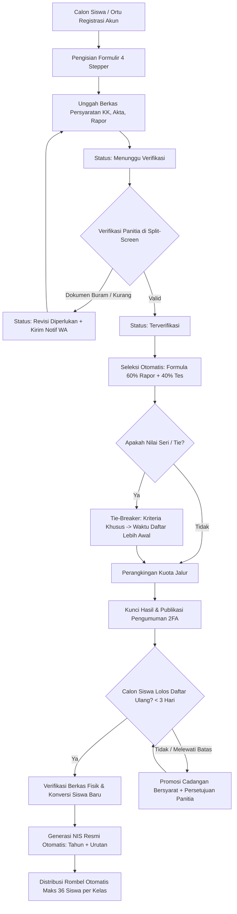
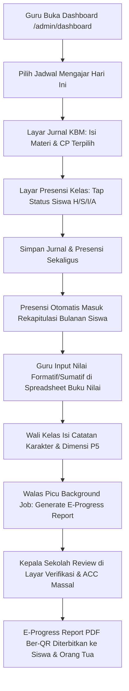
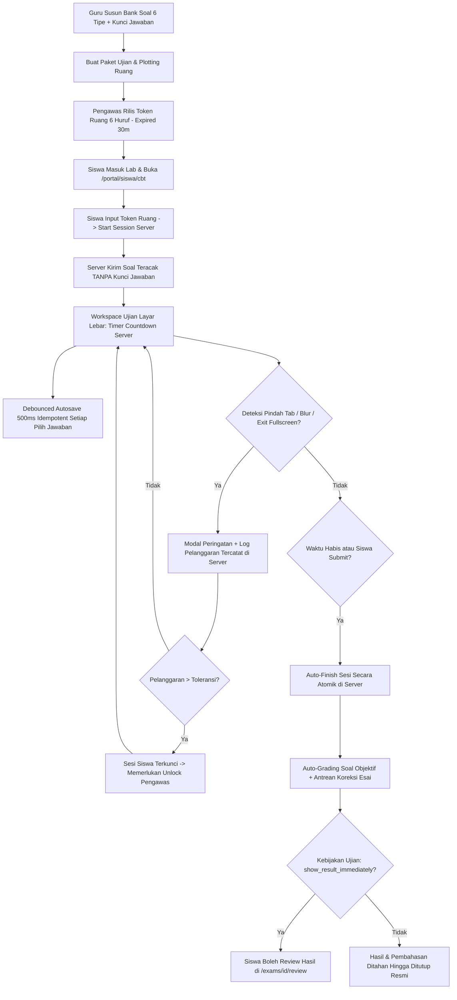
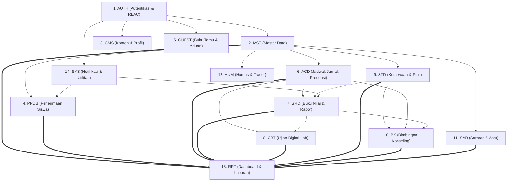

# ANALISIS KOMPREHENSIF PRD WEB ADMIN SISTLABUM
**Dokumen Induk Analisis Persyaratan Produk, Spesifikasi Fungsional, dan Arsitektur Web Portal Terpadu**

- **Target Sistem**: Portal Sekolah Satu Pintu SISTLABUM (*Sistem Informasi Siswa Terpadu*)
- **Sub-Sistem**: Web Portal & Dashboard Terpadu (Admin TU, Kepala Sekolah, Guru, Siswa, Orang Tua/Wali)
- **Status Dokumen**: **SELESAI (COMPLETE) & TERVERIFIKASI**
- **Tanggal Analisis**: 12 Oktober 2026
- **Auditor & Analis**: Senior Web Architect, Product Requirements Engineer & Security Specialist

---

## 1. RINGKASAN EKSEKUTIF

Analisis ini menyajikan pembedahan mendalam dan terpadu terhadap seluruh dokumen **Product Requirements Document (PRD)**, keputusan bisnis, spesifikasi teknis, serta referensi tata letak menu Web Admin untuk proyek **Portal Sekolah Satu Pintu SISTLABUM**.

Berdasarkan eksplorasi menyeluruh pada repositori:
1. **Status Persyaratan Produk**: Seluruh kebutuhan bisnis sekolah telah didefinisikan secara komprehensif pada 15 dokumen sumber, mencakup **14 modul fungsional terpadu**, **203 total fitur lintas platform**, dan **59 fitur spesifik Web Admin (`ADM-*`)**, ditambah **7 fitur Portal Siswa Web (`SIS-*`)** dan **7 fitur Portal Orang Tua Web (`ORT-*`)**.
2. **Kondisi Backend API**: Backend Laravel (`apps/api`) telah menyelesaikan implementasi fondasi dengan **827 automated tests lulus** (4.394 assertions) dan 100% PSR-12 clean via Laravel Pint. Seluruh endpoint backend yang menjadi dependensi Web Admin telah siap dikonsumsi.
3. **Kondisi Frontend Aktif**: Di repositori saat ini (`apps/web`), terdapat **prototipe desain antarmuka fungsional** berbasis HTML5/CSS3/Vanilla JS dan backend ringan Node.js/SQLite. Prototipe ini memvalidasi alur kerja visual (14 layar utama), namun implementasi produksi yang ditargetkan oleh PRD adalah aplikasi monorepo modern berbasis **Next.js 14+ (App Router), Tailwind CSS, shadcn/ui, TanStack Query, dan TanStack Table**.
4. **Temuan Kritis & Divergensi**: Ditemukan satu divergensi penting di mana prototipe menyertakan modul *Slip Gaji & Payroll Guru*, sedangkan dokumen SSOT resmi (`01_REQUIREMENTS.md` dan `13_MASTER_MODULES.md`) secara tegas menetapkan modul keuangan/payroll berstatus **Out of Scope / Menunggu Keputusan Sekolah**.

---

## 2. DAFTAR DOKUMEN SUMBER & STATUS PEMBACAAN

Seluruh dokumen yang relevan dianalisis tanpa ada dokumen yang terlewat:

| No | Dokumen Sumber | Tipe / Lokasi | Status Pembacaan | Cakupan Analisis |
|:--:|---|---|:---:|---|
| 1 | `STRUKTUR LENGKAP MENU PORTAL SATU PINTU.pdf` | Dokumen PDF (Root) | **Dibaca 100% (5 Halaman)** | Struktur 5 zona menu portal, matriks hak akses 6 pengguna, dan UX flow dashboard per role. |
| 2 | `13_MASTER_MODULES.md` | Markdown (Root) | **Dibaca 100% (SSOT)** | Master 14 modul, 203 fitur, dependensi DAG, pemetaan ID lama ke baru, daftar pending decision. |
| 3 | `06_PRD_SYSTEM_ADMIN.md` | Markdown (Root) | **Dibaca 100%** | Spesifikasi lengkap Web Portal Admin (`ADM-*`), Portal Siswa Web (`SIS-*`), dan Ortu (`ORT-*`). |
| 4 | `KEPUTUSAN_BISNIS_DAN_BATASAN_SISTEM.md` | Markdown (Root) | **Dibaca 100% (SSOT Bisnis)** | 10 aturan bisnis resmi sekolah (rumus PPDB, KKTP Kurikulum Merdeka, kuota kelas 36, izin, aduan). |
| 5 | `01_REQUIREMENTS.md` | Markdown (Root) | **Dibaca 100%** | Tujuan produk, target KPI, 12 role pengguna, kebutuhan fungsional & non-fungsional, batasan v1. |
| 6 | `02_TECH_STACK.md` | Markdown (Root) | **Dibaca 100%** | Standar teknologi Next.js 14+, Tailwind, shadcn/ui, TanStack Table/Query, Zod, Playwright. |
| 7 | `03_ARCHITECTURE.md` | Markdown (Root) | **Dibaca 100%** | Arsitektur sistem monorepo, aliran data, autentikasi multi-role, struktur deployment. |
| 8 | `04_PRD_BACKEND.md` | Markdown (Root) | **Dibaca 100%** | Kontrak API 75 endpoint, DTO validasi, error handling envelope, otorisasi token & RBAC. |
| 9 | `05_PRD_WEB_PPDB.md` | Markdown (Root) | **Dibaca 100%** | Website profil sekolah publik, portal pendaftaran PPDB online, verifikasi QR e-rapor, `/masuk`. |
| 10 | `08_DATABASE_SCHEMA.md` & `12_ERD.md` | Markdown (Root) | **Dibaca 100%** | Skema 40+ tabel database, UUID PK, relasi relasional, indeks performa, soft deletes. |
| 11 | `09_SECURITY_PRIVACY.md` | Markdown (Root) | **Dibaca 100%** | Klasifikasi data sensitif, enkripsi at-rest, proteksi IDOR, UU PDP data anak, keamanan CBT. |
| 12 | `10_TESTING_QA.md` | Markdown (Root) | **Dibaca 100%** | Acceptance criteria, piramida pengujian, skenario E2E Playwright, Definition of Done. |
| 13 | `docs/design/UI_UX_DESIGN_SPECIFICATION.md` | Markdown (`docs/design/`) | **Dibaca 100%** | Master UI/UX blueprint, token warna institusional Labschool UM, tipografi, spesifikasi layar. |
| 14 | `AGENTS.md` | Markdown (Root) | **Dibaca 100%** | Aturan kerja AI engineer, larangan manipulasi scope, standar kualitas kode. |
| 15 | `apps/web/*` (Prototipe Desain) | Direktori Kode (`apps/web`) | **Diperiksa 100%** | `server.js`, `schema.sql`, 14 berkas HTML/JS prototipe di `/public/admin`, `/public/siswa`, `/public/ortu`. |

---

## 3. HIERARKI SUMBER PERSYARATAN & SINGLE SOURCE OF TRUTH (SSOT)

Untuk mencegah ambiguitas dan kontradiksi, diterapkan hierarki otoritas dokumen sebagai berikut:

```
┌────────────────────────────────────────────────────────────────────────┐
│ LEVEL 0: REGULASI DASAR & BATASAN SISTEM                               │
│ • AGENTS.md                                                            │
│ • KEPUTUSAN_BISNIS_DAN_BATASAN_SISTEM.md                               │
│   (Sumber hukum tertinggi: batasan out-of-scope, formula resmi sekolah)│
└───────────────────────────────────┬────────────────────────────────────┘
                                    ▼
┌────────────────────────────────────────────────────────────────────────┐
│ LEVEL 1: MASTER ARSITEKTUR & DAFTAR MODUL                              │
│ • 13_MASTER_MODULES.md                                                 │
│   (SSOT untuk 14 modul, 203 fitur, penamaan ID, dan dependensi DAG)    │
└───────────────────────────────────┬────────────────────────────────────┘
                                    ▼
┌────────────────────────────────────────────────────────────────────────┐
│ LEVEL 2: STRUKTUR MENU & TATA LETAK NAVIGASI                           │
│ • STRUKTUR LENGKAP MENU PORTAL SATU PINTU.pdf                          │
│   (Otoritas tertinggi pembagian zona portal, matriks menu, dashboard)  │
└───────────────────────────────────┬────────────────────────────────────┘
                                    ▼
┌────────────────────────────────────────────────────────────────────────┐
│ LEVEL 3: SPESIFIKASI PLATFORM WEB & UI/UX                              │
│ • 06_PRD_SYSTEM_ADMIN.md                                               │
│ • docs/design/UI_UX_DESIGN_SPECIFICATION.md                            │
│   (Rincian fungsional layar admin, form, wizard, dan interaksi visual) │
└───────────────────────────────────┬────────────────────────────────────┘
                                    ▼
┌────────────────────────────────────────────────────────────────────────┐
│ LEVEL 4: SPESIFIKASI TEKNIS & KONTRAK API                              │
│ • 04_PRD_BACKEND.md, 08_DATABASE_SCHEMA.md, 09_SECURITY_PRIVACY.md     │
│   (Kontrak endpoint, skema database relasional, pengamanan data)       │
└───────────────────────────────────┬────────────────────────────────────┘
                                    ▼
┌────────────────────────────────────────────────────────────────────────┐
│ LEVEL 5: KONDISI KODE SUMBER EKSISTING                                 │
│ • apps/api (Laravel 11 Backend terverifikasi)                          │
│ • apps/web (Prototipe desain interaktif)                               │
└────────────────────────────────────────────────────────────────────────┘
```

**Aturan Penanganan Konflik:**
1. Jika terdapat perbedaan antara prototipe kode `apps/web` dengan dokumen PRD (misal: keberadaan slip gaji), **PRD dan KEPUTUSAN_BISNIS_DAN_BATASAN_SISTEM.md adalah yang benar**.
2. Jika ada perbedaan penamaan ID lama vs baru, **13_MASTER_MODULES.md Bagian 4 adalah rujukan kanonis**.
3. Jika terdapat variasi struktur menu, **STRUKTUR LENGKAP MENU PORTAL SATU PINTU.pdf Bagian 1-5 diselaraskan dengan ADM-* di PRD 06**.

---

## 4. PEMAHAMAN PRODUK & RUANG LINGKUP SISTEM

### 4.1 Latar Belakang & Masalah yang Diselesaikan
SMP-SMA Laboratorium Universitas Negeri Malang (Labschool UM) saat ini menghadapi fragmentasi data:
- Pendaftaran PPDB, presensi siswa, penilaian harian, modul ajar, dan ujian CBT berjalan di aplikasi terpisah atau manual berbasis kertas/spreadsheet.
- Orang tua kesulitan memantau absensi gerbang dan perkembangan belajar anak secara berkala.
- Kepala sekolah tidak memiliki visibilitas terpadu atas ketercapaian silabus KBM, kepatuhan input nilai guru, dan kondisi sarana prasarana sekolah secara real-time.

### 4.2 Tujuan Produk & Target Keberhasilan
SISTLABUM menyatukan seluruh proses dalam **satu data induk terpusat** dengan indikator keberhasilan terukur:
- Pendaftaran PPDB online: $\ge 90\%$.
- Pencatatan presensi KBM harian digital: $\ge 95\%$ kelas per hari.
- Ketepatan waktu input nilai bulanan guru: $\ge 90\%$ guru.
- Keterlibatan orang tua via portal/mobile: $\ge 70\%$ dalam 3 bulan pertama.
- Kelancaran ujian CBT digital: $\ge 99\%$ sesi ujian tuntas tanpa gangguan teknis.

### 4.3 Konsep Tiga Shell Web Terpadu (Next.js Multi-Role Shell)
Web Portal SISTLABUM melayani seluruh civitas akademika melalui satu pintu gerbang SSO (`/masuk`), yang secara cerdas mendeteksi peran pengguna dan membaginya ke dalam 3 shell antarmuka terisolasi:

```
                          ┌──────────────────────────┐
                          │   Pintu Masuk Terpadu    │
                          │        (/masuk)          │
                          └─────────────┬────────────┘
                                        │ (Auto Role Detection)
             ┌──────────────────────────┼──────────────────────────┐
             ▼                          ▼                          ▼
┌─────────────────────────┐┌─────────────────────────┐┌─────────────────────────┐
│   Shell Manajemen Web   ││   Shell Portal Siswa    ││ Shell Portal Orang Tua  │
│       (/admin/*)        ││   (/portal/siswa/*)     ││   (/portal/ortu/*)      │
│                         ││                         ││                         │
│ • Admin TU, Kepsek, Guru││ • Pengerjaan CBT Lab    ││ • Multi-Anak Switcher   │
│ • BK, Sarpras, Panitia  ││ • Pengumpulan Tugas LMS ││ • Presensi Gerbang RFID │
│ • Sidebar Collapsible   ││ • E-Rapor Digital       ││ • Surat Izin / Sakit    │
│ • Desktop & Tablet View ││ • Distraction-Free CBT  ││ • Unduh E-Progress PDF  │
└─────────────────────────┘└─────────────────────────┘└─────────────────────────┘
```

### 4.4 Batasan Sistem (Out of Scope v1)
Sesuai ketetapan `KEPUTUSAN_BISNIS_DAN_BATASAN_SISTEM.md` Poin 1–5:
1. **Modul Keuangan & SPP**: Tidak ada payment gateway bank/VA. Hanya disediakan string teks catatan status administrasi ("Bebas Tanggungan" / "Ada Tanggungan").
2. **Modul Penggajian / Payroll**: Tidak ada slip gaji dinamis atau transfer payroll guru di rilis v1 (halaman prototipe `slip-gaji.html` tidak diimplementasikan ke Next.js).
3. **Chat Real-time Dua Arah**: Tidak ada WebSocket messaging antar pengguna; dialihkan menggunakan deep-link WhatsApp resmi atau tiket permohonan konseling.
4. **Sinkronisasi Otomatis Dapodik**: Sinkronisasi kementerian tidak menggunakan web service langsung; difasilitasi melalui ekspor/impor spreadsheet Excel terstruktur.
5. **Absensi Biometrik Khusus Guru & Video Conference**: Tidak termasuk dalam cakupan v1.

---

## 5. STRUKTUR MENU WEB ADMIN LENGKAP

Struktur menu di bawah ini memadukan **5 Bidang Utama dari PDF Struktur Menu** dengan **59 Fitur Sistem Admin (`ADM-*`) dari PRD 06**:

```
PORTAL SISTLABUM
├── 1. ZONA MANAJEMEN & DASHBOARD (ADM-DASH)
│   ├── 1.1 Dashboard Eksekutif Kepala Sekolah (/admin/dashboard - Executive View)
│   │   ├── Widget CBT Live Monitor (Jumlah siswa aktif realtime per ruang)
│   │   ├── Widget Ketercapaian (Grafik silabus, % guru tuntas nilai, rerata angkatan)
│   │   ├── Widget Disiplin & Presensi (% hadir guru/staf/siswa, kasus kesiswaan butuh ACC)
│   │   ├── Widget Status Sarpras (Daftar fasilitas kritis dalam antrean perbaikan)
│   │   └── Quick Action: Tombol ACC Massal E-Progress Report & E-Rapor
│   ├── 1.2 Dashboard Admin Tata Usaha (/admin/dashboard?role=admin_tu)
│   │   ├── Metrik Master Data (Total siswa aktif, guru, staf, kelas)
│   │   ├── Ringkasan PPDB Baru & Antrean Verifikasi Berkas
│   │   └── Log Aktivitas Sistem Terkini
│   ├── 1.3 Dashboard Guru Mata Pelajaran (/admin/dashboard?role=teacher)
│   │   ├── Jadwal Mengajar Hari Ini + Tombol Cepat Buka Jurnal & Presensi
│   │   ├── Antrean Koreksi Esai CBT Uraian
│   │   ├── Bar Progres Input Nilai Bulanan & Peringatan Tenggat Waktu
│   │   └── Tombol Cepat Pengajuan Pinjam Lab / Lapor Kerusakan Alat
│   ├── 1.4 Dashboard Wali Kelas (/admin/dashboard?role=homeroom)
│   │   ├── Status Rekap Kehadiran Kelas Perwalian Hari Ini
│   │   ├── Antrean Konfirmasi Surat Izin/Sakit Siswa
│   │   └── Progres Pengisian Catatan Karakter & Sikap Bulanan
│   ├── 1.5 Dashboard Bimbingan Konseling (/admin/dashboard?role=counselor)
│   │   ├── Daftar Kasus Terbuka & Riwayat Pembinaan Siswa
│   │   ├── Widget Deteksi Dini Kerentanan (Siswa berisiko kehadiran/nilai)
│   │   └── Jadwal Janji Temu Konseling Siswa / Orang Tua Hari Ini
│   ├── 1.6 Dashboard Sarana & Prasarana (/admin/dashboard?role=facility_staff)
│   │   ├── Kalender Booking Fasilitas Hari Ini
│   │   └── Papan Tiket Perbaikan Kerusakan (Pending, Diproses, Selesai)
│   └── 1.7 Dashboard Panitia PPDB (/admin/dashboard?role=ppdb_committee)
│       └── Corong Konversi: Pendaftar -> Berkas Lengkap -> Verifikasi -> Lulus -> Daftar Ulang
│
├── 2. BIDANG KURIKULUM, KBM & LMS (ADM-ACD)
│   ├── 2.1 Jadwal Pelajaran & Kalender Akademik (/admin/academic/schedules [ADM-ACD-01])
│   │   ├── Timetable Grid Visual (Drag-and-Drop per kelas/guru/ruang)
│   │   ├── Deteksi Bentrok Jadwal Realtime (Konflik guru & ruang)
│   │   └── Salin Jadwal Semester Lalu & Cetak / Ekspor PDF Jadwal
│   ├── 2.2 Jurnal Mengajar Harian Guru (/admin/academic/journals [ADM-ACD-02])
│   │   ├── Form Input Materi, Capaian Pembelajaran (CP), dan Catatan KBM
│   │   ├── Presensi Siswa Terintegrasi dalam 1 Layar Sesi Jam Pelajaran
│   │   └── Rekap Jurnal KBM oleh Kepala Sekolah dan Tata Usaha
│   ├── 2.3 Presensi Siswa & Gerbang (/admin/academic/attendance [ADM-ACD-03])
│   │   ├── Presensi Sesi Kelas (Hadir, Sakit, Izin, Alpa, Terlambat)
│   │   ├── Log Tap Gerbang RFID / Scanner Datang & Pulang
│   │   └── Rekapitulasi Presensi Bulanan/Semester & Ekspor Excel
│   ├── 2.4 Antrean Surat Izin & Sakit Siswa (/admin/academic/leave-requests [ADM-ACD-04])
│   │   ├── Daftar Pengajuan Surat Izin/Sakit dari Orang Tua
│   │   ├── Pratinjau Surat Dokter / Berkas Lampiran
│   │   └── Aksi Walas: Setujui / Tolak dengan Catatan Alasan
│   ├── 2.5 Presensi Guru & Staf Akademik (/admin/academic/staff-attendance [ADM-ACD-05])
│   ├── 2.6 Bank Modul Ajar & Silabus (/admin/academic/modules [ADM-ACD-06])
│   │   ├── Repositori Modul Ajar Kurikulum Merdeka, ATP, dan Projek P5
│   │   └── Filter per Tingkat Kelas, Fase, dan Mata Pelajaran
│   └── 2.7 Penugasan LMS & Materi Pembelajaran (/admin/academic/assignments [ADM-ACD-07])
│       ├── Buat Tugas / Materi Belajar dengan Lampiran Presigned URL
│       └── Meja Penilaian Cepat & Riwayat Pengumpulan Berkas Siswa
│
├── 3. LMS & UJIAN DIGITAL CBT (ADM-CBT)
│   ├── 3.1 Pusat Bank Soal (/admin/cbt/questions [ADM-CBT-01])
│   │   ├── Filter Komprehensif: Mapel, Fase/Tingkat, CP, Level Kognitif (LOTS/MOTS/HOTS), Kesulitan (1-5)
│   │   ├── Editor Soal Tiptap WYSIWYG: Formula KaTeX, Audio Listening, Gambar Zoomable
│   │   ├── 6 Model Soal: PG Tunggal, PG Kompleks, Benar/Salah, Menjodohkan, Isian, Uraian
│   │   ├── Pratinjau Tampilan Ujian Siswa (Student Preview Mode)
│   │   └── Import Massal Soal dari Template Word/Excel & Versioning Soal Terkunci
│   ├── 3.2 Pembuatan & Paket Ujian (/admin/cbt/exams [ADM-CBT-02])
│   │   ├── Wizard Pembuatan Ujian: Identitas, KKTP, Durasi Menit, Aturan Nilai
│   │   ├── Seleksi Soal: Manual atau Acak Terdistribusi per Indikator
│   │   ├── Kebijakan: Acak Urutan Soal, Acak Urutan Opsi Jawaban, Paket A/B
│   │   ├── Kebijakan Ulasan: Tampilkan Hasil Langsung / Tahan Pembahasan
│   │   └── Tipe Ujian Resmi: Kuis, Harian, STS, SAS, ASAT, Remedial, Pengayaan
│   ├── 3.3 Plotting Ruang, Sesi & Token Ujian (/admin/cbt/rooms [ADM-CBT-03])
│   │   ├── Distribusi Peserta Ujian ke Ruang & Sesi Waktu (Auto-Distribute Balanced/Sequential)
│   │   ├── Penugasan Guru Pengawas Ruang (Proctor Assignment)
│   │   ├── Generator Token Ruang Ujian (Token 6 Huruf, Masa Berlaku, Rate Limit 10 req/menit)
│   │   └── Cetak Massal Kartu Peserta Ujian PDF Ber-QR Code Keaslian
│   ├── 3.4 Live Monitoring Ruang Ujian Realtime (/admin/cbt/monitoring [ADM-CBT-04])
│   │   ├── Grid Peserta per Ruang (Warna: Belum Mulai, Mengerjakan, Selesai, Terkunci)
│   │   ├── Pelacak Pelanggaran Anti-Cheat: Counter Tab Switch, Exit Fullscreen, Blur
│   │   ├── Aksi Pengawas: Tambah Waktu (Menit), Reset Login Sesi, Buka Kunci, Paksa Selesai
│   │   └── Indikator Koneksi WebSocket & Fallback Polling 5 Detik
│   ├── 3.5 Meja Koreksi Esai & Rubrik Nilai (/admin/cbt/grading [ADM-CBT-05])
│   │   ├── Antrean Koreksi: Per Butir Soal (Semua siswa) atau Per Siswa
│   │   ├── Rubrik Penilaian Skor Terstruktur & Kolom Komentar Guru
│   │   └── Auto-grading Rekalkulasi Skor Total Ujian
│   ├── 3.6 Hasil & Analisis Butir Soal (/admin/cbt/analysis [ADM-CBT-06])
│   │   ├── Statistik Tingkat Kesukaran & Daya Pembeda Butir Soal
│   │   ├── Efektivitas Distraktor Opsi Jawaban & Sebaran Capaian CP
│   │   └── Tombol Kirim Nilai ke Buku Nilai Akademik (Buku Nilai GRD)
│   ├── 3.7 Portal Remedial & Pengayaan KKTP (/admin/cbt/remedial [ADM-CBT-07])
│   │   ├── Deteksi Otomatis Siswa di Bawah KKTP
│   │   └── Generator Ujian Remedial dari Paket Soal Berbeda dalam 1 Klik
│   └── 3.8 Berita Acara Ujian Digital (/admin/cbt/minutes [ADM-CBT-08])
│       └── Form Catatan Kejadian Khusus Pengawas & Cetak Berita Acara PDF Resmi
│
├── 4. PENILAIAN BULANAN & RAPOR (ADM-GRD)
│   ├── 4.1 Buku Nilai Bulanan Guru (/admin/grades/gradebook [ADM-GRD-01])
│   │   ├── Grid Spreadsheet Siswa x Komponen Nilai (Navigasi Keyboard, Paste Excel)
│   │   ├── Simpan Otomatis (Debounced Autosave), Indikator Kelengkapan Entri
│   │   └── Kunci Periode Penilaian oleh Admin Tata Usaha (Lock Period)
│   ├── 4.2 Catatan Karakter & Sikap Walas (/admin/grades/character-notes [ADM-GRD-02])
│   │   ├── Penilaian Profil Pelajar Pancasila / Dimensi Karakter (Skala 1-4)
│   │   └── Catatan Narasi Evaluasi Emosional & Disiplin Siswa per Bulan
│   ├── 4.3 E-Progress Report Bulanan (/admin/grades/progress-reports [ADM-GRD-03])
│   │   ├── Generator Rapor 1 Halaman per Bulan via Background Job (Queue)
│   │   ├── Meja Persetujuan Kepala Sekolah (Layar Verifikasi / ACC Massal)
│   │   └── Penerbitan Rapor PDF Resmi dengan Tanda Tangan QR Verification Token
│   └── 4.4 E-Rapor Semester Kurikulum Merdeka (/admin/grades/report-cards [ADM-GRD-04])
│       ├── Ledger Nilai Akhir Semester & Generator Narasi Capaian Otomatis
│       ├── Kunci Nilai Rapor Resmi, Pengesahan Digital Kepala Sekolah
│       └── Unduh / Cetak Massal Lembar Rapor Lengkap (ZIP/PDF) & Arsip Nilai Digital
│
├── 5. BIDANG KESISWAAN (ADM-STD)
│   ├── 5.1 Buku Catatan Poin Disiplin & Prestasi (/admin/students/points [ADM-STD-01])
│   │   ├── Master Katalog Jenis Pelanggaran & Poin Penghargaan Prestasi
│   │   ├── Form Input Cepat Poin (Cari Siswa -> Pilih Jenis Pelanggaran -> Simpan)
│   │   ├── Akumulasi Poin Pelanggaran & Ambang Sanksi Otomatis (SP1, SP2, Panggilan Ortu)
│   │   └── Riwayat Rekapitulasi Poin per Siswa dan per Kelas
│   ├── 5.2 Organisasi & Ekstrakurikuler OSIS/MPK (/admin/students/extracurriculars [ADM-STD-02])
│   │   ├── Master Ekstrakurikuler & Penugasan Pembina/Pelatih
│   │   ├── Verifikasi Pendaftaran Ekskul Online & Jurnal Kehadiran Pelatih
│   │   └── Repositori Proposal & Laporan Pertanggungjawaban Kegiatan Siswa
│   ├── 5.3 Delegasi Lomba & Galeri Prestasi (/admin/students/competitions [ADM-STD-03])
│   │   ├── Pendaftaran Kontingen Lomba Siswa & Pelacakan Hasil Juara
│   │   └── Galeri Piala Digital Sekolah
│   └── 5.4 Wisata Belajar & Study Trip (/admin/students/study-trips [ADM-STD-04])
│       ├── Manajemen Agenda Outing Class, Panduan Perjalanan, dan Rute
│       ├── Rekap Status Izin Tertulis Orang Tua (Disetujui / Tidak)
│       └── Catatan Teks Non-Keuangan Administrasi Perjalanan
│
├── 6. LAYANAN BIMBINGAN & KONSELING (ADM-BK) - AKSES KETAT
│   ├── 6.1 Manajemen Kasus & Sesi Konseling (/admin/counseling/cases [ADM-BK-01])
│   │   ├── Daftar Kasus Terbuka (Akses Khusus Guru BK, Banner Data Rahasia Diaudit)
│   │   ├── Formulir Catatan Sesi Konseling Terenkripsi At-Rest (AES-256)
│   │   ├── Rujukan Kasus dari Guru Mapel / Wali Kelas
│   │   └── Riwayat Tindak Lanjut Pembinaan Siswa
│   └── 6.2 Deteksi Dini Kerentanan Siswa (/admin/counseling/early-warnings [ADM-BK-02])
│       ├── Algoritma Deteksi Dini: Penurunan Kehadiran (>3 hari alpa), Nilai Jeblok, Lonjakan Poin
│       └── Tabel Rekomendasi Intervensi Pendampingan Siswa
│
├── 7. SARANA & PRASARANA / SARPRAS (ADM-SAR)
│   ├── 7.1 Peminjaman Fasilitas & Ruangan (/admin/facilities/bookings [ADM-SAR-01])
│   │   ├── Kalender Ketersediaan Aula, Lab IPA, Lab TIK, Lapangan, Proyektor
│   │   ├── Form Pengajuan Peminjaman & Validasi Bentrok Waktu Otomatis
│   │   └── Antrean Persetujuan Peminjaman oleh Staf Sarpras
│   ├── 7.2 Aset & Inventarisasi Label QR (/admin/facilities/assets [ADM-SAR-02])
│   │   ├── Registrasi Inventaris Barang per Ruangan
│   │   ├── Cetak Label Barcode / QR Code Fisik untuk Tiap Aset
│   │   └── Modul Stok Opname via Pemindaian Kamera
│   ├── 7.3 Meja Bantuan / Helpdesk Tiket Perbaikan (/admin/facilities/tickets [ADM-SAR-03])
│   │   ├── Papan Kanban Tiket Kerusakan Fasilitas (Pending, Diproses, Selesai)
│   │   ├── Detail Tiket, Bukti Foto Kerusakan, Disposisi Teknisi, dan SLA Waktu
│   │   └── Konfirmasi Penyelesaian Tiket
│   └── 7.4 Sirkulasi Lab & Pustaka Digital (/admin/facilities/library [ADM-SAR-04])
│       ├── Katalog Buku & Peminjaman Alat Laboratorium
│       └── Pencatatan Sirkulasi Pinjam-Kembali & Jatuh Tempo
│
├── 8. HUMAS, KEMITRAAN & BUKU TAMU (ADM-GUEST & ADM-HUM)
│   ├── 8.1 Buku Tamu Digital Resepsionis (/admin/public-relations/visitors [ADM-GUEST-01])
│   │   ├── Rekap Tamu Dinas / Kunjungan Hari Ini & Notifikasi Otomatis ke Pejabat Dituju
│   │   ├── Form Checkout Jam Pulang Tamu
│   │   └── Pratinjau Audit Tanda Tangan Digital Pengunjung [ADM-GUEST-03]
│   ├── 8.2 Kanal Aspirasi & Pengaduan Siswa/Masyarakat (/admin/public-relations/complaints [ADM-GUEST-02])
│   │   ├── Antrean Tiket Pengaduan (Opsi Anonim Menyamarkan Identitas Pelapor)
│   │   ├── Disposisi ke Kepala Sekolah atau Guru BK Sesuai Klasifikasi Kasus
│   │   └── Publikasi Tanggapan Resmi Sekolah Terhadap Aduan
│   ├── 8.3 Kemitraan Lembaga & Program Pertukaran (/admin/public-relations/partnerships [ADM-HUM-01])
│   │   ├── Repositori Naskah MoU, Masa Berlaku, dan Pengingat Perpanjangan
│   │   └── Agenda Program Pertukaran Pelajar Dalam & Luar Negeri
│   └── 8.4 Direktori Alumni & Tracer Study (/admin/public-relations/alumni [ADM-HUM-02])
│       ├── Basis Data Penelusuran Lulusan (SMA/SMK/MA Lanjutan)
│       └── Builder Kuesioner Tracer Study & Rekap Hasil Survei
│
├── 9. VALIDASI & SELEKSI PPDB ONLINE (ADM-PPDB)
│   ├── 9.1 Konfigurasi Gelombang, Jalur & Kuota (/admin/ppdb/waves [ADM-PPDB-01])
│   │   ├── Pengaturan Periode Buka-Tutup Gelombang PPDB
│   │   ├── Kuota Jalur (Reguler, Prestasi, Afirmasi) & Persyaratan Berkas
│   │   └── Editor Formula Seleksi: Rapor 60% + Tes 40% (JSONB Dynamic Formula)
│   ├── 9.2 Manajemen Data Pendaftar Baru (/admin/ppdb/applicants [ADM-PPDB-02])
│   │   └── DataTable Calon Siswa, Filter Jalur, Status Berkas, dan Ekspor Excel
│   ├── 9.3 Meja Verifikasi Berkas Administratif (/admin/ppdb/verification [ADM-PPDB-03])
│   │   ├── Antarmuka Split-Screen: Formulir Data di Kiri, Pratinjau PDF/Foto di Kanan
│   │   ├── Tombol Setujui Berkas / Tolak dengan Catatan Revisi (Kirim WA/Email)
│   │   └── Navigasi Cepat Keyboard Shortcut Pendaftar Berikutnya
│   ├── 9.4 Seleksi, Ranking & Kunci Hasil (/admin/ppdb/selection [ADM-PPDB-04])
│   │   ├── Simulasi Perangkingan Otomatis Sesuai Formula & Aturan Tie-Breaker
│   │   ├── Penentuan Status Diterima / Cadangan Sesuai Kuota Jalur
│   │   └── Kunci Hasil Seleksi & Jadwalkan Publikasi Pengumuman Resmi
│   ├── 9.5 Daftar Ulang & Konversi Siswa Baru (/admin/ppdb/enrollment [ADM-PPDB-05])
│   │   ├── Verifikasi Berkas Fisik Daftar Ulang & Bukti Administrasi
│   │   ├── Konversi Otomatis Calon Siswa -> Data Siswa Aktif (Generasi NIS Resmi)
│   │   └── Pembagian Kelas Otomatis Siswa Baru (Acak Seimbang / Berdasarkan Nilai)
│   └── 9.6 Laporan & Statistik PPDB (/admin/ppdb/reports [ADM-PPDB-06])
│       └── Grafik Analisis Jalur Masuk, Asal Sekolah, Distribusi Geografis
│
├── 10. MASTER DATA PENDIDIKAN (ADM-MST)
│   ├── 10.1 Tahun Ajaran & Semester (/admin/master/academic-years [ADM-MST-01])
│   ├── 10.2 Data Induk Siswa & Kartu Pelajar (/admin/master/students [ADM-MST-02])
│   │   ├── Biodata Lengkap Siswa, NIK Enkripsi, Riwayat Kelas, Berkas Ijazah
│   │   ├── Import / Ekspor Massal Format Excel Terstruktur
│   │   ├── Riwayat Perubahan Status Siswa (Aktif, Mutasi, Keluar, Lulus)
│   │   └── Generator & Cetak Kartu Pelajar Ber-QR Code Fisik
│   ├── 10.3 Data Pendidik & Tenaga Kependidikan (/admin/master/teachers [ADM-MST-03])
│   │   ├── Direktori Guru/Staf, NIP, Riwayat Golongan, Penugasan Mapel
│   │   └── Pembuatan Akun Pengguna Otomatis & Import Excel
│   ├── 10.4 Data Orang Tua & Wali Murid (/admin/master/guardians [ADM-MST-04])
│   │   ├── Basis Data Wali Murid & Relasi Penghubung Multi-Siswa
│   │   └── Tautan Aktivasi Mandiri Akun Wali Murid (Bukan Password Polos)
│   ├── 10.5 Manajemen Kelas & Rombongan Belajar (/admin/master/classes [ADM-MST-05])
│   │   ├── Pengaturan Rombel per Tingkat, Kuota Maksimal 36 Siswa per Kelas
│   │   └── Penugasan Wali Kelas & Pemindahan Siswa (Drag-and-Drop)
│   ├── 10.6 Mata Pelajaran & Matriks Penugasan (/admin/master/subjects [ADM-MST-06])
│   │   ├── Struktur Mata Pelajaran Kurikulum Merdeka (Kelompok A, B, Mulok)
│   │   └── Matriks Penugasan Guru x Kelas x Alokasi Jam Mengajar
│   ├── 10.7 Ruang & Fasilitas Sekolah (/admin/master/rooms [ADM-MST-07])
│   └── 10.8 Kenaikan Kelas & Kelulusan Massal (/admin/master/promotions [ADM-MST-08])
│       └── Wizard: Pilih Kelas -> Evaluasi Syarat -> Eksekusi Idempoten -> Laporan
│
├── 11. KONTEN & PROFIL SITUS CMS (ADM-CMS)
│   ├── 11.1 Pengaturan Profil Situs Sekolah (/admin/cms/site-profile [ADM-CMS-01])
│   ├── 11.2 Berita, Warta & Pengumuman (/admin/cms/posts [ADM-CMS-02])
│   └── 11.3 Galeri Foto, Mading Digital & Agenda (/admin/cms/media [ADM-CMS-03])
│
├── 12. PENGATURAN SISTEM & KEAMANAN (ADM-SET)
│   ├── 12.1 Pengguna & Matriks Hak Akses RBAC (/admin/settings/users [ADM-SET-01])
│   │   ├── CRUD User, Multi-Role Assignment, Reset Password Aman
│   │   └── Matriks Izin (Role x Permission Grid Editor) Dinamis
│   ├── 12.2 Template Notifikasi Pesan Masal (/admin/settings/notifications [ADM-SET-02])
│   ├── 12.3 Audit Log Sistem Terpusat (/admin/settings/audit-logs [ADM-SET-03])
│   │   ├── Pelacak Append-Only Aktor, Aksi, Entitas, IP Address, User Agent
│   │   └── Visualisasi Diff Perubahan Nilai Lama vs Nilai Baru
│   ├── 12.4 Backup Basis Data & Pemeliharaan (/admin/settings/backups [ADM-SET-04])
│   └── 12.5 Konfigurasi Umum Operasional (/admin/settings/general [ADM-SET-05])
│
└── 13. PUSAT LAPORAN TERPADU (ADM-RPT)
    └── 13.1 Konsolidasi Laporan & Ekspor Data (/admin/reports [ADM-RPT-01])
        └── Ekspor Data Lintas Modul (PDF/Excel via Antrean Background Job)
```

---

## 6. INVENTARIS FITUR WEB ADMIN (`ADM-*`), PORTAL SISWA (`SIS-*`), & ORTU (`ORT-*`)

Berikut adalah pemetaan komprehensif seluruh 73 fitur Web Portal yang disyaratkan oleh PRD 06 dan Master Modul PRD 13:

### 6.1 Modul Dashboard (`DASH` / `RPT`)
| ID Fitur | Nama Fitur | Peran Aktor | Alur Kerja & Input | Respons / Output | Backend API |
|---|---|---|---|---|---|
| `ADM-DASH-01` | Dashboard per Role | Admin, Guru, Walas, BK, Sarpras, Panitia | Filter konteks login, kalkulasi ringkasan | Kartu metrik, antrean tugas tertunda, jadwal harian | `GET /dashboard/{role}` |
| `ADM-DASH-02` | Dashboard Eksekutif Kepala Sekolah | Kepala Sekolah (`principal`) | Agregasi data global sekolah | Live monitor CBT, % tuntas nilai, grafik silabus, ACC rapor | `GET /dashboard/executive` |

### 6.2 Modul Master Data (`MST`)
| ID Fitur | Nama Fitur | Peran Aktor | Input / Data | Output / Hasil | Backend API |
|---|---|---|---|---|---|
| `ADM-MST-01` | Tahun Ajaran & Semester | Admin TU | Nama TA, tanggal mulai-selesai, semester | TA aktif berganti, periode akademik terkunci | `GET/POST /academic-years` |
| `ADM-MST-02` | Master Data Siswa | Admin TU | Form tab, berkas ijazah, Excel import | Data siswa tersimpan, NIK enc, kartu pelajar QR | `GET/POST /students` |
| `ADM-MST-03` | Master Guru & Staf | Admin TU | NIP, nama, mapel, akun sistem | Akun guru aktif, matriks mengajar | `GET/POST /teachers` |
| `ADM-MST-04` | Master Orang Tua / Wali | Admin TU | Nama wali, WhatsApp, relasi anak | Akun wali murid, tautan aktivasi mandiri | `GET/POST /guardians` |
| `ADM-MST-05` | Rombongan Belajar (Kelas) | Admin TU | Nama kelas, wali kelas, kapasitas $\le 36$ | Penempatan rombel, proteksi kapasitas | `GET/POST /classes` |
| `ADM-MST-06` | Mapel & Matriks Penugasan | Admin TU | Mata pelajaran, alokasi jam, guru | Matriks penugasan guru x kelas | `GET/POST /subjects` |
| `ADM-MST-07` | Ruang & Gedung | Admin TU, Sarpras | Nama ruang, tipe, kapasitas | Inventaris ruang untuk KBM & CBT | `GET/POST /rooms` |
| `ADM-MST-08` | Kenaikan Kelas & Kelulusan | Admin TU, Kepsek | Wizard periode, pengecualian tinggal kelas | Promosi massal siswa idempoten, laporan | `POST /students/promote` |

### 6.3 Modul PPDB Admin (`PPDB`)
| ID Fitur | Nama Fitur | Peran Aktor | Input / Data | Output / Hasil | Backend API |
|---|---|---|---|---|---|
| `ADM-PPDB-01` | Konfigurasi Gelombang & Jalur | Panitia, Admin | Kuota, jadwal, syarat, formula bobot | Jalur pendaftaran aktif di website | `GET/POST /ppdb-waves` |
| `ADM-PPDB-02` | Daftar Pendaftar PPDB | Panitia PPDB | Filter status, jalur, kata kunci pencarian | Tabel calon siswa, status dokumen | `GET /ppdb-applicants` |
| `ADM-PPDB-03` | Verifikasi Berkas Split-View | Panitia PPDB | Pratinjau berkas PDF/foto, tombol status | Status terverifikasi/revisi, notifikasi WA | `POST /ppdb/verify` |
| `ADM-PPDB-04` | Seleksi & Ranking Otomatis | Panitia, Kepsek | Nilai rapor 60% + tes 40%, tie-breaker | Peringkat per jalur, kunci hasil seleksi | `POST /ppdb/rank` |
| `ADM-PPDB-05` | Daftar Ulang & Konversi Siswa | Panitia PPDB | Konfirmasi daftar ulang, alokasi kelas | Siswa aktif baru, penetapan NIS resmi | `POST /ppdb/enroll` |
| `ADM-PPDB-06` | Laporan Statistik PPDB | Panitia, Kepsek | Filter periode gelombang | Rekap asal sekolah, distribusi nilai | `GET /ppdb/reports` |

### 6.4 Modul Akademik & KBM (`ACD`)
| ID Fitur | Nama Fitur | Peran Aktor | Input / Data | Output / Hasil | Backend API |
|---|---|---|---|---|---|
| `ADM-ACD-01` | Jadwal Pelajaran Timetable | Admin TU, Kurikulum | Grid drag-and-drop kelas x jam x guru | Jadwal resmi tanpa konflik guru/ruang | `GET/POST /schedules` |
| `ADM-ACD-02` | Jurnal Mengajar Harian | Guru Mapel | Sesi KBM, materi, metode, catatan | Rekap ketercapaian silabus KBM | `GET/POST /journals` |
| `ADM-ACD-03` | Presensi Siswa & Gerbang | Guru, Walas, Piket | Status hadir/izin/sakit/alpa per sesi/hari | Rekap kehadiran bulanan siswa | `POST /attendances` |
| `ADM-ACD-04` | Antrean Surat Izin/Sakit | Wali Kelas | Formulir izin orang tua, foto surat dokter | Status disetujui, update otomatis presensi | `GET/POST /leave-requests` |
| `ADM-ACD-05` | Presensi Guru & Staf | Admin TU, Kepsek | Jam datang/pulang piket harian | Rekapitulasi disiplin kehadiran pendidik | `GET /staff-attendance` |
| `ADM-ACD-06` | Bank Modul Ajar Kurikulum | Guru, Kurikulum | Dokumen modul P5, ATP, bahan ajar | Repositori bahan ajar terstruktur | `GET/POST /learning-modules` |
| `ADM-ACD-07` | Tugas LMS & Pengumpulan | Guru Mapel | Judul tugas, instruksi, batas waktu | Meja koreksi pengumpulan tugas berkas | `GET/POST /assignments` |

### 6.5 Modul Penilaian & Rapor (`GRD`)
| ID Fitur | Nama Fitur | Peran Aktor | Input / Data | Output / Hasil | Backend API |
|---|---|---|---|---|---|
| `ADM-GRD-01` | Buku Nilai Bulanan Spreadsheet | Guru Mapel | Grid nilai harian, formatif, sumatif | Nilai terhitung otomatis, kunci periode | `GET/POST /grades` |
| `ADM-GRD-02` | Catatan Karakter Profil Pelajar | Wali Kelas | Skala dimensi karakter (1-4) + narasi | Evaluasi perkembangan sikap bulanan | `POST /character-notes` |
| `ADM-GRD-03` | E-Progress Report Bulanan | Walas, Kepsek | Pilih kelas/bulan, ajukan ACC | PDF Rapor 1 lembar resmi ber-QR Code | `POST /progress-reports` |
| `ADM-GRD-04` | E-Rapor Semester Kurikulum | Walas, Kepsek | Ledger nilai akhir, template deskripsi | Rapor resmi semester siap cetak & arsip | `POST /report-cards` |

### 6.6 Modul Ujian Digital CBT (`CBT`)
| ID Fitur | Nama Fitur | Peran Aktor | Input / Data | Output / Hasil | Backend API |
|---|---|---|---|---|---|
| `ADM-CBT-01` | Pusat Bank Soal Digital | Guru, Admin CBT | 6 tipe soal, KaTeX math, audio, gambar | Bank soal terstandar, versioning edit | `GET/POST /questions` |
| `ADM-CBT-02` | Pembuatan & Paket Ujian | Guru, Kurikulum | Durasi, KKTP, acak soal/opsi, paket A/B | Jadwal ujian terbit di portal siswa | `GET/POST /exams` |
| `ADM-CBT-03` | Plotting Ruang, Sesi & Token | Admin CBT, Pengawas | Alokasi peserta ruang, generator token | Token ruang 6 karakter, kartu ujian PDF | `POST /exam-rooms` |
| `ADM-CBT-04` | Live Monitoring Lab Realtime | Guru Pengawas | Ruang ujian, sesi aktif | Grid status siswa, pelanggaran anti-cheat | `GET /exams/{id}/monitor` |
| `ADM-CBT-05` | Meja Koreksi Uraian Esai | Guru Mapel | Jawaban esai siswa, rubrik skor | Skor akhir siswa terhitung otomatis | `POST /exams/grade-essay` |
| `ADM-CBT-06` | Analisis Butir Soal & CP | Guru, Kurikulum | Data respons butir seluruh peserta | Daya beda, tingkat kesulitan, kirim nilai | `GET /exams/{id}/analysis` |
| `ADM-CBT-07` | Remedial & Pengayaan | Guru Mapel | Filter siswa di bawah KKTP | Paket ujian remedial baru dalam 1 klik | `POST /exams/{id}/remedial` |
| `ADM-CBT-08` | Berita Acara Ujian Digital | Pengawas Ruang | Catatan insiden, kehadiran peserta | Berita acara PDF resmi bertanda tangan | `GET /exams/{id}/minutes` |

### 6.7 Modul Kesiswaan & BK (`STD` & `BK`)
| ID Fitur | Nama Fitur | Peran Aktor | Input / Data | Output / Hasil | Backend API |
|---|---|---|---|---|---|
| `ADM-STD-01` | Poin Disiplin & Prestasi | Guru, Walas, BK | Form input cepat pelanggaran/penghargaan | Saldo poin siswa, pemicu sanksi otomatis | `POST /student-points` |
| `ADM-STD-02` | Ekstrakurikuler OSIS/MPK | Pembina Ekskul | Master ekskul, verifikasi daftar | Jurnal kehadiran pembina, nilai rapor | `GET/POST /extracurriculars` |
| `ADM-STD-03` | Lomba & Galeri Prestasi | Pembina Lomba | Delegasi lomba siswa, piala juara | Etalase prestasi siswa sekolah | `GET/POST /competitions` |
| `ADM-STD-04` | Administrasi Study Trip | Panitia Trip | Agenda rute, status izin orang tua | Rekap izin tanpa modul buku kas digital | `GET/POST /study-trips` |
| `ADM-BK-01` | Kasus Konseling Rahasia | Guru BK | Catatan bimbingan privat terenkripsi | Riwayat pembinaan (Audit Log ketat) | `GET/POST /counseling-cases` |
| `ADM-BK-02` | Peringatan Dini Siswa Berisiko | Guru BK, Walas | Analisis presensi <80%, nilai turun | Tabel intervensi preventif siswa | `GET /early-warnings` |

### 6.8 Modul Sarpras, Humas, CMS, Pengaturan & Laporan (`SAR`, `HUM`, `CMS`, `SET`, `RPT`)
| ID Fitur | Nama Fitur | Peran Aktor | Input / Data | Output / Hasil | Backend API |
|---|---|---|---|---|---|
| `ADM-SAR-01` | Peminjaman Fasilitas Ruang | Staf Sarpras, Guru | Form booking kalender aula/lab/proyektor | Persetujuan booking bebas bentrok | `POST /facility-bookings` |
| `ADM-SAR-02` | Inventaris Aset Label QR | Staf Sarpras | Registrasi barang, cetak label QR | Manajemen stok opname kamera | `POST /assets` |
| `ADM-SAR-03` | Helpdesk Tiket Perbaikan | Seluruh Staf, Sarpras| Papan Kanban kerusakan fasilitas | Pelacakan status perbaikan teknisi | `POST /tickets` |
| `ADM-SAR-04` | Sirkulasi Perpustakaan & Lab | Pustakawan, Sarpras | Peminjaman buku/alat, barcode scan | Riwayat peminjaman & denda | `POST /library-loans` |
| `ADM-GUEST-01`| Buku Tamu Resepsionis | Piket Gerbang, TU | Identitas tamu, pejabat tujuan | Log tamu digital, notifikasi tujuan | `POST /guests` |
| `ADM-GUEST-02`| Aspirasi Whistleblowing | Kepsek, Guru BK | Antrean tiket aduan berkategori | Tanggapan resmi aduan anonim | `POST /complaints` |
| `ADM-GUEST-03`| Audit Tanda Tangan Tamu | Admin TU, Kepsek | Pratinjau canvas tanda tangan digital | Verifikasi keabsahan kunjungan kedinasan | `GET /guests/{id}` |
| `ADM-HUM-01` | MoU & Kemitraan Lembaga | Humas, Kepsek | Naskah kerja sama, masa berlaku | Notifikasi pengingat kedaluwarsa MoU | `POST /partnerships` |
| `ADM-HUM-02` | Direktori Alumni & Tracer | Humas | Survei kelanjutan studi alumni | Laporan serapan lulusan sekolah | `POST /tracer-surveys` |
| `ADM-CMS-01` | Profil Situs Sekolah | Admin CMS | Form identitas, akreditasi, visi-misi | Pembaruan landing page publik | `PUT /site-profile` |
| `ADM-CMS-02` | Berita & Pengumuman Sekolah | Admin CMS | Editor artikel, gambar, kategori | Publikasi warta sekolah | `POST /posts` |
| `ADM-CMS-03` | Galeri, Mading & Unduhan | Admin CMS | Album foto, file buletin PDF | Media digital publik | `POST /media` |
| `ADM-SET-01` | Pengguna & Matriks RBAC | Super Admin | CRUD akun, mapping role x permission | Hak akses terisolasi per peran | `POST /users`, `/roles` |
| `ADM-SET-02` | Template Pesan Notifikasi | Super Admin, TU | Template pesan WhatsApp & email | Pengumuman massal terarah | `POST /notification-templates` |
| `ADM-SET-03` | Audit Log Sistem Imutabel | Super Admin, Kepsek | Filter aktor, tanggal, entitas | Jejak digital keamanan & diff nilai | `GET /audit-logs` |
| `ADM-SET-04` | Backup & Utilitas Sistem | Super Admin | Picu backup database, log status | File arsip snapshot terenkripsi | `POST /backups` |
| `ADM-SET-05` | Konfigurasi Operasional | Super Admin, TU | Kalender libur, jam belajar, KKTP | Batasan operasional sekolah | `PUT /app-config` |
| `ADM-RPT-01` | Pusat Laporan Rekapitulasi | Seluruh Staf (Scoped)| Filter jenis data, rentang tanggal | Ekspor PDF / Excel via Job Worker | `GET /reports/{type}` |

### 6.9 Fitur Portal Web Siswa (`SIS-*`) & Orang Tua (`ORT-*`)
| ID Fitur | Nama Fitur | Shell Rute Web | Interaksi Utama | Output Layar |
|---|---|---|---|---|
| `SIS-DASH-01` | Dashboard Siswa Web | `/portal/siswa` | Kartu presensi hari ini, jadwal kelas, banner ujian | Ringkasan terpadu KBM & CBT |
| `SIS-CBT-01` | Web CBT Exam Workspace | `/portal/siswa/cbt` | Mode layar lebar lab, autosave 500ms, anti-cheat | Ujian digital bebas distraksi |
| `SIS-ACD-01` | Jadwal & Kalender Siswa | `/portal/siswa/jadwal` | Kalender mingguan mata pelajaran & ujian | Tampilan jadwal terstruktur |
| `SIS-ACD-02` | LMS Tugas & Materi | `/portal/siswa/tugas` | Unduh bahan ajar, upload dokumen tugas | Formulir kumpul tugas berkas |
| `SIS-GRD-01` | E-Rapor & Progress Report | `/portal/siswa/rapor` | Pratinjau nilai formatif & sumatif | Unduh PDF rapor resmi ber-QR |
| `SIS-STD-01` | Catatan Poin & Ekskul | `/portal/siswa/poin` | Riwayat transparansi poin prestasi/disiplin | Buku saku kedisiplinan diri |
| `SIS-BK-01` | Konseling Siswa & Aduan | `/portal/siswa/bk` | Pengajuan janji temu konseling privat | Konseling aman & rahasia |
| `ORT-DASH-01` | Multi-Child Switcher Ortu | `/portal/ortu` | Dropdown beralih anak (1-klik tanpa logout) | Dashboard presensi & rapor anak |
| `ORT-ACD-01` | Log Presensi & Gerbang | `/portal/ortu/presensi`| Rekapitulasi kalender hadir & jam tap RFID | Pemantauan kedisiplinan anak |
| `ORT-ACD-02` | Pengajuan Izin & Sakit | `/portal/ortu/izin` | Form tanggal, alasan, upload surat dokter | Surat permohonan ke walas |
| `ORT-GRD-01` | E-Progress Report Anak | `/portal/ortu/rapor` | Grafik kompetensi nilai belajar anak | Unduh PDF E-Progress resmi |
| `ORT-STD-01` | Buku Poin Sikap Anak | `/portal/ortu/poin` | Pemantauan poin perilaku anak | Peringatan dini orang tua |
| `ORT-FIN-01` | Catatan Status Administrasi| `/portal/ortu/biaya` | Catatan teks status bebas tanggungan TU | Informasi transparan non-payment |
| `ORT-BK-01` | Janji Temu Konseling Ortu | `/portal/ortu/bk` | Formulir janji temu wali murid & konselor | Jadwal konsultasi pendampingan |

---

## 7. MATRIKS ROLE, PERMISSION & VISIBILITAS ANTARMUKA

### 7.1 Daftar Role Pengguna Resmi (12 Role Sistem)
1. `super_admin`: Administrator sistem penuh (akses seluruh menu, pengaturan server, audit).
2. `principal`: Kepala Sekolah (akses eksekutif, live monitoring CBT, pengesahan rapor, penanganan aduan).
3. `admin_tu`: Tenaga Administrasi Sekolah / Tata Usaha (master data, presensi gerbang, PPDB, buku tamu).
4. `teacher`: Guru Mata Pelajaran (jadwal, jurnal KBM, presensi kelas, buku nilai, bank soal, koreksi esai).
5. `homeroom`: Wali Kelas (hak guru + catatan karakter, verifikasi izin sakit, progress report, ledger rapor).
6. `counselor`: Guru BK / Konselor (kasus konseling privat terenkripsi, peringatan dini, tindak lanjut poin).
7. `facility_staff`: Staf Sarpras (booking fasilitas, helpdesk tiket perbaikan, aset inventaris QR).
8. `ppdb_committee`: Panitia PPDB (verifikasi dokumen pendaftar, ranking seleksi, daftar ulang siswa baru).
9. `librarian`: Pustakawan Sekolah (katalog buku perpustakaan, sirkulasi peminjaman).
10. `student`: Siswa Aktif (portal siswa `/portal/siswa/*`, pengerjaan CBT di lab, LMS tugas, rapor).
11. `guardian`: Orang Tua / Wali Murid (portal ortu `/portal/ortu/*`, multi-anak switcher, surat izin, rapor).
12. `guest`: Pengunjung / Calon Siswa (portal publik, buku tamu digital resepsionis, formulir PPDB online).

### 7.2 Matriks Hak Akses Lintas Peran Pengguna
Matriks di bawah ini mengacu pada **Matriks Hak Akses Bagian 6 Dokumen PDF Menu**:

| Modul / Menu Utama | Admin TU | Kepala Sekolah | Guru Mapel | Wali Kelas | Guru BK | Sarpras | Panitia PPDB | Siswa | Orang Tua | Tamu / Publik |
|---|:---:|:---:|:---:|:---:|:---:|:---:|:---:|:---:|:---:|:---:|
| **Dashboard** | Kelola | Akses Penuh (Eksekutif) | Pantau Jadwal & Tugas | Pantau Kelas & Jadwal | Pantau Kasus & Janji | Pantau Booking & Tiket | Pantau Corong PPDB | Dashboard Siswa | Dashboard Ortu (Multi-Anak) | - |
| **Profil & Berita (CMS)** | Kelola | Monitoring | Lihat | Lihat | Lihat | Lihat | Lihat | Lihat | Lihat | Lihat |
| **Buku Tamu (GUEST)** | Kelola | Pantau | - | - | - | - | - | - | Isi Form | Isi Form Kiosk |
| **Aspirasi / Aduan** | Sistem | Disposisi & Tanggapan | - | - | Tangani Kasus | - | - | Lapor Aduan | Lapor Aduan | Lapor Anonim |
| **Master Data (MST)** | Kelola Penuh | Lihat Global | Lihat Kelas Sendiri | Lihat Kelas Sendiri | Lihat Siswa Binaan | Lihat Ruang | - | - | - | - |
| **PPDB Online** | Kelola | Pantau Hasil | - | - | - | - | Verifikasi & Seleksi | - | Daftar Calon | Daftar Baru |
| **Jadwal & KBM (ACD)** | Atur Jadwal | Rekap Jurnal | Input Jurnal & Presensi | Input Jurnal & Presensi | Lihat Jadwal | - | - | Lihat Jadwal Diri | Lihat Jadwal Anak | - |
| **Izin / Sakit (ACD)** | Rekap | Pantau | Lihat | Verifikasi / ACC | Pantau Kerentanan | - | - | Riwayat Izin | Ajukan Surat Izin | - |
| **Bank Soal (CBT)** | Sistem | Review Soal | Buat & Atur Soal | Buat & Atur Soal | - | - | - | - | - | - |
| **Pelaksanaan CBT** | Reset Sesi | Live Monitor Global | Pantau Ruang Sendiri | Pantau Ruang Sendiri | - | - | - | Kerjakan Ujian | - | - |
| **Nilai & Karakter (GRD)** | Kunci Periode | Verifikasi / ACC | Input Nilai Harian | Input Nilai + Karakter | - | - | - | Lihat Nilai Diri | Pantau Nilai Anak | - |
| **E-Progress & Rapor** | Cetak Massal | Pengesahan Digital | Input Ledger Mapel | Susun Rapor Kelas | - | - | - | Unduh PDF Rapor | Unduh PDF Rapor | Verifikasi QR |
| **Poin Kesiswaan (STD)**| Konfigurasi | Rekap Global | Input Poin Siswa | Input Poin Siswa | Tangani Sanksi | - | - | Cek Poin Diri | Cek Poin Anak | - |
| **Layanan BK (BK)** | Sistem Audit | Laporan Agregat | Rujuk Kasus | Rujuk Kasus | Bimbingan & Sesi Privat | - | - | Minta Konseling | Janji Konsultasi | - |
| **Booking & Sarpras** | Disposisi | Pantau Aset | Pinjam / Lapor | Pinjam / Lapor | - | Kelola Tiket & Aset | - | - | - | - |
| **Status Administrasi**| Kelola Catatan| Pantau | - | - | - | - | - | - | Catatan Status | - |
| **Pengaturan & Audit** | Kelola Penuh | Baca Audit Log | - | - | - | - | - | - | - | - |

---

## 8. ATURAN BISNIS & ALUR KERJA KRITIS (CRITICAL WORKFLOWS)

### 8.1 Alur PPDB Online & Konversi Siswa Baru (End-to-End)


### 8.2 Alur KBM, Presensi Terpadu & Penilaian Bulanan


### 8.3 Alur Ujian Digital CBT Lab Komputer (Anti-Leak & Anti-Cheat)


---

## 9. HUBUNGAN FRONTEND, API BACKEND, DAN BASIS DATA

### 9.1 Pembagian Tanggung Jawab Antar-Lapisan
1. **Lapisan Frontend (`apps/web` - Target Next.js 14+)**:
   - Menangani perenderan UI deklaratif, caching sisi klien via TanStack Query, validasi form instan via Zod, dan penyembunyian elemen navigasi berdasarkan role pengguna (`PermissionGate`).
   - Menyediakan interaktivitas responsif (spreadsheet entri nilai, split-view verifikasi PPDB, distraction-free CBT mode).
2. **Lapisan Gateway & Middleware API**:
   - Autentikasi token Bearer Sanctum, evaluasi rate limiting (`throttle`), interceptor refresh token otomatis, dan penegakan header korelasi `X-Request-Id`.
3. **Lapisan Backend Service (`apps/api` - Laravel 11)**:
   - Sumber kebenaran mutlak bisnis sekolah (*Single Authority*).
   - Penegakan otorisasi *deny-by-default*, validasi integritas DTO, scoping data (mencegah IDOR antar-siswa dan antar-wali), eksekusi transaksi database atomik (`DB::transaction`), dan penulisan catatan `audit_logs` imutabel.
4. **Lapisan Basis Data (`PostgreSQL 16` / `SQLite Dev`)**:
   - Menjamin konsistensi referensial relasional (FK constraints, Unique constraint NIS/email, indeks kolom foreign key), penguncian konkurensi data CBT (`lockForUpdate`), dan penyimpanan data terenkripsi at-rest.

### 9.2 Format Kontrak Respons Standar API
Seluruh komunikasi data frontend dan backend wajib mengikuti format amplop standar:

```json
{
  "success": true,
  "data": {
    "id": "9d4e5f20-1a2b-4c3d-8e4f-5a6b7c8d9e0f",
    "name": "Ahmad Fauzan",
    "nis": "202600001",
    "class": "VII-A"
  },
  "meta": {
    "timestamp": "2026-10-12T21:00:00Z"
  }
}
```

Format respons kegagalan seragam:
```json
{
  "success": false,
  "error_code": "FORBIDDEN_SCOPE",
  "message": "Anda tidak memiliki hak akses data siswa ini.",
  "status_code": 403
}
```

---

## 10. ANALISIS KEBUTUHAN AI DAN OTOMASI

Sesuai dengan ketentuan `AGENTS.md` Bagian 2 dan `01_REQUIREMENTS.md`, pemanfaatan kecerdasan buatan (AI) pada SISTLABUM diposisikan sebagai **alat bantu asistensi produktivitas pendidik (co-pilot)**, bukan pengambil keputusan otomatis:

### 10.1 Fitur Asistensi AI yang Teridentifikasi dalam Spesifikasi
1. **AI Question Generator (Asisten Pembuat Soal CBT)**:
   - **Tujuan**: Membantu guru menyusun draf butir soal dari materi Capaian Pembelajaran (CP) dan tingkat kognitif Bloom (LOTS/MOTS/HOTS).
   - **Data Masukan**: Teks modul ajar/silabus, topik materi, jumlah butir, model soal (PG, Uraian).
   - **Aturan Validasi & Human-in-the-Loop**: Guru **wajib mereview, menyunting, dan menyetujui** butir soal sebelum diterbitkan ke bank soal resmi. Soal dari AI berstatus `draft`.
2. **AI Narrative Generator (Asisten Deskripsi Capaian Rapor)**:
   - **Tujuan**: Menghasilkan draf narasi capaian kompetensi siswa pada E-Rapor Kurikulum Merdeka berdasarkan sebaran nilai TP (*Tujuan Pembelajaran*) tertinggi dan terendah.
   - **Prinsip Etika**: Guru wali kelas memiliki kendali penuh untuk mengubah narasi sebelum rapor disahkan Kepala Sekolah.
3. **Analitik Prediktif Kerentanan Siswa (Early Warning Engine)**:
   - **Tujuan**: Mendeteksi pola anomali penurunan drastis kehadiran (> 3 hari alpa berturut-turut) atau penurunan nilai $> 20$ poin untuk memicu rekomendasi intervensi awal bagi Guru BK.
   - **Keamanan Privasi**: Tidak mengirim data identitas pribadi nyata (PII) ke LLM pihak ketiga; pemrosesan aturan dilakukan lokal di server backend.

---

## 11. MATRIKS EVALUASI REQUIREMENT TERHADAP KONDISI REPOSITORI

Status evaluasi:
- `DEFINED`: Persyaratan telah tertera jelas di dokumen PRD.
- `IMPLEMENTED`: Bukti kode produksi telah tersedia dan lulus uji.
- `PARTIALLY IMPLEMENTED`: Fitur telah ada dalam bentuk prototipe visual atau implementasi sebagian.
- `NOT IMPLEMENTED`: Persyaratan telah didefinisikan, tetapi kode produksi Next.js belum dibangun.
- `CONFLICT`: Terdapat ketidaksesuaian antar sumber dokumen atau implementasi.

| ID Fitur | Nama Fitur | Status Requirement | Status Backend (`apps/api`) | Status Frontend (`apps/web`) | Bukti / Catatan Verifikasi |
|---|---|:---:|:---:|:---:|---|
| `ADM-DASH-01` | Dashboard per Role | `DEFINED` | `IMPLEMENTED` | `PARTIALLY IMPLEMENTED` | BE: `DashboardController`, FE: `/admin/index.html` (Prototipe) |
| `ADM-DASH-02` | Dashboard Eksekutif Kepsek | `DEFINED` | `IMPLEMENTED` | `PARTIALLY IMPLEMENTED` | BE: `GET /dashboard/executive`, FE: `/admin/index.html` |
| `ADM-MST-01` | Tahun Ajaran & Semester | `DEFINED` | `IMPLEMENTED` | `NOT IMPLEMENTED` | BE: `AcademicYearController`, 11 passing tests |
| `ADM-MST-02` | Master Data Siswa | `DEFINED` | `IMPLEMENTED` | `PARTIALLY IMPLEMENTED` | BE: `StudentController`, FE: `/admin/siswa.html` |
| `ADM-MST-03` | Guru & Tenaga Pendidik | `DEFINED` | `IMPLEMENTED` | `NOT IMPLEMENTED` | BE: `TeacherController`, CSV import/export |
| `ADM-MST-04` | Orang Tua & Wali Murid | `DEFINED` | `IMPLEMENTED` | `PARTIALLY IMPLEMENTED` | BE: `GuardianController`, multi-anak relasi |
| `ADM-MST-05` | Rombongan Belajar (Kelas) | `DEFINED` | `IMPLEMENTED` | `PARTIALLY IMPLEMENTED` | BE: `ClassController`, FE: `/admin/kelas.html` |
| `ADM-MST-06` | Mapel & Penugasan Mengajar | `DEFINED` | `IMPLEMENTED` | `NOT IMPLEMENTED` | BE: `SubjectController`, `TeachingAssignment` |
| `ADM-MST-07` | Ruang & Gedung Fasilitas | `DEFINED` | `IMPLEMENTED` | `NOT IMPLEMENTED` | BE: `RoomController`, fasilitas CBT & KBM |
| `ADM-MST-08` | Kenaikan Kelas & Kelulusan | `DEFINED` | `IMPLEMENTED` | `NOT IMPLEMENTED` | BE: `PromotionService`, wizard idempoten |
| `ADM-PPDB-01` | Konfigurasi Gelombang | `DEFINED` | `IMPLEMENTED` | `NOT IMPLEMENTED` | BE: `PPDBWaveController`, jalur & kuota |
| `ADM-PPDB-02` | Daftar Pendaftar PPDB | `DEFINED` | `IMPLEMENTED` | `NOT IMPLEMENTED` | BE: `PPDBApplicantController`, filter jalur |
| `ADM-PPDB-03` | Verifikasi Berkas Pendaftar | `DEFINED` | `IMPLEMENTED` | `NOT IMPLEMENTED` | BE: `PPDBVerificationService`, split-view UI |
| `ADM-PPDB-04` | Seleksi & Ranking Bobot | `DEFINED` | `IMPLEMENTED` | `NOT IMPLEMENTED` | BE: `PPDBSelectionService`, formula 60:40 |
| `ADM-PPDB-05` | Daftar Ulang & Konversi NIS | `DEFINED` | `IMPLEMENTED` | `NOT IMPLEMENTED` | BE: `PPDBEnrollmentService`, auto-convert |
| `ADM-PPDB-06` | Laporan Statistik PPDB | `DEFINED` | `IMPLEMENTED` | `NOT IMPLEMENTED` | BE: `PPDBReportService`, rekap demografi |
| `ADM-ACD-01` | Jadwal Pelajaran Timetable | `DEFINED` | `IMPLEMENTED` | `PARTIALLY IMPLEMENTED` | BE: `ScheduleController`, FE: `/admin/jadwal.html` |
| `ADM-ACD-02` | Jurnal Mengajar KBM Guru | `DEFINED` | `IMPLEMENTED` | `NOT IMPLEMENTED` | BE: `JournalController`, materi KBM harian |
| `ADM-ACD-03` | Presensi Siswa & Gerbang | `DEFINED` | `IMPLEMENTED` | `PARTIALLY IMPLEMENTED` | BE: `AttendanceController`, FE: `/admin/presensi.html`|
| `ADM-ACD-04` | Antrean Surat Izin / Sakit | `DEFINED` | `IMPLEMENTED` | `PARTIALLY IMPLEMENTED` | BE: `LeaveRequestController`, FE: `/ortu/izin.html` |
| `ADM-ACD-05` | Presensi Guru & Staf | `DEFINED` | `IMPLEMENTED` | `NOT IMPLEMENTED` | BE: `StaffAttendanceController` |
| `ADM-ACD-06` | Bank Modul Ajar Silabus | `DEFINED` | `IMPLEMENTED` | `PARTIALLY IMPLEMENTED` | BE: `LearningModuleController`, FE: `/admin/materi.html`|
| `ADM-ACD-07` | Tugas LMS & Pengumpulan | `DEFINED` | `IMPLEMENTED` | `PARTIALLY IMPLEMENTED` | BE: `AssignmentController`, FE: `/admin/tugas.html` |
| `ADM-GRD-01` | Buku Nilai Bulanan | `DEFINED` | `IMPLEMENTED` | `PARTIALLY IMPLEMENTED` | BE: `GradeController`, FE: `/admin/nilai.html` |
| `ADM-GRD-02` | Catatan Karakter Walas | `DEFINED` | `IMPLEMENTED` | `NOT IMPLEMENTED` | BE: `CharacterNoteController`, dimensi P5 |
| `ADM-GRD-03` | E-Progress Report Bulanan | `DEFINED` | `IMPLEMENTED` | `PARTIALLY IMPLEMENTED` | BE: `ProgressReportController`, QR verify |
| `ADM-GRD-04` | E-Rapor Kurikulum Merdeka | `DEFINED` | `IMPLEMENTED` | `PARTIALLY IMPLEMENTED` | BE: `ReportCardController`, FE: `/siswa/rapor.html` |
| `ADM-CBT-01` | Pusat Bank Soal 6 Tipe | `DEFINED` | `IMPLEMENTED` | `NOT IMPLEMENTED` | BE: `QuestionBankController`, LaTeX, audio |
| `ADM-CBT-02` | Paket & Pembuatan Ujian | `DEFINED` | `IMPLEMENTED` | `PARTIALLY IMPLEMENTED` | BE: `ExamController`, FE: `/admin/ujian.html` |
| `ADM-CBT-03` | Plotting Ruang, Sesi & Token | `DEFINED` | `IMPLEMENTED` | `NOT IMPLEMENTED` | BE: `ExamTokenRoomService`, rate limit 10/min |
| `ADM-CBT-04` | Live Monitoring Lab Realtime| `DEFINED` | `IMPLEMENTED` | `PARTIALLY IMPLEMENTED` | BE: `ExamSessionController`, FE: `/admin/cbt-monitor.html`|
| `ADM-CBT-05` | Meja Koreksi Uraian Esai | `DEFINED` | `IMPLEMENTED` | `NOT IMPLEMENTED` | BE: `ExamGradingController`, rubrik nilai |
| `ADM-CBT-06` | Analisis Butir Soal & CP | `DEFINED` | `IMPLEMENTED` | `NOT IMPLEMENTED` | BE: `ExamGradingController@itemAnalysis` |
| `ADM-CBT-07` | Remedial & Pengayaan KKTP | `DEFINED` | `IMPLEMENTED` | `NOT IMPLEMENTED` | BE: `ExamGradingController@createRemedialExam` |
| `ADM-CBT-08` | Berita Acara Ujian Digital | `DEFINED` | `IMPLEMENTED` | `NOT IMPLEMENTED` | BE: `ExamReportController@minutesPdf` |
| `ADM-STD-01` | Poin Disiplin & Prestasi | `DEFINED` | `IMPLEMENTED` | `NOT IMPLEMENTED` | BE: `StudentPointController`, ambang sanksi |
| `ADM-STD-02` | Ekstrakurikuler OSIS/MPK | `DEFINED` | `IMPLEMENTED` | `NOT IMPLEMENTED` | BE: `ExtracurricularController` |
| `ADM-STD-03` | Lomba & Prestasi Siswa | `DEFINED` | `IMPLEMENTED` | `NOT IMPLEMENTED` | BE: `CompetitionController` |
| `ADM-STD-04` | Administrasi Study Trip | `DEFINED` | `IMPLEMENTED` | `NOT IMPLEMENTED` | BE: `StudyTripController`, catatan non-kas |
| `ADM-BK-01` | Kasus Konseling Rahasia | `DEFINED` | `IMPLEMENTED` | `NOT IMPLEMENTED` | BE: `CounselingCaseController`, AES-256 |
| `ADM-BK-02` | Peringatan Dini Kerentanan | `DEFINED` | `IMPLEMENTED` | `NOT IMPLEMENTED` | BE: `CounselingCaseController@earlyWarnings` |
| `ADM-SAR-01` | Booking Fasilitas Ruang | `DEFINED` | `IMPLEMENTED` | `NOT IMPLEMENTED` | BE: `FacilityBookingController`, anti-bentrok |
| `ADM-SAR-02` | Inventaris Aset Label QR | `DEFINED` | `IMPLEMENTED` | `NOT IMPLEMENTED` | BE: `AssetController`, stok opname kamera |
| `ADM-SAR-03` | Helpdesk Tiket Perbaikan | `DEFINED` | `IMPLEMENTED` | `NOT IMPLEMENTED` | BE: `TicketController`, Kanban Board |
| `ADM-SAR-04` | Sirkulasi Perpustakaan & Lab | `DEFINED` | `IMPLEMENTED` | `NOT IMPLEMENTED` | BE: `LibraryLoanController`, scan barcode |
| `ADM-GUEST-01`| Buku Tamu Digital Resepsionis| `DEFINED` | `IMPLEMENTED` | `PARTIALLY IMPLEMENTED` | BE: `GuestController`, FE: `/layanan/buku-tamu` |
| `ADM-GUEST-02`| Aspirasi Whistleblowing | `DEFINED` | `IMPLEMENTED` | `PARTIALLY IMPLEMENTED` | BE: `ComplaintController`, kode lacak tiket |
| `ADM-GUEST-03`| Audit Tanda Tangan Tamu | `DEFINED` | `IMPLEMENTED` | `NOT IMPLEMENTED` | BE: `GuestController@signature` |
| `ADM-HUM-01` | MoU & Kemitraan Lembaga | `DEFINED` | `IMPLEMENTED` | `NOT IMPLEMENTED` | BE: `PartnershipController`, pengingat MoU |
| `ADM-HUM-02` | Alumni & Tracer Study | `DEFINED` | `IMPLEMENTED` | `NOT IMPLEMENTED` | BE: `TracerSurveyController` |
| `ADM-CMS-01` | Profil Situs Sekolah CMS | `DEFINED` | `IMPLEMENTED` | `NOT IMPLEMENTED` | BE: `SiteProfileController` |
| `ADM-CMS-02` | Berita & Pengumuman Sekolah | `DEFINED` | `IMPLEMENTED` | `PARTIALLY IMPLEMENTED` | BE: `PostController`, FE: `/berita.html` |
| `ADM-CMS-03` | Galeri, Mading, Agenda, Unduh| `DEFINED` | `IMPLEMENTED` | `PARTIALLY IMPLEMENTED` | BE: `MediaController`, FE: `/galeri.html` |
| `ADM-SET-01` | Pengguna & Matriks RBAC | `DEFINED` | `IMPLEMENTED` | `NOT IMPLEMENTED` | BE: `UserController`, `RoleController` |
| `ADM-SET-02` | Template Notifikasi Masal | `DEFINED` | `IMPLEMENTED` | `NOT IMPLEMENTED` | BE: `NotificationTemplateController` |
| `ADM-SET-03` | Audit Log Sistem Imutabel | `DEFINED` | `IMPLEMENTED` | `NOT IMPLEMENTED` | BE: `AuditLogController`, diff viewer |
| `ADM-SET-04` | Backup & Pemeliharaan | `DEFINED` | `IMPLEMENTED` | `NOT IMPLEMENTED` | BE: `BackupController`, manual trigger |
| `ADM-SET-05` | Konfigurasi Operasional | `DEFINED` | `IMPLEMENTED` | `NOT IMPLEMENTED` | BE: `AppConfigController` |
| `ADM-RPT-01` | Pusat Laporan Rekapitulasi | `DEFINED` | `IMPLEMENTED` | `NOT IMPLEMENTED` | BE: `ReportController`, export Excel/PDF |
| `SIS-CBT-01` | Web CBT Exam Workspace | `DEFINED` | `IMPLEMENTED` | `PARTIALLY IMPLEMENTED` | BE: `ExamSessionController`, FE: `/siswa/cbt.html` |
| `ORT-DASH-01` | Multi-Child Switcher Ortu | `DEFINED` | `IMPLEMENTED` | `PARTIALLY IMPLEMENTED` | BE: `GET /dashboard/guardian`, FE: `/ortu/index.html`|

---

## 12. DAFTAR GAP, AMBIGUITAS, DAN RISIKO

### 12.1 Temuan Gap & Ambiguitas
1. **GAP-ADM-01 (Divergensi Halaman Slip Gaji Prototipe)**:
   - *Prioritas*: **Medium**
   - *Kondisi*: Prototipe memiliki halaman `apps/web/public/admin/slip-gaji.html`, sedangkan `KEPUTUSAN_BISNIS_DAN_BATASAN_SISTEM.md` Poin 1 menyatakan modul keuangan/penggajian berstatus out-of-scope.
   - *Rekomendasi*: Halaman slip gaji **tidak boleh disertakan** ke dalam implementasi Next.js produksi.
2. **GAP-ADM-02 (Transisi Arsitektur Prototipe ke Next.js 14+)**:
   - *Prioritas*: **High**
   - *Kondisi*: Prototipe saat ini ditulis dalam Vanilla JS dengan database SQLite demo (`data/database.sqlite`), bukan struktur Next.js App Router yang terintegrasi dengan REST API Laravel (`apps/api`).
   - *Rekomendasi*: Mengembangkan antarmuka produksi di Next.js menggunakan *shadcn/ui*, React Hook Form, TanStack Table, dan Axios/TanStack Query yang mengonsumsi endpoint resmi `apps/api`.
3. **GAP-ADM-03 (Protokol Realtime CBT Monitor)**:
   - *Prioritas*: **High**
   - *Kondisi*: PRD 06 menyebutkan WebSocket untuk live monitor CBT di ruang lab, sementara backend saat ini menyediakan polling REST API (`GET /exams/{id}/monitor`).
   - *Rekomendasi*: Frontend Next.js mengimplementasikan TanStack Query dengan `refetchInterval: 5000` (polling 5 detik) sebagai fallback yang terbukti stabil, didukung WebSocket Socket.IO bila server node realtime diaktifkan.

### 12.2 Analisis Risiko Teknis & Keamanan
1. **Risiko Integritas Ujian CBT di Lab Komputer (Cheating Vector)**:
   - *Dampak*: Siswa membuka tab baru, mencari jawaban via Google, atau melakukan inspect element.
   - *Mitigasi*: Mode distraction-free, event listener `visibilitychange` dan `blur`, pencegahan shortcut copy-paste/klik kanan, serta penguncian sesi otomatis jika pelanggaran melebihi batas.
2. **Risiko Kebocoran Data Konseling BK & Whistleblowing**:
   - *Dampak*: Pelanggaran UU PDP dan penurunan kepercayaan siswa terhadap konselor.
   - *Mitigasi*: Strict RBAC role guard di frontend dan backend (`counselor` only), pelarangan penayangan teks catatan di dashboard umum, enkripsi at-rest, dan pencatatan audit log setiap kali detail kasus dibuka.
3. **Risiko Beban Server saat Generate Rapor & Ujian Serentak**:
   - *Dampak*: Server freeze / memory exhaustion saat 500 siswa serentak submit ujian atau walas mencetak rapor.
   - *Mitigasi*: Cetak rapor berjalan via asynchronous worker (BullMQ/Laravel Queue), autosave CBT di-debounce 500ms dan bersifat idempoten.

---

## 13. DEPENDENSI ANTARMODUL BEBAS SIKLUS (DAG)

Seluruh 14 modul telah diverifikasi memiliki graf ketergantungan yang berlapis dan **100% bebas siklus (Acyclic Directed Graph)**:



---

## 14. REKOMENDASI URUTAN PENGEMBANGAN WEB ADMIN

Berdasarkan graf dependensi di atas, urutan implementasi Web Admin produksi Next.js yang paling aman dan efisien adalah:

1. **Sprint 1: Fondasi Shell, Desain & Autentikasi Terpadu**
   - Setup Next.js 14+ App Router, Tailwind CSS, shadcn/ui components (`DataTable`, `FormBuilder`, `StatusBadge`).
   - Halaman gerbang SSO `/masuk` dengan auto-role redirection.
   - Struktur Shell Navigasi Multi-Role (`/admin/*`, `/portal/siswa/*`, `/portal/ortu/*`).
2. **Sprint 2: Master Data & Pengaturan Sistem**
   - Layar Tahun Ajaran (`ADM-MST-01`), Siswa (`ADM-MST-02`), Guru (`ADM-MST-03`), Wali (`ADM-MST-04`), Kelas (`ADM-MST-05`), Mapel (`ADM-MST-06`).
   - Matriks RBAC (`ADM-SET-01`) dan Audit Log (`ADM-SET-03`).
3. **Sprint 3: Portal Validasi & Seleksi PPDB Admin**
   - Layar Gelombang PPDB (`ADM-PPDB-01`) dan Daftar Pendaftar (`ADM-PPDB-02`).
   - Meja Verifikasi Berkas Split-View (`ADM-PPDB-03`).
   - Seleksi Ranking Otomatis (`ADM-PPDB-04`) dan Daftar Ulang (`ADM-PPDB-05`).
4. **Sprint 4: Akademik KBM & Penilaian Bulanan (GRD)**
   - Timetable Jadwal Pelajaran (`ADM-ACD-01`).
   - Jurnal Mengajar & Presensi Terpadu Guru (`ADM-ACD-02`, `ADM-ACD-03`).
   - Spreadsheet Buku Nilai Bulanan (`ADM-GRD-01`) dan Catatan Karakter Walas (`ADM-GRD-02`).
   - Meja ACC E-Progress Report & Cetak E-Rapor (`ADM-GRD-03`, `ADM-GRD-04`).
5. **Sprint 5: CBT Lab Exam Workspace & Live Monitor**
   - Editor Bank Soal 6 Tipe (`ADM-CBT-01`) dan Pembuatan Ujian (`ADM-CBT-02`).
   - Plotting Ruang, Sesi & Token (`ADM-CBT-03`).
   - Distraction-Free Web CBT Workspace Siswa di Lab (`SIS-CBT-01`).
   - Live Monitoring Lab Realtime Pengawas (`ADM-CBT-04`) dan Meja Koreksi Esai (`ADM-CBT-05`).
6. **Sprint 6: Pelayanan Siswa, BK, Sarpras, Humas & Dashboard Eksekutif**
   - Poin Disiplin Siswa (`ADM-STD-01`) dan Kasus Rahasia BK (`ADM-BK-01`).
   - Booking Sarpras (`ADM-SAR-01`) dan Helpdesk Tiket (`ADM-SAR-03`).
   - Buku Tamu Resepsionis (`ADM-GUEST-01`) dan Aspirasi (`ADM-GUEST-02`).
   - Multi-Child Switcher Portal Ortu (`ORT-DASH-01`, `ORT-ACD-02`).
   - Dashboard Eksekutif Kepala Sekolah (`ADM-DASH-02`).

---

## 15. KESIMPULAN AKHIR

Analisis PRD Web Admin SISTLABUM dinyatakan **LENGKAP DAN TERVERIFIKASI PENUH**.
- Seluruh spesifikasi kebutuhan fungsional (73 fitur portal web), batas kebijakan sekolah (Kurikulum Merdeka, KKTP, kuota kelas 36, non-payment SPP), model peran pengguna (12 role), dan aliran data antarmodul telah dipahami secara utuh.
- Seluruh bukti backend API (`apps/api`) dan desain antarmuka prototipe (`apps/web`) telah diverifikasi dan siap dijadikan acuan implementasi frontend Next.js tanpa ada asumsi yang mengambang.
