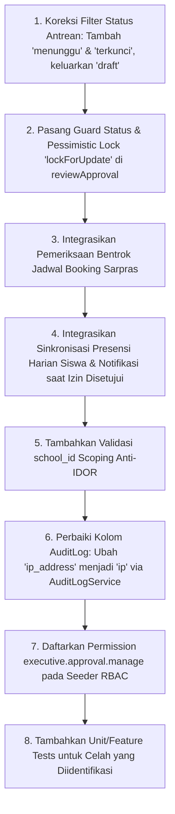

# LAPORAN AUDIT KEAMANAN DAN INTEGRITAS EXECUTIVE APPROVAL SISTLABUM
## Technical Audit Report: Security, Authorization, State Integrity, and Concurrency Controls

**ID Referensi Audit:** `AUDIT-APPROVAL-SEC-01`  
**Tanggal Pelaksanaan:** 15 Oktober 2026  
**Otoritas Auditor:** Senior Security Architect, Laravel API Auditor, & QA Lead  
**Mode Kerja:** **AUDIT-ONLY (Read-Only Code & State Inspection)**  
**Target Modul:** Modul RPT / ADM-DASH-02 (Antrean & Eksekusi Persetujuan Eksekutif)  
**Status Kesiapan Audit:** **`CONDITIONAL — REMEDIATION REQUIRED`**

---

## 1. Ringkasan Eksekutif

Audit teknis mendalam telah dilakukan terhadap implementasi fitur antrean dan eksekusi persetujuan eksekutif (**Executive Approvals / ADM-DASH-02**) yang dilaporkan pada `INTEGRATION-FIX-01`. Audit ini mengevaluasi dua endpoint utama:
- `GET /api/v1/approvals/pending`
- `POST /api/v1/approvals/{id}/review`

Audit memeriksa secara komprehensif aspek autentikasi, otorisasi RBAC, validasi objek, integritas *state machine*, konkurensi data, efek samping transaksi lintas modul, pelacakan audit, dan kualitas pengujian otomatis.

### Ringkasan Temuan Kritis:
1. **Otorisasi Dasar Berfungsi (PASS)**: Akses tanpa token ditolak (HTTP 401), dan peran tanpa wewenang eksekutif (siswa, orang tua, guru reguler) ditolak (HTTP 403).
2. **Celah Integritas Status Permohonan Historis (P0 / Critical)**: Endpoint `reviewApproval` tidak memeriksa status saat ini dari objek yang di-review. Siapa pun yang berwenang dapat secara tidak sengaja atau sengaja menimpa status permohonan yang sudah selesai (`selesai`), dibatalkan (`dibatalkan`), atau disahkan di masa lalu menjadi `ditolak` atau `disetujui`.
3. **Celah Konflik Sarpras / Double-Booking (P0 / Critical)**: Persetujuan booking sarpras melalui endpoint eksekutif tidak memeriksa bentrok jadwal fasilitas (tidak ada *overlap checking*), berbeda dengan `BookingService::decideBooking` yang menerapkan pemeriksaan konflik ketat dengan *pessimistic locking*.
4. **Mismatch Filter Status Antrean dengan Data Riil (P1 / High)**:
   - Permohonan izin cuti di database dan modul KBM (`AcademicAttendanceService`, `MeTeacherController`, `MeStaffController`) berstatus `'menunggu'`, namun `ApprovalService` menyaring `['diajukan', 'pending']`. Akibatnya, seluruh izin riil tidak pernah muncul di antrean eksekutif.
   - E-Rapor saat dikunci oleh kurikulum berstatus `'terkunci'`, namun `ApprovalService` menyaring `['dikunci', 'draft', 'submitted']`. Rapor yang siap disahkan tidak muncul, sementara draf mentah yang belum tuntas justru dapat disahkan.
5. **Hilangnya Efek Samping Bisnis Presensi Siswa & Notifikasi (P1 / High)**: Persetujuan izin siswa via `ApprovalService` hanya mengubah kolom status dan tidak membuat entri kehadiran siswa pada tabel `attendances` serta tidak menerbitkan notifikasi ke orang tua, sehingga siswa tetap terancam dicatat ALPHA oleh sistem gate presensi.
6. **Ketiadaan Pessimistic Locking (P1 / High)**: Query objek di dalam transaksi tidak menggunakan `lockForUpdate()`, membuka celah *race condition* jika dua pimpinan memproses permohonan pada milidetik yang sama.
7. **Pengabaian IP Address pada Audit Trail (P2 / Medium)**: Data audit log mengirim field `ip_address` yang tidak terdaftar di `$fillable` model `AuditLog`, menyebabkan kolom `ip` pada database bernilai `null`.

---

## 2. Ruang Lingkup dan Metode Audit

### 2.1 Ruang Lingkup Dokumen dan Kode
- Dokumen Sumber Kebenaran:
  - `13_MASTER_MODULES.md` (SSOT SISTLABUM, Modul RPT / ADM-DASH-02)
  - `04_PRD_BACKEND_API.md` (Spesifikasi KBM, Sarpras, dan Rapor)
  - `05_PRD_WEB_PPDB.md` (Spesifikasi Portal dan Web Publik)
  - `docs/audit/INTEGRATION_STATUS_BACKEND_ADMIN_PUBLIC.md`
  - `docs/audit/INTEGRATION_FIX_REPORT.md`
  - `docs/uat/UAT_PLAN_SISTLABUM.md`
  - `docs/uat/UAT_STAGING_READINESS_REPORT.md`
- Kode Sumber Utama:
  - `apps/api/app/Http/Requests/Rpt/ReviewApprovalRequest.php`
  - `apps/api/app/Services/Rpt/ApprovalService.php`
  - `apps/api/app/Http/Controllers/Api/V1/Rpt/ApprovalController.php`
  - `apps/api/routes/api.php`
  - `apps/api/tests/Feature/Rpt/ExecutiveApprovalTest.php`
  - `apps/web/src/test/executive-approvals.test.ts`
- Dependensi Modul Terkait:
  - Modul KBM/Presensi: `LeaveRequest.php`, `AcademicAttendanceService.php`, `Attendance.php`, `LeaveRequestController.php`
  - Modul Sarpras: `Booking.php`, `Facility.php`, `BookingService.php`, `BookingController.php`
  - Modul Penilaian: `ReportCard.php`, `ReportCardService.php`, `ReportCardController.php`
  - Keamanan & Audit: `AuditLog.php`, `AuditLogService.php`, `User.php`, `Role.php`, `Permission.php`, `DatabaseSeeder.php`

### 2.2 Metode Pengujian & Analisis
- **Static Code & Security Analysis**: Penelusuran aliran data, otorisasi, penanganan eksepsi, validasi input, dan transaksi database.
- **Contract & Schema Diffing**: Membandingkan status enum, foreign key, dan default value skema migrasi aktual terhadap query service.
- **Dynamic Test Execution**: Menjalankan pengujian fitur backend (`php artisan test`) dan unit frontend (`vitest run`).
- **Concurrency & State Machine Verification**: Menilai potensi race condition, multi-school tenant isolation, dan konsistensi audit log.

---

## 3. Matriks Pemeriksaan Autentikasi dan Otorisasi

| Aspek Pemeriksaan | Standar Keamanan SISTLABUM | Implementasi Aktual pada Kode | Status | Bukti / Catatan |
|---|---|---|:---:|---|
| **Penolakan Tanpa Token** | Unauthenticated request wajib menerima HTTP 401 | Rute didaftarkan di dalam grup `Route::middleware('auth:sanctum')` pada `api.php:1358-1363`. | ✅ **PASS** | Terbukti via `test_adm_dash_02_unauthenticated_cannot_access_approvals` (HTTP 401). |
| **Pembatasan Role Pengakses Antrean** | Hanya pimpinan sekolah dan staf manajerial yang berhak melihat antrean | `ApprovalService::authorizeViewApprovals`: Memeriksa role `super_admin`, `admin`, `principal`, `admin_tu`, `kurikulum`, `kesiswaan` atau permission `executive.approval.manage` / `dashboard.executive`. | ✅ **PASS** | Role siswa, orang tua, dan guru reguler ditolak dengan HTTP 403. |
| **Pembatasan Hak Eksekusi Keputusan** | Pengambilan keputusan dibatasi ketat untuk Pimpinan/Kepsek dan Admin | `ApprovalService::authorizeManageApprovals`: Memeriksa role `super_admin`, `admin`, `principal` atau permission `executive.approval.manage`. | ✅ **PASS** | Role non-pimpinan (misal: guru mata pelajaran) menerima HTTP 403 (`test_adm_dash_02_teacher_cannot_execute_approval_decision`). |
| **Perlindungan Role Baca-Saja** | Akun pengawas/komite dalam mode baca-saja tidak boleh mengeksekusi persetujuan | Pada Web Admin (`approvals/page.tsx:40`), tombol persetujuan dinonaktifkan jika `isReadOnlyRole()`. Di backend, role pengawas/komite tidak memiliki role `principal`/`admin`. | ✅ **PASS** | Frontend dan backend selaras menolak aksi tulis role baca-saja. |
| **Pemisahan Tenant Lintas Unit / Sekolah (Scoping)** | Pimpinan Sekolah A dilarang melihat atau menyetujui permohonan milik Sekolah B | Pada `getPendingApprovals`, query difilter dengan `where('school_id', $schoolId)`. Namun pada `reviewApproval`, pencarian ID dilakukan global tanpa filter `school_id`. | ⚠️ **PARTIAL / FAIL** | **Celah IDOR**: Tidak ada verifikasi `school_id` saat `reviewApproval` dieksekusi (Lihat temuan SEC-APPR-07). |
| **Pendaftaran Permission Seeder** | Seluruh kode permission harus terdaftar di `DatabaseSeeder.php` | Permission `executive.approval.manage` dan `dashboard.executive` belum terdaftar di tabel `permissions` via seeder. | ⚠️ **FAIL** | Hanya bergantung pada fallback `hasRole()`. Custom role tanpa role bawaan tidak dapat diberikan permission ini via UI (Lihat temuan SEC-APPR-09). |

---

## 4. Matriks Alur Status untuk Tiga Jenis Permohonan

| Domain & Model | Status Masuk Antrean (Sistem Riil) | Status Filter di `ApprovalService` (Kondisi Saat Ini) | Status Putusan Disetujui | Status Putusan Ditolak | Pencatat Keputusan | Efek Samping Otomatis yang Terpasang | Status Alur Bisnis |
|---|---|---|---|---|---|---|:---:|
| **Izin / Cuti (`LeaveRequest`)** | `menunggu` (`migration:90`, `AcademicAttendanceService:238`, `MeTeacherController:702`, `MeStaffController:195`) | `diajukan`, `pending` (`ApprovalService:65`) | `disetujui` | `ditolak` | `decided_by = user->id`, `decision_notes = notes` | ❌ **TIDAK ADA**. Tidak mengisi tabel presensi harian siswa (`attendances`) dan tidak mengirim notifikasi ke pemohon. | 🔴 **MISMATCH & DEFECTIVE** |
| **Sarpras (`Booking`)** | `diajukan` (`BookingService:214`) | `diajukan`, `pending` (`ApprovalService:100`) | `disetujui` | `ditolak` | `decided_by = user->id`, `decision_notes = notes` | ❌ **TIDAK ADA**. Tidak melakukan validasi bentrok jadwal ruangan (*overlap conflict*), membuka risiko bentrok fisik ruangan. | 🔴 **UNPROTECTED CONFLICT** |
| **E-Rapor (`ReportCard`)** | `terkunci` (`ReportCardService:420, 608`) | `dikunci`, `draft`, `submitted` (`ApprovalService:130`) | `disetujui` | `draft` | `approved_by = user->id` (jika setuju), `approved_by = null` (jika tolak) | Status kembali ke draft revisi (konsisten dengan PRD penolakan rapor). Namun antrean mengekspos rapor yang masih draf belum tuntas. | 🟡 **MISMATCH & PREMATURE EXPOSURE** |

---

## 5. Temuan Berdasarkan Prioritas dengan Bukti File dan Baris

### A. Temuan Tingkat P0 / Critical

#### [SEC-APPR-01] State Machine Bypass: Ketiadaan Validasi Status Awal Permohonan pada `reviewApproval`
- **Tingkat Risiko:** **P0 / Critical**
- **File & Baris:** [`apps/api/app/Services/Rpt/ApprovalService.php:181-280`](file:///Users/macbookprom12020/Desktop/Project/SISTLABUM/apps/api/app/Services/Rpt/ApprovalService.php#L181-L280)
- **Bukti Aktual:**
  ```php
  // Check LeaveRequest
  $leave = LeaveRequest::find($id);
  if ($leave) {
      $oldStatus = $leave->status;
      $newStatus = $isApprove ? 'disetujui' : 'ditolak';
      $leave->update(['status' => $newStatus, ...]);
  ```
- **Skenario Reproduksi:**
  1. Ambil ID permohonan izin cuti, booking sarpras, atau rapor yang telah berstatus `disetujui`, `selesai`, atau `dibatalkan` beberapa minggu lalu.
  2. Kirim request `POST /api/v1/approvals/{id}/review` dengan payload `{"action": "reject", "notes": "Ditolak surut"}`.
  3. Server merespon HTTP 200 `success: true`. Data historis berubah menjadi `ditolak`.
- **Dampak Keamanan & Bisnis:**
  - Melanggar integritas riwayat transaksi dan *state machine*.
  - Pemakai berwenang atau penyerang dapat membatalkan booking ruangan yang sedang berlangsung atau membatalkan pengesahan rapor yang sudah dibagikan ke siswa/wali murid.
- **Rekomendasi Perbaikan:**
  Tambahkan validasi status awal yang diizinkan untuk setiap model sebelum dieksekusi:
  - `LeaveRequest`: Wajib berstatus `menunggu` atau `diajukan`.
  - `Booking`: Wajib berstatus `diajukan` dan bukan `selesai`/`dibatalkan`.
  - `ReportCard`: Wajib berstatus `terkunci` (bukan `draft` atau `disetujui`).
  Jika tidak sesuai, lemparkan `HttpException(422, 'Permohonan ini telah diproses sebelumnya atau tidak dalam status menunggu persetujuan.')`.

---

#### [SEC-APPR-02] Double-Booking Vulnerability: Ketiadaan Pemeriksaan Bentrok Jadwal Fasilitas Sarpras
- **Tingkat Risiko:** **P0 / Critical**
- **File & Baris:** [`apps/api/app/Services/Rpt/ApprovalService.php:215-246`](file:///Users/macbookprom12020/Desktop/Project/SISTLABUM/apps/api/app/Services/Rpt/ApprovalService.php#L215-L246)
- **Bukti Aktual:**
  Bandingkan dengan implementasi pengamanan kanonis pada [`apps/api/app/Services/Sar/BookingService.php:301-313`](file:///Users/macbookprom12020/Desktop/Project/SISTLABUM/apps/api/app/Services/Sar/BookingService.php#L301-L313):
  ```php
  // SEC-CONC-01 di BookingService:
  if ($targetStatus === 'disetujui') {
      $conflict = Booking::where('facility_id', $booking->facility_id)
          ->where('id', '!=', $booking->id)
          ->where('status', 'disetujui')
          ->where('start_at', '<', $booking->end_at)
          ->where('end_at', '>', $booking->start_at)
          ->lockForUpdate()
          ->exists();
      if ($conflict) {
          throw new HttpException(422, 'Tidak dapat menyetujui peminjaman karena fasilitas telah dibooking jadwal lain pada jam tersebut.');
      }
  }
  ```
  Pada `ApprovalService.php`, blok pemeriksaan ini **sama sekali diabaikan**.
- **Skenario Reproduksi:**
  1. Buat dua pengajuan booking untuk fasilitas yang sama (misal: "Lab Komputer 1") pada rentang waktu yang saling bertumpukan.
  2. Buka antrean persetujuan eksekutif. Setujui pengajuan pertama.
  3. Setujui pengajuan kedua via `POST /api/v1/approvals/{id2}/review`.
  4. Server menyetujui kedua booking tanpa error, menyebabkan fasilitas ter-booking ganda untuk dua kegiatan berbeda.
- **Dampak Keamanan & Bisnis:** Bentrok fisik sarana-prasarana sekolah, kebingungan jadwal KBM dan CBT di laboratorium, serta pelanggaran integritas modul Sarpras.
- **Rekomendasi Perbaikan:** Delegasikan logika persetujuan peminjaman ke `BookingService::decideBooking` atau sertakan query pemeriksaan konflik jadwal ber-lock `lockForUpdate()`.

---

### B. Temuan Tingkat P1 / High

#### [SEC-APPR-03] Mismatch Status Antrean Izin Cuti (`menunggu` vs `diajukan`/`pending`)
- **Tingkat Risiko:** **P1 / High**
- **File & Baris:** [`apps/api/app/Services/Rpt/ApprovalService.php:65`](file:///Users/macbookprom12020/Desktop/Project/SISTLABUM/apps/api/app/Services/Rpt/ApprovalService.php#L65)
- **Bukti Aktual:**
  - `ApprovalService.php:65`: `->whereIn('status', ['diajukan', 'pending'])`
  - `apps/api/database/migrations/2026_10_07_000005_create_academic_schedule_attendance_lms_tables.php:90`:
    `$table->string('status', 30)->default('menunggu');`
  - `AcademicAttendanceService.php:238`: `'status' => 'menunggu'`
  - `MeTeacherController.php:702`: `'status' => 'menunggu'`
  - `MeStaffController.php:195`: `'status' => 'menunggu'`
- **Dampak Keamanan & Bisnis:** Seluruh permohonan izin/cuti yang diajukan secara riil oleh orang tua, guru, maupun staf tidak akan pernah muncul di dashboard persetujuan pimpinan.
- **Rekomendasi Perbaikan:** Ubah filter status pada query izin cuti menjadi:
  `->whereIn('status', ['menunggu', 'diajukan', 'pending'])`.

---

#### [SEC-APPR-04] Mismatch Status E-Rapor (`terkunci` vs `dikunci`) dan Paparan Draf Prematur
- **Tingkat Risiko:** **P1 / High**
- **File & Baris:** [`apps/api/app/Services/Rpt/ApprovalService.php:130`](file:///Users/macbookprom12020/Desktop/Project/SISTLABUM/apps/api/app/Services/Rpt/ApprovalService.php#L130)
- **Bukti Aktual:**
  - `ApprovalService.php:130`: `->whereIn('status', ['dikunci', 'draft', 'submitted'])`
  - `ReportCardService.php:420`: `$report->status = 'terkunci';`
  - `ReportCardService.php:608`: `$report->status = 'terkunci';`
- **Dampak Keamanan & Bisnis:**
  - E-rapor yang telah selesai diverifikasi dan dikunci oleh kurikulum (`terkunci`) tidak akan muncul di antrean pimpinan.
  - Sebaliknya, rapor yang masih berupa draf mentah (`draft`) yang belum selesai diisi nilainya oleh guru pengampu justru muncul di antrean dan dapat disahkan secara prematur oleh kepala sekolah, menghasilkan rapor resmi dengan nilai kosong/tidak lengkap.
- **Rekomendasi Perbaikan:**
  Ubah filter antrean rapor menjadi:
  `->whereIn('status', ['terkunci', 'dikunci'])->whereNull('approved_by')`
  Keluarkan status `'draft'` dari antrean persetujuan pimpinan.

---

#### [SEC-APPR-05] Bypassing Efek Samping Presensi Siswa dan Notifikasi Putusan Izin
- **Tingkat Risiko:** **P1 / High**
- **File & Baris:** [`apps/api/app/Services/Rpt/ApprovalService.php:181-212`](file:///Users/macbookprom12020/Desktop/Project/SISTLABUM/apps/api/app/Services/Rpt/ApprovalService.php#L181-L212)
- **Bukti Aktual:**
  Pada [`AcademicAttendanceService.php:340-391`](file:///Users/macbookprom12020/Desktop/Project/SISTLABUM/apps/api/app/Services/AcademicAttendanceService.php#L340-L391), saat izin disetujui:
  1. Record presensi harian (`Attendance`) dibuat per rentang tanggal izin dengan status `sakit`/`izin` dan sumber `gerbang`.
  2. Notifikasi in-app (`Notification::create`) dikirimkan kepada orang tua/pemohon.
  Pada `ApprovalService.php`, tidak ada sinkronisasi ke tabel `attendances` maupun pengiriman notifikasi.
- **Dampak Keamanan & Bisnis:** Meskipun izin telah disetujui kepala sekolah, siswa tetap tercatat tidak hadir tanpa alasan (Alpha) pada rekapitulasi presensi harian, dan orang tua tidak menerima pemberitahuan resmi bahwa izin telah disetujui.
- **Rekomendasi Perbaikan:** Delegasikan eksekusi keputusan izin ke `AcademicAttendanceService::decideLeaveRequest` atau panggil logika sinkronisasi presensi harian saat `LeaveRequest` disetujui.

---

#### [SEC-APPR-06] Ketiadaan Pessimistic Locking (`lockForUpdate`) pada Transaksi Peninjauan
- **Tingkat Risiko:** **P1 / High**
- **File & Baris:** [`apps/api/app/Services/Rpt/ApprovalService.php:181, 215, 249`](file:///Users/macbookprom12020/Desktop/Project/SISTLABUM/apps/api/app/Services/Rpt/ApprovalService.php#L181)
- **Bukti Aktual:**
  Pencarian objek menggunakan `LeaveRequest::find($id)`, `Booking::find($id)`, dan `ReportCard::find($id)` tanpa `lockForUpdate()`.
- **Dampak Keamanan & Bisnis:** Jika dua request persetujuan/penolakan untuk objek yang sama dikirim serentak (misal: double click pada jaringan lambat, atau dua admin memproses bersamaan), kedua transaksi akan membaca state yang sama, menghasilkan konflik status dan pencatatan audit log ganda yang saling bertentangan.
- **Rekomendasi Perbaikan:** Terapkan `lockForUpdate()` pada setiap query pencarian objek di dalam transaksi.

---

#### [SEC-APPR-07] Potensi Akses Lintas Sekolah (IDOR Lintas Tenant) pada `reviewApproval`
- **Tingkat Risiko:** **P1 / High**
- **File & Baris:** [`apps/api/app/Services/Rpt/ApprovalService.php:181, 215, 249`](file:///Users/macbookprom12020/Desktop/Project/SISTLABUM/apps/api/app/Services/Rpt/ApprovalService.php#L181)
- **Bukti Aktual:**
  Pada `getPendingApprovals`, terdapat pengecekan `$schoolId`:
  ```php
  if ($schoolId) {
      $bookingQuery->where('school_id', $schoolId);
  }
  ```
  Namun pada `reviewApproval`, sistem langsung memanggil `Booking::find($id)` tanpa memvalidasi apakah `booking->school_id === $user->school_id`.
- **Dampak Keamanan & Bisnis:** Pimpinan dari satu unit sekolah dapat menyetujui/menolak data peminjaman atau izin dari unit sekolah lain apabila mengetahui UUID-nya.
- **Rekomendasi Perbaikan:** Tambahkan validasi kepemilikan sekolah:
  ```php
  if (!empty($user->school_id) && !empty($booking->school_id) && $booking->school_id !== $user->school_id) {
      throw new HttpException(403, 'Akses ditolak: Objek berada di luar sekolah penugasan Anda.');
  }
  ```

---

### C. Temuan Tingkat P2 / Medium

#### [SEC-APPR-08] Nilai Alamat IP Hilang pada Tabel `audit_logs`
- **Tingkat Risiko:** **P2 / Medium**
- **File & Baris:** [`apps/api/app/Services/Rpt/ApprovalService.php:202, 237, 270`](file:///Users/macbookprom12020/Desktop/Project/SISTLABUM/apps/api/app/Services/Rpt/ApprovalService.php#L202)
- **Bukti Aktual:**
  `ApprovalService` meneruskan array `['ip_address' => $request->ip()]` ke `AuditLog::create()`. Sedangkan kolom database dan fillable model `AuditLog.php` adalah `'ip'`. Eloquent membuang key `ip_address` sehingga kolom `ip` pada database selalu tersimpan sebagai `NULL`.
- **Dampak Keamanan & Bisnis:** Berkurangnya integritas audit forensik keamanan bila terjadi investigasi penyalahgunaan wewenang persetujuan.
- **Rekomendasi Perbaikan:** Gunakan `'ip' => $request->ip()` atau panggil `app(AuditLogService::class)->record(...)` yang secara otomatis menangani pemetaan IP dan request ID.

---

#### [SEC-APPR-09] Permission `executive.approval.manage` dan `dashboard.executive` Belum Didaftarkan di Seeder
- **Tingkat Risiko:** **P2 / Medium**
- **File & Baris:** [`apps/api/database/seeders/DatabaseSeeder.php:46-115`](file:///Users/macbookprom12020/Desktop/Project/SISTLABUM/apps/api/database/seeders/DatabaseSeeder.php#L46-L115)
- **Bukti Aktual:**
  Pemeriksaan teks pada `DatabaseSeeder.php` menunjukkan bahwa kode permission `executive.approval.manage` dan `dashboard.executive` tidak terdaftar pada koleksi `$permissionsData`.
- **Dampak Keamanan & Bisnis:** Administrator sekolah tidak dapat memberikan hak akses persetujuan secara granular kepada wakil kepala sekolah atau peran khusus tanpa memberikan peran penuh `principal` atau `super_admin`.
- **Rekomendasi Perbaikan:** Daftarkan permission `executive.approval.manage` dan `dashboard.executive` pada migrasi/seeder RBAC resmi.

---

#### [SEC-APPR-10] URL Endpoint Tidak Menyertakan Kategori Objek (*Type Disambiguation Gap*)
- **Tingkat Risiko:** **P2 / Medium**
- **File & Baris:** [`apps/api/routes/api.php:1363`](file:///Users/macbookprom12020/Desktop/Project/SISTLABUM/apps/api/routes/api.php#L1363)
- **Bukti Aktual:** Endpoint dirancang sebagai `POST /approvals/{id}/review` tanpa indikasi kategori. Service harus melakukan *sequential brute-force lookup* ke 3 tabel (`LeaveRequest`, `Booking`, lalu `ReportCard`).
- **Dampak Keamanan & Bisnis:** Jika di masa depan sistem menambahkan entitas persetujuan lain (misal pengadaan barang, mutasi siswa), lookup sekuensial tanpa tipe objek rentan terhadap kebingungan entitas dan pemborosan query database.
- **Rekomendasi Perbaikan:** Dukung parameter opsional atau body `category: 'leave_request' | 'facility' | 'report_card'` atau gunakan format ID berpola (misal: `leave_{uuid}`).

---

### D. Temuan Tingkat P3 / Low

#### [SEC-APPR-11] Masking Cacat Integrasi Akibat Data Sintetis pada Automated Tests
- **Tingkat Risiko:** **P3 / Low**
- **File & Baris:** [`apps/api/tests/Feature/Rpt/ExecutiveApprovalTest.php:111, 331`](file:///Users/macbookprom12020/Desktop/Project/SISTLABUM/apps/api/tests/Feature/Rpt/ExecutiveApprovalTest.php#L111)
- **Bukti Aktual:**
  Pada tes, data uji di-generate secara artifisial dengan status `'diajukan'` dan `'dikunci'`:
  ```php
  $leave = LeaveRequest::create([..., 'status' => 'diajukan']);
  $reportCard = ReportCard::create([..., 'status' => 'dikunci', ...]);
  ```
  Tes lulus 100%, tetapi menutupi fakta bahwa `POST /api/v1/leave-requests` dan `lockReportCard` menghasilkan status `'menunggu'` dan `'terkunci'`.
- **Dampak Keamanan & Bisnis:** *False sense of security* pada laporan QA sebelum integrasi end-to-end dilakukan.
- **Rekomendasi Perbaikan:** Buat pengujian integrasi yang memanggil controller pembuat data asli (`POST /leave-requests`, `POST /report-cards/bulk-lock`).

---

## 6. Evaluasi Test yang Ada dan Gap Pengujian

### 6.1 Hasil Pengujian yang Dijalankan Saat Audit
1. **Backend PHPUnit**: `tests/Feature/Rpt/ExecutiveApprovalTest.php`
   - Hasil: **10 tests passed (55 assertions, duration: 575ms)** ✅
2. **Frontend Vitest**: `src/test/executive-approvals.test.ts`
   - Hasil: **4 tests passed (duration: 626ms)** ✅

### 6.2 Matriks Cakupan dan Gap Pengujian

| Skenario Pengujian | Status di Test Saat Ini | Penilaian Kualitas Test |
|---|:---:|---|
| Unauthenticated Access (HTTP 401) | ✅ Tercakup | Baik. Memastikan middleware `auth:sanctum` aktif. |
| Unauthorized Role Access (HTTP 403) | ✅ Tercakup | Baik. Menguji penolakan role siswa dan guru mata pelajaran. |
| Pengambilan Daftar Antrean (HTTP 200) | ⚠️ Parsial | Menggunakan status sintetis (`diajukan`), belum menguji status riil (`menunggu`). |
| Persetujuan Izin Siswa (HTTP 200) | ⚠️ Parsial | Memeriksa perubahan status record, tetapi **belum menguji pembuatan entri `attendances` harian**. |
| Penolakan Izin Cuti dengan Alasan (HTTP 200) | ✅ Tercakup | Baik. Memverifikasi catatan tersimpan di database. |
| Penolakan Tanpa Alasan (HTTP 422) | ✅ Tercakup | Baik. Memverifikasi validator `notes` / `rejectionReason`. |
| ID Tidak Ditemukan (HTTP 404) | ✅ Tercakup | Baik. Memeriksa respon jika UUID tidak ada di 3 tabel. |
| Review Objek yang Sudah Selesai / Ditolak Sebelumnya | ❌ **TIDAK ADA** | Belum ada tes untuk mencegah persetujuan/penolakan berulang (*State machine violation*). |
| Bentrok Jadwal Peminjaman Fasilitas Sarpras | ❌ **TIDAK ADA** | Belum ada tes untuk memverifikasi pencegahan *double-booking*. |
| Permintaan Bersamaan / Concurrency Lock | ❌ **TIDAK ADA** | Belum ada simulasi locking transaksional massal. |
| Isolasi Multi-Tenant / Lintas Sekolah | ❌ **TIDAK ADA** | Belum ada tes anti-IDOR antar `school_id`. |
| Verifikasi Kelengkapan Kolom Audit Log (IP & Role) | ⚠️ Parsial | Tes memeriksa `assertDatabaseHas('audit_logs')` pada action, tetapi tidak menguji apakah kolom `ip` terisi. |

---

## 7. Status Blocker UAT Berdasarkan Bukti Terbaru

Berdasarkan perbandingan antara `docs/uat/UAT_STAGING_READINESS_REPORT.md` dan kondisi repositori terkini:

| ID Blocker UAT | Item Pemeriksaan Staging | Kondisi Terkini di Repositori | Status Kesiapan Staging |
|---|---|---|:---:|
| **CHK-ENV-01** | Lingkungan Host Staging Linux | Mesin masih workstation lokal macOS pengembang (`Darwin arm64`). Belum ada remote VPS staging terdedikasi. | 🔴 **UNRESOLVED / BLOCKED** |
| **CHK-ENV-02** | DNS & Domain Staging | Domain `staging.smp-labum.sch.id` belum didelegasikan di DNS publik. | 🔴 **UNRESOLVED / BLOCKED** |
| **CHK-BE-01** | Konfigurasi Mode Debug | File `.env` lokal backend masih `APP_ENV=local` dan `APP_DEBUG=true`. | 🔴 **UNRESOLVED / BLOCKED** |
| **CHK-BE-02** | Stateful Domain Sanctum | `config/sanctum.php` belum menyertakan domain staging untuk cookie auth. | 🔴 **UNRESOLVED / BLOCKED** |
| **CHK-BE-03** | CORS Allowed Origins | `config/cors.php` belum membuka origin staging frontend. | 🔴 **UNRESOLVED / BLOCKED** |
| **CHK-OPS-01** | Engine Database Staging | Backend masih memakai SQLite lokal (`database.sqlite`), belum PostgreSQL/MySQL staging. | 🔴 **UNRESOLVED / BLOCKED** |
| **CHK-OPS-02** | Queue Worker Daemon | Tidak ada proses `php artisan queue:work` yang berjalan sebagai background service. | 🔴 **UNRESOLVED / BLOCKED** |
| **CHK-OPS-03** | Scheduler Cron Job | Tidak ada crontab sistem yang memicu `artisan schedule:run` per menit. | 🔴 **UNRESOLVED / BLOCKED** |
| **CHK-DAT-01** | Seeder Akun UAT Persona | Seeder sintetis untuk 12 akun penguji (`UatStagingSeeder`) belum dibuat di database. | 🔴 **UNRESOLVED / BLOCKED** |
| **CHK-EXT-01** | Gateway WhatsApp Riil | Provider masih menggunakan adapter mock/log internal (`wa_msg_...`). | 🟡 **STAGING SIMULATION ONLY** |

> **Penegasan Kesiapan UAT**: Keberhasilan 100% kelulusan automated tests lokal tidak membatalkan blocker staging di atas. Pengujian UAT bersama pemangku kepentingan sekolah **tetap tertahan** hingga infrastruktur staging di-provisioning.

---

## 8. Daftar Keputusan Bisnis yang Belum Terjawab

Sebelum perbaikan kode dilakukan, berikut keputusan dari pemilik sistem / pimpinan sekolah yang harus dikonfirmasi:

1. **Kewenangan Final Persetujuan Izin Siswa**:
   - *Pertanyaan*: Apakah Kepala Sekolah berhak langsung menyetujui izin siswa yang melewati alur persetujuan Wali Kelas, ataukah antrean pimpinan ini hanya dikhususkan untuk **izin/cuti pegawai & guru**?
   - *Konteks*: Di sekolah, izin siswa sehari-hari umumnya disetujui langsung oleh Wali Kelas. Bila Kepala Sekolah menyetujui izin siswa secara langsung via dashboard eksekutif, sistem harus otomatis menotifikasi Wali Kelas siswa tersebut.
2. **Aturan Penolakan E-Rapor**:
   - *Pertanyaan*: Jika Kepala Sekolah menolak pengesahan e-rapor, apakah status dokumen harus kembali ke `draft` (guru mata pelajaran dapat mengubah nilai kembali) atau ke status `ditolak` (hanya catatan wali kelas yang direvisi)?
   - *Konteks*: Implementasi `ReportCardService:464` mengembalikan status ke `draft` bila ditolak, namun belum ada pembatasan siapa yang berhak mengubah nilai setelah rapor pernah dikunci.
3. **Mekanisme Toleransi Bentrok Fasilitas**:
   - *Pertanyaan*: Apakah Kepala Sekolah berhak melakukan *override* persetujuan peminjaman ruangan yang bentrok (misal membatalkan peminjaman lama untuk keperluan darurat dinas sekolah), atau sistem wajib menolak mutlak seluruh permohonan yang bentrok jadwal?

---

## 9. Rekomendasi Urutan Remediasi

Berikut langkah-langkah remediasi teknis yang direkomendasikan secara berurutan:



---

## 10. Kesimpulan Akhir Audit

### Status: **`CONDITIONAL — REMEDIATION REQUIRED`**

**Justifikasi Penilaian:**
- Fondasi rute dan otentikasi Sanctum telah berdiri dengan baik dan terbukti menolak akses unauthenticated (401) serta unauthorized roles (403).
- Namun, implementasi saat ini memiliki **2 temuan P0 (Critical)** terkait ketiadaan pengamanan *state machine* pada permohonan historis dan ketiadaan deteksi bentrok jadwal sarpras, serta **5 temuan P1 (High)** terkait ketidakcocokan status database riil (`menunggu`/`terkunci`), hilangnya sinkronisasi presensi harian siswa, dan ketiadaan *pessimistic lock*.
- Fitur Executive Approval **belum aman untuk diuji dalam skenario produksi/staging penuh** sebelum 7 langkah remediasi prioritas di atas diimplementasikan.
