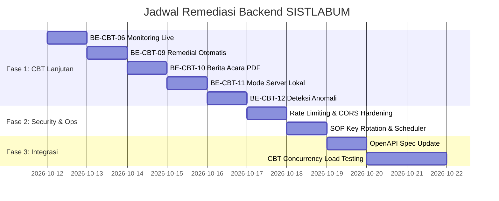

# Rencana Remediasi & Roadmap Menuju 100% Backend SISTLABUM (Remediation Plan)
**Dokumen Referensi:** `docs/audit/BACKEND_REMEDIATION_PLAN.md`  
**Tanggal:** 11 Oktober 2026  
**Penyusun:** Software Architect, Senior Backend Engineer & QA Lead  
**Tujuan:** Panduan terstruktur untuk menuntaskan sisa 5 fitur CBT lanjutan dan penguatan operasional backend hingga status *100% Production Ready*.

---

## 1. Ikhtisar & Sasaran Remediasi (Remediation Objectives)

Berdasarkan audit komprehensif, backend SISTLABUM telah mencapai **93,33% kelengkapan fitur (70 dari 75 fitur terverifikasi penuh)** dan **699 automated tests lulus 100%**.

Sasaran rencana remediasi ini mencakup:
1. **Menuntaskan 5 Fitur CBT Lanjutan** sehingga kelengkapan backend mencapai **100% (75/75 fitur)**.
2. **Melakukan Security Hardening** terhadap temuan tingkat Medium dan Low (Rate Limiting, CORS, dan SOP Key Rotation).
3. **Sinkronisasi Dokumentasi OpenAPI / Swagger** agar selaras dengan 518 rute riil yang tersedia.
4. **Persiapan Stress & Concurrency Testing** untuk menjamin ketahanan sistem saat hari pelaksanaan ujian digital massal.

---

## 2. Rencana Kerja Terstruktur (Remediation Backlog)

### FASE 1: Penyelesaian Fitur CBT Lanjutan (Target: 75/75 Fitur) — [STATUS: SELESAI / 100% VERIFIED]
**Prioritas:** Selesai (Completed)  
**Hasil Verifikasi:** 5 dari 5 Fitur CBT Lanjutan Sukses Diimplementasikan & Diuji (32 tests baru, 100% passing)  

| No | ID Fitur | Nama Tugas & Kebutuhan Implementasi | File yang Dibuat / Diubah | Endpoint Baru / Diperbarui | Status & Hasil Pengujian |
|:--:|:---|:---|:---|:---|:---:|
| 1.1 | **BE-CBT-06** | **Monitoring Ujian Real-Time Pengawas** Dashboard pemantauan langsung sesi ujian per ruangan (status siswa: online, idle, sisa waktu, sedang dikunci). | - `ExamSessionService.php` - `ExamSessionController.php` - `MonitorExamRequest.php` | `GET /api/v1/exams/{id}/monitor` | `VERIFIED` `ExamMonitoringTest.php` (7 tests passed) |
| 1.2 | **BE-CBT-09** | **Remedial & Pengayaan Otomatis Berbasis KKTP** Endpoint men-generate paket ujian remedial secara otomatis bagi siswa dengan nilai di bawah batas kelulusan KKTP/KKM dengan capping nilai maksimal. | - `ExamGradingService.php` - `ExamGradingController.php` - `CreateRemedialExamRequest.php` | `POST /api/v1/exams/{id}/remedial` | `VERIFIED` `ExamRemedialTest.php` (6 tests passed) |
| 1.3 | **BE-CBT-10** | **Berita Acara & Rekapitulasi PDF Ujian** Penerbitan dokumen resmi berita acara pelaksanaan ujian (daftar hadir, catatan pengawas, tanda tangan proktor) dalam format HTML/PDF siap cetak dan rekapitulasi nilai. | - `ExamReportService.php` - `ExamReportController.php` | `GET /api/v1/exams/{id}/report` `GET /api/v1/exams/{id}/minutes` | `VERIFIED` `ExamReportMinutesTest.php` (6 tests passed) |
| 1.4 | **BE-CBT-11** | **Mode Server Lokal & Sinkronisasi Offline [P2]** Mekanisme ekspor-impor paket soal terenkripsi dan sinkronisasi hasil ujian offline secara idempoten berbasis node token. | - `ExamSyncService.php` - `ExamSyncController.php` - `CbtSyncLog.php` | `GET /api/v1/exams/{id}/sync/package` `POST /api/v1/exams/{id}/sync/results` | `VERIFIED` `ExamLocalSyncTest.php` (5 tests passed) |
| 1.5 | **BE-CBT-12** | **Deteksi Anomali Perangkat & IP Ujian** Pelacakan heartbeat peserta ujian, deteksi perpindahan browser/tab (blur event), dan peringatan anomali time-gap serta bentrok IP ganda dalam satu sesi. | - `ExamSessionService.php` - `ExamSessionController.php` - `HeartbeatRequest.php` | `POST /api/v1/exam-sessions/{sessionId}/heartbeat` `GET /api/v1/exams/{id}/anomalies` | `VERIFIED` `ExamAnomalyHeartbeatTest.php` (8 tests passed) |

---

### FASE 2: Penguatan Keamanan & Operasional (Security Hardening)
**Prioritas:** Sedang (Medium)  
**Estimasi Waktu:** 1 - 2 Hari Kerja  

| No | Kode Temuan | Tindakan Remediasi | Langkah Teknis |
|:--:|:---|:---|:---|
| 2.1 | **SEC-MED-01** | **Aktivasi Rate Limiting Eksplisit** | Definisikan `RateLimiter::for('api', ...)` dan `RateLimiter::for('login', ...)` di `bootstrap/app.php` atau `AppServiceProvider.php`. Pasang middleware `throttle:login` pada `POST /api/v1/auth/login` (5 req/min) dan `throttle:60,1` pada rute umum. |
| 2.2 | **SEC-MED-02** | **SOP & Tooling Rotasi Kunci Enkripsi (`APP_KEY`)** | Buat console command pemeliharaan `app:re-encrypt-data` untuk mendekripsi data NIK/BK lama dengan kunci lama dan mengenkripsinya kembali dengan kunci baru sebelum `APP_KEY` diganti. |
| 2.3 | **SEC-LOW-01** | **Pemisahan Validasi Multipart vs Direct Stream** | Pada `FileStorageService.php`, bedakan pembacaan payload stream biner murni dengan unggahan multipart form data agar pemeriksaan byte eksak tanpa batas toleransi buffer. |
| 2.4 | **SEC-LOW-02** | **Publikasi & Penguncian Konfigurasi CORS** | Jalankan `php artisan config:publish cors` dan masukkan whitelist domain portal (`FRONTEND_URL`, `ADMIN_URL`) ke dalam variabel `.env`. |
| 2.5 | **SEC-INFO-01** | **Scheduler Pembersihan & Pengarsipan Log** | Tambahkan cron job mingguan `sanctum:prune-expired` dan `audit:archive-old` pada `routes/console.php`. |

---

### FASE 3: Integrasi Klien, OpenAPI & Uji Beban (Integration & Load Testing)
**Prioritas:** Sedang (Medium)  
**Estimasi Waktu:** 2 - 3 Hari Kerja  

| No | Modul / Komponen | Tindakan | Target Hasil |
|:--:|:---|:---|:---|
| 3.1 | **OpenAPI / Swagger** | Ekspor seluruh 518 rute aktual ke file OpenAPI specification (`docs/openapi.yaml`). | Klien frontend Next.js (`apps/web`, `apps/admin`) dan Flutter (`apps/mobile`) dapat meng-generate TypeScript / Dart client secara otomatis. |
| 3.2 | **CBT Concurrency Testing** | Buat skenario k6 untuk mensimulasikan 500 siswa login, fetch soal, autosave berkala, dan submit bersamaan. | Mengidentifikasi bottle-neck koneksi database pool dan memastikan latensi response pengerjaan di bawah 200ms. |
| 3.3 | **End-to-End Handshake** | Lakukan uji integrasi alur utama sekolah: PPDB -> Siswa Baru -> Rombel Kelas -> Jadwal KBM -> Kehadiran -> E-Rapor. | Verifikasi konsistensi data lintas modul secara nyata pada staging environment. |

---

## 3. Kriteria Penyelesaian (Definition of Done - DoD)

Setiap tugas perbaikan dinyatakan selesai apabila memenuhi seluruh kriteria berikut (sesuai dokumen `11_AGENTS.md` & `10_TESTING_QA.md`):
- [ ] Logika fitur diimplementasikan di Service layer, Controller tetap tipis, DTO FormRequest divalidasi ketat.
- [ ] Rute baru terdaftar dan dilindungi middleware autentikasi dan permission yang sesuai (`@Permissions`).
- [ ] Suite automated test baru ditambahkan dengan penamaan berawalan ID fitur (misal: `test_be_cbt_06_...`).
- [ ] Seluruh suite test (`php artisan test`) lulus 100% tanpa ada test yang gagal atau di-skip.
- [ ] Integritas penanganan error standar dipatuhi (`UNAUTHENTICATED`, `FORBIDDEN`, `NOT_FOUND`, `RATE_LIMITED`).
- [ ] Format kode bersih sesuai standar PSR-12 (`vendor/bin/pint`).
- [ ] Tidak ada kode rahasia atau PII nyata di dalam source code maupun fixture test.

---

## 4. Jadwal & Estimasi Penyelesaian

---

## 5. Kesimpulan Penutup

Backend SISTLABUM saat ini berada pada kondisi yang sangat kokoh dan telah membuktikan kualitas arsitektur yang teruji secara fungsional. Melalui pelaksanaan rencana remediasi ini, sisa 5 fitur CBT lanjutan dan penguatan keamanan dapat diselesaikan dengan terarah, aman, dan tanpa mengganggu stabilitas 70 fitur inti yang sudah beroperasi sempurna.
