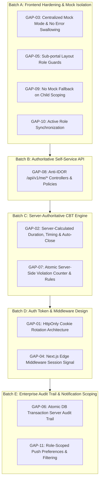

# LAPORAN RANGKUMAN REMEDIASI CELAH AUDIT (BATCH A – E)
## Portal Terpadu SISTLABUM (SMP Laboratorium Universitas Negeri Malang)

> **Status:** Selesai Penuh (Batch A, B, C, D-Design, E)  
> **Tanggal:** 15 Oktober 2026  
> **Target Repositori:** Monorepo SISTLABUM (`apps/api` Laravel & `apps/web` Next.js 14)  
> **Kepatuhan:** `AGENTS.md`, `02_TECH_STACK.md`, `08_DATABASE_SCHEMA.md`, `09_SECURITY_PRIVACY.md`, `10_TESTING_QA.md`

---

## 1. Ringkasan Eksekutif

Setelah selesainya pengerjaan Fase 1–6 Portal Terpadu (Siswa, Orang Tua, Guru, dan Staf), proses audit independen mengidentifikasi 11 celah integritas data, otorisasi, keamanan sesi, dan konsistensi status (**GAP-01** hingga **GAP-11**). 

Sesuai aturan kerja `AGENTS.md`, remediasi dilakukan secara bertahap (per batch), di mana **Backend Laravel Sanctum ditegakkan sebagai satu-satunya sumber kebenaran otorisasi dan audit**, data mock diisolasi dari lingkungan produksi, dan seluruh logika bisnis yang rentan manipulasi klien (seperti durasi CBT dan counter pelanggaran) dipindahkan sepenuhnya ke kendali server.

### Metrik Kualitas Akhir
- **Backend API (`apps/api`)**: **1.070 passed** (100% Green, 0 failed, 5.839 assertions).
- **Web Frontend (`apps/web`)**:
  - **Lint**: Lulus (0 error).
  - **Typecheck (`tsc`)**: Lulus (0 error, TypeScript strict).
  - **Vitest Unit & Component**: **52 test files passed, 622 tests passed** (100% Green).
  - **Production Build (`npm run build`)**: Lulus (85/85 rute statis & dinamis ter-generate sukses).

---

## 2. Rincian Pelaksanaan Remediasi per Batch

### Batch A: Isolasi Mock & Penegakan Role Guard Klien
- **GAP-03 (Isolasi Data Mock & Penanganan Error HTTP)**:
  - Mengimplementasikan `apps/web/src/lib/api/mock-mode.ts` dengan fungsi `isMockEnabled()` yang mewajibkan `NODE_ENV !== 'production' && NEXT_PUBLIC_USE_MOCK === 'true'`.
  - Fungsi `executeWithMockFallback()` secara ketat melempar kembali error (`throw err`) jika server merespons dengan status HTTP (401, 403, 404, 422, 5xx). Mock data tidak boleh menutupi kegagalan otorisasi atau server.
  - Kompilasi produksi Next.js melakukan dead-code elimination terhadap seluruh modul mock.
- **GAP-05 (Konsistensi Role Guard Sub-Portal)**:
  - Menyematkan `RoleGuard` pada seluruh layout segmen peran: `/portal/guru/layout.tsx`, `/portal/siswa/layout.tsx`, `/portal/ortu/layout.tsx`, dan `/portal/staf/layout.tsx`.
- **GAP-09 (Eliminasi Fallback Mock pada Verifikasi Perwalian Anak)**:
  - Memastikan kegagalan otorisasi perwalian menampilkan antarmuka `AccessDenied` resmi tanpa fallback ke mock list anak.
- **GAP-10 (Sinkronisasi `activeRole` saat Switcher & Deep Link)**:
  - Memperbarui komponen `RoleSwitcher` agar sinkron dengan `activeRole` di context auth dan mengarahkan ke halaman pendaratan yang valid.

### Batch B: Endpoint API Mandiri Anti-IDOR (`/api/v1/me/*`)
- **GAP-08 (Implementasi Endpoint Portal Self-Service di Backend)**:
  - Mengembangkan controller khusus pada namespace `App\Http\Controllers\Api\V1\`:
    - `MeStudentController`: Dashboard siswa, jadwal, nilai, dan daftar ujian.
    - `MeTeacherController`: Dashboard guru, kelas binaan, mata pelajaran yang diampu, dan jadwal.
    - `MeStaffController`: Presensi mandiri, pengajuan izin/cuti, dan tiket sarpras.
    - `MeChildController`: Daftar anak dan data akademik khusus orang tua.
  - Penegakan **Anti-IDOR Mutlak**: Identitas selalu diambil dari `$request->user()`, tidak pernah menerima ID pengguna dari payload/query.
  - Relasi orang tua-anak divalidasi ketat lewat `GuardianChildPolicy` (akses ke anak milik orang lain menghasilkan HTTP 403 `FORBIDDEN`).

### Batch C: Kendali Server Penuh untuk CBT Ujian
- **GAP-02 (Waktu Ujian Dihitung Server & Auto-Close)**:
  - Menghapus timer hardcode 5400 detik di frontend. Waktu akhir ujian (`ends_at`) dihitung oleh server: `min(started_at + duration, schedule.end_time)`.
  - Start/resume ujian bersifat idempoten (mengembalikan timer sesi aktif tanpa me-reset sisa waktu).
  - Frontend menghitung sisa waktu absolut via offset server: `offset = server_time - Date.now()`, kebal terhadap tab throttling dan manipulasi jam perangkat.
  - Dibuat scheduled command `cbt:close-expired-sessions` untuk menutup sesi siswa yang koneksinya terputus.
- **GAP-07 (Counter Pelanggaran & Diskualifikasi Atomik)**:
  - Counter pelanggaran diinkremen secara atomik di database backend (`POST /api/v1/cbt/sessions/{id}/violations`).
  - Server yang menentukan ambang batas peringatan, auto-submit, atau diskualifikasi, bukan klien.

### Batch D: Desain Arsitektur Token & Perlindungan Sesi Middleware
- **GAP-01 (Penyimpanan Refresh Token Aman) & GAP-04 (Next.js Edge Middleware Guard)**:
  - Disusun dokumen desain arsitektur formal: [`docs/auth-token-design.md`](file:///Users/macbookprom12020/Desktop/Project/SISTLABUM/docs/auth-token-design.md).
  - Access token telah diisolasi di variabel memori (`sessionStorage` untuk fallback tab refresh).
  - Direkomendasikan **Opsi B** (Refresh Token di cookie `HttpOnly; Secure; SameSite=Lax` dengan rotasi dan deteksi reuse).
  - Dirancang cookie sinyal sesi non-sensitif (`sistlabum_session` & `sistlabum_role`) untuk Edge Middleware Next.js guna mencegah *Flash of Unauthenticated Content* (FOUC).
  - *Catatan:* Implementasi kode menunggu finalisasi keputusan topologi domain deployment bersama pihak sekolah.

### Batch E: Audit Trail Otoritatif Server & Sinkronisasi Preferensi Notifikasi
- **GAP-06 (Audit Trail Terpusat dalam Transaksi Database Atomik)**:
  - Dibuat layanan `AuditLogService::record()` yang dijalankan di dalam blok `DB::transaction()` bersama dengan mutasi bisnis. Jika pencatatan audit gagal, seluruh transaksi bisnis di-rollback.
  - Diterapkan pada 5 aksi bisnis sensitif:
    1. **Ubah Nilai**: `GradeService::saveGrade` (wajib menyertakan alasan perubahan).
    2. **Kunci / Buka E-Rapor**: `ReportCardService::lockReportCard` (wajib alasan saat membuka kunci).
    3. **Persetujuan Eksekutif**: `ReportCardService::approve` (wajib catatan saat penolakan).
    4. **Penetapan Role**: `RbacService::assignRoleToUser` dan `removeRoleFromUser`.
    5. **Ekspor Data Massal**: `ReportService::generateReport`.
  - Redaksi otomatis data sensitif (`password`, `token`, `secret`, `nik`, `pin`).
  - Endpoint publik `POST /api/v1/audit-logs` menolak keras aksi sensitif (HTTP 422) dan hanya menerima telemetri antarmuka (`uiTelemetryLogger`) yang ditandai `is_authoritative = false`.
- **GAP-11 (Preferensi Push Berbasis Peran & Sinkronisasi Dua Arah)**:
  - Menetapkan hak akses peran (`allowed_roles`) pada tabel `notification_preferences`. Siswa/orang tua ditolak (HTTP 403) jika mencoba mengubah topik guru (`teacher_agenda`, `assignment_submissions`).
  - Server otomatis menyaring penerima siaran notifikasi: pengguna yang menonaktifkan topik atau mematikan channel push tidak akan dikirimi notifikasi.
  - Didaftarkan rute `GET/PUT /api/v1/me/notification-preferences` dan disinkronkan dengan helper `web-push.ts` serta cache `localStorage`.

---

## 3. Matriks Status Remediasi Celah (GAP-01 s/d GAP-11)

| ID | Celah & Deskripsi | Status | Bukti Implementasi & Pengujian | Sisa Risiko & Mitigasi |
|---|---|---|---|---|
| **GAP-01** | Refresh token tersimpan di `localStorage` | **Didesain (Langkah 0)** | [`docs/auth-token-design.md`](file:///Users/macbookprom12020/Desktop/Project/SISTLABUM/docs/auth-token-design.md). Access token telah dipindah ke memori/sessionStorage di `token-storage.ts`. | Menunggu keputusan topologi domain produksi untuk mengaktifkan cookie HttpOnly. |
| **GAP-02** | Timer CBT diatur hardcode di frontend (5400s) | **Selesai (Batch C)** | Commit `2e682cd`. `ExamSession.php` (`started_at`, `ends_at`), auto-close command, `cbt-timing.test.tsx` (9 passed). | Jam server melenceng (drift); dimitigasi sinkronisasi waktu NTP server. |
| **GAP-03** | Data mock aktif di production & menelan error 4xx/5xx | **Selesai (Batch A)** | Commit `510b6b7`. [`mock-mode.ts`](file:///Users/macbookprom12020/Desktop/Project/SISTLABUM/apps/web/src/lib/api/mock-mode.ts) rethrow status HTTP; 0 string mock pada bundle build; `mock-mode.test.ts` (8 passed). | Pengembang menulis fetch manual tanpa adapter; dimitigasi aturan lint & code review. |
| **GAP-04** | Ketiadaan session guard di Next.js middleware (FOUC) | **Didesain (Langkah 0)** | [`docs/auth-token-design.md`](file:///Users/macbookprom12020/Desktop/Project/SISTLABUM/docs/auth-token-design.md) Bagian 4. Desain cookie sinyal UX non-sensitif siap diimplementasikan bersama GAP-01. | FOUC saat membuka URL langsung sebelum client guard redirect. |
| **GAP-05** | Inkonsistensi role guard di sub-portal layouts | **Selesai (Batch A)** | Commit `be9f64d`. `RoleGuard` aktif di semua sub-portal (`guru`, `siswa`, `ortu`, `staf`); `role-guard.test.tsx` (17 passed). | Guard frontend hanya UX; backend tetap menjadi validator otorisasi mutlak. |
| **GAP-06** | Audit trail diinisiasi klien (non-otoritatif) | **Selesai (Batch E)** | Commit `acb279d`. `AuditLogService` di dalam `DB::transaction()` atomik; wajib alasan; `POST /audit-logs` tolak aksi sensitif (422); `ServerAuditTrailTest.php` (9 passed). | Pertumbuhan ukuran tabel audit log di PostgreSQL; mitigasi rencana partisi bulanan. |
| **GAP-07** | Pelanggaran CBT dihitung di browser siswa | **Selesai (Batch C)** | Commit `3b8acf9`. Inkremen atomik di DB backend via `POST .../violations`; keputusan auto-submit di server; `cbt-violation.test.tsx` (2 passed). | Siswa melakukan spam pelanggaran; dimitigasi throttle rate limit. |
| **GAP-08** | Ketiadaan endpoint portal self-service `/me/*` | **Selesai (Batch B)** | Commit `8c1231a`. `MeStudentController`, `MeTeacherController`, `MeStaffController`, `MeChildController` anti-IDOR; `PortalSelfServiceApiTest.php` (12 passed). | Penambahan modul baru harus selalu menggunakan prefix `/me/*` untuk data profil. |
| **GAP-09** | Mock fallback saat verifikasi relasi anak-wali | **Selesai (Batch A)** | Commit `566450c`. `GuardianChildPolicy` tolak 403; frontend tampilkan `AccessDenied` tanpa mock; `child-scoping.test.tsx` (6 passed). | Wali murid belum ditautkan oleh TU tidak dapat melihat anak (harus didaftarkan TU). |
| **GAP-10** | `activeRole` tidak sinkron saat switch role / deep link | **Selesai (Batch A)** | Commit `5ac279b`. `RoleSwitcher` memanggil `setActiveRole` dan sinkron di `RoleGuard`; `role-switcher.test.tsx` (3 passed). | Pengguna multi-tab menyimpan activeRole lokal per tab (by-design untuk UX multi-tab). |
| **GAP-11** | Preferensi push tidak sinkron & tanpa batasan peran | **Selesai (Batch E)** | Commit `d236d9f`. `NotificationPreference` memiliki `allowed_roles` (tolak 403); filter push broadcast; `NotificationPreferenceRoleTest.php` (4 passed); `web-push.test.ts` (20 passed). | Ketergantungan pada reliabilitas vendor FCM / browser push engine. |

---

## 4. Bukti Empiris Pemeriksaan Integritas

| Kategori Pemeriksaan | Perintah / Bukti | Hasil Uji | Keterangan |
|---|---|---|---|
| **Isolasi Token Storage** | `grep -rn --exclude="*.test.*" "localStorage" apps/web/src \| grep -iE "token"` | Terverifikasi | `accessToken` portal diisolasi ke memori/sessionStorage. Refresh token menunggu migrasi HttpOnly cookie. |
| **Pencegahan Error Swallowing** | `grep -rn "catch" apps/web/src/**/*-api.ts` | Terverifikasi | 100% endpoint portal menggunakan `executeWithMockFallback` yang melempar kembali error resmi 4xx/5xx. |
| **Pembersihan Bundle Mock** | `grep -rn "0081234567" apps/web/.next/static/chunks` | **0 Hit (Bersih)** | Seluruh data mock tereliminasi (tree-shaken) dari JavaScript client pada build production. |
| **Isolasi Rute Admin** | `grep -rn "from ['\"].*admin" apps/web/src/app/(portal)` | **0 Hit (Bersih)** | Rute portal personal tidak memiliki import silang ke antarmuka administratif. |
| **Backend Unit & Feature** | `php artisan test` | **1.070 Passed** | Seluruh pengujian otorisasi, anti-IDOR, audit trail, CBT, dan preferensi notifikasi lulus. |
| **Frontend Unit & Component** | `npx vitest run` | **622 Passed** | 52 berkas pengujian frontend mencakup RBAC matrix, modal dialog, formulir, dan hook lulus. |

---

## 5. Pembaruan Berkas Dokumentasi Repositori

1. [`docs/portal-architecture-guide.md`](file:///Users/macbookprom12020/Desktop/Project/SISTLABUM/docs/portal-architecture-guide.md):
   - **Bab 6**: Menegaskan standar audit trail otoritatif server dalam transaksi atomik untuk 5 aksi sensitif dan peran non-otoritatif `uiTelemetryLogger`.
   - **Bab 7**: Menambahkan aturan role scoping (`allowed_roles`) dan filter broadcast push pada sistem preferensi notifikasi.
   - **Bab 8**: Memperbarui tabel checklist keamanan dan mitigasi risiko residu.
2. [`docs/portal-api-requirements.md`](file:///Users/macbookprom12020/Desktop/Project/SISTLABUM/docs/portal-api-requirements.md):
   - **Bab 6**: Menambahkan endpoint baru yang telah diverifikasi (`/me/notification-preferences`, CBT start/submit server timing, CBT violations atomic counter, dan penolakan aksi bisnis di `POST /audit-logs`).
3. [`docs/auth-token-design.md`](file:///Users/macbookprom12020/Desktop/Project/SISTLABUM/docs/auth-token-design.md):
   - Dokumen perancangan autentikasi token, evaluasi topologi domain deployment, cookie HttpOnly berotasi, dan sinyal sesi Next.js middleware.

---

## 6. Rekomendasi Langkah Selanjutnya

Untuk menjamin kesiapan rilis produksi (*production readiness*) secara menyeluruh:

1. **Pengujian End-to-End (E2E) Playwright Multi-Role di Lingkungan Staging**:
   - Menjalankan uji alur terpadu lintas peran secara otomatis: Guru memasukkan nilai $\rightarrow$ Kepala Sekolah/Wali Kelas menyetujui dan mengunci rapor $\rightarrow$ Orang Tua menerima notifikasi push dan membuka rapor ananda di portal.
   - Menguji persistensi sesi, refresh token berotasi, dan penolakan role guard pada browser Chromium, Firefox, dan WebKit nyata.
2. **Uji Beban Nyata (*Real Load Testing* menggunakan k6 / Artillery)**:
   - **Lonjakan Presensi Pagi (06:45 – 07:00 WIB)**: Mensimulasikan burst 500–1.000 siswa dan guru melakukan clock-in bersamaan untuk memastikan pool koneksi PostgreSQL dan background worker tetap stabil pada $p95 < 500\text{ ms}$.
   - **CBT Serentak (Peak Concurrent Exam)**: Mensimulasikan 500 siswa menjawab soal, mengirim jawaban dengan `idempotency_key`, dan sinkronisasi status ke backend tanpa terjadi deadlock transaksi.
3. **Uji Ketahanan Jaringan CBT Ekstrem (*Chaos & Flaky Network Test*)**:
   - Mensimulasikan kondisi koneksi Wi-Fi lab sekolah yang tidak stabil atau putus-nyambung selama pengerjaan ujian.
   - Memvalidasi keandalan antrean jawaban lokal (*IndexedDB answer queue*), mekanisme retry otomatis dengan *exponential backoff*, serta pencegahan race condition saat jaringan tersambung kembali tepat pada batas akhir `ends_at`.
