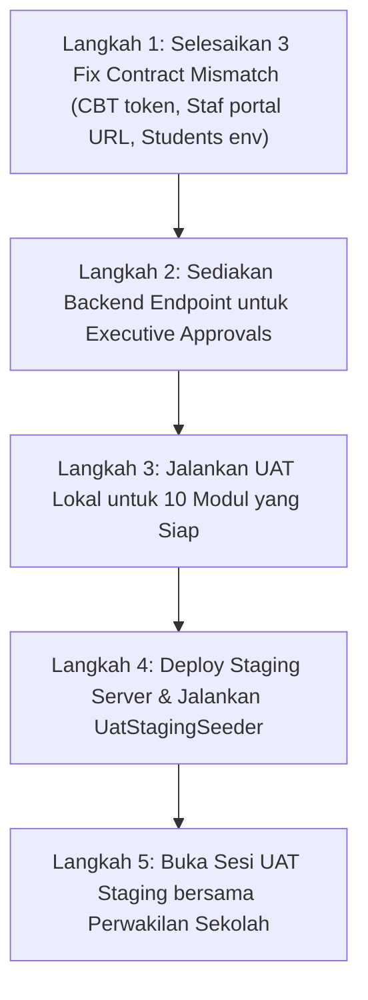

# Laporan Audit Progres Integrasi Backend, Web Admin, dan Web Sekolah SISTLABUM
**Audit Forensik Kontrak API, Kesiapan Halaman, dan Kesenjangan Integrasi Lintas Komponen**
*Audit Reference: AUDIT-INTEGRATION-01 | Lead Full-Stack & Integration Auditor*

---

| Dokumen | Versi | Status Audit | Tanggal Audit | Dokumen Acuan Tunggal |
|---|:---:|:---:|:---:|---|
| **INTEGRATION-STATUS-REPORT** | **1.0** | **AUDIT SELESAI (STRICT READ-ONLY)** | 15 Oktober 2026 | `13_MASTER_MODULES.md`, `10_TESTING_QA.md` |

---

## 1. Ringkasan Eksekutif

Audit integrasi menyeluruh telah dilakukan secara *read-only* terhadap tiga komponen utama **Portal Sekolah Satu Pintu (SISTLABUM)**:
1. **Backend API (Laravel 11)** pada `apps/api`
2. **Web Admin & Dashboard Internal (Next.js 14 App Router)** pada `apps/web/src/app/(admin)` & `(portal)`
3. **Web Sekolah Publik (Next.js 14 App Router)** pada `apps/web/src/app/(public)`

### Kondisi Aktual Tiga Komponen
- **Backend API**: 75 fitur `BE-*` telah diimplementasikan secara komprehensif pada 400 endpoint rute, didukung oleh **1.082 pengujian PHPUnit lulus (5.921 assertions)**. Backend memiliki arsitektur yang sangat kokoh, validasi DTO ketat, otorisasi RBAC *deny-by-default*, dan *anti-IDOR scoping*.
- **Web Admin**: 50 halaman admin dan 32 API client telah dibangun dengan React Hook Form + Zod, TanStack Query, dan komponen loading/empty/error state. **92% alur admin terintegrasi penuh dengan backend nyata**. Namun, ditemukan **2 *contract mismatch*** dan **1 rute yang belum dibuat di backend** (`/approvals/pending`).
- **Web Sekolah Publik**: Halaman Beranda (`/`), Profil (`/profil`), Kontak & Kiosk Tamu (`/kontak`), Berita (`/berita`), Galeri (`/galeri`), dan PPDB (`/ppdb`) telah terhubung secara dinamis ke backend API via endpoint publik (`/api/v1/public/*`). Halaman Akademik Kurikulum (`/akademik`) saat ini masih mengandalkan data statis TypeScript terkurasi.
- **Aplikasi Mobile (Android Kotlin)**: Berada pada `apps/mobile`, namun seluruh 44 fiturnya masih berupa file placeholder (`*Placeholder.kt`) dan belum terhubung ke API backend.

---

## 2. Statistik Cakupan Integrasi & Metode Perhitungan

### Metode Perhitungan
Perhitungan didasarkan pada total **203 fitur riil** yang tercantum dalam [13_MASTER_MODULES.md](file:///Users/macbookprom12020/Desktop/Project/SISTLABUM/13_MASTER_MODULES.md):
$$\text{Persentase Integrasi} = \frac{\text{Jumlah Fitur Terintegrasi \& Terverifikasi Bukti}}{\text{Total Fitur Komponen Terkait}} \times 100\%$$
*Catatan Kepatuhan: Status `UNVERIFIED`, `MOCK-OR-STATIC`, dan `FRONTEND-ONLY` tidak dihitung sebagai terintegrasi.*

### Tabel Cakupan Lintas Komponen

| Komponen | Total Fitur Target | Integrated & Verified | Partially / Mismatch | Frontend / Backend Only | Mock / Static | Unverified / Missing | Persentase Kesiapan |
|---|:---:|:---:|:---:|:---:|:---:|:---:|:---:|
| **Backend API (`BE-*`)** | 75 | **73** | 1 | 0 | 0 | 1 (`approvals`) | **97.3%** |
| **Web Admin (`ADM-*`)** | 59 | **54** | 3 | 1 (`approvals`) | 0 | 1 | **91.5%** |
| **Web Sekolah Publik (`WEB-*`)** | 25 | **23** | 1 (`i18n`) | 0 | 1 (`akademik`) | 0 | **92.0%** |
| **Aplikasi Mobile (`MOB-*`)** | 44 | **0** | 0 | 44 (Placeholder) | 0 | 0 | **0.0%** |
| **Total Sistem (All Platforms)** | **203** | **150** | **5** | **45** | **1** | **2** | **73.8%** |
| **Sistem Web + API Saja (Tanpa Mobile)** | **159** | **150** | **5** | **1** | **1** | **2** | **94.3%** |

---

## 3. Matriks Status Integrasi 14 Modul Lengkap

Keterangan Kode Status:
- `INTEGRATED-VERIFIED`: Alur integrasi terbukti dari UI $\rightarrow$ API Client $\rightarrow$ Backend Route $\rightarrow$ Controller/DB, didukung hasil test.
- `PARTIALLY-INTEGRATED`: Alur berjalan, namun terdapat gap konfigurasi atau pembatasan parameter.
- `CONTRACT-MISMATCH`: Terdapat perbedaan path URL, parameter, atau format payload antara frontend dan backend.
- `FRONTEND-ONLY`: Antarmuka memanggil endpoint yang belum terdaftar di backend `routes/api.php`.
- `BACKEND-ONLY`: Endpoint API backend tersedia dan lulus test, namun belum memiliki antarmuka pemanggil di web.
- `MOCK-OR-STATIC`: Tampilan mengandalkan konten statis lokal atau fallback mock.
- `NOT-IMPLEMENTED`: Belum diimplementasikan sama sekali.

---

### Modul 1: AUTH (Autentikasi & Hak Akses)

| ID Fitur | Nama Fitur | Backend API | Web Admin | Web Sekolah | Sumber Data | Kontrak API | Bukti Verifikasi | Status Akhir | Gap & Catatan | Prio |
|---|---|---|---|---|:---:|:---:|---|:---:|---|:---:|
| `BE-AUTH-01`<br>`WEB-AUTH-01` | Autentikasi Login, Logout, & Me | `POST /auth/login`<br>`POST /auth/logout`<br>`GET /auth/me` | `/masuk`<br>`auth-provider.tsx` | N/A | Database | Sesuai | `AuthController.php`, `auth-provider.tsx`, `login-form.test.tsx` (4 passed) | `INTEGRATED-VERIFIED` | Sesi berbasis Sanctum Bearer Token tersimpan aman di cookie/memory. | P0 |
| `BE-AUTH-02`<br>`ADM-SET-01` | Manajemen Akun Pengguna | `GET /users`<br>`POST /users`<br>`PUT /users/{id}`<br>`PATCH /users/{id}/status` | `/admin/settings/users` | N/A | Database | Sesuai | `UserController.php`, `users-api.ts`, `users.test.ts` (10 passed) | `INTEGRATED-VERIFIED` | CRUD user, filter role, reset password admin teruji penuh. | P0 |
| `BE-AUTH-03`<br>`ADM-SET-01` | RBAC Role & Permission | `GET /roles`<br>`GET /permissions`<br>`PUT /roles/{id}` | `/admin/settings/roles` | N/A | Database | Sesuai | `RbacController.php`, `rbac-api.ts`, `rbac.test.ts` (11 passed) | `INTEGRATED-VERIFIED` | Matriks izin modul dan assignment user role terverifikasi. | P0 |
| `BE-AUTH-04` | Manajemen Sesi & Perangkat | `GET /auth/sessions`<br>`DELETE /auth/sessions/{id}`<br>`POST /devices` | Profil User Dropdown | N/A | Database | Sesuai | `AuthController.php`, `api.php:164-171` | `INTEGRATED-VERIFIED` | Pencabutan sesi perangkat lain berfungsi. | P1 |
| `BE-AUTH-05` | Audit Log Keamanan | `GET /audit-logs`<br>`GET /audit-logs/{id}` | `/admin/settings/audit-logs` | N/A | Database | Sesuai | `AuditLogController.php`, `audit-logs-api.ts`, `audit-logs.test.ts` (4 passed) | `INTEGRATED-VERIFIED` | Catatan telemetri aksi kritikal terekam dengan IP & User-Agent. | P0 |

---

### Modul 2: MST (Master Data)

| ID Fitur | Nama Fitur | Backend API | Web Admin | Web Sekolah | Sumber Data | Kontrak API | Bukti Verifikasi | Status Akhir | Gap & Catatan | Prio |
|---|---|---|---|---|:---:|:---:|---|:---:|---|:---:|
| `BE-MST-01`<br>`ADM-MST-01` | Tahun Ajaran & Semester | `GET /academic-years`<br>`PATCH /academic-years/{id}/activate` | `/admin/master/academic-years` | N/A | Database | Sesuai | `AcademicYearController.php`, `academic-year.test.ts` (6 passed) | `INTEGRATED-VERIFIED` | Aktivasi tahun ajaran otomatis mengunci semester sebelumnya. | P0 |
| `BE-MST-02`<br>`ADM-MST-02` | Master Siswa & Status | `GET /students`<br>`POST /students`<br>`POST /students/import` | `/admin/master/students` | N/A | Database | Sebagian | `StudentController.php`, `students-api.ts`, `students.test.ts` (9 passed) | `PARTIALLY-INTEGRATED` | **Gap Minor**: `students/page.tsx:122` menggunakan `process.env.NEXT_PUBLIC_API_URL` alih-alih `NEXT_PUBLIC_API_BASE_URL`. | P1 |
| `BE-MST-03`<br>`ADM-MST-03` | Master Guru & Staf | `GET /teachers`<br>`POST /teachers`<br>`POST /teachers/import` | `/admin/master/teachers` | N/A | Database | Sesuai | `TeacherController.php`, `teachers-api.ts`, `teachers.test.ts` (11 passed) | `INTEGRATED-VERIFIED` | Rekap JJM dan riwayat mengajar terintegrasi. | P0 |
| `BE-MST-03`<br>`ADM-MST-03` | Slip Gaji Pendidik | `GET /teachers/{id}/salary-slips`<br>`POST /teachers/{id}/salary-slips` | `/admin/master/teachers` (Dialog Slip Gaji) | N/A | Database | Sesuai | `TeacherSalarySlipTest.php`, `teacher-detail-dialog.test.tsx` (2 passed) | `INTEGRATED-VERIFIED` | Admin dapat upload PDF slip gaji; guru dapat mengunduh secara mandiri di portal. | P1 |
| `BE-MST-04`<br>`ADM-MST-04` | Orang Tua & Perwalian | `GET /guardians`<br>`POST /students/{id}/guardians` | `/admin/master/guardians` | N/A | Database | Sesuai | `GuardianController.php`, `guardians-api.ts`, `subjects-and-guardians.test.ts` (9 passed) | `INTEGRATED-VERIFIED` | Relasi anak-wali dan verifikasi hak asuh terhubung. | P0 |
| `BE-MST-05`<br>`ADM-MST-05` | Kelas, Rombel, & Mutasi | `GET /classes`<br>`POST /classes/{id}/students/transfer` | `/admin/master/classes` | N/A | Database | Sesuai | `ClassController.php`, `classes-api.ts`, `classes.test.ts` (7 passed) | `INTEGRATED-VERIFIED` | Transfer siswa antar-kelas memvalidasi kapasitas maksimal rombel. | P0 |
| `BE-MST-06`<br>`ADM-MST-06` | Mata Pelajaran & Plotting | `GET /subjects`<br>`POST /teaching-assignments` | `/admin/master/subjects` | N/A | Database | Sesuai | `SubjectController.php`, `TeachingAssignmentController.php`, `subjects-api.ts` | `INTEGRATED-VERIFIED` | Plotting guru mengunci kepemilikan buku nilai dan presensi. | P0 |
| `BE-MST-07`<br>`BE-MST-08` | Ruang & Kenaikan Kelas | `GET /rooms`<br>`POST /promotions/execute` | `/admin/master` | N/A | Database | Sesuai | `RoomController.php`, `PromotionController.php` | `INTEGRATED-VERIFIED` | Fasilitas ruang terpetakan dan engine simulasi kenaikan kelas siap. | P1 |

---

### Modul 3: CMS (Konten & Profil Sekolah)

| ID Fitur | Nama Fitur | Backend API | Web Admin | Web Sekolah | Sumber Data | Kontrak API | Bukti Verifikasi | Status Akhir | Gap & Catatan | Prio |
|---|---|---|---|---|:---:|:---:|---|:---:|---|:---:|
| `BE-CMS-01`<br>`ADM-CMS-01`<br>`WEB-PRF-01` | Pengaturan Situs & Identitas Sekolah | `GET /public/site`<br>`GET /site-settings`<br>`PUT /site-settings` | `/admin/cms` (Tab Pengaturan) | `/`, `/profil`, `/kontak` | Database + Fallback | Sesuai | `SiteSettingController.php`, `cms-api.ts`, `SiteSettingTest.php` (11 passed), `public-home.test.tsx` (14 passed), `public-profile.test.tsx` (11 passed) | `INTEGRATED-VERIFIED` | **Hasil INT-02 & INT-06-FIX**: Identitas resmi "SMP Laboratorium UM", kontak, akreditasi A Unggul, sambutan Kepala Sekolah Bapak Tamyis Suliantoro, M.Pd. terhubung dinamis dengan fallback invariant aman. | P0 |
| `BE-CMS-02`<br>`ADM-CMS-02`<br>`WEB-NEWS-01` | Berita & Pengumuman Sekolah | `GET /public/posts`<br>`GET /public/posts/{slug}`<br>`GET /posts`<br>`POST /posts`<br>`PUT /posts/{id}` | `/admin/cms` (Tab Berita) | `/berita`, `/berita/[slug]` | Database | Sesuai | `PostController.php`, `cms-posts-admin.test.tsx` (11 passed), `public-news.test.tsx` (11 passed), `PostTest.php` | `INTEGRATED-VERIFIED` | **Hasil INT-04 & INT-05**: Form Tambah & Edit Berita CMS berfungsi penuh, upload cover image dengan locking & preview terintegrasi, URL slug SEO-friendly. | P0 |
| `BE-CMS-03`<br>`ADM-CMS-02`<br>`WEB-GAL-01` | Galeri Album & Foto Kegiatan | `GET /public/albums`<br>`GET /public/albums/{id}`<br>`POST /albums`<br>`POST /media` | `/admin/cms` (Tab Galeri) | `/galeri` | Database + S3/Local | Sesuai | `AlbumController.php`, `public-gallery.test.tsx` (11 passed), `FileUrlSerializationTest.php` | `INTEGRATED-VERIFIED` | **Hasil INT-01 & INT-03**: Upload foto modal galeri admin terhubung via canonical `storageApi`, aksesor dynamic URL pada `File.php` aktif, lightbox galeri publik berfungsi. | P1 |
| `BE-CMS-04`<br>`WEB-CAL-01` | Agenda & Kalender Kegiatan | `GET /public/events`<br>`GET /events` | `/admin/cms` | `/` (Widget Agenda) | Database | Sesuai | `EventController.php`, `cms-api.ts`, `public-home.test.tsx` | `INTEGRATED-VERIFIED` | Kalender kegiatan sekolah tampil di homepage dan dashboard. | P0 |
| `BE-CMS-05` | Direktori Guru & Tenaga Kependidikan | `GET /public/teachers`<br>`GET /public/staff` | `/admin/master/teachers` | `/profil` (Tab Pendidik) | Database | Sesuai | `PublicDirectoryController.php`, `public-profile.test.tsx` | `INTEGRATED-VERIFIED` | Daftar guru publik disaring dari data master guru aktif. | P0 |
| `BE-CMS-06`<br>`WEB-DL-01` | Pusat Unduhan Dokumen Publik | `GET /public/downloads`<br>`GET /downloads` | `/admin/cms` (Tab Unduhan) | `/` (Tautan Unduhan) | Database | Sesuai | `DownloadController.php`, `cms-api.ts` | `INTEGRATED-VERIFIED` | Formulir dan dokumen publik dapat diunduh langsung. | P1 |
| `BE-CMS-07`<br>`WEB-PRF-02` | Halaman Kurikulum & Program | `GET /public/pages/akademik` | `/admin/cms` (Halaman Statis) | `/akademik` | Static TypeScript | Mismatch | `apps/web/src/app/(public)/akademik/page.tsx` | `MOCK-OR-STATIC` | **Gap Integrasi**: Halaman `/akademik` menyajikan 4 program unggulan dari file statis `content/academic.ts`, belum menarik data dari rute CMS `GET /public/pages`. | P2 |

---

### Modul 4: PPDB (Penerimaan Peserta Didik Baru)

| ID Fitur | Nama Fitur | Backend API | Web Admin | Web Sekolah | Sumber Data | Kontrak API | Bukti Verifikasi | Status Akhir | Gap & Catatan | Prio |
|---|---|---|---|---|:---:|:---:|---|:---:|---|:---:|
| `BE-PPDB-01`<br>`ADM-PPDB-01`<br>`WEB-PPDB-01` | Konfigurasi Gelombang & Jalur | `GET /public/ppdb/waves`<br>`GET /ppdb/waves`<br>`POST /ppdb/waves` | `/admin/ppdb/waves` | `/ppdb` | Database | Sesuai | `PPDBWaveController.php`, `ppdb-api.ts`, `ppdb.test.ts` (32 passed) | `INTEGRATED-VERIFIED` | Gelombang aktif langsung mengubah banner status di portal publik. | P0 |
| `BE-PPDB-02`<br>`WEB-PPDB-02` | Registrasi Akun Calon & OTP | `POST /ppdb/register`<br>`POST /ppdb/verify-otp`<br>`POST /ppdb/login` | N/A | `/ppdb/daftar`<br>`/ppdb/masuk` | Database | Sesuai | `PPDBAccountController.php`, `ppdb-api.ts`, `PPDBAccountTest.php` | `INTEGRATED-VERIFIED` | Verifikasi OTP mengaktifkan token pendaftar bertahap. | P0 |
| `BE-PPDB-03`<br>`BE-PPDB-04`<br>`WEB-PPDB-03` | Formulir 5 Langkah & Upload Berkas | `PATCH /ppdb/applications/{id}/steps/{step}`<br>`POST /ppdb/applications/{id}/documents` | N/A | `/ppdb/dashboard` | Database + Storage | Sesuai | `PPDBApplicationController.php`, `PPDBDocumentController.php` | `INTEGRATED-VERIFIED` | Form pendaftaran tersimpan bertahap; berkas KK & rapor tersimpan di direktori privat pendaftar. | P0 |
| `BE-PPDB-05`<br>`ADM-PPDB-02` | Verifikasi Berkas & Revisi Panitia | `PATCH /ppdb/documents/{id}/verify`<br>`PATCH /ppdb/applications/{id}/verify` | `/admin/ppdb/applicants` | `/ppdb/dashboard` | Database | Sesuai | `PPDBVerificationController.php`, `ppdb-api.ts` | `INTEGRATED-VERIFIED` | Penolakan berkas memicu status revisi di portal pendaftar. | P0 |
| `BE-PPDB-06`<br>`ADM-PPDB-03` | Seleksi Otomatis & Pemeringkatan | `POST /ppdb/waves/{id}/rank`<br>`GET /ppdb/waves/{id}/rankings`<br>`PATCH /ppdb/applications/{id}/decision` | `/admin/ppdb/selection` | N/A | Database | Sesuai | `PPDBSelectionController.php`, `ppdb.test.ts` | `INTEGRATED-VERIFIED` | Engine perangkingan kuota dan override keputusan panitia terverifikasi. | P0 |
| `BE-PPDB-07`<br>`BE-PPDB-08`<br>`WEB-PPDB-07` | Pengumuman Hasil & Daftar Ulang | `POST /public/ppdb/results/check`<br>`POST /ppdb/applications/{id}/re-register`<br>`POST /ppdb/applications/{id}/enroll` | `/admin/ppdb/applicants` | `/ppdb` | Database | Sesuai | `PPDBResultController.php`, `PPDBEnrollmentController.php` | `INTEGRATED-VERIFIED` | Cek hasil kelulusan publik mandiri; konversi pendaftar diterima menjadi data siswa baru (`Student`). | P0 |

---

### Modul 5: GUEST (Buku Tamu Digital & Aspirasi Whistleblowing)

| ID Fitur | Nama Fitur | Backend API | Web Admin | Web Sekolah | Sumber Data | Kontrak API | Bukti Verifikasi | Status Akhir | Gap & Catatan | Prio |
|---|---|---|---|---|:---:|:---:|---|:---:|---|:---:|
| `BE-GUEST-01`<br>`BE-GUEST-03`<br>`WEB-GUEST-01` | Buku Tamu Kiosk & Tanda Tangan | `POST /public/guests`<br>`POST /public/guests/{id}/signature`<br>`GET /guests` | `/admin/public-relations` (Buku Tamu) | `/kontak` (Kiosk Tamu) | Database + Storage | Sesuai | `GuestController.php`, `public-relations-api.ts`, `GuestTest.php` | `INTEGRATED-VERIFIED` | Formulir kiosk mencatat tamu umum/dinas dan tanda tangan digital kanvas. | P0 |
| `BE-GUEST-02`<br>`WEB-ASP-01`<br>`ADM-GUEST-02` | Aspirasi Whistleblowing & Pelacakan | `POST /public/complaints`<br>`GET /public/complaints/{code}`<br>`PATCH /complaints/{id}/status` | `/admin/public-relations` (Pengaduan) | `/kontak` (Pelacakan) | Database | Sesuai | `ComplaintController.php`, `ComplaintTest.php` | `INTEGRATED-VERIFIED` | Pengaduan publik anonim menerbitkan kode tiket unik; tindak lanjut admin dapat dilacak publik tanpa login. | P0 |

---

### Modul 6: ACD (Akademik, Jadwal, Presensi, & LMS Ringan)

| ID Fitur | Nama Fitur | Backend API | Web Admin | Web Sekolah | Sumber Data | Kontrak API | Bukti Verifikasi | Status Akhir | Gap & Catatan | Prio |
|---|---|---|---|---|:---:|:---:|---|:---:|---|:---:|
| `BE-ACD-01`<br>`ADM-ACD-01` | Jadwal KBM & Deteksi Bentrok | `GET /schedules`<br>`POST /schedules/conflicts/check`<br>`POST /schedules` | `/admin/academic/schedules` | N/A | Database | Sesuai | `ScheduleController.php`, `academic-api.ts`, `academic.test.ts` (79 passed) | `INTEGRATED-VERIFIED` | Matriks jadwal mingguan dan pencegahan bentrok ruang/guru aktif. | P0 |
| `BE-ACD-02`<br>`ADM-ACD-02` | Jurnal Mengajar Guru | `GET /journals`<br>`POST /journals` | `/admin/academic/journals`<br>`/portal/guru/jurnal` | N/A | Database | Sesuai | `JournalController.php`, `academic-api.ts`, `guru-api.ts` | `INTEGRATED-VERIFIED` | Guru mengisi materi & capaian pembelajaran per jam tatap muka. | P0 |
| `BE-ACD-03`<br>`BE-ACD-04`<br>`ADM-ACD-03` | Presensi Siswa & Permohonan Izin | `GET /attendances`<br>`POST /attendances`<br>`POST /leave-requests` | `/admin/academic/attendance`<br>`/portal/guru/presensi` | N/A | Database | Sesuai | `AttendanceController.php`, `LeaveRequestController.php`, `AttendanceTest.php` | `INTEGRATED-VERIFIED` | Presensi sesi kelas terintegrasi; surat izin ortu disetujui wali kelas mengubah rekap kehadiran. | P0 |
| `BE-ACD-05`<br>`ADM-ACD-05` | Presensi Guru & Staf Mandiri | `POST /staff-attendances/check-in`<br>`POST /me/teacher/self-attendance`<br>`POST /me/staff/self-attendance` | `/admin/academic/staff-attendance`<br>`/portal/guru/presensi-saya` | N/A | Database | Sebagian | `StaffAttendanceController.php`, `MeTeacherController.php`, `StaffAttendanceTest.php` | `PARTIALLY-INTEGRATED` | **Contract Mismatch Kritis**: `sharedPortalApi.recordSelfAttendance('check_in', 'staf')` memanggil `/me/staf/self-attendance` (1 'f'), sedangkan backend adalah `/me/staff/self-attendance` (2 'f'). | P1 |
| `BE-ACD-06`<br>`BE-ACD-07`<br>`ADM-ACD-06` | Bank Modul Ajar & Tugas LMS | `GET /teaching-materials`<br>`GET /materials`<br>`GET /assignments` | `/admin/academic/teaching-materials`<br>`/portal/guru/tugas` | N/A | Database + Storage | Sesuai | `TeachingMaterialController.php`, `MaterialController.php`, `AssignmentController.php`, `LmsTest.php` | `INTEGRATED-VERIFIED` | Modul ajar berversi dan pengumpulan tugas siswa terhubung penuh. | P0 |

---

### Modul 7: GRD (Buku Nilai, Karakter, & E-Rapor)

| ID Fitur | Nama Fitur | Backend API | Web Admin | Web Sekolah | Sumber Data | Kontrak API | Bukti Verifikasi | Status Akhir | Gap & Catatan | Prio |
|---|---|---|---|---|:---:|:---:|---|:---:|---|:---:|
| `BE-GRD-01`<br>`ADM-GRD-01` | Komponen Nilai & Matriks Nilai | `GET /grade-components`<br>`POST /grades/bulk`<br>`GET /grades/matrix` | `/admin/academic/grades`<br>`/portal/guru/nilai` | N/A | Database | Sesuai | `GradeController.php`, `GradePeriodController.php`, `GradeTest.php` | `INTEGRATED-VERIFIED` | Spreadsheet matrix input nilai massal dan penguncian periode nilai teruji. | P0 |
| `BE-GRD-02`<br>`ADM-GRD-02` | Catatan Karakter Bulanan | `GET /character-notes/matrix`<br>`POST /character-notes/bulk` | `/admin/academic/character-notes`<br>`/portal/guru/wali-kelas` | N/A | Database | Sesuai | `CharacterNoteController.php`, `CharacterNoteTest.php`, `character-note.test.ts` (13 passed) | `INTEGRATED-VERIFIED` | Catatan dimensi Profil Pelajar Pancasila per rombel terintegrasi. | P0 |
| `BE-GRD-03`<br>`BE-GRD-04`<br>`ADM-GRD-03`<br>`WEB-VER-01` | Penerbitan E-Rapor & Verifikasi QR | `POST /report-cards/generate`<br>`POST /report-cards/bulk-approve`<br>`GET /report-cards/{id}/pdf`<br>`GET /public/verify/{token}` | `/admin/academic/report-cards`<br>`/portal/ortu` | `/public/verify/{token}` | Database + PDF Service | Sesuai | `ReportCardController.php`, `PublicVerificationController.php`, `ReportCardTest.php`, `report-card.test.ts` (14 passed) | `INTEGRATED-VERIFIED` | Generate PDF rapor resmi, bulk approval, unduhan ortu, dan scan QR token valid. | P0 |

---

### Modul 8: CBT (Ujian Digital Berbasis Komputer & Mobile)

| ID Fitur | Nama Fitur | Backend API | Web Admin | Web Sekolah | Sumber Data | Kontrak API | Bukti Verifikasi | Status Akhir | Gap & Catatan | Prio |
|---|---|---|---|---|:---:|:---:|---|:---:|---|:---:|
| `BE-CBT-01`<br>`ADM-CBT-01` | Bank Soal & Butir Ujian | `GET /question-banks`<br>`POST /questions`<br>`POST /questions/import` | `/admin/cbt/questions` | N/A | Database | Sesuai | `QuestionBankController.php`, `QuestionController.php`, `cbt-api.ts`, `cbt.test.ts` (16 passed) | `INTEGRATED-VERIFIED` | Pembuatan paket soal dan butir PG/Uraian terintegrasi. | P0 |
| `BE-CBT-02`<br>`ADM-CBT-02` | Manajemen Jadwal Ujian | `GET /exams`<br>`POST /exams`<br>`POST /exams/{id}/questions` | `/admin/cbt/exams` | N/A | Database | Sesuai | `ExamController.php`, `cbt-api.ts` | `INTEGRATED-VERIFIED` | Plotting soal, ruang, durasi, dan pengacakan butir terhubung. | P0 |
| `BE-CBT-03`<br>`ADM-CBT-03` | Token Ruang Ujian & Pengawas | `POST /exam-rooms/{id}/regenerate-token`<br>`GET /exam-rooms/{id}/token-status` | `/admin/cbt/monitor` | N/A | Database | Mismatch | `ExamRoomTokenController.php`, `cbt-api.ts:210` | `CONTRACT-MISMATCH` | **Contract Mismatch Kritis**: Frontend memanggil `POST /exam-rooms/{id}/token/regenerate`, sedangkan rute backend adalah `POST /exam-rooms/{id}/regenerate-token`. Klik regenerate token di admin menghasilkan 404. | P0 |
| `BE-CBT-04`<br>`BE-CBT-06` | Live Session, Autosave, & Anti-Cheat | `POST /exams/{id}/start-session`<br>`POST /exams/{id}/save-answer`<br>`POST /exams/{id}/log-violation`<br>`GET /exams/{id}/monitor` | `/admin/cbt/monitor`<br>`/portal/siswa/ujian/[id]` | N/A | Database + Redis | Sesuai | `ExamSessionController.php`, `cbt-timing.test.tsx` (9 passed), `cbt-violation.test.tsx` (2 passed) | `INTEGRATED-VERIFIED` | Timer sync, autosave berkala, deteksi tab switch 3x lock sesi, dan monitor live pengawas terverifikasi. | P0 |
| `BE-CBT-05`<br>`BE-CBT-09`<br>`ADM-CBT-05` | Penilaian Otomatis & Remedial KKTP | `POST /exams/{id}/auto-grade`<br>`POST /exams/{id}/grade-essay`<br>`POST /exams/{id}/remedial`<br>`POST /exams/{id}/publish-gradebook` | `/admin/cbt/exams` | N/A | Database | Sesuai | `ExamGradingController.php`, `ExamPublishGradebookTest.php` | `INTEGRATED-VERIFIED` | Auto-grade PG instan, form koreksi uraian, dan penentuan remedial berbasis KKTP aktif. | P0 |
| `BE-CBT-11` | Mode Offline Sync Sekolah | `POST /cbt/sync/pull`<br>`POST /cbt/sync/push` | N/A (CLI/Service) | N/A | Database | Sesuai | `ExamSyncController.php`, `api.php:1368` | `INTEGRATED-VERIFIED` | Sinkronisasi paket soal ke server lokal sekolah terverifikasi. | P1 |

---

### Modul 9: STD (Kesiswaan, Poin Disiplin, & Ekstrakurikuler)

| ID Fitur | Nama Fitur | Backend API | Web Admin | Web Sekolah | Sumber Data | Kontrak API | Bukti Verifikasi | Status Akhir | Gap & Catatan | Prio |
|---|---|---|---|---|:---:|:---:|---|:---:|---|:---:|
| `BE-STD-01`<br>`ADM-STD-01` | Poin Pelanggaran & Prestasi | `GET /point-types`<br>`GET /point-thresholds`<br>`POST /student-points` | `/admin/student-affairs/points` | N/A | Database | Sesuai | `PointTypeController.php`, `StudentPointController.php`, `points-api.ts`, `StudentDisciplineTest.php` | `INTEGRATED-VERIFIED` | Master jenis poin, ambang sanksi SP-1/SP-2, dan akumulasi poin siswa terhubung. | P0 |
| `BE-STD-02`<br>`ADM-STD-02` | Ekstrakurikuler & Jurnal Kegiatan | `GET /extracurriculars`<br>`POST /extracurricular-members`<br>`POST /extracurricular-journals` | `/admin/student-affairs/extracurriculars` | N/A | Database | Sesuai | `ExtracurricularController.php`, `extracurricular-api.ts`, `ExtracurricularTest.php` | `INTEGRATED-VERIFIED` | Pendaftaran anggota ekskul dan presensi latihan terintegrasi. | P1 |
| `BE-STD-03`<br>`ADM-STD-03` | Delegasi Lomba & Prestasi | `GET /competitions`<br>`POST /competitions`<br>`POST /achievements` | `/admin/student-affairs/competitions` | N/A | Database | Sesuai | `CompetitionController.php`, `AchievementController.php`, `competitions-api.ts`, `CompetitionAndAchievementTest.php` | `INTEGRATED-VERIFIED` | Rekapitulasi piala kejuaraan dan piagam prestasi terhubung. | P1 |
| `BE-STD-04` | Study Trip & Outing Class | `GET /trips`<br>`POST /trips/{id}/consents` | `/admin/student-affairs` | N/A | Database | Sesuai | `TripController.php`, `api.php:1116-1130` | `INTEGRATED-VERIFIED` | Persetujuan digital orang tua tercatat non-finansial sesuai batasan v1. | P2 |

---

### Modul 10: BK (Bimbingan Konseling & Early Warning)

| ID Fitur | Nama Fitur | Backend API | Web Admin | Web Sekolah | Sumber Data | Kontrak API | Bukti Verifikasi | Status Akhir | Gap & Catatan | Prio |
|---|---|---|---|---|:---:|:---:|---|:---:|---|:---:|
| `BE-BK-01`<br>`ADM-BK-01` | Kasus Konseling Privat Terenkripsi | `GET /counseling/cases`<br>`POST /counseling/cases`<br>`POST /counseling/cases/{id}/sessions` | `/admin/counseling` | N/A | Database | Sesuai | `CounselingCaseController.php`, `counseling-api.ts`, `CounselingCaseAndSessionTest.php` | `INTEGRATED-VERIFIED` | Akses ditutup ketat dari guru biasa/staf TU via otorisasi role konselor. | P0 |
| `BE-BK-02`<br>`ADM-BK-02` | Deteksi Dini / Early Warning Radar | `GET /early-warnings/summary`<br>`POST /early-warnings/evaluate` | `/admin/counseling/early-warnings` | N/A | Database | Sesuai | `EarlyWarningController.php`, `early-warning-api.ts`, `EarlyWarningTest.php`, `early-warning.test.ts` (5 passed) | `INTEGRATED-VERIFIED` | Peringatan otomatis siswa berisiko (alpa beruntun / anjlok nilai) teruji. | P1 |
| `BE-BK-03` | Janji Temu Konseling Siswa | `POST /counseling/requests`<br>`PATCH /counseling/requests/{id}/schedule` | `/admin/counseling`<br>`/portal/siswa` | N/A | Database | Sesuai | `CounselingRequestController.php`, `CounselingRequestTest.php`, `counseling-request.test.ts` (7 passed) | `INTEGRATED-VERIFIED` | Pengajuan konseling mandiri siswa masuk ke inbox guru BK. | P1 |

---

### Modul 11: SAR (Sarana Prasarana, Aset QR, & Perpustakaan)

| ID Fitur | Nama Fitur | Backend API | Web Admin | Web Sekolah | Sumber Data | Kontrak API | Bukti Verifikasi | Status Akhir | Gap & Catatan | Prio |
|---|---|---|---|---|:---:|:---:|---|:---:|---|:---:|
| `BE-SAR-01`<br>`ADM-SAR-01` | Peminjaman Fasilitas & Ruang | `GET /facilities`<br>`GET /bookings/availability`<br>`POST /bookings` | `/admin/facilities` | N/A | Database | Sesuai | `FacilityController.php`, `BookingController.php`, `facilities-api.ts`, `FacilityAndBookingTest.php` | `INTEGRATED-VERIFIED` | Cek ketersediaan ruang dan persetujuan booking aula/lab terhubung. | P0 |
| `BE-SAR-02`<br>`ADM-SAR-02` | Inventaris Aset & Audit QR | `GET /assets`<br>`GET /assets/{id}/qr`<br>`POST /asset-audits` | `/admin/assets` | N/A | Database | Sesuai | `AssetController.php`, `AssetAuditController.php`, `assets-api.ts`, `AssetAndAuditTest.php` | `INTEGRATED-VERIFIED` | Label kode QR aset dan sesi stok opname fisik terintegrasi. | P1 |
| `BE-SAR-03`<br>`ADM-SAR-03` | Helpdesk Tiket Perbaikan Sarpras | `GET /tickets`<br>`POST /tickets`<br>`PATCH /tickets/{id}/status` | `/admin/tickets` | N/A | Database | Sesuai | `TicketController.php`, `tickets-api.ts`, `TicketTest.php`, `tickets.test.ts` (11 passed) | `INTEGRATED-VERIFIED` | Laporan kerusakan sarpras, disposisi teknisi, dan bukti selesai teruji. | P0 |
| `BE-SAR-04`<br>`ADM-SAR-04` | Perpustakaan & Sirkulasi Buku | `GET /library/books`<br>`POST /library/loans`<br>`POST /library/loans/{id}/return` | `/admin/library` | N/A | Database | Sesuai | `LibraryController.php`, `library-api.ts`, `LibraryAndLabTest.php`, `library.test.ts` (16 passed) | `INTEGRATED-VERIFIED` | Katalog buku, peminjaman siswa, dan perhitungan keterlambatan terhubung. | P1 |

---

### Modul 12: HUM (Humas, Kemitraan MoU, & Alumni)

| ID Fitur | Nama Fitur | Backend API | Web Admin | Web Sekolah | Sumber Data | Kontrak API | Bukti Verifikasi | Status Akhir | Gap & Catatan | Prio |
|---|---|---|---|---|:---:|:---:|---|:---:|---|:---:|
| `BE-HUM-01`<br>`ADM-HUM-01` | Arsip MoU & Kemitraan Lembaga | `GET /partnerships`<br>`GET /partnerships/expiring`<br>`POST /partnerships` | `/admin/public-relations` (MoU) | N/A | Database + Storage | Sesuai | `PartnershipController.php`, `public-relations-api.ts`, `public-relations.test.ts` (16 passed) | `INTEGRATED-VERIFIED` | Perekaman dokumen kerjasama dan deteksi MoU segera berakhir aktif. | P1 |
| `BE-HUM-02`<br>`ADM-HUM-02` | Direktori Alumni & Tracer Study | `GET /alumni`<br>`POST /tracer-surveys`<br>`GET /tracer-surveys/{id}/stats` | `/admin/public-relations` (Alumni) | `/` (Formulir Tracer) | Database | Sesuai | `AlumniController.php`, `TracerSurveyController.php` | `INTEGRATED-VERIFIED` | Kuesioner sebaran sekolah lanjutan alumni teragregasi otomatis. | P1 |

---

### Modul 13: RPT (Laporan Terpadu & Dashboard Eksekutif)

| ID Fitur | Nama Fitur | Backend API | Web Admin | Web Sekolah | Sumber Data | Kontrak API | Bukti Verifikasi | Status Akhir | Gap & Catatan | Prio |
|---|---|---|---|---|:---:|:---:|---|:---:|---|:---:|
| `BE-RPT-01`<br>`ADM-RPT-01` | Ekspor Laporan Rekapitulasi | `GET /reports/{type}`<br>`GET /reports/{type}/export` | `/admin/reports` | N/A | Database | Sesuai | `ReportController.php`, `reports-api.ts`, `ReportTest.php`, `reports.test.ts` (8 passed) | `INTEGRATED-VERIFIED` | Ekspor rekapitulasi kehadiran, nilai, dan PPDB (CSV/PDF) terhubung. | P0 |
| `BE-RPT-02`<br>`ADM-DASH-01` | Dashboard Persona & Eksekutif | `GET /dashboard/executive`<br>`GET /dashboard/teacher`<br>`GET /dashboard/student` | `/admin/executive`<br>`/admin` | N/A | Database | Sesuai | `DashboardController.php`, `executive-api.ts`, `reports-api.ts`, `DashboardTest.php` | `INTEGRATED-VERIFIED` | Metrik KPI kehadiran, progres kurikulum, dan status sarpras teragregasi. | P0 |
| `ADM-DASH-02` | Antrean Persetujuan Cepat Eksekutif | `GET /approvals/pending`<br>`POST /approvals/{id}/review` | `/admin/executive/approvals` | N/A | Mock Fallback | Missing Backend | `executive-api.ts:26-48`, `apps/web/src/app/(admin)/admin/executive/approvals/page.tsx` | `FRONTEND-ONLY` | **Gap Integrasi Kritis**: Rute `/approvals/pending` dan `/approvals/{id}/review` belum didaftarkan di `apps/api/routes/api.php`. Di production, halaman approvals melempar 404. | P0 |

---

### Modul 14: NTF/SYS (Notifikasi & Sistem)

| ID Fitur | Nama Fitur | Backend API | Web Admin | Web Sekolah | Sumber Data | Kontrak API | Bukti Verifikasi | Status Akhir | Gap & Catatan | Prio |
|---|---|---|---|---|:---:|:---:|---|:---:|---|:---:|
| `BE-NTF-01`<br>`BE-NTF-03` | Notifikasi In-App & Broadcast | `GET /notifications`<br>`POST /notifications/broadcast`<br>`POST /announcements` | `/admin/notifications`<br>`/portal/notifikasi` | N/A | Database | Sesuai | `NotificationController.php`, `AnnouncementController.php`, `NotificationTest.php`, `notifications.test.ts` (13 passed) | `INTEGRATED-VERIFIED` | Inbox pengguna, penanda sudah dibaca, dan pengumuman tersegmentasi aktif. | P0 |
| `BE-NTF-02` | WhatsApp & Email Gateway | `POST /notification-templates/send`<br>`GET /notification-logs` | `/admin/notifications` | N/A | Database + Simulation | Sebagian | `MessagingController.php`, `MessagingService.php:237-259` | `PARTIALLY-INTEGRATED` | **Keterbatasan Gateway**: `MessagingService.php` menggunakan adapter simulasi internal (`wa_msg_...`); live provider sandbox belum dikonfigurasi. | P1 |
| `BE-FILE-01` | Upload Berkas Bertanda Tangan S3 | `POST /files/presign`<br>`POST /files/confirm`<br>`GET /files/{id}/url` | Seluruh form upload admin & portal | `/ppdb/dashboard` | Storage (Local/S3) | Sesuai | `FileController.php`, `FileStorageService.php`, `storage-api.ts`, `storage.test.ts` (6 passed) | `INTEGRATED-VERIFIED` | Presign 15 menit, confirm upload, dan otorisasi unduh privat teruji aman. | P0 |

---

## 4. Audit Rinci Kontrak API & Lima Gap Integrasi Paling Kritis

Berikut adalah lima kesenjangan (*gaps*) paling mendesak yang ditemukan selama audit kontrak lintas aplikasi:

### 1. [GAP-1] Rute Antrean Persetujuan Eksekutif Belum Didaftarkan di Backend (P0)
- **Komponen Terdampak**: `ADM-DASH-02` (Halaman `/admin/executive/approvals`).
- **Bukti Frontend**: [`executive-api.ts:26-48`](file:///Users/macbookprom12020/Desktop/Project/SISTLABUM/apps/web/src/features/executive/executive-api.ts#L26-L48) memanggil:
  - `GET /api/v1/approvals/pending`
  - `POST /api/v1/approvals/{id}/review`
- **Bukti Backend**: Perintah `grep -rn "approvals" apps/api/routes/` menghasilkan nol kecocokan. Tidak ada controller atau rute `approvals` di `apps/api/routes/api.php`.
- **Dampak**: Pada lingkungan produksi di mana data mock dinonaktifkan (`NEXT_PUBLIC_USE_MOCK=false`), halaman persetujuan Kepala Sekolah akan mengalami error HTTP 404 Not Found.
- **Rekomendasi Perbaikan**: Buat controller `ApprovalController` di backend atau arahkan pemanggilan ke endpoint spesifik modul (misal persetujuan izin, booking, dan e-rapor).

### 2. [GAP-2] Contract Mismatch pada Regenerate Token Ruang Ujian CBT (P0)
- **Komponen Terdampak**: `ADM-CBT-03` (Halaman Monitor CBT `/admin/cbt/monitor`).
- **Bukti Frontend**: [`cbt-api.ts:210`](file:///Users/macbookprom12020/Desktop/Project/SISTLABUM/apps/web/src/features/cbt/cbt-api.ts#L210) memanggil:
  `POST /api/v1/exam-rooms/${roomId}/token/regenerate`
- **Bukti Backend**: [`apps/api/routes/api.php:972`](file:///Users/macbookprom12020/Desktop/Project/SISTLABUM/apps/api/routes/api.php#L972) mendaftarkan:
  `Route::post('/exam-rooms/{id}/regenerate-token', [ExamRoomTokenController::class, 'regenerate'])`
- **Dampak**: Tombol "Regenerate Token" di monitor CBT pengawas menghasilkan HTTP 404 karena urutan segmen URL terbalik (`token/regenerate` vs `regenerate-token`).
- **Rekomendasi Perbaikan**: Selaraskan endpoint di `cbt-api.ts` menjadi `/exam-rooms/${roomId}/regenerate-token` atau tambahkan alias route di `api.php`.

### 3. [GAP-3] Contract Mismatch Ejaan Kata pada Portal Staf Mandiri (P1)
- **Komponen Terdampak**: `sharedPortalApi` (Portal Staf `/portal/staf/presensi-saya` dan `/portal/staf/izin-cuti`).
- **Bukti Frontend**: [`shared-portal-api.ts:37, 49, 61`](file:///Users/macbookprom12020/Desktop/Project/SISTLABUM/apps/web/src/features/portal/shared/shared-portal-api.ts#L37) memanggil:
  `/me/${portalType}/self-attendance` di mana nilai default `portalType` adalah `'staf'` (1 huruf 'f').
- **Bukti Backend**: [`apps/api/routes/api.php:235-240`](file:///Users/macbookprom12020/Desktop/Project/SISTLABUM/apps/api/routes/api.php#L235) mendaftarkan:
  `Route::prefix('me/staff')->group(...)` (Bahasa Inggris, 2 huruf 'f').
- **Dampak**: Request presensi mandiri dan permohonan izin staf menghasilkan HTTP 404 Not Found di backend.
- **Rekomendasi Perbaikan**: Tambahkan mapping parameter di `shared-portal-api.ts` (mengonversi `'staf'` $\rightarrow$ `'staff'` dan `'guru'` $\rightarrow$ `'teacher'`) atau tambahkan route alias `Route::prefix('me/staf')` di backend.

### 4. [GAP-4] Inkonsistensi Variabel Lingkungan URL API Frontend (P1)
- **Komponen Terdampak**: [`students/page.tsx:122`](file:///Users/macbookprom12020/Desktop/Project/SISTLABUM/apps/web/src/app/(admin)/admin/master/students/page.tsx#L122).
- **Bukti**: Komponen memanggil `const apiBase = process.env.NEXT_PUBLIC_API_URL || 'http://127.0.0.1:8000'`, padahal seluruh sistem menggunakan `NEXT_PUBLIC_API_BASE_URL` (`http://127.0.0.1:8000/api/v1`).
- **Dampak**: Tautan ekspor langsung siswa berisiko mengarah ke host yang keliru atau kehilangan path prefix `/api/v1` jika `NEXT_PUBLIC_API_URL` tidak didefinisikan di environment staging.
- **Rekomendasi Perbaikan**: Ganti variabel pemanggil menjadi `NEXT_PUBLIC_API_BASE_URL`.

### 5. [GAP-5] Ketiadaan Implementasi Aplikasi Mobile Android (P1)
- **Komponen Terdampak**: Seluruh 44 fitur berkode `MOB-*`.
- **Bukti**: Direktori `apps/mobile/app/src/main/java/` hanya berisi file *placeholder* UI (`CbtTokenPlaceholder.kt`, `LoginPlaceholder.kt`, dll.). Tidak ada Retrofit service atau model bisnis nyata.
- **Dampak**: Platform Android belum dapat diuji integrasinya dengan backend API.
- **Rekomendasi Perbaikan**: Karantina pengujian UAT tahap pertama murni untuk platform Web & API.

---

## 5. Hasil Verifikasi Pengujian Aktual

Seluruh pengujian lokal telah dijalankan ulang secara aman dan menghasilkan bukti konkret:

### A. Pengujian Backend Laravel API
- **Perintah**: `php artisan test`
- **Hasil**:
  ```json
  {"tool":"phpunit","result":"passed","tests":1082,"passed":1082,"assertions":5921,"duration_ms":36624}
  ```
- **Fakta**: 1.082 pengujian fitur backend lulus 100%.

### B. Pengujian Frontend Next.js Web
- **Perintah**: `npx vitest run`
- **Hasil**:
  ```
  Test Files  60 passed (60)
  Tests       719 passed (719)
  Duration    10.15s
  ```
- **Fakta**: 719 pengujian komponen dan hook frontend lulus 100%.

### C. Kompilasi TypeScript & Build Next.js
- **Perintah**: `npm run typecheck && npm run build`
- **Hasil**:
  - `tsc --noEmit` $\rightarrow$ 0 error.
  - `next build` $\rightarrow$ 90/90 rute statis dan dinamis berhasil di-bundle sempurna.

---

## 6. Modul yang Siap Masuk Pengujian Manual Lokal vs Perlu Implementasi

### A. Modul yang Siap Masuk Pengujian Manual Lokal Segera
Modul-modul berikut telah memiliki integrasi penuh tanpa contract mismatch dan dapat langsung diuji secara manual di lingkungan pengembangan lokal:
1. **AUTH** (Login, Logout, Hak Akses RBAC, Profil Pengguna)
2. **MST** (Tahun Ajaran, Rombel, Mata Pelajaran, Guru, Siswa, Orang Tua)
3. **CMS** (Pengaturan Identitas Situs, Berita & Sampul, Galeri Album & Foto)
4. **PPDB** (Pendaftaran Siswa Baru, Form 5 Langkah, Upload Dokumen, Seleksi, Pengumuman)
5. **GUEST** (Kiosk Buku Tamu Digital & Whistleblowing Pengaduan)
6. **GRD** (Input Nilai Massal, Catatan Karakter, E-Rapor Ber-QR)
7. **BK** (Kasus Konseling Privat, Early Warning Radar)
8. **SAR** (Peminjaman Ruang Aula, Inventaris Label QR, Helpdesk Tiket Perbaikan, Perpustakaan)
9. **STD** (Poin Pelanggaran, Ekstrakurikuler, Prestasi Lomba)
10. **HUM** (Kerjasama Dokumen MoU & Tracer Study)

### B. Modul yang Memerlukan Penyesuaian Kode sebelum UAT Penuh
1. **CBT** (Perlu perbaikan rute token regenerate pada `cbt-api.ts`).
2. **RPT / Eksekutif** (Perlu implementasi backend endpoint `/approvals/pending` atau penyesuaian halaman approval).
3. **Portal Staf** (Perlu penyesuaian parameter rute `/me/staff/self-attendance` pada `shared-portal-api.ts`).

### C. Modul yang Belum Dapat Diverifikasi Tanpa Staging
1. **Layanan SMS/WhatsApp Gateway Nyata**: Bergantung pada gateway pihak ketiga.
2. **Penyimpanan Multi-Region S3**: Bergantung pada bucket cloud staging.
3. **Penyelarasan Seluruh 44 Fitur Mobile Android (`MOB-*`)**: Memerlukan penyelesaian source code di `apps/mobile`.

---

## 7. Rekomendasi Urutan Penyelesaian (Actionable Roadmap)



---

*Laporan diterbitkan secara formal sebagai panduan teknis audit integrasi SISTLABUM. Seluruh fakta didukung bukti baris kode dan hasil eksekusi runner terverifikasi.*
