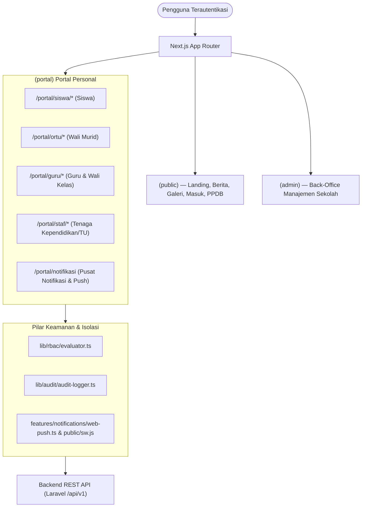

# Panduan Arsitektur & Pedoman Pengembang Portal Terpadu (SISTLABUM)

Dokumen ini merupakan panduan arsitektur teknis resmi untuk pengembangan dan pemeliharaan antarmuka frontend **Portal Satu Pintu Terpadu** (`apps/web`), sesuai standar `AGENTS.md`, `02_TECH_STACK.md`, `08_DATABASE_SCHEMA.md`, dan `09_SECURITY_PRIVACY.md`.

---

## 1. Ikhtisar Arsitektur (Architecture Overview)

SISTLABUM menerapkan arsitektur **Next.js 14 App Router** berbasis *role-partitioned route groups* yang memisahkan area publik, portal personal terpadu, dan modul manajemen back-office administrator.



---

## 2. Struktur Direktori & Pemisahan Tanggung Jawab

```
apps/web/src/
├── app/
│   ├── (public)/                 # Landing publik, berita, kontak, masuk (login)
│   ├── (portal)/                 # Portal Personal Terpadu
│   │   ├── portal/
│   │   │   ├── layout.tsx        # PortalShell global wrapper
│   │   │   ├── page.tsx          # Auto-redirect dashboard berbasis peran
│   │   │   ├── siswa/            # Rute spesifik siswa (jadwal, tugas, nilai, cbt)
│   │   │   ├── ortu/             # Rute spesifik wali murid (presensi, e-rapor, karakter)
│   │   │   ├── guru/             # Rute spesifik pendidik (jadwal, cuti, slip honorarium)
│   │   │   ├── staf/             # Rute operasional staf TU/Sarpras (tiket, cuti, slip)
│   │   │   └── notifikasi/       # Pusat notifikasi & preferensi Web Push
│   ├── (admin)/                  # Back-office manajemen akademik, sarpras, CBT, CMS
├── components/
│   ├── shell/portal/             # PortalShell, navigation bar, mobile menu drawer
│   ├── shell/admin/              # AdminSidebar, AdminTopbar
│   ├── shell/shared/             # RoleSwitcher (multi-peran)
│   ├── notifications/            # NotificationBell, NotificationInboxView
│   └── shared/                   # DataTable, ConfirmDialog, PermissionGate, Empty/Error State
├── features/
│   ├── auth/                     # LoginForm, AuthProvider, login redirects
│   ├── portal/                   # Hook portal (usePortal, useGuruPortal, useStafPortal)
│   ├── academic/                 # API presensi, nilai, e-rapor, jurnal
│   ├── notifications/            # notifications-api.ts, web-push.ts, topics & preferences
│   └── cbt/                      # Engine CBT & monitoring ujian
├── lib/
│   ├── api/                      # Axios client, error parser, interceptors
│   ├── audit/                    # audit-logger.ts (Audit trail 5 aksi sensitif)
│   └── rbac/                     # evaluator.ts (canAccessShell, resolveUserDestination)
└── public/
    └── sw.js                     # Service Worker (Web Push handler & sanitasi deep-link)
```

### Aturan Isolasi Mutlak
1. **Zero Admin Import di Portal**: Komponen atau modul di dalam `src/app/(portal)` **dilarang keras** mengimpor komponen back-office dari `src/app/(admin)` atau komponen khusus internal admin.
2. **Deny-by-Default Shell Access**: Evaluasi peran pada `canAccessShell(roles, shell)` wajib divalidasi sebelum merender antarmuka. Siswa dan wali murid tidak memiliki izin merender shell admin (`canAccessShell(['student'], 'admin') === false`).
3. **No Direct Fetch**: Semua komunikasi data wajib melalui instance `apiClient` atau wrapper domain feature (`academicApi`, `cbtApi`, `notificationsApi`).

---

## 3. Konvensi Penamaan (Naming Conventions)

Sesuai aturan `AGENTS.md` Bagian 4:
- **Teks UI & URL Publik/Portal**: Bahasa Indonesia yang baku, bersahabat, dan jelas bagi warga sekolah.
  - Contoh URL: `/portal/siswa/jadwal`, `/portal/ortu/anak/[id]`, `/portal/guru/slip-gaji`, `/portal/staf/tiket`.
  - Pesan validasi / error UI: *"Kata sandi wajib diisi"*, *"Presensi berhasil dicatat"*.
- **Identifier Teknis & Kode**: Bahasa Inggris teknis.
  - Fungsi: `resolveNotificationDeepLink`, `canAccessShell`, `recordDailyAttendance`.
  - Interface/Tipe: `NotificationPreferenceSettings`, `RecordAuditLogPayload`, `DailyGateAttendancePayload`.

---

## 4. Panduan Pengembang: Menambah Halaman Portal Baru

Ikuti langkah-langkah berikut untuk menambahkan halaman baru di portal (misalnya halaman pengumuman ekstrakurikuler siswa di `/portal/siswa/ekstrakurikuler`):

### Langkah 1: Buat Direktori Rute di `src/app/(portal)/portal/<role>/<slug>/page.tsx`
Gunakan Client Component dengan integrasi layout dan hook portal:

```tsx
'use client';

import React from 'react';
import Link from 'next/link';
import { ArrowLeft, Award } from 'lucide-react';
import { Card, CardHeader, CardTitle, CardContent } from '@/components/ui/card';
import { LoadingSpinner } from '@/components/shared/loading-spinner';
import { EmptyState } from '@/components/shared/empty-state';
import { ErrorState } from '@/components/shared/error-state';

export default function StudentExtracurricularPage() {
  // 1. Fetching via TanStack Query atau API Hook
  // 2. Wajib sediakan 3 state visual: Loading, Error, Empty
  const isLoading = false;
  const isError = false;
  const items: any[] = [];

  return (
    <div className="space-y-6">
      {/* Breadcrumb / Navigasi Balik */}
      <div className="flex items-center gap-3">
        <Link
          href="/portal/siswa"
          className="p-2 rounded-lg text-slate-500 hover:bg-slate-100 hover:text-slate-800 transition-colors"
          aria-label="Kembali ke Beranda Siswa"
        >
          <ArrowLeft className="h-5 w-5" />
        </Link>
        <div>
          <h1 className="text-xl font-bold text-slate-950">Kegiatan Ekstrakurikuler</h1>
          <p className="text-xs text-slate-500">Daftar kegiatan bakat dan minat yang diikuti ananda</p>
        </div>
      </div>

      {isLoading && <LoadingSpinner message="Memuat daftar ekstrakurikuler..." />}
      {isError && <ErrorState message="Gagal memuat data ekstrakurikuler." onRetry={() => {}} />}
      {!isLoading && !isError && items.length === 0 && (
        <EmptyState
          icon={Award}
          title="Belum Terdaftar Ekstrakurikuler"
          description="Silakan hubungi pembina kesiswaan atau wali kelas untuk pendaftaran kegiatan."
        />
      )}
    </div>
  );
}
```

### Langkah 2: Tambahkan Link Navigasi pada `portal-shell.tsx`
Perbarui daftar `navItems` di [apps/web/src/components/shell/portal/portal-shell.tsx](file:///Users/macbookprom12020/Desktop/Project/SISTLABUM/apps/web/src/components/shell/portal/portal-shell.tsx) sesuai segmen role terkait agar tautan muncul di menu desktop dan mobile drawer.

### Langkah 3: Tulis Uji Vitest Terkait
Pastikan rute dan komponen lulus pengujian isolasi role dan pengujian komponen.

---

## 5. Panduan Pengembang: Menambah Role Baru

Jika sekolah menambah peran baru (contoh: `pustakawan` atau `bendahara`):

1. **Perbarui Tipe Role & Topik**:
   - Tambahkan kode peran pada tipe `PortalRoleTopic` di `apps/web/src/features/notifications/types.ts`.
   - Konfigurasikan topik notifikasi default di `ROLE_NOTIFICATION_TOPICS` pada `apps/web/src/features/notifications/web-push.ts`.
2. **Perbarui RBAC Evaluator**:
   - Daftarkan hak akses shell di `canAccessShell()` pada `apps/web/src/lib/rbac/evaluator.ts`.
   - Daftarkan penentuan pendaratan login di `resolveUserDestination()` pada `evaluator.ts`.
3. **Petakan Deep Link Kanonis**:
   - Daftarkan resolusi URL klik notifikasi pada fungsi `resolveNotificationDeepLink()` di `web-push.ts`.
4. **Daftarkan Navigasi di Shell**:
   - Tambahkan menu navigasi pada `PortalShell` (`apps/web/src/components/shell/portal/portal-shell.tsx`).
5. **Tambahkan Matriks Uji**:
   - Tambahkan kasus uji isolasi pada `apps/web/src/test/cross-role-matrix.test.ts`.

---

## 6. Audit Trail Aksi Sensitif (Audit Logging Standard)

Setiap aksi kritis di sistem wajib dicatat ke dalam audit trail yang **otoritatif di sisi backend** (GAP-06).

1. **Autoritatif di Sisi Server**:
   - Pencatatan audit dieksekusi di dalam blok `DB::transaction()` yang sama dengan mutasi data bisnis. Jika pencatatan audit gagal, seluruh mutasi bisnis otomatis di-rollback.
   - Kolom audit mencakup: `actor_id` & `actor_role` (diambil dari `$request->user()`), `action`, `entity_type`, `entity_id`, `old_values`, `new_values` (diff komputasi otomatis), `reason`, `ip_address`, `user_agent`, `request_id`, dan `is_authoritative = true`.
   - Redaksi otomatis terhadap data sensitif (`password`, `token`, `secret`, `nik`, `pin`).
2. **Cakupan 5 Aksi Sensitif**:
   - **Pembaruan Nilai**: `academic.grade.update` (`GradeService`), wajib menyertakan alasan (`reason`).
   - **Kunci / Buka E-Rapor**: `academic.report_card.lock` / `unlock` (`ReportCardService`), wajib alasan saat pembukaan kunci.
   - **Keputusan Persetujuan**: `executive.approval.decision` (`ReportCardService`), wajib catatan saat penolakan (`rejected`).
   - **Perubahan Role Akun**: `auth.role.assign` / `revoke` (`RbacService`).
   - **Unduh Data Massal**: `report.bulk.export` (`ReportService`).
3. **Endpoint Klien `POST /api/v1/audit-logs`**:
   - Khusus menerima telemetri antarmuka (UI telemetry) yang ditandai `is_authoritative = false`.
   - Menolak keras (HTTP 422) upaya pelaporan aksi bisnis sensitif dari sisi klien. Frontend menggunakan `uiTelemetryLogger` (`apps/web/src/lib/audit/audit-logger.ts`) hanya untuk event UI.

---

## 7. Web Push Notification & Deep-Link Canonical Security

Sesuai `09_SECURITY_PRIVACY.md` dan GAP-11:
1. **Pencegahan Open-Redirect**:
   - `public/sw.js` dan fungsi `sanitizeTargetUrl()` secara ketat menolak karakter kontrol, backslash (`\`), protocol-relative URL (`//evil.com`), serta skema berbahaya (`javascript:`, `data:`). Hanya path relatif internal berawalan `/` atau URL same-origin yang diizinkan untuk navigasi klik notifikasi.
2. **Kerahasiaan Isi Notifikasi**:
   - Judul dan pesan push notification **dilarang memuat data pribadi sensitif** (skor angka detail siswa, nomor NIK, atau catatan diagnosis konseling BK).
   - Pengguna diarahkan ke tautan kanonis terautentikasi untuk membuka detail di portal.
3. **Sinkronisasi Preferensi & Scoping Peran (GAP-11)**:
   - Preferensi notifikasi pengguna dikelola melalui `GET/PUT /api/v1/me/notification-preferences`.
   - Server membatasi topik yang diizinkan per peran (`allowed_roles`). Siswa/ortu dilarang mengonfigurasi topik khusus guru (ditolak HTTP 403).
   - Server memfilter penerima notifikasi siaran (broadcast/reminder): pengguna yang menonaktifkan topik atau channel push tidak akan dikirimi notifikasi.

---

## 8. Daftar Periksa Keamanan & Risiko Residu (Security Checklist & Residual Risks)

| Aspek | Status | Bukti & Mitigasi Aktual |
|---|---|---|
| **Penyimpanan Token (GAP-01/04)** | Didesain | Access token di memori; desain arsitektur refresh token HttpOnly dan Edge Middleware telah didokumentasikan di `docs/auth-token-design.md` menunggu finalisasi topologi domain deployment. |
| **Batas Waktu CBT (GAP-02)** | Aman | Waktu ujian ditentukan server (`ends_at`), start/resume idempoten, toleransi server-side, sisa waktu dihitung dari offset absolut, auto-close command aktif. |
| **Isolasi Mock (GAP-03)** | Aman | Terpusat di `mock-mode.ts`; dead-code eliminated di bundle production (terbukti 0 string mock pada chunks client production). Error HTTP server tidak pernah disamarkan oleh mock. |
| **Audit Trail (GAP-06)** | Aman | Audit server otoritatif dalam transaksi DB atomik untuk 5 aksi sensitif; validasi alasan wajib; endpoint klien menolak aksi bisnis sensitif. |
| **Anti-Cheat CBT (GAP-07)** | Aman | Counter pelanggaran diinkremen atomik di server (`POST .../violations`); ambang konsekuensi diputuskan server (bukan manipulasi klien). |
| **Anti-IDOR Portal (GAP-08/09)** | Aman | Endpoint mandiri `/api/v1/me/*`; verifikasi relasi anak-wali di server dengan penolakan HTTP 403; tanpa fallback mock pada otorisasi. |
| **Sinkronisasi Peran (GAP-05/10)** | Aman | Role guard terintegrasi di setiap sub-portal layout; sinkronisasi otomatis `activeRole` saat klik switcher maupun navigasi deep link. |
| **Preferensi Push (GAP-11)** | Aman | Role-scoped preferences di database; server memfilter broadcast push bagi user yang menonaktifkan topik; sinkronisasi dua arah web-push. |
| **Risiko Residu 1: Migrasi HttpOnly Cookie** | Diwaspadai | Implementasi kode Opsi B (refresh token HttpOnly cookie + UX signal session cookie di Next.js middleware) harus dieksekusi segera setelah topologi domain disahkan user. |
| **Risiko Residu 2: Uji Beban Nyata (k6)** | Diwaspadai | Simulasi internal telah lulus, namun pengujian beban nyata dengan k6/Artillery (burst presensi serentak jam 06:45-07:00 dan CBT serentak 1000 siswa) perlu dijalankan di environment staging. |
| **Risiko Residu 3: Ketahanan Jaringan CBT Flaky** | Diwaspadai | Perlu uji ketahanan antrean jawaban offline (IndexedDB / retry exponential backoff) pada kondisi koneksi lab sekolah yang putus-nyambung. |

---

*Dokumen ini diperbarui secara berkala seiring penutupan celah audit Batch A-E pada repositori SISTLABUM.*
