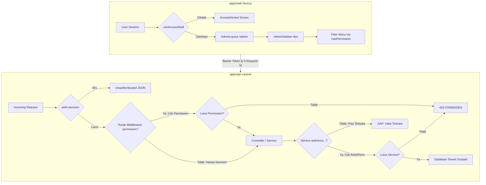

# AUDIT-ADMIN-RBAC-INTERNAL-ROLES-01
# Laporan Audit RBAC Admin System dan Integrasi Jabatan Internal SISTLABUM

> **Status Audit:** Selesai (AUDIT-ONLY, Tanpa Modifikasi Kode / Destructive Action)  
> **Tanggal Pelaksanaan:** 15 Oktober 2026  
> **Target Analisis:** `apps/api` (Laravel 11), `apps/web` (Next.js 14), `apps/mobile` (Mobile Workspace), Database Migrations & Seeders  
> **Dasar Acuan (SSOT):** `13_MASTER_MODULES.md`, `docs/rbac-matrix.md`, Keputusan Arsitektur Portal & Internal Roles  

---

## 1. Ringkasan Eksekutif

Audit independen ini dilaksanakan untuk memverifikasi secara mendalam dan faktual dua hal pokok dalam sistem SISTLABUM (Portal Sekolah Satu Pintu SMP Laboratorium UM):
1. **Penerapan Role-Based Access Control (RBAC)** secara konsisten dan aman di seluruh layer: antarmuka frontend Web Admin (`apps/web`), routing dan middleware backend (`apps/api`), kontrol service/controller, serta basis data.
2. **Integrasi seluruh jabatan internal sekolah** ke dalam satu **Admin System terpusat (`/admin`)** berbasis hak akses tanpa membuat portal mandiri yang terpisah atau redundan.

### Hasil Audit Utama:
- **Kesesuaian Arsitektur Portal Web: PASS (100%)**.  
  Sistem telah mematuhi keputusan arsitektur secara konsisten di mana hanya terdapat **4 portal personal** (`/portal/siswa`, `/portal/ortu`, `/portal/guru`, `/portal/staf`), **1 panel admin terpusat** (`/admin`), dan **website publik + PPDB**. Tidak ditemukan portal mandiri terpisah untuk Kepala Sekolah, BK, Pustakawan, Sarpras, Bendahara, Kesiswaan, Humas, Alumni, maupun Mitra Industri.
- **RBAC Admin System: CONDITIONAL (82% Terverifikasi, Butuh Penyelarasan)**.  
  Fondasi RBAC backend (`Role`, `Permission`, middleware `RequirePermission`, trait `ApiResponse`) dan evaluasi RBAC frontend (`evaluator.ts`, `hasPermission`, `AdminSidebar`, `PermissionGate`) telah berjalan nyata dan teruji (213 test backend + 75 test frontend RBAC berstatus 100% HIJAU). Namun ditemukan celah otorisasi pada endpoint buku tamu (`GET /api/v1/guests`) dan inkonsistensi penamaan permission antara seeder, service, dan frontend navigation.
- **Integrasi 7 Jabatan Internal: CONDITIONAL**.  
  - 4 Jabatan **Telah Terintegrasi Penuh (PASS)**: Kepala Sekolah (`principal`), Bimbingan Konseling (`counselor`), Pustakawan (`librarian`), dan Sarana Prasarana (`facility_staff`).
  - 3 Jabatan **Terintegrasi Parsial (PARTIAL)**: Kesiswaan (`student_affairs`), Humas (`public_relations`), dan Bendahara (`treasurer`). Menu UI dan fungsionalitas backend sudah ada di dalam `/admin`, namun definisi rolenya belum didaftarkan ke dalam `DatabaseSeeder.php` dan `UatStagingSeeder.php`.
- **Status Mobile Workspace: DISCREPANCY**.  
  Direktori `apps/mobile` saat ini masih berupa proyek native Android (Kotlin / Gradle / Jetpack Compose) berisi placeholder UI, belum berupa proyek Flutter (`pubspec.yaml`).

---

## 2. Kesimpulan RBAC Admin System



### Temuan Arsitektur RBAC:
1. **Model Relasi Database**: Relasi many-to-many `roles` $\leftrightarrow$ `permissions` melalui tabel pivot `role_permissions`, dan `users` $\leftrightarrow$ `roles` melalui `user_roles` dengan dukungan kolom `scope_class_id` untuk pembatasan ruang lingkup kelas.
2. **Dukungan Multi-Peran**: Metode `hasRole` dan `hasPermission` pada model `User` mendukung pengecekan multi-peran dengan pemanggilan eager loading yang aman (`loadMissing`).
3. **Super Admin Bypass**: Implementasi `User::hasPermission` memberikan bypass global otomatis bagi role `super_admin`.
4. **Dua Pola Otorisasi Backend**:
   - *Pola A (Route Middleware)*: Memanfaatkan `->middleware('permission:code')` yang dialiaskan ke `RequirePermission::class` pada `bootstrap/app.php`. Pola ini diterapkan pada Master Data, CBT, CMS, dan PPDB Waves.
   - *Pola B (Service Layer Enforcement)*: Rute hanya diproteksi `auth:sanctum`, otorisasi dilakukan secara terprogram di dalam method service (contoh: `ApprovalService`, `CounselingService`, `BookingService`, `AssetService`).
   - *Risiko Dualisme*: Pada rute `GET /api/v1/guests`, rute tidak diproteksi middleware permission dan `GuestService::listGuests` juga tidak melakukan pengecekan permission, sehingga terjadi kebocoran hak akses baca daftar tamu (SEC-RBAC-01).

---

## 3. Matriks Global Role dan Permission

### A. Matriks Registrasi Role
Daftar role aktual yang terdaftar pada `DatabaseSeeder.php` dibandingkan dengan `docs/rbac-matrix.md` dan frontend `evaluator.ts`:

| Kode Role (`code`) | Nama Resmi | Terdaftar di DatabaseSeeder | Terdaftar di UatStagingSeeder | Terdaftar di Frontend `ADMIN_SHELL_ROLES` | Status Sinkronisasi |
|---|---|:---:|:---:|:---:|:---:|
| `super_admin` | Super Administrator | ✅ Ada (Line 20) | ✅ Ada | ✅ Ada | **SINKRON** |
| `admin_tu` | Admin Tata Usaha | ✅ Ada (Line 21) | ✅ Ada | ✅ Ada | **SINKRON** |
| `principal` | Kepala Sekolah | ✅ Ada (Line 22) | ✅ Ada | ✅ Ada | **SINKRON** |
| `vice_principal` | Wakil Kepala Sekolah | ❌ Belum Ada | ✅ Ada (UAT alias) | ✅ Ada | **PARTIAL** |
| `teacher` | Guru Mata Pelajaran | ✅ Ada (Line 23) | ✅ Ada | ✅ Ada | **SINKRON** |
| `homeroom` | Wali Kelas | ✅ Ada (Line 24) | ✅ Ada | ✅ Ada | **SINKRON** |
| `counselor` | Guru Bimbingan Konseling | ✅ Ada (Line 25) | ✅ Ada | ✅ Ada | **SINKRON** |
| `facility_staff` | Staf Sarana & Prasarana | ✅ Ada (Line 26) | ✅ Ada | ✅ Ada | **SINKRON** |
| `ppdb_committee` | Panitia PPDB | ✅ Ada (Line 27) | ✅ Ada | ✅ Ada | **SINKRON** |
| `librarian` | Pustakawan | ✅ Ada (Line 28) | ✅ Ada | ✅ Ada | **SINKRON** |
| `student_affairs` | Kesiswaan & Ekstrakurikuler | ❌ **Belum Ada** | ❌ Belum Ada | ✅ Ada | **GAP (Backend Seeder Missing)** |
| `public_relations` | Humas & Kemitraan | ❌ **Belum Ada** | ❌ Belum Ada | ✅ Ada | **GAP (Backend Seeder Missing)** |
| `treasurer` | Bendahara Sekolah | ❌ **Belum Ada** | ❌ Belum Ada | ✅ Ada | **GAP (Backend Seeder Missing)** |
| `operator_cms` | Operator CMS & Publikasi | ❌ Belum Ada | ❌ Belum Ada | ✅ Ada | **GAP (Backend Seeder Missing)** |
| `committee` | Komite Sekolah (Read-Only) | ❌ Belum Ada | ❌ Belum Ada | ✅ Ada | **GAP (Backend Seeder Missing)** |
| `supervisor` | Pengawas Dinas (Read-Only) | ❌ Belum Ada | ❌ Belum Ada | ✅ Ada | **GAP (Backend Seeder Missing)** |
| `student` | Siswa (Portal Personal) | ✅ Ada (Line 29) | ✅ Ada | ❌ (Non-Admin) | **SINKRON** |
| `guardian` | Orang Tua / Wali Murid | ✅ Ada (Line 30) | ✅ Ada | ❌ (Non-Admin) | **SINKRON** |
| `guest` | Tamu / Publik | ✅ Ada (Line 31) | ❌ (Non-Auth) | ❌ (Non-Admin) | **SINKRON** |

### B. Matriks Inkonsistensi Permission (Discrepancy Table)

| Domain | Permission di DatabaseSeeder | Kode yang Diperiksa di Service/Route | Kode di Frontend Sidebar | Status Masalah |
|---|---|---|---|---|
| **BK** | `counseling.case.read`, `counseling.case.write` | `bk.counseling.manage` (`CounselingService.php:403`) | `counseling.case.read`, `counseling.case.write` | Inkonsistensi penamaan di Service layer. |
| **Eksekutif** | `dashboard.executive` | `dashboard.executive` (`ApprovalService.php:31`) | `executive.dashboard.view` (`navigation.ts:30`) | Beda penamaan permission dashboard. |
| **Laporan** | *(Belum didaftarkan)* | `reports.view` (`ReportService.php:24`) | `reports.view` (`navigation.ts:30`) | Missing seeder registration. |
| **Perpustakaan** | `library.book.manage` | `library.loan.manage` (`LibraryService.php:378`) | `library.book.manage` | Sub-permission peminjaman belum di-seed. |
| **Laboratorium** | *(Belum didaftarkan)* | `lab.equipment.manage`, `lab.loan.manage` | `facility.asset.manage` | Modul lab memeriksa permission yang belum di-seed. |

---

## 4. Matriks Audit Tujuh Jabatan Internal

Pemeriksaan mendalam terhadap 7 jabatan internal sekolah yang diwajibkan menggunakan Admin System terpusat:

| No | Jabatan Internal | Role Backend | Permission Terkait | Menu / Halaman UI Admin | Proteksi API | Tenant Isolation | Uji Otomatis | Kesimpulan Status |
|:--:|---|---|---|---|---|---|---|:---:|
| 1 | **Kepala Sekolah (Kepsek)** | `principal` | `executive.approval.manage`, `dashboard.executive`, `academic.report.generate`, dll. | `/admin/executive`<br>`/admin/executive/approvals`<br>`/admin/reports` | Diperiksa di `ApprovalService`, `ReportService`, dan `api.php`. | Enforced (Verifikasi `school_id` pada leave, booking, dan rapor). | `ExecutiveApprovalTest.php`<br>`portal-admin-rbac.test.ts` | **PASS** |
| 2 | **Bimbingan Konseling (BK)** | `counselor` | `counseling.case.read`, `counseling.case.write`, `student.point.*` | `/admin/counseling`<br>`/admin/counseling/early-warnings`<br>`/admin/student-affairs/points` | Diperiksa di `CounselingService` (Role & `bk.counseling.manage`), enkripsi & audit log detail. | Enforced (`whereHas('student.school_id')`). | `CounselingCaseAndSessionTest.php`<br>`counseling.test.ts` | **PASS** (dengan catatan inkonsistensi string permission) |
| 3 | **Pustakawan** | `librarian` | `library.book.manage`, `facility.asset.manage` | `/admin/library`<br>(Katalog, Sirkulasi, Denda) | Diperiksa di `LibraryService::authorizeManageLibrary`. | Enforced (`$book->school_id === $user->school_id`). | `LibraryAndLabTest.php`<br>`library.test.ts` | **PASS** |
| 4 | **Sarana & Prasarana (Sarpras)** | `facility_staff` | `facility.booking.manage`, `facility.asset.manage` | `/admin/facilities`<br>`/admin/assets`<br>`/admin/tickets` | Diperiksa di `BookingService` & `AssetService::authorizeManage`, pessimistic lock pada booking. | Enforced (`school_id` matching pada fasilitas & aset). | `FacilityAndBookingTest.php`<br>`AssetAndAuditTest.php`<br>`TicketTest.php` | **PASS** |
| 5 | **Bendahara** | `treasurer` *(Belum di-seed)* | `ppdb.applicant.verify`, `ppdb.applicant.read`, slip gaji | Menu Keuangan formal **belum ada** (Sesuai FASE 4 Deferred). Saat ini menumpang di `/admin/ppdb/applicants`. | Parsial (Verifikasi daftar ulang ada, modul billing/kas belum dibangun). | Enforced pada data PPDB & slip gaji guru. | `TeacherSalarySlipTest.php`<br>`portal-admin-rbac.test.ts` | **PARTIAL** (Modul keuangan ditunda, role belum di-seed) |
| 6 | **Kesiswaan** | `student_affairs` *(Belum di-seed)* | `student.point.read`, `student.point.write` | `/admin/student-affairs/points`<br>`/admin/student-affairs/extracurriculars`<br>`/admin/student-affairs/competitions` | Diperiksa di `StudentPointService::isAdminOrStaff`, `ExtracurricularService`. | Enforced pada siswa dan rombel. | `StudentDisciplineTest.php`<br>`ExtracurricularTest.php`<br>`student-affairs.test.ts` | **PARTIAL** (UI & Backend siap, role belum terdaftar di seeder) |
| 7 | **Humas** | `public_relations` *(Belum di-seed)* | `guest.book.read`, `guest.book.manage`, `complaint.*` | `/admin/public-relations`<br>(Buku Tamu Digital & Pengaduan Whistleblowing) | Diperiksa di `ComplaintService::verifyComplaintAccess`.<br>⚠️ **Gap pada `GET /api/v1/guests`**. | Enforced pada data instansi tamu dan pengaduan. | `GuestTest.php`<br>`ComplaintTest.php`<br>`public-relations.test.ts` | **PARTIAL** (Gap otorisasi endpoint tamu & role belum di-seed) |

---

## 5. Temuan Backend API dan Frontend

### A. Backend API Routes
1. **Celah Otorisasi Terbuka pada Buku Tamu**:
   - File: [`apps/api/routes/api.php`](file:///Users/macbookprom12020/Desktop/Project/SISTLABUM/apps/api/routes/api.php#L700-L704) baris 700.
   - Endpoint: `GET /api/v1/guests`.
   - Masalah: Route hanya dibungkus oleh `Route::middleware('auth:sanctum')`. Tidak terdapat middleware `permission:guest.book.read`. Pada method [`GuestService::listGuests`](file:///Users/macbookprom12020/Desktop/Project/SISTLABUM/apps/api/app/Services/GuestService.php#L79), tidak terdapat pemeriksaan hak akses sama sekali. Setiap token pengguna valid (termasuk siswa dan wali) dapat mengambil data buku tamu instansi luar dan no HP tamu.
2. **Ketiadaan Role Kesiswaan dan Humas di Seeder**:
   - File: [`apps/api/database/seeders/DatabaseSeeder.php`](file:///Users/macbookprom12020/Desktop/Project/SISTLABUM/apps/api/database/seeders/DatabaseSeeder.php#L19-L32).
   - Masalah: Service layer menguji string role `student_affairs` dan `public_relations`, namun seeder hanya mendaftarkan 12 role baku tanpa menyertakan kedua peran ini. Pengguna baru tidak dapat diberikan peran resmi kesiswaan/humas saat database di-seed.

### B. Frontend Admin System
1. **Filtering Navigasi Sidebar Berfungsi Baik**:
   - File: [`apps/web/src/components/shell/admin/admin-sidebar.tsx`](file:///Users/macbookprom12020/Desktop/Project/SISTLABUM/apps/web/src/components/shell/admin/admin-sidebar.tsx#L119-L121) baris 119-121.
   - Logika: `const isItemVisible = (item: NavItem) => hasPermission(user, item.permission);`.
   - Pengujian: Terbukti menyaring menu sidebar berdasarkan permission aktual pengguna secara dinamis.
2. **Ketiadaan Route Guard di Level Halaman Halaman Sub-Modul Admin**:
   - File: [`apps/web/src/app/(admin)/admin/layout.tsx`](file:///Users/macbookprom12020/Desktop/Project/SISTLABUM/apps/web/src/app/(admin)/admin/layout.tsx#L36).
   - Masalah: `AdminLayout` hanya memverifikasi apakah role pengguna termasuk ke dalam `ADMIN_SHELL_ROLES`. Jika pengguna staf sarpras mengetikkan URL `/admin/counseling` secara manual, antarmuka halaman akan termuat dan menampilkan form sebelum kemudian gagal memuat data karena API menolak request (403). Halaman belum membungkus kontennya dengan `PermissionGate` di root layout masing-masing sub-modul.

---

## 6. Hasil Pemeriksaan Tenant Isolation (Multi-Tenancy `school_id`)

Pemeriksaan terhadap parameter dan scoping `school_id`:
1. **Bimbingan Konseling (`CounselingService`)**:
   - `listCases` membatasi data: `whereHas('student', fn ($sq) => $sq->where('school_id', $user->school_id))`.
   - `createCase` memvalidasi siswa target berada pada `school_id` yang sama dengan konselor.
2. **Sarpras & Fasilitas (`BookingService` & `AssetService`)**:
   - `getBooking` dan `getAsset` memeriksa apakah `school_id` objek cocok dengan `user->school_id`. Jika tidak cocok, dilemparkan `HttpException(403)`.
3. **Pustaka (`LibraryService`)**:
   - `createBook`, `updateBook`, `deleteBook` membatasi operasi hanya pada buku dengan `school_id` yang cocok.
4. **Buku Tamu & Pengaduan (`GuestService` & `ComplaintService`)**:
   - Kueri daftar membatasi `where('school_id', $currentUser->school_id)->orWhereNull('school_id')`.
5. **Persetujuan Eksekutif (`ApprovalService`)**:
   - Seluruh mutasi persetujuan (cuti dinas, booking sarpras, penguncian nilai rapor) telah menerapkan isolasi `school_id` wajib yang diremediasi pada tugas keamanan sebelumnya.

---

## 7. Hasil Audit Pengujian Otomatis

Seluruh pengujian dijalankan langsung pada environment lokal tanpa mock pada layer backend:

### A. Pengujian Backend (PHPUnit)
Perintah yang dieksekusi:
```bash
php artisan test tests/Feature/Auth tests/Feature/Bk tests/Feature/Sar tests/Feature/Std tests/Feature/Guest
```
Hasil:
```text
Passed: 246 tests, 999 assertions, duration 7.21s (100% PASS)
- Auth/RbacTest.php: 11 tests passed
- Auth/DatabaseSeederRolePermissionsTest.php: 4 tests passed
- Auth/UatSeederTest.php: 18 tests passed
- Bk/CounselingCaseAndSessionTest.php, EarlyWarningTest.php, CounselingRequestTest.php: 54 tests passed
- Sar/FacilityAndBookingTest.php, AssetAndAuditTest.php, TicketTest.php, LibraryAndLabTest.php: 78 tests passed
- Std/StudentDisciplineTest.php, ExtracurricularTest.php, StudyTripTest.php, CompetitionTest.php: 52 tests passed
- Guest/GuestTest.php, ComplaintTest.php, GuestSignatureTest.php: 29 tests passed
```

### B. Pengujian Frontend (Vitest)
Perintah yang dieksekusi:
```bash
npm test -- src/test/portal-admin-rbac.test.ts src/test/evaluator.test.ts src/test/read-only-roles.test.ts src/test/role-switcher.test.tsx src/test/role-guard.test.tsx src/test/cross-role-matrix.test.ts src/test/permission-gate.test.tsx src/test/rbac.test.ts
```
Hasil:
```text
Test Files: 8 passed (8)
Tests:      75 passed (75)
Duration:   1.52s (100% PASS)
```

---

## 8. Ketidaksesuaian dengan SSOT (`13_MASTER_MODULES.md` & Keputusan Arsitektur)

1. **Modul Keuangan (Bendahara)**:
   - Keputusan Arsitektur: Bendahara menggunakan Admin System via RBAC.
   - Realita Repository: Sesuai `docs/finance-module-assessment.md`, modul penagihan kas/SPP berstatus **TUNDA (Fase 4)**. Fungsionalitas bendahara saat ini terbatas pada verifikasi berkas PPDB dan rekap slip gaji. Role `treasurer` belum ada di database seeder.
2. **Modul Mobile**:
   - Keputusan Arsitektur: Mobile dibangun dengan **Flutter** untuk peran personal (Siswa, Ortu, Guru, Staf TU).
   - Realita Repository: Direktori `apps/mobile` saat ini berbasis **native Android Kotlin (Gradle)** dengan Jetpack Compose, tanpa berkas Flutter (`pubspec.yaml`).
3. **Modul Kemitraan & Tracer Alumni (Humas)**:
   - SSOT `13_MASTER_MODULES.md` mencantumkan modul HUM (P2) untuk MoU dan tracer study. Keputusan arsitektur terbaru mencoret portal mandiri alumni dan mitra untuk jenjang SMP. Pada Admin System, menu ini belum dibuatkan halaman mandiri (hanya mencakup Buku Tamu & Pengaduan).

---

## 9. Daftar Temuan Berdasarkan Prioritas (P0–P3)

### Temuan P0 (Critical - Celah Keamanan / Bypass Kritis)
*Tidak ditemukan celah P0 baru. Celah bypass otorisasi eksekutif telah tuntas diperbaiki pada fase audit sebelumnya.*

### Temuan P1 (High - Gap Otorisasi Endpoint / Role Operasional Tidak Dapat Diberikan)
- **SEC-RBAC-01 (P1)**: **Gap Otorisasi Baca pada Endpoint Buku Tamu (`GET /api/v1/guests`)**
  - Lokasi: [`apps/api/routes/api.php:700`](file:///Users/macbookprom12020/Desktop/Project/SISTLABUM/apps/api/routes/api.php#L700), [`apps/api/app/Services/GuestService.php:79`](file:///Users/macbookprom12020/Desktop/Project/SISTLABUM/apps/api/app/Services/GuestService.php#L79).
  - Dampak: Pengguna login dengan peran non-staf (seperti siswa atau wali murid) dapat memanggil `GET /api/v1/guests` dan memperoleh data tamu instansi kedinasan beserta nomor telepon.
  - Rekomendasi: Pasang `->middleware('permission:guest.book.read')` pada rute `GET /api/v1/guests` dan tambahkan validasi `$this->verifyGuestAccess($currentUser)` di `GuestService::listGuests`.
- **SEC-RBAC-02 (P1)**: **Role Kesiswaan (`student_affairs`) dan Humas (`public_relations`) Belum Didaftarkan dalam Database Seeder**
  - Lokasi: [`apps/api/database/seeders/DatabaseSeeder.php:19`](file:///Users/macbookprom12020/Desktop/Project/SISTLABUM/apps/api/database/seeders/DatabaseSeeder.php#L19).
  - Dampak: Akun staf dengan jabatan resmi Kesiswaan dan Humas tidak dapat di-seed secara idempoten dengan hak akses yang presisi. Permission terkait (`student.point.*`, `guest.book.*`) terpaksa diampu sementara oleh konselor BK atau admin TU.
  - Rekomendasi: Daftarkan `student_affairs` dan `public_relations` ke dalam array `$rolesData` di `DatabaseSeeder.php` dan petakan permission default masing-masing.

### Temuan P2 (Medium - Inkonsistensi Naming Permission & Arsitektur Mobile)
- **SEC-RBAC-03 (P2)**: **Inkonsistensi Naming Permission Antar Layer (BK, Eksekutif, Laporan)**
  - Lokasi: `CounselingService.php:403` (`bk.counseling.manage` vs `counseling.case.write`), `navigation.ts:30` (`executive.dashboard.view` vs `dashboard.executive`), `ReportService.php:24` (`reports.view` missing in seeder).
  - Dampak: Jika pengguna memiliki permission custom tanpa role bawaan, otorisasi dapat gagal karena ketidaksamaan string permission.
  - Rekomendasi: Lakukan rekonsiliasi kamus permission dan daftarkan permission yang hilang ke seeder.
- **SEC-RBAC-04 (P2)**: **Dualisme Penerapan Proteksi Endpoint di `routes/api.php`**
  - Lokasi: [`apps/api/routes/api.php:1130-1175`](file:///Users/macbookprom12020/Desktop/Project/SISTLABUM/apps/api/routes/api.php#L1130-L1175).
  - Dampak: Sulit mengaudit kepatuhan otorisasi secara deklaratif karena sebagian rute mengandalkan middleware rute dan sebagian rute lainnya mengandalkan throw exception di service layer.
  - Rekomendasi: Terapkan middleware `permission:...` secara konsisten di tingkat route group pada `api.php`.
- **SEC-RBAC-05 (P2)**: **Discrepansi Workspace Mobile (`apps/mobile`)**
  - Lokasi: [`apps/mobile/`](file:///Users/macbookprom12020/Desktop/Project/SISTLABUM/apps/mobile/).
  - Dampak: Repositori mobile saat ini masih berbasis native Android (Kotlin), belum mengadopsi Flutter sesuai keputusan arsitektur terbaru.
  - Rekomendasi: Jadwalkan inisialisasi ulang repositori Flutter jika keputusan migrasi dari Android native ke Flutter telah disetujui secara manajerial.

### Temuan P3 (Low - Kualitas & Coverage Pengujian)
- **SEC-RBAC-06 (P3)**: **Ketiadaan Negative Test untuk Otorisasi Baca Buku Tamu**
  - Lokasi: [`apps/api/tests/Feature/Guest/GuestTest.php`](file:///Users/macbookprom12020/Desktop/Project/SISTLABUM/apps/api/tests/Feature/Guest/GuestTest.php).
  - Dampak: Pengujian regresi belum mencakup penolakan 403 saat pengguna tanpa izin membaca daftar tamu.
- **SEC-RBAC-07 (P3)**: **Ketiadaan Route Guarding Level Halaman di Web Admin**
  - Lokasi: Halaman sub-modul admin di `apps/web/src/app/(admin)/admin/`.
  - Dampak: Pengguna staf dengan role terbatas masih dapat membuka halaman UI modul lain sebelum API backend menolak muatan data.

---

## 10. Rekomendasi dan Urutan Remediasi

Jika perbaikan disetujui, urutan langkah remediasi teknis yang disarankan:

1. **Langkah 1 (P1 - Cepat)**: Pasang middleware `permission:guest.book.read` pada route `GET /api/v1/guests` di `apps/api/routes/api.php` dan tambahkan pengecekan izin pada method `GuestService::listGuests`. Tambahkan uji regresi penolakan (403) pada `GuestTest.php`.
2. **Langkah 2 (P1 - Idempoten)**: Perbarui `DatabaseSeeder.php` dan `UatStagingSeeder.php` untuk mendaftarkan role `student_affairs` (Kesiswaan), `public_relations` (Humas), dan `treasurer` (Bendahara) beserta pemetaan permission default masing-masing.
3. **Langkah 3 (P2 - Rekonsiliasi)**: Rekonsiliasikan nama permission BK di `CounselingService.php` (`counseling.case.write`) dan daftarkan `reports.view` ke tabel `permissions`.
4. **Langkah 4 (P2 - Frontend Guard)**: Tambahkan pengecekan `hasPermission` pada layout atau halaman admin di Next.js agar menampilkan komponen `AccessDenied` jika URL diakses secara langsung tanpa izin.
5. **Langkah 5 (P2 - Keputusan Mobile)**: Klarifikasi keputusan manajerial mengenai `apps/mobile`: mempertahankan arsitektur Android Kotlin yang sudah ada atau melakukan migrasi ke Flutter pada sprint terpisah.

---

## 11. Daftar File yang Diperiksa

- **Dokumentasi & Regulasi**:
  - `13_MASTER_MODULES.md`
  - `docs/rbac-matrix.md`
  - `docs/finance-module-assessment.md`
  - `docs/public-site-inventory.md`
- **Backend Model & Seeder**:
  - `apps/api/app/Models/Role.php`
  - `apps/api/app/Models/Permission.php`
  - `apps/api/app/Models/User.php`
  - `apps/api/database/seeders/DatabaseSeeder.php`
  - `apps/api/database/seeders/UatStagingSeeder.php`
- **Backend Routing & Middleware**:
  - `apps/api/bootstrap/app.php`
  - `apps/api/app/Http/Middleware/RequirePermission.php`
  - `apps/api/routes/api.php`
- **Backend Controllers & Services**:
  - `apps/api/app/Http/Controllers/Api/V1/Rpt/ApprovalController.php`
  - `apps/api/app/Services/Rpt/ApprovalService.php`
  - `apps/api/app/Http/Controllers/Api/V1/Bk/CounselingCaseController.php`
  - `apps/api/app/Services/Bk/CounselingService.php`
  - `apps/api/app/Http/Controllers/Api/V1/Sar/FacilityController.php`
  - `apps/api/app/Http/Controllers/Api/V1/Sar/BookingController.php`
  - `apps/api/app/Services/Sar/BookingService.php`
  - `apps/api/app/Http/Controllers/Api/V1/Sar/AssetController.php`
  - `apps/api/app/Services/Sar/AssetService.php`
  - `apps/api/app/Http/Controllers/Api/V1/Sar/LibraryController.php`
  - `apps/api/app/Services/Sar/LibraryService.php`
  - `apps/api/app/Http/Controllers/Api/V1/Std/StudentPointController.php`
  - `apps/api/app/Services/Std/StudentPointService.php`
  - `apps/api/app/Http/Controllers/Api/V1/GuestController.php`
  - `apps/api/app/Services/GuestService.php`
  - `apps/api/app/Http/Controllers/Api/V1/ComplaintController.php`
  - `apps/api/app/Services/ComplaintService.php`
  - `apps/api/app/Http/Controllers/Api/V1/Cbt/ExamSyncController.php`
  - `apps/api/app/Services/Cbt/ExamSyncService.php`
- **Frontend Admin & RBAC**:
  - `apps/web/src/app/(admin)/admin/layout.tsx`
  - `apps/web/src/components/shell/admin/admin-sidebar.tsx`
  - `apps/web/src/lib/rbac/evaluator.ts`
  - `apps/web/src/lib/rbac/navigation.ts`
  - `apps/web/src/app/(admin)/admin/counseling/page.tsx`
  - `apps/web/src/app/(admin)/admin/public-relations/page.tsx`
  - `apps/web/src/app/(admin)/admin/facilities/page.tsx`
  - `apps/web/src/app/(admin)/admin/library/page.tsx`
  - `apps/web/src/app/(admin)/admin/student-affairs/points/page.tsx`
  - `apps/web/src/app/(admin)/admin/executive/approvals/page.tsx`
  - `apps/web/src/app/(admin)/admin/reports/page.tsx`
- **Frontend Portals (`apps/web/src/app/(portal)/portal`)**:
  - `guru/`, `ortu/`, `siswa/`, `staf/`
- **Mobile Workspace**:
  - `apps/mobile/build.gradle.kts`
  - `apps/mobile/app/src/main/`

---

## 12. Batasan Audit dan Hal yang Belum Terverifikasi

1. **Modul Keuangan Penuh**: Tidak dapat diaudit secara fungsional karena tabel database, model, dan kontroler penagihan SPP/buku kas belum dibangun sesuai keputusan penundaan ke Fase 4.
2. **Lingkungan Multi-School Staging Riil**: Pengujian isolasi multi-tenant diverifikasi melalui unit/feature test otomatis pada SQLite/PostgreSQL in-memory; pengujian lintas host fisik staging belum dapat dilakukan karena infrastruktur staging Linux belum diprovisi.
3. **Aplikasi Mobile Flutter**: Belum dapat diaudit karena source code Flutter belum ada pada direktori `apps/mobile`.

---

## Kesimpulan Akhir

| Aspek Penilaian | Hasil Evaluasi | Penjelasan Ringkas |
|---|:---:|---|
| **RBAC Admin System** | **CONDITIONAL** | Fondasi RBAC model-permission dan evaluasi frontend kuat dan teruji (PASS pada fungsionalitas utama), namun bersyarat karena ada gap otorisasi pada endpoint `GET /api/v1/guests` dan inkonsistensi penamaan string permission. |
| **Integrasi Jabatan Internal** | **CONDITIONAL** | Seluruh 7 jabatan internal sekolah telah disatukan ke dalam satu Admin System (`/admin`) tanpa portal mandiri terpisah. 4 peran telah beroperasi penuh, 3 peran (Kesiswaan, Humas, Bendahara) masih parsial karena definisi rolenya belum didaftarkan di seeder backend. |
| **Kesesuaian Arsitektur Portal** | **PASS** (Web) / **CONDITIONAL** (Mobile) | Pada layer web, pemisahan 4 portal personal (Siswa, Ortu, Guru, Staf TU) dan 1 panel admin telah terpenuhi 100% tanpa adanya portal alumni/mitra yang menyimpang. Pada layer mobile, proyek masih berupa Android Kotlin dan belum berupa Flutter. |
