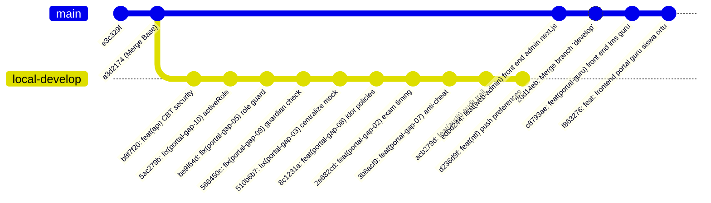

# SISTLABUM-GITHUB-PULL-01 — Laporan Pemeriksaan Git & Analisis Divergence Remote

**Tanggal Pemeriksaan:** 15 Oktober 2026, 18:39 WIB  
**Direktori Repository:** `/Users/macbookprom12020/Desktop/Project/SISTLABUM`  
**Branch Aktif:** `develop`  
**Remote Upstream:** `origin` (`https://github.com/faruqadrean7/SISTLABUM.git`), tracking `origin/develop`  
**Status Eksekusi Pull:** **DITUNDA / DIHENTIKAN SEMENTARA (KASUS B: DIVERGENCE + KASUS C: RISIKO KONFLIK)**

---

## 1. Ringkasan Kondisi Repository

Sebelum menjalankan sinkronisasi, pemeriksaan menyeluruh dan pencadangan telah dilakukan dengan hasil:
1. **Branch Divergence Terdeteksi:**
   - Commit lokal saat ini berada pada `d236d9f` (10 commit di depan titik temu/merge-base).
   - Commit remote `origin/develop` berada pada `f863276` (4 commit baru di GitHub).
   - Titik temu (*merge base*): `a3d2174b889a80a65cf5026484cf096e511f4d46`.
   - Status Git: `## develop...origin/develop [ahead 10, behind 4]`.
2. **Fast-Forward Tidak Memungkinkan:**
   - Karena branch lokal memiliki 10 commit mandiri, `git pull --ff-only` secara teknis tidak dapat dijalankan (`fatal: Not possible to fast-forward, aborting`).
3. **Perubahan Lokal yang Dilindungi:**
   - 140 file tracked mengalami modifikasi (` M`).
   - 41 file tracked dihapus (` D` - penghapusan legacy file HTML/CSS lama).
   - 229 entri file belum dilacak (`??` / 445 file individu).
   - 0 file dalam index staging (`git diff --cached --stat` kosong).
   - Tidak ada operasi merge, rebase, atau cherry-pick yang sedang berjalan.

---

## 2. Pencadangan Terverifikasi (Backup Outside Repo)

Seluruh perubahan lokal telah dicadangkan secara aman di dua lokasi di luar direktori kerja aktif:
1. **Direktori Persisten Scratch Agent:**  
   `/Users/macbookprom12020/.gemini/antigravity/brain/5dadeddf-d4ac-4edd-8649-ce4e37739244/scratch/backup-sistlabum-local-pre-pull/`
2. **Direktori Proyek Eksternal Pengguna:**  
   `/Users/macbookprom12020/Desktop/Project/backup-sistlabum-local-pre-pull/`

### Rincian Berkas Cadangan:
- `tracked_changes.patch`: 1,5 MB (memuat seluruh diff perubahan 140 file termodifikasi dan 41 file terhapus).
- `untracked_files.tar.gz`: 1,9 MB (arsip terkompresi memuat 445 berkas untracked).
- `untracked_files_list.txt`: 445 path berkas untracked terdaftar.
- `git_status_before.txt`: Rekaman kondisi status git sebelum fetch.
- `git_log_before.txt`: Rekaman 10 commit lokal terakhir.
- **Verifikasi Integritas:** Pengujian integritas arsip (`tar -tzf`) mengonfirmasi 445/445 berkas utuh tanpa error. Tidak ada token, password, atau file `.env` rahasia di dalam cadangan.

---

## 3. Analisis Commit Lokal vs Remote

### A. 10 Commit Lokal yang Ada di Mesin Lokal:
1. `d236d9f`: `feat(ntf): implement synchronized push preferences with server role scoping (GAP-11)`
2. `acb279d`: `feat(audit): implement authoritative server-side audit trail for sensitive actions (GAP-06)`
3. `3b8acf9`: `feat(portal-gap-07): implement atomic server-side violation tracking and anti-cheat enforcement`
4. `2e682cd`: `feat(portal-gap-02): enforce server-calculated exam duration, timing and auto-close`
5. `8c1231a`: `feat(portal-gap-08): implement secure self-service portal api endpoints with anti-idor policies`
6. `510b6b7`: `fix(portal-gap-03): centralize mock mode and prevent error swallowing`
7. `566450c`: `fix(portal-gap-09): eliminate mock fallback in guardian child verification`
8. `be9f64d`: `fix(portal-gap-05): enforce role guard across sub-portal layouts`
9. `5ac279b`: `fix(portal-gap-10): sync activeRole on role switcher click and deep link`
10. `b8f7f20`: `feat(api): harden CBT security and complete dashboard validation`

### B. 4 Commit Remote yang Baru Masuk di GitHub (`origin/develop`):
1. `edbd244`: `feat(web-admin): front end admin menggunakan next.js (masih belum di cek)`
2. `20d14eb`: `Merge branch 'develop' of https://github.com/faruqadrean7/SISTLABUM into develop`
3. `c8793ae`: `feat(portal-guru): front end lms guru`
4. `f863276`: `feat: frontend portal guru, siswa dan ortu`

---

## 4. Analisis Dampak Arsitektur & Potensi Konflik (Kasus B & C)

### 1. Konflik File Langsung:
- File `.gitignore` telah dimodifikasi di remote dan juga sedang dimodifikasi secara lokal di working tree.
- Setiap operasi merge atau pull langsung akan memicu penolakan Git:
  `error: Your local changes to the following files would be overwritten by merge: .gitignore`

### 2. Divergence Arsitektur:
- **Perubahan di Remote (`origin/develop`):**
  - Membuat 2 direktori aplikasi Next.js baru yang terpisah di root:
    - `apps/admin/` (Next.js 15 standalone admin app)
    - `apps/portal/` (Next.js 15 standalone portal app untuk guru, siswa, ortu)
  - Memasukkan data mock lokal (`apps/portal/src/lib/mock-lms-data.ts`, `mock-student-data.ts`, `mock-guardian-data.ts`) dan halaman pembayaran `apps/portal/src/app/ortu/biaya/page.tsx`.
- **Implementasi Terintegrasi di Lokal (Sesuai SSOT `13_MASTER_MODULES.md`):**
  - Mengonsolidasikan Web Publik, Portal Peran Personal (`/portal/*`), dan Admin System (`/admin/*`) di dalam satu monorepo Next.js `apps/web/` yang terhubung langsung ke backend Laravel `apps/api`.
  - Telah memiliki 370 backend tests dan 84 frontend tests yang memvalidasi RBAC, eliminasi mock, audit trail, route guarding, dan pencegahan bypass security.
  - Modul Bendahara/Keuangan (`biaya`) berada dalam status `PARTIAL` (pembayaran SPP ditunda ke Fase 4).

### 3. Risiko Keamanan & Integritas:
- Menjalankan `git merge` atau `git pull` secara tergesa-gesa berisiko mengaburkan struktur direktori (akan ada `apps/web`, `apps/admin`, dan `apps/portal` secara bersamaan) serta berpotensi menimpa perubahan lokal yang belum di-commit.

---

## 5. Keputusan & Opsi Penanganan (Kasus B)

Sesuai aturan kerja pada spesifikasi tugas:
> *"Kasus B — Branch divergence: Jika branch lokal dan remote memiliki commit berbeda, jangan melakukan merge atau rebase otomatis. Laporkan commit yang berbeda dan tunggu persetujuan."*

**Integrasi saat ini dihentikan sementara (HALTED) dengan kondisi aman:**
- Working tree lokal **100% utuh**, tidak ada file yang hilang, tertimpa, atau diubah paksa.
- Cadangan telah dibuat dan terverifikasi di dua lokasi aman di luar repositori.
- Local commit tetap di `d236d9f`.

### Opsi Tindak Lanjut yang Tersedia untuk Pengguna:

1. **Opsi 1 (Disarankan — Inspeksi & Review Terpisah):**
   - Buat branch lokal baru untuk commit remote (misalnya `git branch remote-preview origin/develop`).
   - Periksa apakah fitur di `apps/admin` dan `apps/portal` pada remote memang perlu diintegrasikan ke dalam `apps/web` kanonis, atau apakah repositori remote seharusnya diselaraskan dengan hasil pekerjaan lokal saat ini.
2. **Opsi 2 (Merge Manual Terkontrol):**
   - Commit perubahan lokal terlebih dahulu atau simpan sementara, kemudian lakukan `git merge origin/develop` dengan penyelesaian konflik secara manual pada file `.gitignore`.
3. **Opsi 3 (Force Push Remote jika Lokal adalah Otoritas Utama):**
   - Jika 10 commit lokal dan suite pengujian yang sudah diverifikasi (370 backend + 84 frontend tests) adalah acuan yang benar untuk tim, commit remote dapat ditinjau ulang sebelum dilakukan update upstream.
