# LAPORAN FINALISASI KEAMANAN FOTO PROFIL DAN PEMBERSIHAN BERKAS YATIM SISTLABUM
**Dokumen:** `docs/uat/ORPHAN_FILE_CLEANUP_AND_PROFILE_PHOTO_FINAL_REPORT.md`  
**Status Akhir:** `READY FOR STAGING UAT`  
**Target Repository:** `/Users/macbookprom12020/Desktop/Project/SISTLABUM`  
**Branch:** `develop` (HEAD: `448a1a499d3c3a87aa61c3d28428c616dd8f0405`)  
**Tanggal Verifikasi:** 16 Oktober 2026  
**Standar Acuan:** `AGENTS.md`, `13_MASTER_MODULES.md`, `08_DATABASE_SCHEMA.md`, `09_SECURITY_PRIVACY.md`, `10_TESTING_QA.md`

---

## 1. RINGKASAN EKSEKUTIF DAN KEPUTUSAN PROYEK

Laporan ini memfinalisasi evaluasi keamanan fitur Foto Profil Terintegrasi serta mengimplementasikan mekanisme investigasi dan pembersihan berkas unggahan yatim (*orphan file cleanup*) pada arsitektur penyimpanan SISTLABUM.

### Keputusan Pemilik Proyek yang Ditegakkan:
1. **Tata Kelola Resmi Terpusat:** Foto profil resmi siswa dan guru tetap dikelola secara terpusat oleh Bagian Tata Usaha (TU) melalui modul Admin Master Data guna menjamin validitas rapor dan administrasi sekolah.
2. **Ketiadaan Workflow Mandiri/Tabel Verifikasi:** Tidak dibangun alur pengajuan mandiri ataupun tabel verifikasi baru pada tahap ini. Portal persona secara jujur dan transparan menginformasikan tata tertib pembaruan pasfoto resmi melalui TU sekolah.
3. **Penundaan Kolom Tambahan:** Penambahan kolom fisik foto pada tabel `guardians` dan `staff` ditunda sesuai prioritas; komponen Avatar kanonis frontend menggunakan inisial nama secara aman.
4. **Integritas Skema:** Tidak ada eksekusi migrasi atau seeding basis data baru.
5. **Mitigasi Berkas Yatim Teruji:** Telah dibangun layanan `OrphanFileService` dan perintah konsol Artisan `files:cleanup-orphans` yang konservatif, berbasis ambang batas usia (>= 24 jam), memiliki mode dry-run secara bawaan, dan dilengkapi verifikasi ganda.

Status akhir ditetapkan sebagai: **`READY FOR STAGING UAT`**.

---

## 2. AUDIT LENGKAP REFERENSI BERKAS (FILE USAGE MAPPING)

Berdasarkan inspeksi skema basis data PostgreSQL/SQLite pada sistem SISTLABUM, seluruh modul menggunakan satu sumber kebenaran penyimpanan berkas yaitu tabel `files`. Ditemukan tepat **32 relasi kunci asing (*foreign keys*)** yang tersebar di **27 tabel bisnis**:

```mermaid
flowchart LR
    files[Tabel files<br/>id UUID PK]

    subgraph Master & Profil
        students[students.photo_file_id]
        teachers[teachers.photo_file_id]
    end

    subgraph Akademik & LMS
        assignments[assignments.file_id]
        submissions[assignment_submissions.file_id]
        learning[learning_materials.file_id]
        teaching[teaching_materials.file_id]
        leaves[leave_requests.attachment_file_id]
        reports[report_cards.file_id]
        progress[progress_reports.file_id]
        slips[teacher_salary_slips.file_id]
    end

    subgraph Kesiswaan & Ekstrakurikuler
        points[student_points.evidence_file_id]
        achieve_cert[achievements.certificate_file_id]
        achieve_photo[achievements.photo_file_id]
        trips[trips.guide_file_id]
        act_docs[activity_documents.file_id]
    end

    subgraph Sarpras & Presensi
        tickets[tickets.photo_file_id]
        ticket_events[ticket_events.file_id]
        attendances[staff_attendances.photo_file_id]
    end

    subgraph Publikasi & Hubmas
        ppdb[applicant_documents.file_id]
        guests_photo[guests.photo_file_id]
        guests_sig[guests.signature_file_id]
        mou[partnerships.mou_file_id]
        posts[posts.cover_file_id]
        albums[albums.cover_file_id]
        media[media_items.file_id]
        bulletins_cov[bulletins.cover_file_id]
        bulletins_file[bulletins.file_id]
        downloads[downloads.file_id]
        announcements[announcements.attachment_file_id]
        lib_cover[library_books.cover_file_id]
        lib_file[library_books.file_id]
        jobs[jobs.result_file_id]
    end

    students -.-> files
    teachers -.-> files
    assignments -.-> files
    submissions -.-> files
    learning -.-> files
    teaching -.-> files
    leaves -.-> files
    reports -.-> files
    progress -.-> files
    slips -.-> files
    points -.-> files
    achieve_cert -.-> files
    achieve_photo -.-> files
    trips -.-> files
    act_docs -.-> files
    tickets -.-> files
    ticket_events -.-> files
    attendances -.-> files
    ppdb -.-> files
    guests_photo -.-> files
    guests_sig -.-> files
    mou -.-> files
    posts -.-> files
    albums -.-> files
    media -.-> files
    bulletins_cov -.-> files
    bulletins_file -.-> files
    downloads -.-> files
    announcements -.-> files
    lib_cover -.-> files
    lib_file -.-> files
    jobs -.-> files
```



### Matriks Target Referensi yang Dilindungi:
1. `achievements`: `certificate_file_id`, `photo_file_id`
2. `activity_documents`: `file_id`
3. `albums`: `cover_file_id`
4. `announcements`: `attachment_file_id`
5. `applicant_documents`: `file_id` (Dokumen pendaftaran PPDB)
6. `assignment_submissions`: `file_id` (Tugas yang dikumpulkan siswa)
7. `assignments`: `file_id` (Lampiran soal tugas guru)
8. `bulletins`: `cover_file_id`, `file_id` (PDF majalah/buletin)
9. `downloads`: `file_id` (Dokumen unduhan publik)
10. `guests`: `photo_file_id`, `signature_file_id` (Buku tamu & TTD digital)
11. `jobs`: `result_file_id` (Hasil export data/laporan)
12. `learning_materials`: `file_id` (Materi ajar digital)
13. `leave_requests`: `attachment_file_id` (Surat izin/cuti)
14. `library_books`: `cover_file_id`, `file_id` (E-book & sampul perpustakaan)
15. `media_items`: `file_id` (Galeri foto/video)
16. `partnerships`: `mou_file_id` (Dokumen MoU kemitraan)
17. `posts`: `cover_file_id` (Sampul berita/artikel CMS)
18. `progress_reports`: `file_id` (Lembar kemajuan berkala)
19. `report_cards`: `file_id` (E-Rapor resmi siswa)
20. `staff_attendances`: `photo_file_id` (Swafoto presensi GPS staf)
21. `student_points`: `evidence_file_id` (Bukti poin pelanggaran/prestasi)
22. `students`: `photo_file_id` (Pasfoto resmi siswa)
23. `teacher_salary_slips`: `file_id` (Slip gaji guru)
24. `teachers`: `photo_file_id` (Pasfoto resmi guru)
25. `teaching_materials`: `file_id` (Bahan ajar kurikulum)
26. `ticket_events`: `file_id` (Bukti progres perbaikan sarpras)
27. `tickets`: `photo_file_id` (Foto kerusakan sarpras)
28. `trips`: `guide_file_id` (Buku panduan kegiatan luar sekolah)

> **Prinsip Utama:** Tidak ada file yang boleh dianggap yatim hanya karena tidak terhubung ke tabel `students` atau `teachers`. Pembersihan wajib memeriksa seluruh 32 target referensi di atas ditambah inspeksi dinamis basis data.

---

## 3. RANCANG BANGUN LAYANAN DAN PERINTAH CLEANUP YANG AMAN

Telah diimplementasikan dua komponen backend berstandar enterprise:
1. **Layanan Inti:** [`apps/api/app/Services/Storage/OrphanFileService.php`](file:///Users/macbookprom12020/Desktop/Project/SISTLABUM/apps/api/app/Services/Storage/OrphanFileService.php)
2. **Perintah Konsol Artisan:** [`apps/api/app/Console/Commands/CleanupOrphanFilesCommand.php`](file:///Users/macbookprom12020/Desktop/Project/SISTLABUM/apps/api/app/Console/Commands/CleanupOrphanFilesCommand.php)

### 7 Lapisan Perlindungan Keamanan (Defense-in-Depth):
1. **Grace Period 24 Jam:** Hanya berkas yang berumur minimal 24 jam (`created_at < now()->subHours(24)`) yang dapat dipertimbangkan. Berkas yang baru diunggah (< 24 jam) dilindungi secara mutlak agar tidak mengganggu pengguna yang sedang mengisi formulir bertahap.
2. **Pemeriksaan Komprehensif (32 Target):** Setiap berkas diperiksa terhadap 32 kolom kunci asing di seluruh basis data. Jika ada SATU saja tabel yang mencatat ID berkas tersebut, berkas langsung ditandai `REFERENCED` dan dipertahankan.
3. **Inspeksi Skema Dinamis:** Mendeteksi secara dinamis bila ada tabel atau foreign key baru yang ditambahkan di kemudian hari.
4. **Fail-Safe / Pendekatan Konservatif:** Jika query ke suatu tabel mengalami kegagalan teknis, berkas diasumsikan aktif (`ERROR_ASSUMED_REFERENCED`) dan dilarang dihapus.
5. **Mode Dry-Run Default:** Menjalankan `php artisan files:cleanup-orphans` secara default hanya menghasilkan laporan analisis dan estimasi kapasitas tanpa menghapus data atau berkas fisik. Eksekusi nyata memerlukan parameter eksplisit `--execute`.
6. **Verifikasi Ganda (*Double-Check Guard*):** Tepat sebelum baris data dan berkas fisik dihapus pada mode eksekusi, sistem melakukan re-verifikasi instan. Jika berkas baru saja dikaitkan oleh entitas lain pada milidetik terakhir, proses penghapusan berkas tersebut seketika dibatalkan.
7. **Pencatatan Audit Log & Privasi Data:** Setiap operasi pembersihan aktual mencatat log resmi ke tabel `audit_logs` dengan aksi `FILES_ORPHAN_PURGED`. Tidak ada informasi pribadi (nama siswa, NIK, nama berkas mentah) yang dicetak pada konsol atau log.

---

## 4. VERIFIKASI KEAMANAN FOTO PROFIL (SECTION C)

1. **Validasi Server-Side:**
   - Berkas dengan `purpose: 'avatar'` dibatasi maksimal 2 MB di server (`PresignFileRequest` dan `FileStorageService`).
   - Ekstensi dan MIME divalidasi ketat di server: hanya menerima `image/jpeg`, `image/png`, dan `image/webp`.
2. **Otorisasi & Anti-IDOR:**
   - Pembaruan pasfoto resmi siswa hanya dapat dilakukan melalui endpoint yang dilindungi izin `master.student.write`.
   - Pembaruan pasfoto resmi guru hanya dapat dilakukan melalui endpoint yang dilindungi izin `master.teacher.manage`.
   - Pengguna dengan role siswa, guru, orang tua, atau staf yang mencoba memanipulasi `photo_file_id` secara langsung menerima respon HTTP 403 Forbidden.
3. **Pemisahan Visibilitas & URL Publik:**
   - Berkas foto profil disimpan dengan visibilitas `publik` dan nama objek biner acak (UUID v4) dalam direktori `public/YYYY/MM/`, menghindari paparan direktori sistem.
   - Atribut `$file->url` pada model `File` secara konsisten mengembalikan `null` untuk berkas privat, mengharuskan URL bertanda tangan sementara (Signed URL <= 5 menit).

---

## 5. HASIL PENGUJIAN OTOMATIS AKTUAL (SECTION D)

### A. Pengujian Layanan Orphan File Cleanup (`apps/api`)
Perintah:
```bash
php artisan test --filter="OrphanFileCleanupTest"
```
Hasil:
```json
{"tool":"phpunit","result":"passed","tests":8,"passed":8,"assertions":30,"duration_ms":557}
```
**Status: 8/8 Lulus (100% Green)**
- `test_active_file_referenced_by_student_is_never_marked_as_orphan` ✅ (Berkas siswa aktif tidak tersentuh)
- `test_active_file_referenced_by_teacher_is_never_marked_as_orphan` ✅ (Berkas guru aktif tidak tersentuh)
- `test_active_file_referenced_by_ticket_is_never_marked_as_orphan` ✅ (Berkas modul lain tidak tersentuh)
- `test_recent_unreferenced_file_under_24_hours_is_protected_from_orphan_scan` ✅ (Grace period 24 jam aktif)
- `test_old_unreferenced_file_over_24_hours_is_identified_as_orphan_candidate` ✅ (Deteksi akurat berkas yatim)
- `test_dry_run_command_reports_orphans_without_deleting_physical_or_db_data` ✅ (Dry-run tidak menghapus data)
- `test_execute_command_purges_orphan_and_records_audit_log` ✅ (Eksekusi aman & tercatat audit)
- `test_concurrent_association_double_check_prevents_purging_if_file_becomes_referenced` ✅ (Verifikasi ganda aktif)

### B. Pengujian Seluruh Komponen Penyimpanan Berkas (`apps/api`)
Perintah:
```bash
php artisan test --filter="Storage"
```
Hasil:
```json
{"tool":"phpunit","result":"passed","tests":31,"passed":31,"assertions":124,"duration_ms":1001}
```
**Status: 31/31 Lulus (100% Green)**

### C. Pengujian Regresi Lintas Modul Backend (`apps/api`)
Perintah:
```bash
php artisan test --filter="StudentTest|TeacherStaffTest|Storage|MePortalApiTest|UserControllerTest"
```
Hasil:
```json
{"tool":"phpunit","result":"passed","tests":89,"passed":89,"assertions":456,"duration_ms":2316}
```
**Status: 89/89 Lulus (100% Green)**

### D. Frontend Typecheck (`apps/web`)
Perintah:
```bash
npm run typecheck
```
Hasil: `Exit code: 0 (0 error, clean typecheck)`

### E. Frontend Profile Photo UI & Component Tests (`apps/web`)
Perintah:
```bash
npx vitest run src/test/profile-photo.test.tsx
```
Hasil: `10/10 Lulus (Duration: 880ms, Exit code: 0)`

### F. Frontend Full Test Suite (`apps/web`)
Perintah:
```bash
npm test
```
Hasil: `66 file uji lulus, 775 tes lulus, 0 gagal (Duration: 11.96s, Exit code: 0)`

---

## 6. ANALISIS RISIKO RESIDUAL DAN REKOMENDASI PENJADWALAN

### Analisis Risiko Residual:
1. **Risiko Penghapusan Berkas Aktif:** Sangat Rendah (Negligible). Dengan 32 target foreign key, inspeksi skema dinamis, grace period 24 jam, dan verifikasi ganda instan, probabilitas terhapusnya berkas aktif adalah nihil.
2. **Konektivitas Penyimpanan S3 / Disk:** Jika koneksi storage fisik terputus saat penghapusan fisik, transaksi database membatalkan perubahan dan mencatat kegagalan dalam log tanpa merusak referensi data bisnis.

### Rekomendasi Penjadwalan Pembersihan Otomatis (Cron / Scheduler):
Perintah `files:cleanup-orphans` telah dirancang aman untuk dijalankan secara berkala pada jam beban rendah (misal pukul 03:00 dini hari) dengan konfigurasi ambang batas 48 jam untuk keamanan ekstra:
```php
// apps/api/routes/console.php
use Illuminate\Support\Facades\Schedule;

Schedule::command('files:cleanup-orphans --hours=48 --execute --force')
    ->dailyAt('03:00')
    ->withoutOverlapping()
    ->onOneServer();
```

---

## 7. KESIMPULAN

Fitur Foto Profil Terintegrasi dan mekanisme Pembersihan Berkas Upload Yatim (*Safe Orphan File Cleanup*) telah selesai diimplementasikan, diperkuat dari sisi keamanan server dan klien, terverifikasi melalui 89 tes backend dan 775 tes frontend tanpa pelanggaran terhadap batasan arsitektur atau skema database.

Sistem dinyatakan **`READY FOR STAGING UAT`**.
