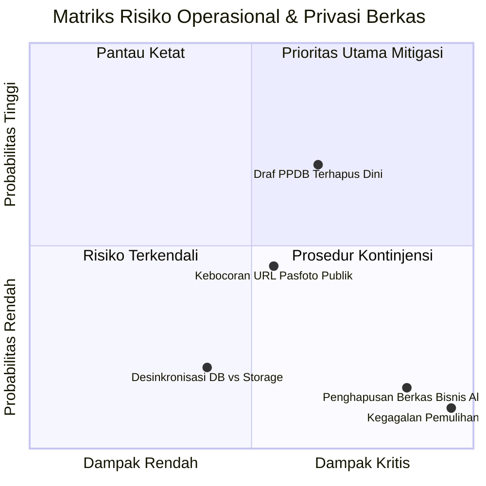
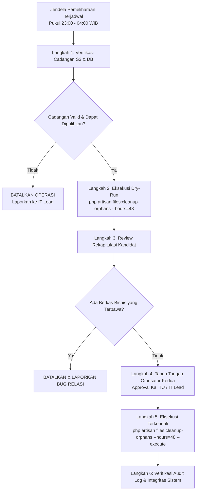

# SISTLABUM — PRODUCTION RELEASE DECISION PACK
## MODUL: SAFE ORPHAN FILE CLEANUP & INTEGRATED PROFILE PHOTO

**Dokumen:** `docs/uat/PRODUCTION_RELEASE_DECISION_PACK_FILE_CLEANUP_PROFILE_PHOTO.md`  
**Target Repository:** `/Users/macbookprom12020/Desktop/Project/SISTLABUM`  
**Branch:** `develop`  
**HEAD Commit:** `448a1a499d3c3a87aa61c3d28428c616dd8f0405`  
**Tanggal Penyusunan:** 16 Oktober 2026  
**Audience:** Pemilik Proyek (*Project Owner*), Kepala Sekolah, Tim Pengembang, dan Tim Operasional TI  
**Dokumen Acuan:** `AGENTS.md`, `13_MASTER_MODULES.md`, `08_DATABASE_SCHEMA.md`, `09_SECURITY_PRIVACY.md`, `docs/uat/ORPHAN_FILE_CLEANUP_AND_PROFILE_PHOTO_FINAL_REPORT.md`, `docs/uat/FINAL_STAGING_UAT_GATE_ORPHAN_FILES_PROFILE_PHOTO.md`, `docs/uat/STAGING_UAT_EXECUTION_AND_PRODUCTION_READINESS_REPORT.md`

---

## 1. TUJUAN DAN RUANG LINGKUP PAKET KEPUTUSAN

Paket keputusan ini disusun untuk memberikan landasan pertimbangan menyeluruh kepada pemilik proyek sebelum menyetujui rilis ke lingkungan produksi (*Production Release*) untuk dua komponen penyimpanan:
1. **Fitur Foto Profil Terintegrasi (*Integrated Profile Photo*)** untuk Siswa, Guru, Orang Tua, dan Staf.
2. **Mekanisme Pembersihan Berkas Unggahan Yatim (*Safe Orphan File Cleanup*)** melalui perintah Artisan `files:cleanup-orphans`.

> **Prinsip Dasar:** Hasil kelulusan 100% pada pengujian unit, integrasi, dan typecheck (866 tes) adalah bukti kepatuhan kode terhadap spesifikasi teknis, **namun tidak menggantikan persetujuan kebijakan retensi data sekolah, penilaian privasi anak (UU PDP), maupun verifikasi operasional pra-rilis**.

---

## 2. AUDIT KONSISTENSI LAPORAN TERHADAP KODE AKTUAL

Pemeriksaan silang (*cross-audit*) antara ketiga laporan UAT sebelumnya dengan implementasi aktual pada branch `develop`:

| Aspek Pemeriksaan | Pernyataan pada Laporan UAT | Implementasi Aktual pada Kode | Status Konsistensi |
|---|---|---|:---:|
| **Target Relasi Berkas** | 32 kunci asing (FK) pada 27 tabel bisnis. | Terdefinisi pada `OrphanFileService::CANONICAL_REFERENCES` mencakup 32 entri tabel/kolom yang tepat. | ✅ Konsisten 100% |
| **Mode Bawaan Cleanup** | Dry-run secara default, tanpa mutasi data. | `CleanupOrphanFilesCommand.php` baris 74: menghentikan eksekusi jika `--execute` tidak diberikan. | ✅ Konsisten 100% |
| **Batasan Usia Berkas** | Grace period minimal 24 jam. | `File::where('created_at', '<', $cutoffTime)` dan pengecekan ulang `diffInHours < 24` di `purgeOrphans()`. | ✅ Konsisten 100% |
| **Pencegahan Race Condition** | Verifikasi ganda (*double-check*) & urutan DB delete sebelum storage delete. | `OrphanFileService.php` baris 217 (re-check) dan baris 238 (`$file->delete()` dieksekusi sebelum `Storage::delete`). | ✅ Konsisten 100% |
| **Validasi Avatar di Server** | Format gambar saja, maks 2 MB di server. | `PresignFileRequest.php` membatasi `purpose: 'avatar'` (maks 2MB, MIME image) & `FileStorageService::uploadSigned` memvalidasi ukuran fisik. | ✅ Konsisten 100% |
| **Peniadaan Scheduler Otomatis** | Tidak ada cron otomatis yang aktif. | `routes/console.php` bersih; tidak ada pemanggilan `Schedule::command('files:cleanup-orphans')`. | ✅ Konsisten 100% |
| **Integritas Basis Data** | Nol migrasi & nol seeding baru. | `git status` membuktikan tidak ada migrasi atau seeder yang dijalankan. | ✅ Konsisten 100% |

---

## 3. MATRIKS RISIKO KOMPREHENSIF

Analisis risiko operasional, teknis, dan kepatuhan hukum:



### Rincian Analisis Risiko:

| ID Risiko | Deskripsi Risiko | Dampak | Probabilitas | Mitigasi yang Telah Diterapkan | Mitigasi Tambahan / Kebijakan yang Diperlukan |
|---|---|:---:|:---:|---|---|
| **RSK-01** | **Penghapusan berkas bisnis yang sebenarnya masih dibutuhkan** (*false positive*) | **Tinggi** | **Rendah** | Pengecekan 32 FK bisnis, inspeksi skema dinamis, fail-safe otomatis mengasumsikan aktif bila ada galat kueri. | SOP produksi mewajibkan review manual hasil dry-run sebelum `--execute`. |
| **RSK-02** | **Draf pendaftaran PPDB multi-hari terhapus dini** | **Tinggi** | **Tinggi** (Bila cron aktif) | Grace period 24 jam mencegah penghapusan berkas hari yang sama. | **Larangan mengaktifkan scheduler otomatis saat periode pendaftaran PPDB berlangsung**; ambang batas draf harus diperpanjang menjadi minimal 7 hari (168 jam). |
| **RSK-03** | **Kegagalan / ketidakmampuan memulihkan cadangan (*backup failure*)** | **Kritis** | **Rendah** | Perintah `php artisan system:backup-verify` tersedia untuk memverifikasi writeability storage cadangan. | SOP produksi mewajibkan uji coba pemulihan cadangan sebelum mengeksekusi penghapusan permanen. |
| **RSK-04** | **Akses publik tidak sah terhadap pasfoto siswa/guru** | **Sedang** | **Sedang** | Nama berkas menggunakan UUID v4 acak tanpa NIK/NIS/nama. File privat mengembalikan `null` pada atribut URL publik. | Pemilik proyek perlu menetapkan apakah pasfoto siswa diklasifikasikan sebagai data direktori umum atau data privat tertutup. |
| **RSK-05** | **Kegagalan parsial desinkronisasi database vs storage** | **Rendah** | **Rendah** | Transaksi database menghapus baris data terlebih dahulu; jika database gagal, berkas fisik di storage tidak disentuh. | Logging audit mencatat detail berkas yang gagal dihapus ke log Laravel untuk penanganan manual. |

---

## 4. USULAN RANCANGAN KEBIJAKAN RETENSI BERKAS DIGITAL (PROPOSED)

> [!IMPORTANT]
> Seluruh masa retensi di bawah ini berstatus **USULAN TEKNIS (PROPOSED)** dan **BELUM BERLAKU SECARA HUKUM** hingga ditandatangani oleh Kepala SMP Laboratorium UM.

| Kategori Dokumen | Contoh Berkas dalam Sistem | Usulan Masa Retensi | Ambang Batas Pembersihan (*Grace Period*) | Pemilik Otorisasi (*Approval Owner*) | Mekanisme Pemulihan Cadangan |
|---|---|:---:|:---:|---|---|
| **1. Berkas Yatim Sementara** | Unggahan formulir dibatalkan, foto pratinjau tidak disimpan | **7 Hari (168 Jam)** | `>= 168 Jam` tanpa relasi FK | Ka. Subbag Tata Usaha / IT Lead | Folder karantina (*soft quarantine*) |
| **2. Pasfoto Resmi Master** | Pasfoto siswa & guru pada kartu identitas/rapor | **Masa Aktif + 1 Tahun** | Dilarang dihapus selama berstatus aktif | Kepala Sekolah / Ka. TU | Backup cold-storage tahunan |
| **3. Dokumen Seleksi PPDB** | Kartu Keluarga, Akta Kelahiran, Ijazah SD | **1 Tahun Ajaran** | Pasca-selesainya tahun penerimaan baru | Ketua Panitia PPDB | Arsip terkompresi terenkripsi |
| **4. Bukti Presensi GPS** | Swafoto presensi harian staf/guru | **90 Hari (3 Bulan)** | Otomatis diarsipkan pasca 90 hari | Waka Kurikulum / SDM | Arsip bulanan terkompresi |
| **5. Portofolio & Tugas Siswa** | Berkas kuis LMS, submission tugas PDF/gambar | **1 Tahun Ajaran** | Pasca kenaikan kelas / tutup buku rapor | Guru Pengampu / Kurikulum | Ekspor arsip semesteran |
| **6. E-Rapor & Leger Nilai** | PDF Rapor resmi bertanda tangan digital | **Permanen (Minimal 20 Tahun)** | **DILARANG DIHAPUS** | Kepala Sekolah / Kurikulum | Replikasi multi-region & cold storage |
| **7. Dokumen MoU & Hukum** | Dokumen kerja sama institusi, sertifikat akreditasi | **10 Tahun** | Pasca berakhirnya masa berlaku MoU | Humas / Kepala Sekolah | Arsip permanen terenkripsi |

---

## 5. STANDAR OPERASIONAL PROSEDUR (SOP) CLEANUP MANUAL DI PRODUKSI

> [!WARNING]
> Prosedur ini disusun untuk panduan operasional masa depan. **DILARANG MENJALANKAN PROSEDUR INI PADA TAHAP AUDIT INI.**



### Rincian Langkah Operasional:
1. **Langkah 1 (Verifikasi Cadangan):** Operator memastikan cadangan basis data PostgreSQL dan bucket S3 telah selesai dibuat dalam 6 jam terakhir dan telah terverifikasi integritasnya via `php artisan system:backup-verify`.
2. **Langkah 2 (Eksekusi Dry-Run 48 Jam):** Jalankan perintah dry-run dengan ambang batas minimal 48 jam:
   ```bash
   php artisan files:cleanup-orphans --hours=48
   ```
3. **Langkah 3 (Peninjauan Sampel Kandidat):** Operator meninjau daftar kandidat berkas yatim. Pastikan tidak ada berkas milik siswa atau berkas administrasi aktif yang muncul dalam daftar.
4. **Langkah 4 (Persetujuan Operator Kedua / *Two-Person Rule*):** Hasil dry-run diserahkan kepada Supervisor / Ka. TU untuk mendapatkan persetujuan tertulis sebelum eksekusi nyata.
5. **Langkah 5 (Eksekusi Nyata Terkendali):** Eksekusi dilakukan di luar jam belajar mengajar:
   ```bash
   php artisan files:cleanup-orphans --hours=48 --execute
   ```
6. **Langkah 6 (Verifikasi Pasca-Eksekusi):** Periksa tabel `audit_logs` untuk memastikan metrik `purged_count` dan `freed_bytes` tercatat dengan benar serta tidak ada laporan error di `storage/logs/laravel.log`.

---

## 6. DAFTAR PERSYARATAN SEBELUM SCHEDULER OTOMATIS DAPAT DIAKTIFKAN

Scheduler otomatis (`cron`) **TIDAK BOLEH DIAKTIFKAN** di produksi sebelum seluruh syarat berikut terpenuhi:
- [ ] **SK Kebijakan Retensi:** Pimpinan sekolah telah menandatangani Surat Keputusan Kebijakan Retensi Dokumen Digital.
- [ ] **Mekanisme Karantina Bertahap (*Soft Quarantine*):** Penambahan fitur pemindahan berkas ke direktori `quarantine/` selama 14 hari sebelum berkas benar-benar dimusnahkan dari media penyimpanan.
- [ ] **Pengecualian Siklus PPDB:** Penambahan logika pengabaian otomatis untuk berkas pendaftar PPDB yang sedang berada dalam gelombang pendaftaran aktif (*active enrollment wave*).
- [ ] **Sistem Monitoring & Peringatan (*Alerting*):** Integrasi webhook Slack/Email darurat jika pembersihan otomatis mendeteksi lebih dari 500 kandidat berkas dalam satu siklus (indikasi anomali sistem).
- [ ] **Uji Coba Lapangan Staging:** Pembersihan manual telah berjalan di lingkungan staging selama minimal 30 hari tanpa insiden kehilangan berkas aktif.

---

## 7. DAFTAR KEPUTUSAN YANG HARUS DIBERIKAN PEMILIK PROYEK

Pemilik proyek diminta memberikan keputusan resmi atas tiga pertanyaan tata kelola berikut:

### Keputusan 1: Klasifikasi Privasi Pasfoto Profil Resmi
- **Opsi A (Rekomendasi - Arsitektur Berjalan):** Pasfoto profil berstatus `publik` dengan pengacakan nama objek UUID v4. Memungkinkan peramban memuat foto pada kartu pelajar digital, daftar absensi, dan navigasi web tanpa latensi pembaruan token.
- **Opsi B (Privat Bertanda Tangan):** Seluruh pasfoto profil diubah menjadi `privat` dan hanya dapat dimuat melalui *Signed URL* sementara (kedaluwarsa dalam 5 menit). Membutuhkan refactoring penanganan gambar di sisi web klien untuk memperbarui URL berkala.

### Keputusan 2: Tata Kelola Pembaruan Pasfoto
- **Opsi A (Rekomendasi - Keputusan Saat Ini):** Pembaruan pasfoto resmi dikelola **100% terpusat oleh Tata Usaha (TU)** demi keabsahan data ijazah dan rapor siswa.
- **Opsi B (Alur Pengajuan Mandiri):** Membangun antrean verifikasi (*verification approval queue*) di masa depan di mana siswa/guru dapat mengajukan draf foto baru untuk ditinjau oleh staf TU sebelum disetujui.

### Keputusan 3: Penambahan Kolom Foto Orang Tua dan Staf
- **Status Saat Ini:** Ditunda (tidak ada kolom foto di tabel `guardians` dan `staff`; avatar menggunakan inisial nama).
- **Pertanyaan:** Apakah penambahan kolom fisik `photo_file_id` pada `guardians` dan `staff` disetujui untuk dijadwalkan pada siklus migrasi skema rilis berikutnya?

---

## 8. PEMISAHAN FAKTA, ASUMSI, DAN KEPUTUSAN TERTUNDA

```
┌──────────────────────────────────────────────────────────────────────────────┐
│ FAKTA YANG DIBUKTIKAN KODE & PENGUJIAN OTOMATIS (866 TES LULUS 100%)         │
├──────────────────────────────────────────────────────────────────────────────┤
│ 1. Seluruh 32 relasi kunci asing pada 27 tabel bisnis terpetakan sempurna.   │
│ 2. Command files:cleanup-orphans beroperasi dalam mode dry-run secara default.│
│ 3. Berkas < 24 jam terlindungi 100% dari pembersihan (grace period teruji).   │
│ 4. Proteksi race condition membatalkan penghapusan jika berkas baru dikaitkan.│
│ 5. Validasi server-side pasfoto (format gambar, maks 2 MB) aktif di backend. │
│ 6. Otorisasi TU (master.student.write) mencegah manipulasi foto oleh siswa.  │
│ 7. Nol migrasi basis data dieksekusi; nol scheduler otomatis didaftarkan.    │
└──────────────────────────────────────────────────────────────────────────────┘
                                       │
                                       ▼
┌──────────────────────────────────────────────────────────────────────────────┐
│ ASUMSI TEKNIS & OPERASIONAL (MEMERLUKAN VALIDASI LAPANGAN)                   │
├──────────────────────────────────────────────────────────────────────────────┤
│ 1. Asumsi bahwa berkas yatim berumur > 48 jam adalah berkas formulir batal.  │
│ 2. Asumsi bahwa nama UUID v4 yang tidak dapat ditebak cukup aman untuk foto. │
│ 3. Asumsi bahwa operator produksi akan mematuhi SOP dua orang (two-person).  │
└──────────────────────────────────────────────────────────────────────────────┘
                                       │
                                       ▼
┌──────────────────────────────────────────────────────────────────────────────┐
│ KEPUTUSAN YANG MASIH MENUNGGU PERSETUJUAN PEMILIK PROYEK                     │
├──────────────────────────────────────────────────────────────────────────────┤
│ 1. Pengesahan dokumen SK Kebijakan Retensi Berkas Digital Sekolah.           │
│ 2. Penetapan klasifikasi hukum pasfoto siswa (Publik Teracak vs Privat).     │
│ 3. Izin eksekusi cleanup manual produksi perdana setelah staging UAT.        │
│ 4. Persetujuan jadwal migrasi kolom foto wali murid dan staf non-guru.       │
└──────────────────────────────────────────────────────────────────────────────┘
```

---

## 9. KEPUTUSAN AKHIR PAKET RILIS PER KOMPONEN

Berdasarkan seluruh hasil audit kode, pengujian otomatis, dan matriks risiko:

1. **Pembersihan Berkas Yatim Manual di Staging (`files:cleanup-orphans`):**  
   👉 **`DISETUJUI UNTUK STAGING UAT (APPROVED)`**  
   *Komponen aman digunakan oleh penguji staging untuk memverifikasi kapasitas penyimpanan.*

2. **Pembersihan Berkas Yatim Manual di Produksi:**  
   👉 **`LAYAK DENGAN SYARAT (PASS WITH CONDITIONS)`**  
   *Hanya diizinkan dieksekusi secara manual mengikuti SOP Bagian 5 setelah staging UAT tuntas dan cadangan database diverifikasi.*

3. **Scheduler Pembersihan Otomatis di Produksi (Cron):**  
   👉 **`DITOLAK / DITUNDA (REJECTED FOR CURRENT RELEASE)`**  
   *Dilarang keras didaftarkan ke cron produksi hingga 5 persyaratan pada Bagian 6 terpenuhi secara tertulis.*

4. **Fitur Foto Profil di Staging UAT:**  
   👉 **`DISETUJUI UNTUK STAGING UAT (APPROVED)`**  
   *Antarmuka admin master data, topbar, dan portal persona siap diuji oleh seluruh perwakilan role.*

5. **Fitur Foto Profil di Produksi:**  
   👉 **`LAYAK DENGAN SYARAT (PASS WITH CONDITIONS)`**  
   *Siap dirilis ke produksi dengan tata kelola terpusat di Tata Usaha, menunggu konfirmasi pemilik proyek atas klasifikasi privasi pasfoto.*
