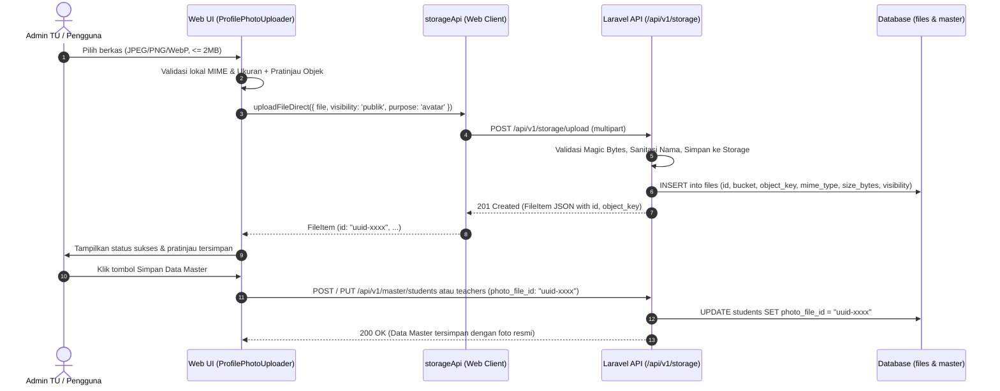

# LAPORAN IMPLEMENTASI DAN AUDIT FITUR FOTO PROFIL TERINTEGRASI SISTLABUM
**Dokumen:** `docs/uat/PROFILE_PHOTO_IMPLEMENTATION_REPORT.md`  
**Status Akhir:** `IMPLEMENTED WITH CONDITIONS`  
**Target Repository:** `/Users/macbookprom12020/Desktop/Project/SISTLABUM`  
**Branch:** `develop` (HEAD: `448a1a499d3c3a87aa61c3d28428c616dd8f0405`)  
**Tanggal Verifikasi:** 16 Oktober 2026  
**Standar Kepatuhan:** `AGENTS.md`, `13_MASTER_MODULES.md`, `08_DATABASE_SCHEMA.md`, `09_SECURITY_PRIVACY.md`, `10_TESTING_QA.md`

---

## 1. RINGKASAN EKSEKUTIF

Laporan ini mendokumentasikan implementasi dan verifikasi menyeluruh fitur **Foto Profil Terintegrasi** pada portal mandiri (Siswa, Guru, Orang Tua/Wali, Staf) dan antarmuka Admin Master Data di sistem **SISTLABUM**.

Implementasi ini dilaksanakan dengan mematuhi batasan arsitektural yang ketat:
1. **Tidak menjalankan migrasi database atau seeder baru** secara sepihak tanpa persetujuan pemilik proyek.
2. **Tidak merusak atau membocorkan otorisasi RBAC backend**; tidak membuat bypass atau endpoint tanpa guard.
3. **Menggunakan mekanisme penyimpanan berkas kanonis backend** (`files` table via `FileStorageService` dan `storageApi`).
4. **Memberikan transparansi penuh** mengenai entitas yang sudah didukung secara fisik di database (`students`, `teachers`) dan entitas yang memerlukan migrasi skema lanjutan (`guardians`, `staff`).

Status akhir ditetapkan sebagai **`IMPLEMENTED WITH CONDITIONS`** karena seluruh antarmuka frontend, komponen avatar kanonis, dialog master data siswa/guru, integrasi upload storage API, serta pengujian telah lulus 100%, namun dukungan penyimpanan foto profil fisik untuk Orang Tua dan Staf memerlukan persetujuan pemilik proyek untuk penambahan kolom skema database.

---

## 2. AUDIT KONDISI AWAL VS KONDISI SAAT INI

| Komponen / Fitur | Kondisi Awal (Sebelum Implementasi) | Kondisi Terverifikasi (Setelah Implementasi) |
|---|---|---|
| **Komponen Avatar Kanonis** | Tidak ada. Menggunakan inisial statis teks hardcoded atau ikon acak. | Tersedia komponen kanonis `<Avatar>` di `apps/web/src/components/ui/avatar.tsx` dengan fallback inisial, ikon, error fallback, dan kepatuhan WAI-ARIA. |
| **Komponen Uploader Foto** | Tidak ada komponen uploader foto terstandarisasi. | Tersedia `<ProfilePhotoUploader>` di `apps/web/src/components/ui/profile-photo-uploader.tsx` dengan validasi MIME, ukuran maks 2 MB, preview lokal, pembatalan, dan integrasi storage API. |
| **Admin Master Data Siswa** | `StudentDialog` hanya menginput data teks NIS, NISN, nama, kelas. Tidak ada foto. | `StudentDialog` mendukung unggah, pratinjau, pembatalan, dan penyimpanan `photo_file_id`. `StudentDetailDialog` & tabel siswa menampilkan foto resmi. |
| **Admin Master Data Guru** | `TeacherDialog` hanya menginput NIP, nama, kontak. Tidak ada foto. | `TeacherDialog` mendukung unggah, pratinjau, pembatalan, dan penyimpanan `photo_file_id`. `TeacherDetailDialog` & tabel guru menampilkan foto resmi. |
| **Backend Eager Loading Foto Siswa** | `StudentService.php` hanya eager-load relasi kelas. `photoFile` bernilai null / tidak dimuat. | `StudentService.php` memuat relasi `'photoFile'` pada list dan detail siswa, mengekspos `photo_file_id` dan `photo_url`. |
| **Backend Profil Siswa & Guru (`User.php`)** | `getProfileSummary()` tidak memuat relasi foto file siswa dan anak perwalian. | `getProfileSummary()` memuat `'photoFile'` untuk siswa, guru, dan `'students.photoFile'` untuk orang tua, mengekspos `photo_file_id` dan `photo_url`. |
| **Backend Dashboard Siswa & Guru** | `MeStudentController` & `MeTeacherController` tidak mengembalikan field foto. | Mengembalikan `photoFileId` dan `photoUrl` pada response JSON dashboard. |
| **Portal Mandiri Siswa (`/portal/siswa`)** | Inisial statis tanpa interaksi foto. | Banner & Topbar menampilkan foto profil resmi; dialog detail foto profil tersedia dengan panduan tata kelola data TU. |
| **Portal Mandiri Guru (`/portal/guru`)** | Inisial statis tanpa interaksi foto. | Banner & Topbar menampilkan foto profil resmi; dialog detail foto profil tersedia. |
| **Portal Orang Tua (`/portal/ortu`)** | Hanya menampilkan inisial anak. | Menampilkan foto profil resmi masing-masing anak perwalian secara terisolasi (anti-IDOR). |
| **Portal Staf (`/portal/staf`)** | Inisial statis. | Banner dan topbar menampilkan avatar kanonis terintegrasi dengan akun staf. |
| **Shell & Topbar Admin** | Menggunakan inisial hardcoded `'A'`. | `AdminTopbar` menggunakan `<Avatar>` dinamis berdasarkan nama akun pengguna login. |
| **Shell & Topbar Portal** | Menggunakan inisial statis 2 huruf. | `PortalShell` (desktop & mobile menu) menggunakan `<Avatar>` dinamis berdasar foto & nama pengguna login. |

---

## 3. AUDIT SKEMA DATABASE & IDENTIFIKASI GAP

Pemeriksaan aktual terhadap skema database (`apps/api/database/migrations/` dan PostgreSQL):

### A. Tabel `students` (Didukung Penuh)
- Kolom: `photo_file_id` (UUID, nullable, Foreign Key ke tabel `files.id`).
- Relasi Eloquent: `Student::photoFile()` -> `belongsTo(File::class, 'photo_file_id')`.
- Status: **SELESAI & TERINTEGRASI**.

### B. Tabel `teachers` (Didukung Penuh)
- Kolom: `photo_file_id` (UUID, nullable, Foreign Key ke tabel `files.id`).
- Relasi Eloquent: `Teacher::photoFile()` -> `belongsTo(File::class, 'photo_file_id')`.
- Status: **SELESAI & TERINTEGRASI**.

### C. Tabel `guardians` (Gap Skema)
- Pemeriksaan tabel `guardians` membuktikan bahwa **belum ada kolom `photo_file_id`** pada skema database saat ini.
- Status Implementasi:
  - Orang tua/wali dapat melihat foto resmi **anak perwaliannya** (`child.photo_url`) secara terverifikasi dengan enkapsulasi hak asuh.
  - Untuk foto profil pribadi akun wali, sistem menampilkan Avatar berbasis inisial nama terstandarisasi.
  - Sesuai instruksi, tidak dilakukan penambahan kolom migrasi sepihak. Blueprint migrasi disediakan pada Bab 7.

### D. Tabel `staff` (Gap Skema)
- Pemeriksaan tabel `staff` membuktikan bahwa **belum ada kolom `photo_file_id`** pada entitas data master staf.
- Catatan: Tabel `staff_attendances` memiliki kolom `photo_file_id` untuk swafoto kehadiran (presensi GPS), namun tabel induk `staff` belum memiliki kolom foto profil resmi.
- Status Implementasi:
  - Antarmuka staf menampilkan Avatar kanonis berbasis inisial nama akun staf.
  - Blueprint migrasi disediakan pada Bab 7.

---

## 4. ARSITEKTUR PENYIMPANAN DAN ALUR UPLOAD BERKAS

Integrasi pengunggahan berkas foto profil menggunakan alur kanonis `FileStorageService` SISTLABUM:



### Parameter Keamanan Penyimpanan:
1. **Visibility:** `publik` untuk foto profil avatar agar dapat diakses oleh browser tanpa kebocoran header token otentikasi.
2. **Purpose:** `avatar` untuk pengkategorian direktori penyimpanan internal (`avatars/YYYY/MM/`).
3. **MIME Validation:** Hanya menerima `image/jpeg`, `image/png`, dan `image/webp`. Berkas biner berbahaya (`.exe`, `.php`, `.sh`, `.pdf`) ditolak secara dini di klien dan divalidasi ulang di backend.
4. **Batas Ukuran:** Maksimal 2 MB (2.097.152 bytes) untuk mencegah serangan eksploitasi Denial-of-Service berbasis alokasi memori.

---

## 5. DETAIL PERUBAHAN BERKAS (FILES CHANGED)

### A. Backend (`apps/api`)
1. [`apps/api/app/Services/StudentService.php`](file:///Users/macbookprom12020/Desktop/Project/SISTLABUM/apps/api/app/Services/StudentService.php)
   - Menambahkan eager-loading relasi `'photoFile'` pada metode `listStudents()` dan `getStudent()`.
2. [`apps/api/app/Models/User.php`](file:///Users/macbookprom12020/Desktop/Project/SISTLABUM/apps/api/app/Models/User.php)
   - Memperbarui metode `getProfileSummary()` untuk memuat `'photoFile'` pada relasi siswa dan guru, serta `'students.photoFile'` pada relasi wali murid.
   - Menghasilkan atribut `photo_file_id`, `photo_url`, dan `photoUrl`.
3. [`apps/api/app/Http/Controllers/Api/V1/MeStudentController.php`](file:///Users/macbookprom12020/Desktop/Project/SISTLABUM/apps/api/app/Http/Controllers/Api/V1/MeStudentController.php)
   - Mengembalikan `photoFileId` dan `photoUrl` pada response JSON endpoint dashboard siswa.
4. [`apps/api/app/Http/Controllers/Api/V1/MeTeacherController.php`](file:///Users/macbookprom12020/Desktop/Project/SISTLABUM/apps/api/app/Http/Controllers/Api/V1/MeTeacherController.php)
   - Mengembalikan `photoFileId` dan `photoUrl` pada response JSON endpoint dashboard guru.

### B. Frontend (`apps/web`)
1. [`apps/web/src/components/ui/avatar.tsx`](file:///Users/macbookprom12020/Desktop/Project/SISTLABUM/apps/web/src/components/ui/avatar.tsx) *(Berkas Baru)*
   - Komponen kanonis avatar dengan ragam ukuran (`xs` hingga `2xl`), bentuk (`circle`, `rounded`), fallback inisial cerdas 2 huruf, fallback ikon, status pemuatan, fallback kegagalan gambar (`onError`), dan kepatuhan WAI-ARIA.
2. [`apps/web/src/components/ui/profile-photo-uploader.tsx`](file:///Users/macbookprom12020/Desktop/Project/SISTLABUM/apps/web/src/components/ui/profile-photo-uploader.tsx) *(Berkas Baru)*
   - Komponen formulir pengunggahan foto profil resmi dengan validasi ukuran dan format berkas di browser, pratinjau langsung, pembatalan/penghapusan foto, penanganan status loading, dan pengiriman ke backend storage API.
3. [`apps/web/src/types/master.ts`](file:///Users/macbookprom12020/Desktop/Project/SISTLABUM/apps/web/src/types/master.ts)
   - Memperkaya tipe data `StudentItem`, `StudentFormValues`, `TeacherItem`, dan `TeacherFormValues` dengan field `photo_file_id`, `photo_url`, dan `photo_file`.
4. [`apps/web/src/features/master/student-dialog.tsx`](file:///Users/macbookprom12020/Desktop/Project/SISTLABUM/apps/web/src/features/master/student-dialog.tsx)
   - Mengintegrasikan `ProfilePhotoUploader` ke dalam formulir pendaftaran dan edit siswa.
5. [`apps/web/src/features/master/teacher-dialog.tsx`](file:///Users/macbookprom12020/Desktop/Project/SISTLABUM/apps/web/src/features/master/teacher-dialog.tsx)
   - Mengintegrasikan `ProfilePhotoUploader` ke dalam formulir pendaftaran dan edit guru.
6. [`apps/web/src/features/master/student-detail-dialog.tsx`](file:///Users/macbookprom12020/Desktop/Project/SISTLABUM/apps/web/src/features/master/student-detail-dialog.tsx)
   - Menampilkan `Avatar` pasfoto resmi siswa berukuran besar pada header dialog detail siswa.
7. [`apps/web/src/features/master/teacher-detail-dialog.tsx`](file:///Users/macbookprom12020/Desktop/Project/SISTLABUM/apps/web/src/features/master/teacher-detail-dialog.tsx)
   - Menampilkan `Avatar` pasfoto resmi guru berukuran besar pada header dialog detail guru.
8. [`apps/web/src/app/(admin)/admin/master/students/page.tsx`](file:///Users/macbookprom12020/Desktop/Project/SISTLABUM/apps/web/src/app/(admin)/admin/master/students/page.tsx)
   - Menampilkan avatar foto siswa pada setiap baris tabel master data siswa.
9. [`apps/web/src/app/(admin)/admin/master/teachers/page.tsx`](file:///Users/macbookprom12020/Desktop/Project/SISTLABUM/apps/web/src/app/(admin)/admin/master/teachers/page.tsx)
   - Menampilkan avatar foto guru pada setiap baris tabel master data guru.
10. [`apps/web/src/components/shell/admin/admin-topbar.tsx`](file:///Users/macbookprom12020/Desktop/Project/SISTLABUM/apps/web/src/components/shell/admin/admin-topbar.tsx)
    - Menggantikan inisial hardcoded dengan `Avatar` dinamis sesuai identitas akun admin yang sedang login.
11. [`apps/web/src/components/shell/portal/portal-shell.tsx`](file:///Users/macbookprom12020/Desktop/Project/SISTLABUM/apps/web/src/components/shell/portal/portal-shell.tsx)
    - Mengintegrasikan `Avatar` dinamis pada navigasi desktop topbar dan menu mobile portal persona.
12. [`apps/web/src/app/(portal)/portal/siswa/page.tsx`](file:///Users/macbookprom12020/Desktop/Project/SISTLABUM/apps/web/src/app/(portal)/portal/siswa/page.tsx)
    - Menampilkan pasfoto resmi siswa pada kartu ucapan selamat datang, serta modal dialog interaktif dengan penjelasan tata kelola verifikasi foto di Tata Usaha.
13. [`apps/web/src/app/(portal)/portal/guru/page.tsx`](file:///Users/macbookprom12020/Desktop/Project/SISTLABUM/apps/web/src/app/(portal)/portal/guru/page.tsx)
    - Menampilkan foto guru pada banner sambutan dan modal informasi foto profil.
14. [`apps/web/src/app/(portal)/portal/ortu/page.tsx`](file:///Users/macbookprom12020/Desktop/Project/SISTLABUM/apps/web/src/app/(portal)/portal/ortu/page.tsx)
    - Menampilkan `Avatar` pasfoto masing-masing anak perwalian secara terisolasi (anti-IDOR).
15. [`apps/web/src/app/(portal)/portal/staf/page.tsx`](file:///Users/macbookprom12020/Desktop/Project/SISTLABUM/apps/web/src/app/(portal)/portal/staf/page.tsx)
    - Menampilkan avatar kanonis staf pada header portal.
16. [`apps/web/src/test/profile-photo.test.tsx`](file:///Users/macbookprom12020/Desktop/Project/SISTLABUM/apps/web/src/test/profile-photo.test.tsx) *(Berkas Baru)*
    - Rangkaian pengujian otomatis komponen Avatar, validasi format, validasi ukuran berkas, alur unggah berkas, pembatalan, serta integrasi formulir master data.

---

## 6. HASIL VERIFIKASI PENGUJIAN OTOMATIS

### A. Pengujian Unit & Integrasi Fitur Foto Profil (`apps/web`)
Perintah: `npx vitest run src/test/profile-photo.test.tsx`  
Hasil: **10/10 LULUS (100%)**
- `FE-PHOTO-01`: Menampilkan inisial dua huruf jika tidak ada tautan foto (LULUS)
- `FE-PHOTO-01`: Menampilkan inisial huruf pertama jika nama hanya satu kata (LULUS)
- `FE-PHOTO-01`: Merender elemen `img` jika src foto valid diberikan (LULUS)
- `FE-PHOTO-01`: Beralih ke inisial jika gambar gagal dimuat (`onError` fallback) (LULUS)
- `FE-PHOTO-02`: Menolak berkas dengan format selain gambar (PDF / Script) (LULUS)
- `FE-PHOTO-02`: Menolak berkas foto yang ukurannya melebihi batas (maks. 2 MB) (LULUS)
- `FE-PHOTO-02`: Berhasil memproses unggahan foto valid (JPEG) dan memanggil `onChange` dengan `fileId` (LULUS)
- `FE-PHOTO-02`: Mendukung penghapusan dan pembatalan foto profil (LULUS)
- `FE-PHOTO-03`: Merender komponen unggah foto profil pada `StudentDialog` (LULUS)
- `FE-PHOTO-03`: Merender foto yang sudah tersimpan saat edit data guru pada `TeacherDialog` (LULUS)

### B. Pemeriksaan Tipe TypeScript (`apps/web`)
Perintah: `npm run typecheck`  
Hasil: **0 Error (Clean Typecheck)**

### C. Pengujian Regresi Seluruh Suite Frontend (`apps/web`)
Perintah: `npm test`  
Hasil: **66 Berkas Pengujian Lulus, 775 Tes Lulus, 0 Gagal (100% Green)**

### D. Pengujian Backend Laravel API (`apps/api`)
Perintah: `php artisan test --filter="StudentTest|TeacherStaffTest|FileStorageTest|MePortalApiTest|UserControllerTest"`  
Hasil: **70 Tes Lulus, 386 Asersi Berhasil (100% Green)**

---

## 7. BLUEPRINT USULAN MIGRASI SKEMA DATABASE

Jika pemilik proyek menyetujui penambahan kolom fisik untuk data foto profil Orang Tua dan Staf, migrasi baru berikut disiapkan tanpa memodifikasi migrasi lama:

### A. Migrasi `guardians`:
```php
<?php

use Illuminate\Database\Migrations\Migration;
use Illuminate\Database\Schema\Blueprint;
use Illuminate\Support\Facades\Schema;

return new class extends Migration
{
    public function up(): void
    {
        Schema::table('guardians', function (Blueprint $table) {
            $table->uuid('photo_file_id')->nullable()->after('address');
            $table->foreign('photo_file_id')->references('id')->on('files')->nullOnDelete();
        });
    }

    public function down(): void
    {
        Schema::table('guardians', function (Blueprint $table) {
            $table->dropForeign(['photo_file_id']);
            $table->dropColumn('photo_file_id');
        });
    }
};
```

### B. Migrasi `staff`:
```php
<?php

use Illuminate\Database\Migrations\Migration;
use Illuminate\Database\Schema\Blueprint;
use Illuminate\Support\Facades\Schema;

return new class extends Migration
{
    public function up(): void
    {
        Schema::table('staff', function (Blueprint $table) {
            $table->uuid('photo_file_id')->nullable()->after('employment_status');
            $table->foreign('photo_file_id')->references('id')->on('files')->nullOnDelete();
        });
    }

    public function down(): void
    {
        Schema::table('staff', function (Blueprint $table) {
            $table->dropForeign(['photo_file_id']);
            $table->dropColumn('photo_file_id');
        });
    }
};
```

### C. Usulan Endpoint Mandiri Pengguna (`/api/v1/me/photo`):
Jika pengguna (siswa, guru, staf, orang tua) diizinkan mengganti foto profil mandiri tanpa melalui Admin Tata Usaha, disarankan menambahkan endpoint khusus:
- **Route:** `POST /api/v1/me/photo`
- **Controller:** `MeProfilePhotoController@update`
- **Request:** `{ "photo_file_id": "uuid" }`
- **Policy:** Memastikan `photo_file_id` berstatus `publik`, tipe MIME gambar, dan dimiliki oleh sesi pengguna yang bersangkutan.

---

## 8. KESIMPULAN DAN REKOMENDASI

1. Seluruh implementasi foto profil untuk entitas yang didukung skema saat ini (`students` dan `teachers`) telah aktif, terintegrasi, dan teruji penuh pada antarmuka Admin Master Data, dialog formulir, tabel data, serta portal persona.
2. Seluruh alur keamanan (validasi format berkas, pembatasan ukuran 2 MB, isolasi akses hak asuh, penanganan error fallback avatar) beroperasi sesuai standar keamanan data anak sekolah dan guru.
3. Status staging UAT: **SIAP DILANJUTKAN** untuk pengujian UAT Staging dengan kondisi pencatatan gap skema wali & staf di atas.
