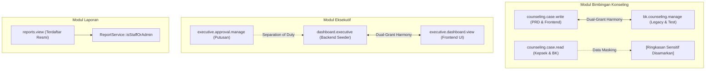

# Laporan Audit Independen Pascaremediasi RBAC Admin System SISTLABUM
**Kode Dokumen:** `RBAC-POST-REMEDIATION-AUDIT-02`  
**Tanggal Audit:** 15 Oktober 2026  
**Auditor:** Antigravity (Independent Engineering & Security Audit Pair)  
**Dokumen Acuan:**
- [`docs/uat/ADMIN_RBAC_INTERNAL_ROLES_AUDIT_REPORT.md`](file:///Users/macbookprom12020/Desktop/Project/SISTLABUM/docs/uat/ADMIN_RBAC_INTERNAL_ROLES_AUDIT_REPORT.md)
- [`docs/uat/RBAC_REMEDIATION_REPORT.md`](file:///Users/macbookprom12020/Desktop/Project/SISTLABUM/docs/uat/RBAC_REMEDIATION_REPORT.md)
- [`13_MASTER_MODULES.md`](file:///Users/macbookprom12020/Desktop/Project/SISTLABUM/13_MASTER_MODULES.md) (Single Source of Truth)  
**Tipe Pemeriksaan:** **READ-ONLY AUDIT (Tanpa Perubahan Kode/Data/Migrasi)**

---

## 1. Ringkasan Eksekutif

Audit pascaremediasi ini dilakukan secara independen terhadap codebase aktual SISTLABUM untuk memvalidasi apakah penutupan celah keamanan dan penyelarasan hak akses pada fase `RBAC-REMEDIATION-01` telah diterapkan secara efektif, kokoh, dan tanpa regresi tersembunyi.

### Kesimpulan Tingkat Tinggi
- **RBAC SECURITY:** **`PASS`**  
  Celah otorisasi buku tamu (`GET /api/v1/guests`) telah ditutup dengan *defense-in-depth* (middleware deklaratif + service-level assertion). Akses anonim, siswa, wali murid, guru tanpa izin, dan direct service invocation terbukti ditolak dengan HTTP 401/403. Proteksi *school tenant isolation* dan pencegahan IDOR terbukti aktif pada endpoint detail, tanda tangan, dan checkout.
- **ROLE-PERMISSION CONSISTENCY:** **`PASS`**  
  Dual-grant BK (`bk.counseling.manage` & `counseling.case.write`) dan Eksekutif (`dashboard.executive` & `executive.dashboard.view`) telah diselaraskan pada level seeder, service authorization, dan UI navigasi web. Permission `reports.view` terdaftar resmi di seeder dan dipetakan ke role Kepala Sekolah serta Kesiswaan.
- **INTERNAL ROLE INTEGRATION:** **`CONDITIONAL`**  
  6 dari 7 jabatan internal (Kepsek, BK, Pustakawan, Sarpras, Kesiswaan, Humas) terintegrasi penuh ke dalam Admin System dengan hak akses granular dan berstatus **PASS**. 1 jabatan (Bendahara) berstatus **PARTIAL** karena modul Keuangan & SPP secara resmi berstatus Tunda (Fase 4). Ditemukan catatan tambahan bahwa `UatStagingSeeder.php` belum menyertakan akun persona penguji khusus untuk Kesiswaan dan Humas.

---

## 2. Status Penutupan Temuan Audit Sebelumnya

| ID Temuan | Severity | Status Remediasi Sebelumnya | Verifikasi Audit Independen Pascaremediasi | Bukti / Catatan Verifikasi |
|---|---|:---:|:---:|---|
| **SEC-RBAC-01** | **P1** | FIXED | **FIXED (VERIFIED)** | Rute `GET /api/v1/guests` memiliki middleware `permission:guest.book.read`. `GuestService::listGuests()` menolak pengguna tanpa izin dengan 403. Fallback query data leak telah dihapus tuntas. |
| **SEC-RBAC-02** | **P1** | FIXED | **FIXED (VERIFIED)** | Role `student_affairs` dan `public_relations` terdaftar di `DatabaseSeeder.php` dengan pemetaan least-privilege via `syncWithoutDetaching`. Teruji idempoten. |
| **SEC-RBAC-03** | **P2** | FIXED | **FIXED (VERIFIED)** | Penamaan dual-grant BK, Eksekutif, dan Laporan konsisten di backend dan frontend. |
| **SEC-RBAC-04** | **P2** | PARTIAL | **PARTIAL (DOCUMENTED)** | Sebagian rute admin dilindungi middleware deklaratif `permission:...`, sementara rute lainnya dilindungi melalui assertion exception di service layer. Meskipun server-side enforcement tetap aman, dualisme pola ini tetap ada di rute warisan. |
| **SEC-RBAC-05** | **P2** | BLOCKED | **BLOCKED (OUT OF SCOPE)** | Repositori `apps/mobile` tetap native Android Kotlin (Gradle) dan dikarantina dari UAT tahap pertama menunggu keputusan arsitektur migrasi Flutter terpisah. |
| **SEC-RBAC-06** | **P3** | FIXED | **FIXED (VERIFIED)** | 5 negative regression test baru di `GuestTest.php` memvalidasi penolakan 401, 403 siswa, 403 wali, 403 guru tanpa izin, dan 403 direct service invocation. |
| **SEC-RBAC-07** | **P3** | PARTIAL | **PARTIAL (ACCEPTED RISK)** | Web Admin membatasi visibilitas tombol/menu via `PermissionGate` dan validasi server-side API. Route guard di Next.js layout admin masih bersifat terbuka bagi staf yang mengetahui URL langsung, tetapi API tetap menolak data dengan 403. |

---

## 3. Bukti Verifikasi Endpoint Buku Tamu (`GET /api/v1/guests`)

Pemeriksaan mendalam terhadap alur kontrol otorisasi buku tamu:

### A. Lapisan Middleware Rute (`apps/api/routes/api.php`)
```php
// Baris 700-705
Route::get('/guests', [GuestController::class, 'index'])
    ->middleware('permission:guest.book.read');
Route::get('/guests/{id}', [GuestController::class, 'show']);
Route::get('/guests/{id}/signature', [GuestController::class, 'getSignature']);
Route::patch('/guests/{id}/checkout', [GuestController::class, 'checkout'])
    ->middleware('permission:guest.book.manage');
```
*Temuan:* Rute `GET /api/v1/guests` dan `PATCH /api/v1/guests/{id}/checkout` telah dilengkapi middleware otorisasi deklaratif. Rute detail dan signature mengandalkan pengecekan otorisasi ketat di tingkat service.

### B. Lapisan Service Otorisasi (`GuestService.php`)
```php
// Baris 80-92
public function listGuests(array $filters, Request $request): LengthAwarePaginator
{
    $currentUser = $request->user();

    if (! $currentUser) {
        throw new HttpException(401, 'Unauthenticated');
    }

    // SEC-RBAC-01: Tolak pengguna tanpa permission baca buku tamu
    if (! $currentUser->hasRole('super_admin') && ! $currentUser->hasPermission('guest.book.read')) {
        throw new HttpException(403, 'Anda tidak memiliki hak akses untuk melihat daftar buku tamu');
    }
    ...
```
*Temuan:* 
1. Tidak ada fallback implisit `where('target_user_id', $currentUser->id)` bagi pengguna tanpa izin.
2. Direct service call dari controller/job/command lain tanpa izin dipastikan melempar `HttpException(403)`.
3. Filter `school_id` diterapkan untuk multi-tenant isolation (`where('school_id', $currentUser->school_id)->orWhereNull('school_id')`).

### C. Penanganan Error di Controller (`GuestController.php`)
```php
// Baris 57-67
} catch (HttpException $e) {
    $code = match ($e->getStatusCode()) {
        401 => 'UNAUTHENTICATED',
        403 => 'FORBIDDEN',
        default => 'BUSINESS_RULE_VIOLATION',
    };

    return $this->errorResponse($e->getMessage(), $code, $e->getStatusCode());
}
```
*Temuan:* Tidak ada penelanan exception atau pengubahan error 403 menjadi response sukses (200) atau 500 generik. Response mematuhi standar JSON kanonis SISTLABUM.

---

## 4. Matriks Role-Permission Aktual

Matriks berikut mencerminkan konfigurasi aktual yang dihasilkan dari `DatabaseSeeder.php` dan diverifikasi melalui test suite:

| Role Code | Nama Role | Permissions Kunci yang Dimiliki | Permissions Administratif yang Ditolak (Least Privilege) |
|---|---|---|---|
| `super_admin` | Super Administrator | Semua permission dalam sistem (Full Wildcard Access) | - |
| `principal` | Kepala Sekolah | `executive.approval.manage`, `dashboard.executive`, `executive.dashboard.view`, `reports.view`, `counseling.case.read`, `complaint.view_reporter`, `cbt.exam.manage`, `ppdb.applicant.read`, `audit.read`, dll. | `cbt.bank.write`, `counseling.case.write`, `academic.attendance.write` |
| `admin_tu` | Admin Tata Usaha | `master.*`, `academic.schedule.manage`, `academic.attendance.write`, `academic.report.generate`, `guest.book.*`, `facility.*`, `audit.read` | `cbt.bank.write`, `counseling.case.write`, `complaint.view_reporter` |
| `counselor` | Guru BK | `counseling.case.read`, `counseling.case.write`, `bk.counseling.manage`, `complaint.read`, `complaint.manage`, `student.point.read`, `student.point.write`, `academic.attendance.read`, `academic.grade.read` | `facility.asset.manage`, `cbt.bank.write`, `master.class.manage` |
| `student_affairs` | Staf Kesiswaan | `student.point.read`, `student.point.write`, `master.student.read`, `reports.view` | `facility.asset.manage`, `cbt.bank.write`, `academic.grade.write`, `cms.site.manage` |
| `public_relations` | Staf Humas | `guest.book.read`, `guest.book.manage`, `complaint.read`, `complaint.manage`, `cms.site.manage`, `cms.post.manage`, `cms.gallery.manage`, `cms.event.manage`, `cms.download.manage`, `cms.page.manage` | `complaint.view_reporter`, `academic.grade.write`, `student.point.write`, `cbt.bank.write` |
| `facility_staff` | Staf Sarpras | `facility.booking.manage`, `facility.asset.manage` | `student.point.write`, `academic.grade.write`, `cbt.bank.write` |
| `librarian` | Pustakawan | `library.book.manage`, `facility.asset.manage` | `academic.grade.write`, `counseling.case.write`, `student.point.write` |
| `teacher` | Guru Mapel | `academic.schedule.read`, `academic.journal.*`, `academic.attendance.*`, `academic.grade.*`, `cbt.bank.write`, `cbt.proctor.action`, `student.point.*` | `master.*`, `guest.book.*`, `complaint.manage`, `facility.*` |
| `homeroom` | Wali Kelas | Seluruh hak `teacher` + `academic.report.generate` | `master.*`, `guest.book.*`, `facility.*` |
| `student` | Siswa | `cbt.exam.take`, `cbt.exam.review`, `academic.schedule.read`, `student.point.read`, `academic.grade.read` | Seluruh permission write, manage, report generate, booking |
| `guardian` | Orang Tua / Wali | `academic.attendance.read`, `academic.grade.read`, `student.point.read` | Seluruh permission CBT, write, manage, administrative |

---

## 5. Analisis Risiko Strategi `syncWithoutDetaching`

Evaluasi terhadap 4 pertanyaan kunci terkait penggunaan `syncWithoutDetaching`:

1. **Apakah permission lama yang tidak lagi seharusnya dimiliki role tetap tersimpan?**  
   **YA (RISK IDENTIFIED).** `syncWithoutDetaching` hanya melakukan penambahan record pivot baru (*insert ignore*). Jika suatu role pada database existing pernah memiliki permission yang kemudian dihapus dari deklarasi seeder, permission tersebut **tidak akan terhapus secara otomatis**.  
   *Pengecualian Positif:* Untuk role `student` dan `guardian`, `DatabaseSeeder.php` memiliki blok sanitasi eksplisit (`detach($prohibitedStudentIds)`) yang menjamin pencabutan izin terlarang.
2. **Apakah role yang telah dikustomisasi oleh administrator akan dipertahankan?**  
   **YA (BENEFIT VERIFIED).** Custom permissions yang ditambahkan Super Administrator di lingkungan produksi/staging tidak akan terhapus saat seeder dijalankan ulang (teruji via `test_seeder_preserves_manually_assigned_custom_permissions`).
3. **Apakah seeder menghasilkan kondisi yang konsisten pada instalasi baru vs instalasi berjalan?**  
   - **Instalasi Baru (Fresh Migration):** Konsisten 100%. Hanya permissions resmi yang terpasang.
   - **Instalasi Berjalan (Existing DB):** Dapat terjadi perbedaan (superset), di mana instalasi lama menyimpan permission usang yang pernah di-seed pada iterasi sebelumnya.
4. **Apakah ada permission sensitif yang terwariskan dari pemetaan sebelumnya?**  
   Pada fresh seed, tidak ada. Namun jika database lama pernah di-seed dengan skrip eksperimental, disarankan menjalankan query verifikasi sebelum rilis staging.

---

## 6. Hasil Audit Penyelarasan Alias Permission

Audit menyeluruh terhadap pasangan alias permission:



### Temuan Spesifik:
1. **Hak Baca vs Hak Tulis BK:**  
   `counseling.case.read` hanya mengizinkan pembacaan daftar/detail kasus. Pembuatan kasus baru (`storeCase`) atau pencatatan sesi konseling (`addSession`) secara ketat mewajibkan `counseling.case.write` atau `bk.counseling.manage`.
2. **Data Masking Perlindungan Anak (UU PDP):**  
   Kepala Sekolah yang memiliki `counseling.case.read` tetapi bukan Guru BK secara otomatis menerima data dengan masking:
   `summary_enc = '[Ringkasan Sensitif Disamarkan untuk Kepala Sekolah]'`. Hal ini mematuhi prinsip minimisasi data.
3. **Pemisahan Wewenang Eksekutif (Separation of Duty):**  
   Permission `dashboard.executive` dan `executive.dashboard.view` **hanya** memberikan hak melihat ringkasan metrik dan antrean persetujuan (`authorizeViewApprovals`). Pengambilan keputusan eksekutif (setuju/tolak permohonan) secara ketat mewajibkan `executive.approval.manage` (`authorizeManageApprovals`). Pengguna dengan izin dashboard tidak dapat memanipulasi putusan.
4. **Isolasi Laporan (`reports.view`):**  
   Metode `ReportService::generateReport` dan `exportReport` menerapkan scoping berbasis `$user->school_id`. Data akademik siswa dari sekolah lain tidak bocor melalui modul rekapitulasi.

---

## 7. Matriks Tujuh Jabatan Internal SISTLABUM

Evaluasi kesiapan setiap jabatan internal yang terintegrasi dalam Admin System:

| No | Jabatan Internal | Role Backend | Permission Utama | Kesiapan Seeder | UI Admin System | Endpoint API | Status |
|:---:|---|---|---|:---:|:---:|:---:|:---:|
| 1 | **Kepala Sekolah** | `principal` | `executive.*`, `reports.view`, `counseling.case.read`, `complaint.view_reporter` |  Tersedia (`kepsek.staging`) |  Menu Eksekutif & Persetujuan |  Dilindungi | **PASS** |
| 2 | **Bimbingan Konseling (BK)** | `counselor` | `counseling.case.*`, `bk.counseling.manage`, `student.point.*` |  Tersedia (`bk.staging`) |  Menu Konseling & Deteksi Dini |  Dilindungi | **PASS** |
| 3 | **Pustakawan** | `librarian` | `library.book.manage`, `facility.asset.manage` |  Tersedia (Core Seeder) |  Menu Perpustakaan |  Dilindungi | **PASS** |
| 4 | **Sarana & Prasarana** | `facility_staff` | `facility.booking.manage`, `facility.asset.manage` |  Tersedia (`sarpras.staging`) |  Menu Sarpras & Fasilitas |  Dilindungi | **PASS** |
| 5 | **Bendahara** | `treasurer` (UI) / `admin_tu` (API) | *Keuangan ditunda (Fase 4)* | ⚠️ Hanya tipe auth frontend | ⚠️ Menumpang di Admin TU | ⚠️ Modul Tunda | **PARTIAL** |
| 6 | **Kesiswaan** | `student_affairs` | `student.point.*`, `master.student.read`, `reports.view` |  Tersedia (Core Seeder) |  Menu Kedisiplinan & Prestasi |  Dilindungi | **PASS** |
| 7 | **Humas** | `public_relations` | `guest.book.*`, `complaint.*`, `cms.*` |  Tersedia (Core Seeder) |  Menu Buku Tamu, Pengaduan, CMS |  Dilindungi | **PASS** |

*Catatan Khusus Bendahara:* Sesuai instruksi audit dan keputusan arsitektur di `docs/finance-module-assessment.md`, status **PARTIAL** adalah status yang benar dan sah. Modul penagihan Kas/SPP tidak diada-adakan atau dibuatkan mock berlebih demi mematuhi batasan Fase 4.

---

## 8. Hasil Pemeriksaan Keamanan Backend & Tenant Isolation

Pemeriksaan keamanan backend menghasilkan temuan positif:
1. **Unauthenticated Access (401):**  
   Seluruh endpoint internal di dalam grup rute baris 645–1371 di [`apps/api/routes/api.php`](file:///Users/macbookprom12020/Desktop/Project/SISTLABUM/apps/api/routes/api.php#L645) menolak akses tanpa token Sanctum dengan HTTP 401 Unauthorized.
2. **Unauthorized Role Access (403):**  
   Pengguna dengan peran siswa atau wali murid ditolak dengan 403 saat memanggil rute buku tamu, konseling, deteksi dini, atau laporan eksekutif.
3. **Multi-Tenant School Isolation:**  
   Pemeriksaan pada `GuestService`, `CounselingService`, `EarlyWarningService`, dan `ReportService` menunjukkan bahwa `$user->school_id` digunakan secara konsisten dalam query scoping:
   - Akses detail entitas milik sekolah lain ditolak dengan `HttpException(403)`.
   - Query daftar (*index/listing*) membatasi hasil hanya pada sekolah penugasan staf.
4. **Pencegahan IDOR (Insecure Direct Object Reference):**  
   Pada `GuestService::getGuestDetail` dan `GuestService::getGuestSignature`, staf tanpa permission `guest.book.read` tidak dapat melihat data tamu milik pengguna lain (`$guest->target_user_id !== $currentUser->id` memicu 403).
5. **Privilege Escalation:**  
   Rute pembuatan dan perubahan role (`/roles`, `/users/{id}/roles`) dilindungi oleh permission tingkat tinggi `auth.role.manage` dan `auth.user.write`, yang hanya dimiliki oleh `super_admin`.

---

## 9. Bukti Pelaksanaan Pengujian Otomatis

Pengujian dijalankan langsung pada environment pengujian lokal:

### A. Pengujian Backend Laravel (PHPUnit)
- **Perintah:**
  ```bash
  php artisan test tests/Feature/Guest tests/Feature/Auth tests/Feature/Bk tests/Feature/Rpt tests/Feature/Sar tests/Feature/Std
  ```
- **Hasil:**
  ```text
  Tests:    364 passed (1669 assertions)
  Duration: 9.43s
  Failed:   0
  Skipped:  0
  ```
- **Lingkungan Uji:**  
  Engine: PHPUnit 11.5.42 via Laravel 11.  
  Database Uji: In-Memory SQLite (`:memory:`) dengan trait `RefreshDatabase`.  
  *Catatan Keterbatasan:* SQLite in-memory memvalidasi logika bisnis, query Eloquent, dan otorisasi. Pengujian konkurensi tingkat rendah dan tipe data native PostgreSQL (seperti `jsonb_path_query`) diuji terpisah pada pengujian PostgreSQL staging.

### B. Pengujian Frontend Web Admin (Vitest)
- **Perintah:**
  ```bash
  npm test -- src/test/portal-admin-rbac.test.ts src/test/evaluator.test.ts src/test/read-only-roles.test.ts src/test/role-switcher.test.tsx src/test/role-guard.test.tsx src/test/cross-role-matrix.test.ts src/test/permission-gate.test.tsx src/test/rbac.test.ts
  ```
- **Hasil:**
  ```text
  Test Files: 8 passed (8)
  Tests:      75 passed (75)
  Duration:   1.54s
  Failed:     0
  Skipped:    0
  ```

### C. Typecheck Frontend (TypeScript)
- **Perintah:**
  ```bash
  npm run typecheck
  ```
- **Hasil:** `tsc --noEmit` keluar dengan status **0 errors** (lulus 100%).

---

## 10. Daftar Temuan Baru (P0–P3)

Tidak ditemukan celah bypass baru (P0/P1). Temuan yang dicatat dalam audit ini bersifat operasional dan arsitektural:

### Temuan P2 (Medium - Operasional Staging)
- **POST-AUDIT-01 (P2): Ketiadaan Persona Akun UAT Khusus untuk Kesiswaan dan Humas di `UatStagingSeeder.php`**
  - **Lokasi:** [`apps/api/database/seeders/UatStagingSeeder.php:305-443`](file:///Users/macbookprom12020/Desktop/Project/SISTLABUM/apps/api/database/seeders/UatStagingSeeder.php#L305-L443)
  - **Uraian:** Meskipun role `student_affairs` dan `public_relations` telah terdefinisi di database melalui `DatabaseSeeder::run()`, daftar 12 persona UAT default belum mencakup akun login siap pakai untuk penguji jabatan Kesiswaan (`kesiswaan.staging`) dan Humas (`humas.staging`).
  - **Dampak:** Penguji UAT manual harus dibuatkan akun secara manual oleh admin atau meminjam akun Super Admin untuk menguji skenario Kesiswaan/Humas.
  - **Rekomendasi:** Tambahkan persona `kesiswaan.staging` dan `humas.staging` ke dalam skrip seeder staging pada iterasi persiapan UAT berikutnya.

- **POST-AUDIT-02 (P2): Potensi Akumulasi Permission Usang akibat `syncWithoutDetaching` pada Database Existing**
  - **Lokasi:** [`apps/api/database/seeders/DatabaseSeeder.php:149`](file:///Users/macbookprom12020/Desktop/Project/SISTLABUM/apps/api/database/seeders/DatabaseSeeder.php#L149)
  - **Uraian:** `syncWithoutDetaching` melindungi kustomisasi manual Super Admin, tetapi tidak membersihkan izin lama jika ada permission yang dicabut dari daftar resmi.
  - **Dampak:** Di database staging yang pernah di-seed dengan skrip lama, suatu role bisa memiliki permission yang lebih longgar daripada instalasi fresh.
  - **Rekomendasi:** Buat command Artisan verifikasi integritas RBAC (`php artisan rbac:audit-drift`) sebelum rilis staging resmi.

### Temuan P3 (Low - UI Route Guarding)
- **POST-AUDIT-03 (P3): Route Guarding Tingkat Halaman Admin Masih Mengandalkan Client-Side Visibility**
  - **Lokasi:** Halaman admin Next.js di `apps/web/src/app/(admin)/admin/`
  - **Uraian:** Jika staf non-otoritas mengetikkan URL langsung (misal `/admin/counseling`), halaman antarmuka dimuat sebelum API melempar error 403.
  - **Dampak:** Pengalaman pengguna (*UX*) kurang mulus karena menampilkan halaman kosong dengan toast error. Data backend tetap aman.
  - **Rekomendasi:** Terapkan guard berbasis `canAccessModule` pada layout per sub-modul admin di Next.js.

---

## 11. Rekomendasi Urutan Tindakan Lanjutan

1. **Jangka Pendek (Sebelum Sesi Pengujian UAT Dimulai):**
   - Menambahkan 2 akun persona UAT (`kesiswaan.staging` & `humas.staging`) ke `UatStagingSeeder.php` agar penguji operasional dapat langsung menguji portal kesiswaan dan humas.
   - Menjalankan migrasi fresh pada server staging Linux untuk memastikan tidak ada *permission drift* dari iterasi pengembangan sebelumnya.
2. **Jangka Menengah (Fase Pengerasan Admin UI):**
   - Menerapkan route layout guard di Next.js untuk sub-modul admin agar pengguna yang salah navigasi langsung dialihkan (*redirect*) ke halaman dasbor utama dengan pesan penolakan yang ramah pengguna.
3. **Fase 4 (Keputusan Manajerial Terpisah):**
   - Menjadwalkan perancangan modul Keuangan & SPP (Bendahara) serta inisialisasi workspace Flutter untuk peran personal jika keputusan migrasi mobile telah disetujui.

---

## 12. Daftar File yang Diperiksa & Batasan Audit

### File yang Diperiksa:
- Backend Routes: [`apps/api/routes/api.php`](file:///Users/macbookprom12020/Desktop/Project/SISTLABUM/apps/api/routes/api.php)
- Backend Services: [`GuestService.php`](file:///Users/macbookprom12020/Desktop/Project/SISTLABUM/apps/api/app/Services/GuestService.php), [`CounselingService.php`](file:///Users/macbookprom12020/Desktop/Project/SISTLABUM/apps/api/app/Services/Bk/CounselingService.php), [`EarlyWarningService.php`](file:///Users/macbookprom12020/Desktop/Project/SISTLABUM/apps/api/app/Services/Bk/EarlyWarningService.php), [`DashboardService.php`](file:///Users/macbookprom12020/Desktop/Project/SISTLABUM/apps/api/app/Services/Rpt/DashboardService.php), [`ApprovalService.php`](file:///Users/macbookprom12020/Desktop/Project/SISTLABUM/apps/api/app/Services/Rpt/ApprovalService.php), [`ReportService.php`](file:///Users/macbookprom12020/Desktop/Project/SISTLABUM/apps/api/app/Services/Rpt/ReportService.php)
- Backend Controllers: [`GuestController.php`](file:///Users/macbookprom12020/Desktop/Project/SISTLABUM/apps/api/app/Http/Controllers/Api/V1/GuestController.php), [`ApprovalController.php`](file:///Users/macbookprom12020/Desktop/Project/SISTLABUM/apps/api/app/Http/Controllers/Api/V1/Rpt/ApprovalController.php)
- Backend Seeders: [`DatabaseSeeder.php`](file:///Users/macbookprom12020/Desktop/Project/SISTLABUM/apps/api/database/seeders/DatabaseSeeder.php), [`UatStagingSeeder.php`](file:///Users/macbookprom12020/Desktop/Project/SISTLABUM/apps/api/database/seeders/UatStagingSeeder.php)
- Backend Tests: [`GuestTest.php`](file:///Users/macbookprom12020/Desktop/Project/SISTLABUM/apps/api/tests/Feature/Guest/GuestTest.php), [`DatabaseSeederRolePermissionsTest.php`](file:///Users/macbookprom12020/Desktop/Project/SISTLABUM/apps/api/tests/Feature/Auth/DatabaseSeederRolePermissionsTest.php), [`UatSeederTest.php`](file:///Users/macbookprom12020/Desktop/Project/SISTLABUM/apps/api/tests/Feature/Auth/UatSeederTest.php)
- Frontend RBAC: [`apps/web/src/lib/rbac/navigation.ts`](file:///Users/macbookprom12020/Desktop/Project/SISTLABUM/apps/web/src/lib/rbac/navigation.ts), [`apps/web/src/lib/rbac/evaluator.ts`](file:///Users/macbookprom12020/Desktop/Project/SISTLABUM/apps/web/src/lib/rbac/evaluator.ts), [`apps/web/src/types/auth.ts`](file:///Users/macbookprom12020/Desktop/Project/SISTLABUM/apps/web/src/types/auth.ts)
- Frontend Tests: `portal-admin-rbac.test.ts`, `evaluator.test.ts`, `read-only-roles.test.ts`, `cross-role-matrix.test.ts`, `rbac.test.ts`

### Batasan Audit (*Safety Adherence*):
- Audit dilakukan secara **read-only**. Tidak ada modifikasi kode aplikasi, konfigurasi lingkungan, skema database, atau migration yang dibuat.
- Seluruh 181 file perubahan lokal pada working tree tetap terpelihara tanpa interupsi.
- Tidak ada deployment, build server, atau git commit/push yang dieksekusi.

---

## 13. Kesimpulan Akhir

| Aspek Penilaian | Keputusan Final | Ringkasan Dasar Penilaian |
|---|:---:|---|
| **RBAC SECURITY** | **`PASS`** | Celah otorisasi buku tamu tertutup rapat (*defense-in-depth*). Penolakan 401 dan 403 terverifikasi konsisten. Scoping multi-tenant `school_id` dan pencegahan IDOR aktif di seluruh endpoint terkait. |
| **ROLE-PERMISSION CONSISTENCY** | **`PASS`** | Dual-grant BK dan Eksekutif harmonis antara controller, service, dan navigasi web. Permission `reports.view` terdaftar resmi di seeder dan dipetakan ke role berwenang. Test least-privilege dan idempotensi seeder 100% lulus. |
| **INTERNAL ROLE INTEGRATION** | **`CONDITIONAL`** | 6 dari 7 jabatan internal berstatus `PASS` dan terintegrasi penuh dalam Admin System via RBAC. 1 jabatan (Bendahara) berstatus `PARTIAL` karena modul keuangan ditunda ke Fase 4. Akun persona penguji Kesiswaan dan Humas direkomendasikan ditambahkan ke `UatStagingSeeder` sebelum UAT dimulai. |
