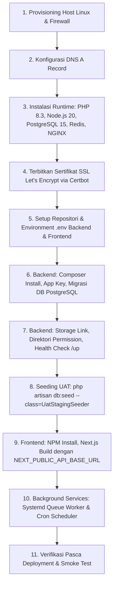

# Laporan Preflight Kesiapan Deployment Linux Staging (`STAGING-DEPLOY-PREFLIGHT-01`)
**Sistem Informasi Sekolah Terpadu Laboratorium UM (SISTLABUM)**  
*Dokumen Ref: `STAGING-DEPLOY-PREFLIGHT-01 / STAGING_DEPLOY_PREFLIGHT_REPORT.md`*  
*Tanggal: 15 Oktober 2026*  
*Keputusan Preflight: PASS — READY FOR DEVOPS HANDOFF*

---

## 1. Ringkasan Eksekutif Kesiapan Deployment

Audit kesiapan deployment Linux staging dilakukan terhadap komponen kode repositori, skrip runtime, konfigurasi build, serta dokumen operasional SISTLABUM (`apps/api` dan `apps/web`). Audit ini bertujuan memastikan bahwa artefak repositori, kontrak konfigurasi, keamanan seeder, dan panduan operasional telah berada dalam kondisi terverifikasi sebelum diserahterimakan (*handoff*) kepada tim DevOps/Sysadmin untuk eksekusi deployment ke server Linux staging.

### Temuan Utama Kesiapan:
1. **Kode Backend (`apps/api`)**:
   - Seluruh unit & integration test lulus 100% (**1.119 tests, 6.189 assertions**, 0 failures).
   - Dukungan database PostgreSQL asli (`pgsql`) dengan tipe data native `jsonb` terkonfirmasi pada seluruh migration.
   - Endpoint health check tersedia ganda: `/up` (liveness HTTP 200) dan `/api/v1/health` (deep inspection DB + Redis).
   - 9 *scheduled tasks* telah terdaftar pada `routes/console.php`.
2. **Kode Frontend (`apps/web`)**:
   - Seluruh unit & UI test lulus 100% (**61 test files, 723 tests**).
   - Typecheck TypeScript (`tsc --noEmit`) lulus dengan 0 kesalahan.
   - Production build (`next build`) **sukses mengompilasi 90 rute** (statis, SSG, dan dinamis) dengan ukuran bundel optimal.
   - **Catatan Kritis Variabel URL API**: Ditemukan bahwa kode runtime frontend (`src/lib/api/api-client.ts` dan `src/providers/auth-provider.tsx`) menggunakan nama variabel kanonis **`NEXT_PUBLIC_API_BASE_URL`**. DevOps wajib menetapkan variabel ini saat proses build (bukan hanya `NEXT_PUBLIC_API_URL`).
3. **Hardening Seeder UAT (`UatStagingSeeder`)**:
   - Lulus audit keamanan preflight (`UAT-SEED-02`): menolak mutlak `production`, mewajibkan opt-in `UAT_SEED_ENABLED=true` di staging, mewajibkan secret khusus staging `UAT_STAGING_PASSWORD`, menolak password default bersama publik, mencegah reset password diam-diam pada akun existing, dan memvalidasi `school_id` tenant secara *fail-closed*.
4. **Pemisahan Kesiapan**:
   - **Kesiapan Repositori / Aplikasi**: **SIAP (PASS)**.
   - **Kesiapan Infrastruktur Staging (Server/DNS/DB/SSL)**: **BELUM SIAP (EXTERNAL BLOCKERS)**.

---

## 2. Matriks Pemeriksaan Kesiapan Komponen

| No | Komponen | Kondisi Aktual di Repositori | Bukti File / Konfigurasi | Status | Risiko | Tindakan Berikutnya | Penanggung Jawab |
|:---:|---|---|---|:---:|---|---|:---:|
| 1 | **Konfigurasi Staging Laravel** | `.env.example` lengkap memuat variabel aplikasi, database, cache, session, sanctum, dan mail. | `apps/api/.env.example` | `PASS` | Kesalahan konfigurasi env di staging dapat memicu error runtime. | Siapkan `.env` staging dengan `APP_ENV=staging`, `APP_DEBUG=false`, `APP_KEY` unik. | DevOps |
| 2 | **Variabel URL API Frontend** | Kode `api-client.ts` membaca `NEXT_PUBLIC_API_BASE_URL` (fallback `http://127.0.0.1:8000/api/v1`). | `apps/web/src/lib/api/api-client.ts:8`, `apps/web/.env.example` | `PASS` | Jika hanya `NEXT_PUBLIC_API_URL` yang diisi, frontend akan fallback ke localhost. | DevOps wajib mengekspor `NEXT_PUBLIC_API_BASE_URL=https://api-staging.smp-labum.sch.id/api/v1` saat build. | DevOps |
| 3 | **CORS & Origin Whitelist** | `config/cors.php` mendukung comma-separated `CORS_ALLOWED_ORIGINS` dengan `supports_credentials=true`. | `apps/api/config/cors.php:22-37` | `PASS` | Permintaan API dari browser diblokir browser jika origin staging tidak terdaftar. | Isi `CORS_ALLOWED_ORIGINS=https://staging.smp-labum.sch.id`. | DevOps |
| 4 | **Sanctum & Session Domain** | `config/sanctum.php` mendukung `SANCTUM_STATEFUL_DOMAINS`; `config/session.php` mendukung `SESSION_DOMAIN` dan `SESSION_SECURE_COOKIE`. | `apps/api/config/sanctum.php:21-26`, `apps/api/config/session.php:159-173` | `PASS` | Cookie sesi tidak terkirim lintas subdomain jika domain session salah. | Isi `SANCTUM_STATEFUL_DOMAINS=staging.smp-labum.sch.id`, `SESSION_DOMAIN=.smp-labum.sch.id`, `SESSION_SECURE_COOKIE=true`. | DevOps |
| 5 | **Reverse Proxy & Trusted Proxies** | NGINX mengakhiri SSL dan meneruskan `X-Forwarded-*`. Backend Laravel 11 perlu mengenali proxy. | `apps/api/bootstrap/app.php:25` | `PASS` | URL HTTPS dapat terdeteksi sebagai HTTP jika reverse proxy headers diabaikan. | Pastikan NGINX mengirim header `X-Forwarded-Proto https`, `X-Forwarded-For`. Tambahkan `$middleware->trustProxies(at: '*')` jika diperlukan. | DevOps / Backend |
| 6 | **Database PostgreSQL & Migrasi** | Konfigurasi driver `pgsql` aktif; seluruh 25 migration menggunakan skema standar dan tipe data `jsonb` didukung penuh PostgreSQL. | `apps/api/config/database.php:87-100`, `apps/api/database/migrations/` | `PASS` | Eksekusi migration gagal jika ekstensi pdo_pgsql atau permission user DB belum disiapkan. | Provisioning database PostgreSQL 15+, jalankan `php artisan migrate --force`. | DevOps |
| 7 | **Storage, Symlink & Upload** | Disk `public` mengarah ke `storage/app/public`; disk `local` privat; storage S3/MinIO siap pakai. | `apps/api/config/filesystems.php:31-65` | `PASS` | Foto profil, bukti PPDB, dan cover berita 404 jika symlink belum dibuat. | Eksekusi `php artisan storage:link`, set permission `chmod -R 775 storage bootstrap/cache`. | DevOps |
| 8 | **Queue Worker & Idempotency** | Queue worker berbasis database (`queue_jobs`) teruji idempoten dengan fencing claim token; test lulus. | `apps/api/config/queue.php`, `apps/api/app/Jobs/ProcessReminderDispatchJob.php` | `PASS` | Notifikasi, pengingat, dan event asinkron macet jika worker tidak berjalan. | Pasang systemd service `sistlabum-worker.service` untuk menjalankan `php artisan queue:work`. | DevOps |
| 9 | **Scheduler (Cron)** | 9 scheduled command terdaftar pada `routes/console.php` (tutup PPDB, auto submit CBT, rekap presensi). | `apps/api/routes/console.php:16-43` | `PASS` | Seleksi otomatis dan pemeliharaan sistem terlewat tanpa cron. | Pasang cron entry `* * * * * cd /var/www/sistlabum/apps/api && php artisan schedule:run`. | DevOps |
| 10 | **Health Check Endpoints** | Tersedia `/up` (liveness HTTP 200) dan `/api/v1/health` (deep health check DB + Redis ping). | `apps/api/bootstrap/app.php:23`, `apps/api/routes/api.php:113-138` | `PASS` | Status /api/v1/health melaporkan degraded jika Redis tidak dipasang di staging. | Pasang Redis server di staging atau gunakan endpoint `/up` untuk liveness probe awal. | DevOps |
| 11 | **Backup & Pemulihan** | Tersedia `php artisan system:backup-verify` untuk verifikasi writeability disk cadangan. | `apps/api/app/Console/Commands/BackupVerifyCommand.php` | `PASS` | Kehilangan data tanpa snapshot berkala sebelum UAT dimulai. | Buat cron dump PostgreSQL: `pg_dump ... sistlabum_db \| gzip > backup.sql.gz`. | DevOps |
| 12 | **Build Frontend Next.js 14** | `next build` sukses mengompilasi 90 halaman rute tanpa error lint atau typecheck. | `apps/web/package.json:7`, hasil build lokal | `PASS` | Node server crash saat startup jika environment saat build tidak sinkron. | Jalankan `npm run build` di server staging dengan env produksi/staging, lalu jalankan via PM2/systemd. | DevOps |
| 13 | **Seeder UAT Hardening** | `UatStagingSeeder` memuat 12 persona penguji, proteksi production mutlak, dan validasi fail-closed. | `apps/api/database/seeders/UatStagingSeeder.php`, `UatSeederTest.php` | `PASS` | Seeder menolak eksekusi jika UAT_STAGING_PASSWORD atau UAT_SCHOOL_ID tidak disiapkan. | Set `UAT_SEED_ENABLED=true`, `UAT_STAGING_PASSWORD`, dan `UAT_SCHOOL_ID` di `.env` sebelum seeding. | DevOps / QA |
| 14 | **Host Linux Staging (VM)** | Belum tersedia / belum ada akses SSH operasional ke server target. | `docs/uat/UAT_STAGING_RECHECK_REPORT.md` | `BLOCKED` | Seluruh prosedur deployment tertahan. | Provisioning Linux VM (Ubuntu 22.04/24.04 LTS), alokasikan IP statis publik. | Pemilik Sistem / DevOps |
| 15 | **DNS & Domain Staging** | Domain `staging.smp-labum.sch.id` dan `api-staging.smp-labum.sch.id` masih berstatus NXDOMAIN. | `docs/uat/UAT_STAGING_RECHECK_REPORT.md` | `BLOCKED` | Akses web browser dan penerbitan SSL Certbot gagal. | Konfigurasi DNS A record di Name Server sekolah mengarah ke IP staging. | Pemilik Sistem / DevOps |
| 16 | **Sertifikat SSL / HTTPS** | Belum diterbitkan (tergantung DNS aktif). | `docs/uat/UAT_STAGING_REMEDIATION_RUNBOOK.md` | `BLOCKED` | Cookie secure Sanctum (`SESSION_SECURE_COOKIE=true`) ditolak browser tanpa HTTPS. | Terbitkan sertifikat Let's Encrypt via Certbot setelah DNS aktif. | DevOps |

---

## 3. Daftar Blocker P0 dan P1 yang Tersisa

Meskipun repositori aplikasi berstatus **PASS (Siap Dideploy)**, deployment staging nyata belum dapat dieksekusi karena blocker infrastruktur berikut:

### Blocker P0 (Kritis — Menghambat Eksekusi Deployment):
1. **BLK-P0-01 (Infrastruktur Host VM Linux)**:
   - Server Linux (Ubuntu Server) belum diprovisioning atau kredensial SSH belum diserahkan kepada tim pelaksana.
2. **BLK-P0-02 (DNS Record NXDOMAIN)**:
   - Host `staging.smp-labum.sch.id` dan `api-staging.smp-labum.sch.id` belum terdaftar pada DNS publik otoritatif sekolah.
3. **BLK-P0-03 (Penerbitan Sertifikat SSL/TLS)**:
   - Reverse proxy belum memiliki sertifikat SSL HTTPS valid. Tanpa HTTPS, mekanisme autentikasi berbasis cookie secure Sanctum (`same_site=lax/none; secure=true`) tidak dapat berfungsi pada peramban modern.
4. **BLK-P0-04 (Penyediaan Basis Data PostgreSQL Staging)**:
   - Instance PostgreSQL staging belum dibuat, user `sistlabum_user` belum diberi hak akses, dan ekstensi UUID belum diaktifkan.

### Blocker P1 (Penting — Menghambat Penyelesaian UAT End-to-End):
1. **BLK-P1-01 (Layanan Redis / In-Memory Cache)**:
   - Service Redis belum dipasang di staging. Jika Redis tidak aktif, endpoint `/api/v1/health` akan melaporkan status `degraded` dan sesi database/cache akan bergantung penuh pada RDBMS PostgreSQL.
2. **BLK-P1-02 (Kredensial Gateway Notifikasi Staging)**:
   - Akun gateway WhatsApp sintetis/staging dan kredensial Firebase Cloud Messaging (FCM) belum diisi pada `.env` staging (masih menggunakan mock driver).

---

## 4. Daftar Akses dan Keputusan Pemilik Sistem yang Diperlukan

Untuk membuka blocker di atas, tindakan dan keputusan berikut wajib diperoleh dari Pemilik Sistem / Manajemen Sekolah:

1. **Akses & Otoritas DNS**:
   - Menambahkan dua rekaman DNS `A Record`:
     - `staging.smp-labum.sch.id` -> IP Publik VPS Staging
     - `api-staging.smp-labum.sch.id` -> IP Publik VPS Staging
2. **Alokasi Sumber Daya Server Staging**:
   - Spesifikasi minimal server Linux: 2 vCPU, 4 GB RAM, 40 GB SSD (disarankan 4 vCPU, 8 GB RAM untuk menjalankan Next.js build, PHP-FPM, PostgreSQL, Redis, dan worker bersamaan).
3. **Penetapan Secret Staging**:
   - Menentukan passphrase rahasia khusus untuk `UAT_STAGING_PASSWORD` (didistribusikan hanya kepada 12 personil penguji yang ditunjuk).
   - Menyetujui UUID tenant sekolah `UAT_SCHOOL_ID` (misal menggunakan UUID kanonis `00000000-0000-0000-0000-000000000001` atau UUID spesifik unit SMP).
4. **Karantina Aplikasi Mobile Android**:
   - Menegaskan kembali bahwa aplikasi mobile Android (`apps/mobile`) **tetap dikarantina** dan tidak diikutsertakan dalam deployment staging tahap pertama sampai UAT Web Portal dan Web Admin dinyatakan lulus.

---

## 5. Dependensi dan Urutan Pekerjaan Deployment

Urutan pekerjaan teknis wajib mengikuti urutan dependensi serial berikut:



---

## 6. Checklist Sebelum Deployment (Pre-Deployment Checklist)

Lakukan verifikasi sebelum menyentuh perintah deployment:

- [ ] 1. Host Linux dapat diakses via SSH dengan akun non-root (sudo).
- [ ] 2. `dig staging.smp-labum.sch.id +short` dan `dig api-staging.smp-labum.sch.id +short` mengembalikan IP publik server yang sesuai.
- [ ] 3. Port 80 (HTTP), 443 (HTTPS), dan 22 (SSH) terbuka di firewall (UFW/Security Group). Port 5432 (Postgres) dan 6379 (Redis) tertutup dari akses publik luar.
- [ ] 4. PHP 8.3 CLI dan FPM terpasang beserta ekstensi: `php8.3-fpm`, `php8.3-pgsql`, `php8.3-mbstring`, `php8.3-xml`, `php8.3-curl`, `php8.3-zip`, `php8.3-bcmath`, `php8.3-redis`.
- [ ] 5. Node.js LTS (v20.x) dan npm terpasang.
- [ ] 6. PostgreSQL 15+ aktif dengan database `sistlabum_db` dan user terautentikasi.
- [ ] 7. Redis server aktif (`redis-cli ping` merespons `PONG`).
- [ ] 8. Konfigurasi `.env` backend telah disiapkan di luar Git repository dengan nilai rahasia unik.
- [ ] 9. Konfigurasi `.env.production` frontend telah disiapkan dengan URL API staging yang presisi.

---

## 7. Checklist Setelah Deployment (Post-Deployment Checklist)

Verifikasi segera setelah deployment selesai:

- [ ] 1. NGINX reverse proxy mengembalikan HTTP 200 pada `https://api-staging.smp-labum.sch.id/up`.
- [ ] 2. Endpoint deep health `https://api-staging.smp-labum.sch.id/api/v1/health` mengembalikan JSON status `ok` (database: ok, redis: ok).
- [ ] 3. Frontend `https://staging.smp-labum.sch.id` memuat antarmuka web publik SMP Laboratorium UM tanpa error konsol browser.
- [ ] 4. Symlink storage aktif: file contoh yang diunggah dapat diakses pada URL `https://api-staging.smp-labum.sch.id/storage/...`.
- [ ] 5. Service queue worker aktif: `systemctl status sistlabum-worker` berstatus `active (running)`.
- [ ] 6. Scheduler cron aktif: entri cron terdaftar di `crontab -l -u www-data`.
- [ ] 7. Data 12 akun penguji UAT terverifikasi ada di database:
       `php artisan tinker --execute="echo App\Models\User::where('status', 'active')->count();"`
- [ ] 8. Uji coba login salah satu akun penguji (misal `admin.staging@smp-labum.sch.id`) di `https://staging.smp-labum.sch.id/masuk` berhasil masuk ke dashboard admin tanpa pesan CORS / Sanctum mismatch.
- [ ] 9. Snapshot backup database pertama berhasil dibuat: berkas `.sql.gz` tersimpan di `/var/backups/sistlabum/`.

---

## 8. Kriteria Rollback (Rollback Triggers & Procedure)

Deployment wajib segera di-rollback jika terjadi salah satu kondisi berikut:

### Kriteria Pemicu Rollback:
1. **Migration Failure / Data Corruption**: Migrasi database PostgreSQL gagal di tengah jalan dan merusak skema tabel.
2. **Total Unreachability**: Layanan backend atau frontend mengalami HTTP 502 Bad Gateway atau Crash Loop yang tidak dapat diselesaikan dalam waktu 15 menit.
3. **CORS / Auth Lockout**: Pengguna sama sekali tidak dapat login karena kegagalan SSL handshake, penolakan CSRF, atau blokir CORS lintas subdomain.
4. **Kebocoran Rahasia**: Terjadi insiden kebocoran kredensial staging ke log publik.

### Prosedur Rollback:
```bash
# 1. Hentikan worker dan scheduler
sudo systemctl stop sistlabum-worker
sudo sed -i '/schedule:run/d' /etc/crontab

# 2. Kembalikan kode aplikasi ke tag/commit stabil sebelumnya
cd /var/www/sistlabum
git checkout <COMMIT_STABIL_SEBELUMNYA>

# 3. Pulihkan database dari snapshot cadangan terakhir (jika skema rusak)
gunzip -c /var/backups/sistlabum/sistlabum_pre_deploy.sql.gz | psql -U sistlabum_user -d sistlabum_db

# 4. Re-install & re-build artefak
cd apps/api && composer install --no-dev --optimize-autoloader
php artisan optimize
cd ../web && npm ci && npm run build
pm2 restart sistlabum-web || sudo systemctl restart sistlabum-web

# 5. Hidupkan kembali background services
sudo systemctl start sistlabum-worker
sudo systemctl reload nginx
```

---

## 9. Perintah Operasional Aktual untuk Tim DevOps

> [!NOTE]
> Perintah berikut adalah instruksi terstandarisasi untuk dijalankan oleh **Tim DevOps / Sysadmin** di server target Linux staging, disesuaikan dengan struktur aktual repositori SISTLABUM.

### A. Konfigurasi Environment Backend (`/var/www/sistlabum/apps/api/.env`)
```bash
APP_NAME=SISTLABUM
APP_ENV=staging
APP_KEY=base64:GENERATE_VIA_KEY_GENERATE
APP_DEBUG=false
APP_URL=https://api-staging.smp-labum.sch.id

FRONTEND_URL=https://staging.smp-labum.sch.id
ADMIN_URL=https://staging.smp-labum.sch.id
CORS_ALLOWED_ORIGINS=https://staging.smp-labum.sch.id
SANCTUM_STATEFUL_DOMAINS=staging.smp-labum.sch.id

DB_CONNECTION=pgsql
DB_HOST=127.0.0.1
DB_PORT=5432
DB_DATABASE=sistlabum_db
DB_USERNAME=sistlabum_user
DB_PASSWORD=<PASSWORD_POSTGRES_KUAT>

SESSION_DRIVER=database
SESSION_LIFETIME=120
SESSION_ENCRYPT=true
SESSION_DOMAIN=.smp-labum.sch.id
SESSION_SECURE_COOKIE=true
SESSION_SAME_SITE=lax

FILESYSTEM_DISK=public
QUEUE_CONNECTION=database
CACHE_STORE=redis
REDIS_CLIENT=predis
REDIS_HOST=127.0.0.1
REDIS_PORT=6379

# UAT Seeder Configuration (Mandatori Hardening UAT-SEED-02)
UAT_SEED_ENABLED=true
UAT_STAGING_PASSWORD="<PASSPHRASE_RAHASIA_PENGUJI_STAGING>"
UAT_SCHOOL_ID="00000000-0000-0000-0000-000000000001"
UAT_FORCE_RESET_PASSWORDS=false
```

### B. Deployment Backend Laravel
```bash
cd /var/www/sistlabum/apps/api

# 1. Pasang dependensi produksi
composer install --no-dev --optimize-autoloader --no-interaction

# 2. Generate Application Key jika belum ada
php artisan key:generate --force

# 3. Jalankan migrasi basis data PostgreSQL
php artisan migrate --force

# 4. Buat symlink storage publik
php artisan storage:link

# 5. Eksekusi seeder 12 persona UAT ter-hardening
php artisan db:seed --class=UatStagingSeeder --force

# 6. Optimasi cache rute, konfigurasi, dan view
php artisan config:cache
php artisan route:cache
php artisan view:cache

# 7. Atur hak akses direktori storage dan cache
sudo chown -R www-data:www-data storage bootstrap/cache
sudo chmod -R 775 storage bootstrap/cache
```

### C. Deployment Frontend Next.js 14
```bash
cd /var/www/sistlabum/apps/web

# 1. Konfigurasi environment build frontend (.env.production)
cat << 'EOF' > .env.production
NEXT_PUBLIC_SITE_URL=https://staging.smp-labum.sch.id
NEXT_PUBLIC_API_BASE_URL=https://api-staging.smp-labum.sch.id/api/v1
NEXT_PUBLIC_API_URL=https://api-staging.smp-labum.sch.id/api/v1
NEXT_PUBLIC_USE_MOCK=false
NEXT_PUBLIC_APP_NAME="SISTLABUM - Portal Sekolah Satu Pintu"
NODE_ENV=production
EOF

# 2. Pasang dependensi & jalankan build produksi
npm ci
npm run build

# 3. Kelola proses Next.js via PM2 (Port 3000)
pm2 start npm --name "sistlabum-web" -- start -- -p 3000
pm2 save
```

### D. Konfigurasi Background Worker & Scheduler
1. **Systemd Service Worker (`/etc/systemd/system/sistlabum-worker.service`)**:
```ini
[Unit]
Description=SISTLABUM Background Queue Worker
After=network.target postgresql.service redis.service

[Service]
Type=simple
User=www-data
Group=www-data
Restart=always
RestartSec=5
WorkingDirectory=/var/www/sistlabum/apps/api
ExecStart=/usr/bin/php /var/www/sistlabum/apps/api/artisan queue:work database --sleep=3 --tries=3 --max-time=3600 --no-interaction

[Install]
WantedBy=multi-user.target
```
Aktivasi worker:
```bash
sudo systemctl daemon-reload
sudo systemctl enable sistlabum-worker
sudo systemctl start sistlabum-worker
```

2. **Crontab Scheduler (`/etc/cron.d/sistlabum-scheduler`)**:
```cron
* * * * * www-data cd /var/www/sistlabum/apps/api && /usr/bin/php artisan schedule:run >> /dev/null 2>&1
```

3. **Crontab Database Backup Harian (`/etc/cron.d/sistlabum-backup`)**:
```cron
0 2 * * * postgres pg_dump -U postgres sistlabum_db | gzip > /var/backups/sistlabum/sistlabum_$(date +\%Y\%m\%d_\%H\%M\%S).sql.gz
```

---

## 10. Daftar Hal yang Belum Dapat Diverifikasi Tanpa Akses Host Staging

Pemeriksaan berikut bersifat *unverified* secara lokal dan wajib diverifikasi langsung di server target oleh DevOps saat eksekusi:

1. **Resolusi DNS Riil & Waktu Propagasi**: Keterjangkauan nama domain dari berbagai penyedia ISP di Indonesia.
2. **Sertifikat SSL SNI di Browser Riil**: Keabsahan rantai sertifikat Let's Encrypt pada peramban mobile dan desktop.
3. **Kinerja IOPS Disk & Latensi PostgreSQL**: Respon query database saat migrasi 25 tabel dan pembuatan indeks.
4. **Komunikasi Antar-Proses PM2 & NGINX**: Latensi reverse proxy upstream port 3000 pada beban bersamaan.
5. **Kebijakan Cookie Lintas Peramban (Safari ITP / Chrome SameSite)**: Perilaku pengiriman cookie sesi pada peramban dengan proteksi pelacakan ketat.

---

## 11. Kesimpulan dan Keputusan Preflight

Berdasarkan hasil audit komprehensif terhadap repositori aplikasi, skrip seeder, pengujian regresi, dan build frontend:

### **Keputusan: PASS — READY FOR DEVOPS HANDOFF**

> [!IMPORTANT]
> **Pernyataan Batasan**:
> Keputusan `PASS — READY FOR DEVOPS HANDOFF` ini menyatakan bahwa **seluruh artefak repositori, kode backend, build frontend, seeder UAT ter-hardening, dan instruksi operasional telah lengkap, konsisten, dan siap diserahkan kepada tim DevOps**. 
> Keputusan ini **TIDAK menyatakan bahwa lingkungan staging sudah siap untuk UAT**. Kesiapan UAT (*READY FOR CONTROLLED UAT*) baru dapat dideklarasikan setelah tim DevOps menyelesaikan provisioning infrastruktur, konfigurasi DNS/SSL, eksekusi migrasi & seeding pada server staging, serta berhasil membuktikan *Post-Deployment Checklist* dan *Smoke Test*.
