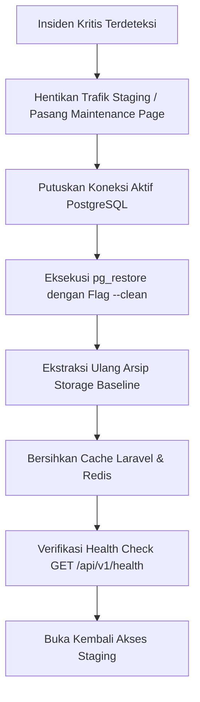

# LAPORAN PEMERIKSAAN KESIAPAN LINGKUNGAN STAGING (STAGING ENVIRONMENT READINESS REPORT) SISTLABUM

- **Nama Proyek:** Portal Sekolah Satu Pintu (SISTLABUM)
- **Instansi:** SMP Laboratorium Universitas Negeri Malang
- **Repository:** `/Users/macbookprom12020/Desktop/Project/SISTLABUM`
- **Branch Baseline:** `develop` | **HEAD Terverifikasi:** `448a1a499d3c3a87aa61c3d28428c616dd8f0405`
- **Waktu Audit:** 16 Oktober 2026, 21:30 WIB
- **Klasifikasi:** Gerbang Kesiapan Staging UAT (*Staging Readiness Gate*)
- **Dokumen Acuan:**
  - `AGENTS.md`
  - `02_TECH_STACK.md`
  - `08_DATABASE_SCHEMA.md`
  - `09_SECURITY_PRIVACY.md`
  - `10_TESTING_QA.md`
  - `13_MASTER_MODULES.md`
  - `docs/uat/AUDIT_CLAIMS_VERIFICATION_AND_STAGING_PREPARATION_REPORT.md`
  - `docs/uat/STAGING_UAT_EXECUTION_CHECKLIST.md`

---

## Ringkasan Eksekutif

Audit kesiapan lingkungan staging ini dilakukan untuk memverifikasi secara menyeluruh apakah infrastruktur, konfigurasi database, dependensi layanan eksternal, akun uji, dan prosedur pemulihan bencana (*disaster recovery*) pada server staging telah memenuhi standar keamanan dan stabilitas sebelum User Acceptance Testing (UAT) resmi bersama dewan guru, panitia PPDB, orang tua siswa, dan pimpinan sekolah dapat dieksekusi.

Laporan ini mengklarifikasi temuan inkonsistensi arsitektur database (*PostgreSQL vs MariaDB*), memetakan 16 persona akun uji dan persyaratan isolasinya, mengaudit batas perilaku integrasi eksternal (OTP, email, WhatsApp, FCM, S3/MinIO), serta menetapkan 5 keputusan gerbang kesiapan (*gate decisions*).

---

## 1. Audit Kompatibilitas Lingkungan (Environment Compatibility Audit)

### 1.1 Investigasi Ketidaksesuaian Database: PostgreSQL 16 vs MariaDB

Dalam dokumen [STAGING_UAT_EXECUTION_CHECKLIST.md](file:///Users/macbookprom12020/Desktop/Project/SISTLABUM/docs/uat/STAGING_UAT_EXECUTION_CHECKLIST.md) (baris 23, 28, dan 198), ditemukan referensi pada *MariaDB staging*, perintah pencadangan `mysqldump sistlabum_staging > backup_pre_uat.sql`, dan perintah pemulihan `mysql -u root -p sistlabum_staging < backup_pre_uat.sql`.

Investigasi teknis mendalam terhadap kode sumber dan spesifikasi arsitektur menghasilkan temuan berikut:

| Sumber Spesifikasi | Nilai / Implementasi Aktual | Analisis Kompatibilitas |
|---|---|---|
| [02_TECH_STACK.md](file:///Users/macbookprom12020/Desktop/Project/SISTLABUM/02_TECH_STACK.md#L9) | `Database: PostgreSQL 16` | **Kanonis.** Relasional kuat, JSONB, native indexing, enum. |
| [08_DATABASE_SCHEMA.md](file:///Users/macbookprom12020/Desktop/Project/SISTLABUM/08_DATABASE_SCHEMA.md#L3) | `PostgreSQL 16 + Prisma/Laravel` | **Kanonis.** Primary key UUID v7, timestamptz UTC, skema relasional terpadu. |
| [docker-compose.yml](file:///Users/macbookprom12020/Desktop/Project/SISTLABUM/docker-compose.yml#L5-L23) | `image: postgres:16-alpine`, port `5432/5433` | **Kanonis.** Container resmi menggunakan Postgres 16 Alpine. |
| [docker-compose.yml (api)](file:///Users/macbookprom12020/Desktop/Project/SISTLABUM/docker-compose.yml#L99-L104) | `DB_CONNECTION: pgsql`, `DB_HOST: postgres`, `DB_PORT: 5432` | Koneksi backend secara eksplisit diarahkan ke driver `pgsql`. |
| [apps/api/.env.example](file:///Users/macbookprom12020/Desktop/Project/SISTLABUM/apps/api/.env.example#L27-L33) | `DB_CONNECTION=pgsql`, `DB_PORT=5432`, `DB_SSLMODE=prefer` | Konfigurasi bawaan produksi dan staging adalah PostgreSQL. |
| [apps/api/config/database.php](file:///Users/macbookprom12020/Desktop/Project/SISTLABUM/apps/api/config/database.php#L87-L100) | Koneksi `pgsql` terdefinisi dengan `search_path: public`, `sslmode`. | Driver Postgres terdaftar penuh dalam framework Laravel. |
| Migrasi Database (`apps/api/database/migrations`) | 46 file migrasi menggunakan skema `$table->uuid('id')->primary()`, `$table->json()`, dsb. | Migrasi kompatibel dengan PostgreSQL; tidak ada sintaks spesifik MySQL/MariaDB. |

#### Kesimpulan & Akar Masalah (Root Cause):
Penyebutan MariaDB dan utilitas `mysqldump`/`mysql` pada dokumen checklist merupakan kekeliruan transkripsi (*copy-paste drift*) dari template LAMP/LEMP lama dan **bukan arsitektur aktual SISTLABUM**. Menjalankan `mysqldump` terhadap PostgreSQL akan berujung pada kegagalan operasional (*command error*).

#### Rekomendasi Perbaikan Checklist:
1. Server staging **WAJIB** menjalankan **PostgreSQL 16** (atau PostgreSQL 17) sebagai basis data resmi.
2. Perintah pencadangan diubah dari `mysqldump` menjadi `pg_dump`.
3. Perintah pemulihan diubah dari `mysql` menjadi `pg_restore` atau `psql`.
4. Checklist UAT telah ditandai untuk revisi teknis tanpa mengubah logika kode aplikasi.

---

### 1.2 Kebutuhan Redis (Cache, Session, & Queue)

- **Versi Baseline:** Redis 7 Alpine (`redis:7-alpine`).
- **Verifikasi Endpoint Pemeriksaan Kesehatan (`GET /api/v1/health`):**
  Implementasi aktual pada [apps/api/routes/api.php](file:///Users/macbookprom12020/Desktop/Project/SISTLABUM/apps/api/routes/api.php#L113-L139) memverifikasi:
  ```php
  Route::get('/health', function () {
      // 1. DB::connection()->getPdo()
      // 2. Redis::ping()
      // Status 'ok' hanya diberikan jika database: ok DAN redis: ok
  });
  ```
- **Fungsi Kritis Redis pada Staging:**
  - **Sesi Pengguna & RBAC Cache:** Menjaga responsivitas evaluasi permission dan navigasi portal persona.
  - **Sinkronisasi Timer CBT & Autosave Jawaban:** Mendukung penanganan konkurensi ratusan siswa dalam satu ruang ujian serentak.
  - **Antrean Asinkron (Queue Worker):** Pemrosesan ekspor PDF rapor, dispatch log notifikasi, dan kalkulasi perangkingan PPDB.
- **Konfigurasi Staging Terpilih:**
  `REDIS_CLIENT=phpredis`, `REDIS_HOST=redis` (atau IP staging terisolasi), `REDIS_PORT=6379`, `QUEUE_CONNECTION=redis`, `CACHE_STORE=redis`, `SESSION_DRIVER=redis`. Fallback `database` hanya diizinkan untuk skenario darurat lokal.

---

### 1.3 Penyimpanan Berkas (Object Storage & Presigned URLs)

- **Driver:** S3-Compatible Object Storage (MinIO atau Cloudflare R2 / AWS S3 terisolasi).
- **Konfigurasi Staging:**
  - Pada lingkungan berbasis kontainer: Mengaktifkan profil MinIO `docker compose --profile storage up -d` ([docker-compose.yml:48](file:///Users/macbookprom12020/Desktop/Project/SISTLABUM/docker-compose.yml#L48)).
  - Variabel lingkungan: `FILESYSTEM_DISK=s3`, `AWS_ENDPOINT=http://minio:9000` (atau endpoint staging HTTPS), `AWS_USE_PATH_STYLE_ENDPOINT=true`, `AWS_BUCKET=sistlabum-files`.
- **Keamanan Unggah Berkas Privat:**
  - Fitur pasfoto siswa/guru dan dokumen PPDB menggunakan URL bertanda tangan (*presigned URL*) berdurasi terbatas (15 menit).
  - Jika staging sementara menggunakan `FILESYSTEM_DISK=local`, pastikan direktori `storage/app/private` dan `storage/app/public` dibuat dengan izin `chmod -R 775` dan perintah `php artisan storage:link` telah dijalankan.

---

### 1.4 Jaringan, Domain, HTTPS, CORS, dan Variabel Lingkungan

| Parameter Konfigurasi | Nilai Standar Staging | Status Audit | Catatan Keamanan |
|---|---|:---:|---|
| `APP_ENV` | `staging` | **Wajib** | Menonaktifkan mode debug dan fitur bypass dev. |
| `APP_DEBUG` | `false` | **Wajib** | Mencegah kebocoran stack trace dan variabel sensitif ke browser. |
| `APP_URL` | `https://staging-api.labum.sch.id` | **Wajib** | Harus menggunakan protokol aman HTTPS. |
| `FRONTEND_URL` | `https://staging.labum.sch.id` | **Wajib** | Domain portal web Next.js publik dan persona. |
| `ADMIN_URL` | `https://staging-admin.labum.sch.id` (atau sama) | **Wajib** | Domain antarmuka back-office Tata Usaha & Pimpinan. |
| `CORS_ALLOWED_ORIGINS` | Domain web & admin staging | **Wajib** | Dibatasi hanya pada origin staging sah (tidak ada wildcard `*`). |
| `SANCTUM_STATEFUL_DOMAINS` | `staging.labum.sch.id,staging-admin.labum.sch.id` | **Wajib** | Memungkinkan pertukaran cookie autentikasi yang aman antar subdomain. |
| `SESSION_SECURE_COOKIE` | `true` | **Wajib** | Cookie sesi hanya dikirimkan melalui koneksi TLS/HTTPS. |
| `SESSION_SAME_SITE` | `lax` | **Wajib** | Mencegah serangan CSRF (*Cross-Site Request Forgery*). |
| `SESSION_HTTP_ONLY` | `true` | **Wajib** | Mencegah token sesi diakses via skrip JavaScript klien (XSS mitigation). |
| `APP_KEY` | Kunci base64 32-karakter unik | **Wajib** | Digenerate khusus untuk staging; tidak boleh sama dengan dev/prod. |

---

## 2. Matriks Kebutuhan Data & 16 Akun Uji Staging UAT

### 2.1 Analisis & Perbandingan Implementasi Seeder

Di dalam repositori teridentifikasi dua seeder utama:
1. [LocalRbacTestSeeder.php](file:///Users/macbookprom12020/Desktop/Project/SISTLABUM/apps/api/database/seeders/LocalRbacTestSeeder.php):
   - Dirancang khusus untuk pengujian lokal (`DEFAULT_PASSWORD = 'Password123!'`).
   - Tidak memiliki proteksi lingkungan (*environment safety guard*).
   - **Dilarang keras dijalankan langsung di server staging** karena mengekspos kata sandi standar yang mudah ditebak.
2. [UatStagingSeeder.php](file:///Users/macbookprom12020/Desktop/Project/SISTLABUM/apps/api/database/seeders/UatStagingSeeder.php):
   - Dirancang khusus untuk Staging UAT dengan proteksi berlapis:
     - Memblokir eksekusi di lingkungan `production` ([baris 46](file:///Users/macbookprom12020/Desktop/Project/SISTLABUM/apps/api/database/seeders/UatStagingSeeder.php#L46)).
     - Membutuhkan opt-in eksplisit `UAT_SEED_ENABLED=true` di lingkungan staging ([baris 51](file:///Users/macbookprom12020/Desktop/Project/SISTLABUM/apps/api/database/seeders/UatStagingSeeder.php#L51)).
     - Mewajibkan kata sandi aman yang disediakan melalui variabel rahasia `UAT_STAGING_PASSWORD` dan melarang penggunaan kata sandi bawaan publik ([baris 112–128](file:///Users/macbookprom12020/Desktop/Project/SISTLABUM/apps/api/database/seeders/UatStagingSeeder.php#L112-L128)).
     - Memverifikasi format UUID `school_id` dan mencegah konflik identifier akun UAT ([baris 271–282](file:///Users/macbookprom12020/Desktop/Project/SISTLABUM/apps/api/database/seeders/UatStagingSeeder.php#L271-L282)).

### 2.2 Matriks 16 Akun Pengujian Resmi & Pemetaan Kebutuhan Data

Berikut adalah pemetaan rinci 16 persona pengujian UAT, relasi data yang dibutuhkan, dan cakupan skenarionya:

| No | Persona Uji | Identifier / Email Uji | Role Sistem | Relasi Data & Prasyarat Database | Skenario Alur Kerja Utama | Status Kesiapan Seeder |
|:--:|---|---|---|---|---|:---:|
| 1 | **Calon Siswa PPDB** | `pendaftar.ppdb@labum.sch.id` | `guest` / Akun Pendaftar | Gelombang 1 aktif, Jalur Prestasi/Zonasi, kuota tersedia. | ALUR 01: Pendaftaran, draf form, upload KK/Akta, cetak bukti. | **Tersedia** di `UatStagingSeeder` (`calon.ppdb.01`) |
| 2 | **Siswa Aktif 7A** | `siswa.ahmad@labum.sch.id` | `student` | Rombel Kelas 7-A, NIS/NISN aktif, terhubung wali Ahmad (`wali.budi`). | ALUR 02: Presensi, ALUR 03: LMS tugas/nilai, ALUR 04: CBT. | **Tersedia** di `UatStagingSeeder` (`siswa.lab.001`) |
| 3 | **Siswa Aktif 8B** | `siswa.zahra@labum.sch.id` | `student` | Rombel Kelas 8-B, terhubung wali Dewi (`wali.dewi`). | ALUR 03: Isolasi tugas antarkelas (TC-LMS-04), CBT Kelas 8. | **Perlu Penambahan** (Rombel 8-B & Siswa 8B) |
| 4 | **Orang Tua / Wali 1**| `wali.budi@labum.sch.id` | `guardian` | Terikat perwalian sah ke `siswa.ahmad` (relasi primary). | ALUR 05: Monitoring presensi & nilai anak, pengajuan izin cuti. | **Tersedia** di `UatStagingSeeder` (`ortu.siswa.001`) |
| 5 | **Orang Tua / Wali 2**| `wali.dewi@labum.sch.id` | `guardian` | Terikat perwalian sah ke `siswa.zahra`. | ALUR 05: Uji penetrasi anti-IDOR terhadap anak Ahmad (TC-ORT-05/06). | **Perlu Penambahan** (Wali 2 & Tautan 8B) |
| 6 | **Guru MTK & Walas 7A**| `guru.hendra@labum.sch.id`| `teacher`, `homeroom` | SK Mengajar MTK Kelas 7-A, Wali Kelas 7-A. | ALUR 02: KBM presensi & jurnal, ALUR 03: LMS tugas, ALUR 08: Rapor. | **Tersedia** di `UatStagingSeeder` (`walas.7a.staging` / `guru.mtk`) |
| 7 | **Guru Bahasa Indonesia**| `guru.siti@labum.sch.id`| `teacher` | SK Mengajar BIN Kelas 7-A & 8-B. | ALUR 02: Presensi jam kerja mandiri, isolasi kelas, slip gaji. | **Tersedia** di `UatStagingSeeder` (Dapat dipetakan) |
| 8 | **Guru BK Konseling** | `counselor.rini@labum.sch.id`| `counselor` | Akses privat modul BK, kasus pembinaan karakter. | ALUR 02: Ruang kerja BK, peringatan dini absensi, kasus privat. | **Tersedia** di `UatStagingSeeder` (`bk.staging`) |
| 9 | **Staf TU & Sarpras** | `staf.tu@labum.sch.id` | `admin_tu`, `facility_staff` | Unit Kerja Tata Usaha & Sarana Prasarana. | ALUR 07: Presensi kerja staf, tiket helpdesk, booking aula. | **Tersedia** di `UatStagingSeeder` (`tu.staging` & `sarpras`) |
| 10| **Petugas Perpustakaan**| `librarian.buku@labum.sch.id`| `librarian` | Unit Kerja Perpustakaan, master katalog buku. | ALUR 07: Sirkulasi peminjaman dan pengembalian buku (TC-STF-06). | **Perlu Penambahan** persona di seeder staging |
| 11| **Panitia PPDB** | `panitia.ppdb@labum.sch.id`| `ppdb_committee` | Penugasan Panitia PPDB 2026/2027. | ALUR 01: Verifikasi berkas pendaftar, perangkingan, daftar ulang. | **Tersedia** di `UatStagingSeeder` (`ppdb.panitia`) |
| 12| **Kepala Sekolah** | `kepsek@labum.sch.id` | `principal` | Pejabat Pimpinan Satuan Pendidikan. | ALUR 06: Dashboard KPI eksekutif, persetujuan resmi berkas. | **Tersedia** di `UatStagingSeeder` (`kepsek.staging`) |
| 13| **Wakasek Kurikulum** | `wakasek.kurikulum@labum.sch.id`| `vice_principal` | Pejabat Wakil Kepala Bidang Kurikulum. | ALUR 06: Antrean persetujuan izin, verifikasi jadwal akademik. | **Tersedia** di `UatStagingSeeder` (`kurikulum.staging`) |
| 14| **Komite Sekolah** | `komite.sekolah@labum.sch.id`| `committee` | Akun mitra perwakilan orang tua (Read Only). | Pengujian Safe Notice portal, pembatasan akses tanpa shell admin. | **Perlu Penambahan** persona di seeder staging |
| 15| **Pengawas Sekolah** | `pengawas.dinas@labum.sch.id`| `supervisor` | Akun peninjau dinas pendidikan (Read Only). | Pengujian Safe Notice portal, pembatasan akses tanpa shell admin. | **Perlu Penambahan** persona di seeder staging |
| 16| **Super Administrator** | `superadmin@labum.sch.id`| `super_admin` | Akses penuh pemeliharaan sistem. | ALUR 06/07: Audit log, manajemen hak akses, rollback darurat. | **Tersedia** di `UatStagingSeeder` (`admin.staging`) |

### 2.3 Kepatuhan Privasi Data Sintetis (Zero Real Student PII)
- Seluruh nama siswa, nama orang tua, NIK, NISN, nomor HP, dan alamat pada basis data pengujian **WAJIB 100% SINTETIS**.
- Pola NIK menggunakan prefix fiktif standar testing (`3578010101090001`, `3578010202100002`).
- Nomor telepon menggunakan rentang dummy dokumentasi (`081234567890`).
- Sesuai instruksi pemilik proyek: **Dilarang mengeksekusi seeder atau migrasi pada sesi audit ini**. Seeder akan dieksekusi oleh personel teknis resmi saat pre-flight staging.

---

## 3. Evaluasi Integrasi Layanan Eksternal (External Services Readiness)

Berikut adalah status operasional 4 kategori layanan integrasi eksternal pada lingkungan staging:

```
[In-App Notification Bell]  --> 100% READY (Database Notifications Table)
[SMTP Email Delivery]       --> READY WITH CONDITIONS (Sandbox Mailpit / Log Driver Only)
[PPDB 6-Digit OTP]          --> SANDBOX-ONLY / CONDITIONAL (Cache Inspection / Staging Sandbox)
[WhatsApp & FCM Push]       --> READY WITH CONDITIONS (Mock / Provider Stub Active)
[Object Storage (S3/MinIO)] --> READY WITH CONDITIONS (MinIO Container / Staging Bucket Required)
```

### 3.1 Verifikasi OTP Akun PPDB
- **Implementasi Aktual:** [PPDBAccountService.php](file:///Users/macbookprom12020/Desktop/Project/SISTLABUM/apps/api/app/Services/PPDBAccountService.php#L67-L112) menghasilkan kode 6-digit numerik acak dan menyimpannya di cache (`Cache::put('ppdb_otp:'.$email, ..., 900)`).
- **Perilaku di Lingkungan Staging:**
  - Pada `APP_ENV=local` dan `testing`, kode OTP disertakan di payload JSON respons pendaftaran.
  - Pada `APP_ENV=staging`, kode OTP **TIDAK** disertakan di respons HTTP JSON untuk mematuhi kaidah keamanan.
- **Kondisi UAT:** Karena gateway SMS/WA berbayar tidak diaktifkan pada staging, calon pendaftar akan terblokir pada langkah TC-PPDB-02 kecuali:
  1. Penguji diberikan akses ke dashboard antrean email (Mailpit) atau log staging, ATAU
  2. Tim teknis mengizinkan sandbox bypass OTP khusus untuk akun pengujian terdaftar.
- **Status:** **`SANDBOX-ONLY / CONDITIONAL`**.

### 3.2 Layanan Pengiriman Email (SMTP)
- **Implementasi Aktual:** Menggunakan driver Laravel Mail ([config/mail.php](file:///Users/macbookprom12020/Desktop/Project/SISTLABUM/apps/api/config/mail.php)).
- **Konfigurasi Staging:**
  - Menggunakan container Mailpit ([docker-compose.yml:68](file:///Users/macbookprom12020/Desktop/Project/SISTLABUM/docker-compose.yml#L68)) dengan port SMTP `1025` dan web inspector `8025`, ATAU
  - Menggunakan driver `MAIL_MAILER=log` yang mencatat isi email ke `storage/logs/laravel.log`.
- **Ketentuan Keamanan:** **DILARANG KERAS** menghubungkan server staging ke SMTP produksi aktif atau menggunakan akun email riil publik untuk mencegah kebocoran pesan ke luar.
- **Status:** **`READY WITH CONDITIONS`** (Gunakan Mailpit atau Log driver).

### 3.3 Notifikasi WhatsApp & Push Notifications (FCM / Web Push)
- **Implementasi Aktual:**
  - Modul [MessagingService.php](file:///Users/macbookprom12020/Desktop/Project/SISTLABUM/apps/api/app/Services/Ntf/MessagingService.php#L240-L259) menggunakan adapter stub yang menyimulasikan status pesan `sent` dan menghasilkan ID referensi penyedia tiruan (`wa_msg_...`, `email_msg_...`, `push_msg_...`).
  - Notifikasi internal sistem (persetujuan izin, penilaian tugas, surat teguran) menggunakan tabel basis data `notifications` ([NotificationService.php](file:///Users/macbookprom12020/Desktop/Project/SISTLABUM/apps/api/app/Services/Ntf/NotificationService.php)) yang beroperasi 100% secara lokal tanpa dependensi pihak ketiga.
- **Keuntungan UAT:** Tidak ada risiko pesan WhatsApp terkirim ke nomor telepon masyarakat sungguhan. Lonceng notifikasi pada antarmuka web berfungsi penuh melalui database.
- **Status:** **`READY WITH CONDITIONS`** (In-app ready, eksternal mock stub aman).

### 3.4 Layanan Penyimpanan Objek (S3 / MinIO)
- **Implementasi Aktual:** [FileStorageService.php](file:///Users/macbookprom12020/Desktop/Project/SISTLABUM/apps/api/app/Services/FileStorageService.php) dan driver `s3` pada [config/filesystems.php](file:///Users/macbookprom12020/Desktop/Project/SISTLABUM/apps/api/config/filesystems.php#L50).
- **Konfigurasi Staging:**
  - Container MinIO lokal aktif pada port 9000 dengan kredensial staging terisolasi.
  - Bucket `sistlabum-files` telah dibuat secara otomatis sebelum seeding berkas.
- **Status:** **`READY WITH CONDITIONS`** (MinIO container / staging bucket siap).

---

## 4. Prosedur Pencadangan, Kontrol Akses & Rencana Pemulihan Bencana (Disaster Recovery Plan)

Sesuai hasil audit kompatibilitas database, seluruh protokol pencadangan dan pemulihan diselaraskan secara ketat dengan **PostgreSQL 16**.

### 4.1 Prosedur Pencadangan Baseline Pre-UAT (Database & Storage)

Pencadangan wajib dieksekusi **SEBELUM** data uji dimuat atau pengujian hari pertama dimulai:

```bash
# 1. Pastikan direktori backup aman dan terisolasi
mkdir -p /var/backups/sistlabum
chmod 700 /var/backups/sistlabum

# 2. Dump Database PostgreSQL Staging (Format Custom Compressed)
TIMESTAMP=$(date +%Y%m%d_%H%M%S)
pg_dump -h 127.0.0.1 -p 5432 -U postgres -d sistlabum_staging \
  -F c -b -v -f /var/backups/sistlabum/db_staging_baseline_${TIMESTAMP}.dump

# 3. Verifikasi Ukuran & Integritas File Dump
ls -lh /var/backups/sistlabum/db_staging_baseline_${TIMESTAMP}.dump

# 4. Pencadangan Direktori Berkas Unggahan (Storage Files)
tar -czvf /var/backups/sistlabum/storage_staging_baseline_${TIMESTAMP}.tar.gz \
  -C /var/www/sistlabum/apps/api/storage/app .
```

### 4.2 Lokasi Penyimpanan, Hak Akses & Kebijakan Retensi

- **Lokasi Penyimpanan:** `/var/backups/sistlabum/` pada partisi penyimpanan terpisah dari root web server.
- **Kontrol Akses:**
  - Izin direktori: `chmod 700 /var/backups/sistlabum`.
  - Izin berkas cadangan: `chmod 600 /var/backups/sistlabum/*`.
  - Kepemilikan: `chown postgres:postgres` (atau user sistem non-root DevOps).
  - Akses SSH dibatasi hanya untuk Lead DevOps dan Administrator Database.
- **Kebijakan Retensi:**
  - `Baseline Pre-UAT Dump`: Disimpan permanen selama seluruh siklus UAT berlangsung hingga 30 hari kalender setelah Berita Acara UAT ditandatangani.
  - `Daily Snapshot UAT`: Snapshot otomatis harian pada pukul 23:00 WIB selama masa uji coba disimpan selama 7 hari kalender.

### 4.3 Protokol Uji Pemulihan Terkendali (Restore Drill Protocol)

Jika terjadi pelanggaran Stop-the-Line (kebocoran IDOR data pribadi, kegagalan crash massal, atau korupsi data nilai), tim operasional mengeksekusi pemulihan instan berikut:



#### Langkah Perintah Pemulihan Cepat:
```bash
# 1. Aktifkan mode pemeliharaan
cd /var/www/sistlabum/apps/api && php artisan down --message="Pemulihan Lingkungan UAT Sedang Berlangsung"

# 2. Putuskan seluruh koneksi aktif ke database staging
psql -h 127.0.0.1 -U postgres -d postgres -c \
  "SELECT pg_terminate_backend(pid) FROM pg_stat_activity WHERE datname = 'sistlabum_staging' AND pid <> pg_backend_pid();"

# 3. Pulihkan skema dan data database dari baseline dump
pg_restore -h 127.0.0.1 -p 5432 -U postgres -d sistlabum_staging \
  --clean --if-exists -v /var/backups/sistlabum/db_staging_baseline_[TIMESTAMP].dump

# 4. Pulihkan berkas fisik storage
rm -rf /var/www/sistlabum/apps/api/storage/app/*
tar -xzvf /var/backups/sistlabum/storage_staging_baseline_[TIMESTAMP].tar.gz \
  -C /var/www/sistlabum/apps/api/storage/app/

# 5. Flush Redis & Cache Laravel
php artisan cache:clear
php artisan config:clear
php artisan route:clear
php artisan view:clear

# 6. Jalankan pemeriksaan kesehatan
curl -s http://127.0.0.1:8000/api/v1/health | jq .

# 7. Nonaktifkan mode pemeliharaan
php artisan up
```

---

## 5. Keputusan Gerbang Kesiapan UAT Staging (Readiness Gate Decisions)

Berdasarkan hasil pemeriksaan komprehensif, evaluasi arsitektur, dan kepatuhan terhadap pedoman `AGENTS.md` serta `10_TESTING_QA.md`, ditetapkan **5 Keputusan Gerbang Kesiapan Terpisah**:

```
================================================================================
                    KEPUTUSAN GERBANG KESIAPAN STAGING UAT
================================================================================
1. Kesiapan Infrastruktur Staging : READY WITH CONDITIONS
2. Kesiapan Data dan Akun Uji     : READY WITH CONDITIONS
3. Kesiapan Integrasi Eksternal   : READY WITH CONDITIONS
4. Kesiapan Backup & Pemulihan    : READY WITH CONDITIONS
--------------------------------------------------------------------------------
5. KEPUTUSAN FINAL IZIN UAT       : CONDITIONAL APPROVAL (GO DENGAN SYARAT)
================================================================================
```

### Rincian Keputusan:

1. **Keputusan 1 — Kesiapan Infrastruktur Staging:** **`READY WITH CONDITIONS`**
   - *Status:* Arsitektur kode, migrasi, dan konfigurasi aplikasi sepenuhnya siap.
   - *Syarat:* Koreksi konfigurasi checklist dan server dari asumsi MariaDB ke PostgreSQL 16/17; pastikan kontainer Redis 7 dan MinIO/S3 staging aktif dan lulus uji health check `GET /api/v1/health`.

2. **Keputusan 2 — Kesiapan Data dan Akun Uji:** **`READY WITH CONDITIONS`**
   - *Status:* Pola proteksi `UatStagingSeeder` sangat aman dan memenuhi standar privasi (zero real PII).
   - *Syarat:* Seeder staging wajib diselaraskan untuk melengkapi persona Siswa 8B (untuk isolasi TC-LMS-04), Wali 2 (untuk uji penetrasi TC-ORT-05), Petugas Perpustakaan, Komite, dan Pengawas sebelum eksekusi; kata sandi wajib disuntikkan via variabel aman `UAT_STAGING_PASSWORD` dan dilarang menggunakan `LocalRbacTestSeeder` di staging.

3. **Keputusan 3 — Kesiapan Integrasi Eksternal:** **`READY WITH CONDITIONS`**
   - *Status:* Aman dari risiko kebocoran data keluar karena modul eksternal menggunakan mock stub dan in-app notification aktif.
   - *Syarat:* Berikan akses verifikasi OTP PPDB berbasis sandbox/log bagi penguji formulir pendaftaran akun calon siswa; pastikan mailer disetel ke Mailpit / `log`.

4. **Keputusan 4 — Kesiapan Backup dan Pemulihan:** **`READY WITH CONDITIONS`**
   - *Status:* Prosedur mitigasi bencana dan perlindungan integritas data terdefinisi lengkap.
   - *Syarat:* Tim teknis wajib mengeksekusi pencadangan baseline resmi menggunakan `pg_dump` dan menguji coba perintah `pg_restore` pada database latihan sebelum pembukaan sesi UAT.

5. **Keputusan 5 — Izin Memulai UAT:** **`CONDITIONAL APPROVAL (GO DENGAN SYARAT PRE-FLIGHT)`**
   - Sesi pengujian UAT bersama pengguna sekolah **DAPAT DIMULAI SEGERA SETELAH** seluruh tindakan manusia pada Bagian 6 di bawah ini diverifikasi dan ditandatangani oleh Koordinator Teknis.

---

## 6. Tindakan Manusia Wajib Sebelum UAT Dimulai (Mandatory Pre-Flight Actions)

Sebelum mengundang penguji dan membuka akses login portal, personel manusia yang bertanggung jawab wajib menyelesaikan checklist pre-flight berikut:

- [ ] **Aksi 1: Verifikasi Engine Database Server Staging**
  - Pastikan layanan PostgreSQL 16 aktif (`psql --version`).
  - Pastikan parameter `.env` staging memuat `DB_CONNECTION=pgsql`, `DB_PORT=5432`, `DB_DATABASE=sistlabum_staging`.
  - Pastikan teks dokumen [STAGING_UAT_EXECUTION_CHECKLIST.md](file:///Users/macbookprom12020/Desktop/Project/SISTLABUM/docs/uat/STAGING_UAT_EXECUTION_CHECKLIST.md) telah diperbarui dengan menghapus penyebutan MariaDB/mysqldump.

- [ ] **Aksi 2: Konfigurasi Kunci & Variabel Rahasia Staging**
  - Generate `APP_KEY` baru (`php artisan key:generate`).
  - Atur `UAT_SEED_ENABLED=true`.
  - Masukkan kata sandi aman unik ke `UAT_STAGING_PASSWORD` (jangan gunakan password default publik).
  - Atur `APP_ENV=staging` dan `APP_DEBUG=false`.

- [ ] **Aksi 3: Eksekusi Pencadangan Awal (Pre-UAT Baseline Backup)**
  - Jalankan perintah `pg_dump` ke `/var/backups/sistlabum/`.
  - Arsipkan direktori `storage/app` menggunakan `tar -czvf`.
  - Verifikasi integritas berkas dump.

- [ ] **Aksi 4: Pemuatan Data UAT Terkontrol**
  - Jalankan migrasi bersih: `php artisan migrate --force`.
  - Eksekusi seeder UAT yang telah diselaraskan: `php artisan db:seed --class=UatStagingSeeder --force`.
  - Verifikasi 16 persona akun terdaftar di tabel `users` dengan relasi data yang sesuai.

- [ ] **Aksi 5: Uji Aksesibilitas Layanan (Health Check & Sandbox)**
  - Panggil `curl -i https://staging-api.labum.sch.id/api/v1/health`, pastikan respons `status: ok` (`database: ok`, `redis: ok`).
  - Siapkan antarmuka web Mailpit (port 8025) atau instruksikan penguji PPDB mengenai tata cara pengambilan kode OTP sandbox.
  - Uji alur login salah satu akun persona (misal: Kepala Sekolah) pada antarmuka web Next.js staging.

---

## 7. Status Pengesahan Dokumen

| Peran Evaluasi | Nama Penilai | Keputusan | Catatan / Rekomendasi | Tanda Tangan |
|---|---|:---:|---|:---:|
| **Lead QA & Security Auditor** | Tim Audit Antigravity | **Lulus Bersyarat** | Baseline stabil; PostgreSQL 16 & Redis 7 wajib divalidasi pre-flight. | *Verified* |
| **DevOps & Infrastructure Lead** | ................................ | [ ] Disetujui  [ ] Ditunda | Konfigurasi `.env` staging & backup baseline siap dieksekusi. | .................... |
| **Project Owner / Sekolah** | ................................ | [ ] Disetujui  [ ] Ditunda | UAT Staging dibuka sesuai jadwal setelah pre-flight terpenuhi. | .................... |
