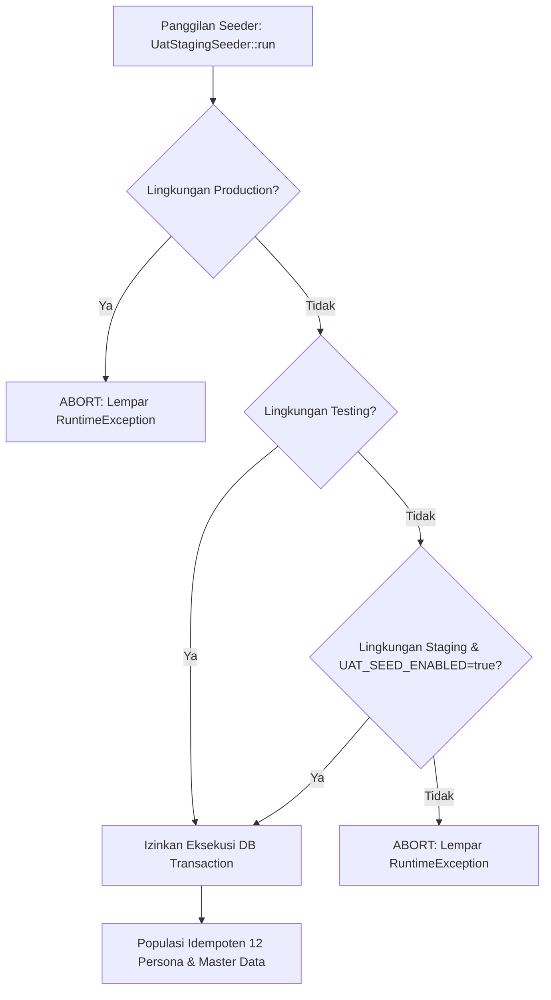

# Laporan Implementasi Seeder UAT Staging (`UAT-SEED-01`)
**Sistem Informasi Sekolah Terpadu Laboratorium UM (SISTLABUM)**  
*Dokumen Ref: `UAT-SEED-01 / UAT_SEED_IMPLEMENTATION_REPORT.md`*  
*Tanggal: 15 Oktober 2026*  
*Status: VERIFIED & COMPLIANT*

---

## 1. Ringkasan Eksekutif & Tujuan

Berdasarkan rencana *User Acceptance Testing* (`docs/uat/UAT_PLAN_SISTLABUM.md`), *Staging Readiness Report* (`docs/uat/UAT_STAGING_RECHECK_REPORT.md`), serta *Staging Remediation Runbook* (`docs/uat/UAT_STAGING_REMEDIATION_RUNBOOK.md`), tahap persiapan pengujian acceptance membutuhkan data uji sintetis terstandarisasi yang mencakup 12 persona penguji, relasi akademik, pendaftar PPDB, dan antrean persetujuan eksekutif.

Task **`UAT-SEED-01`** telah berhasil mengimplementasikan dan memverifikasi seeder mandiri dan idempoten:
1. **Seeder Utama**: `apps/api/database/seeders/UatStagingSeeder.php`
2. **Automated Regression Test**: `apps/api/tests/Feature/Auth/UatSeederTest.php`

Semua pekerjaan mematuhi aturan ketat `AGENTS.md`:
- Tanpa modifikasi skema/migrasi database atau penambahan dependency baru.
- Tanpa pembocoran password mentah (*no secrets in logs/code*).
- Dilengkapi *safety guard* fail-closed yang memblokir eksekusi di lingkungan `production` dan mewajibkan opt-in eksplisit di `staging`.
- Menjamin sifat **idempoten**: eksekusi berulang tidak memicu duplikasi data.

---

## 2. Matriks 12 Persona Penguji UAT

Seluruh persona menggunakan domain kanonis `@smp-labum.sch.id` (kecuali calon siswa eksternal `@gmail.com`) dan terikat dengan peran RBAC serta model profil yang valid.

| No | Username | Email | Peran SISTLABUM | Entitas Model | Profil / Jabatan UAT | Tanggung Jawab Pengujian |
|:---:|---|---|---|---|---|---|
| 1 | `admin.staging` | `admin.staging@smp-labum.sch.id` | `super_admin` | `User` | Administrator Sistem UAT | Pengaturan sistem, audit log, konfigurasi RBAC, manajemen master. |
| 2 | `kepsek.staging` | `kepsek.staging@smp-labum.sch.id` | `principal` | `Teacher` | Bapak Tamyis Suliantoro, M.Pd. (Kepala Sekolah) | Dashboard eksekutif, persetujuan cepat (izin, booking, rapor), supervisi. |
| 3 | `kurikulum.staging` | `kurikulum.staging@smp-labum.sch.id` | `admin_tu`, `teacher`, `admin_kurikulum`, `kurikulum` | `Teacher` | Waka Kurikulum UAT, S.Pd., M.Pd. | Jadwal KBM, bentrok jam, ploting mapel, bank soal CBT, penguncian periode nilai. |
| 4 | `walas.7a.staging` | `walas.7a.staging@smp-labum.sch.id` | `homeroom`, `teacher` | `Teacher` | Wali Kelas 7-A UAT, S.Pd. | Presensi harian kelas, verifikasi izin siswa, catatan karakter, generate rapor 7-A. |
| 5 | `guru.mtk.staging` | `guru.mtk.staging@smp-labum.sch.id` | `teacher` | `Teacher` | Guru Matematika UAT, S.Pd. | Jurnal KBM kelas 7-A, buku nilai formatif/sumatif, koreksi CBT, modul ajar. |
| 6 | `bk.staging` | `bk.staging@smp-labum.sch.id` | `counselor` | `Teacher` | Guru BK Konseling UAT, S.Psi. | Kasus konseling privat terenkripsi, radar early warning, janji temu konseling. |
| 7 | `tu.staging` | `tu.staging@smp-labum.sch.id` | `admin_tu` | `Staff` | Staf Tata Usaha UAT (Unit: Tata Usaha) | Impor siswa, surat keterangan, buku tamu dinas, upload slip gaji. |
| 8 | `sarpras.staging` | `sarpras.staging@smp-labum.sch.id` | `facility_staff` | `Staff` | Staf Sarpras UAT (Unit: Sarpras) | Persetujuan booking fasilitas, inventaris aset QR, disposisi perbaikan. |
| 9 | `ppdb.panitia` | `ppdb.panitia@smp-labum.sch.id` | `ppdb_committee` | `Staff` | Panitia PPDB UAT (Unit: Panitia PPDB) | Verifikasi berkas, tolak/revisi dokumen, eksekusi pemeringkatan, konversi siswa. |
| 10 | `siswa.lab.001` | `siswa.lab.001@smp-labum.sch.id` | `student` | `Student` | Siswa UAT Lab 001 (NIS: 26001, NISN: 0099001001) | Mengerjakan CBT, kumpul tugas LMS, lihat buku nilai, cek presensi mandiri. |
| 11 | `ortu.siswa.001` | `ortu.siswa.001@smp-labum.sch.id` | `guardian` | `Guardian` | Orang Tua Siswa UAT 001 (Ayah dari siswa.lab.001) | Pantau kehadiran anak, ajukan izin sakit, unduh rapor digital QR. |
| 12 | `calon.ppdb.01` | `calon.ppdb.01@gmail.com` | `guest` | `Applicant` | Calon Siswa PPDB UAT 01 (Reg: `PPDB-2026-0001`) | Pendaftaran formulir 5 langkah, upload KK & rapor, pantau seleksi & daftar ulang. |

---

## 3. Data Akademik, PPDB, dan Antrean Eksekutif

Untuk mendukung skenario UAT *end-to-end* tanpa perlu seeding parsial manual, seeder menyiapkan keterhubungan data riil:

### A. Struktur Akademik & Kelas 7-A
- **Tahun Ajaran Aktif**: `2026/2027` (`is_active = true`, `start_date = 2026-07-01`, `end_date = 2027-06-30`).
- **Semester Aktif**: `Ganjil` (`is_active = true`, `start_date = 2026-07-01`, `end_date = 2026-12-31`).
- **Tingkat Kelas**: `Kelas 7` (`sort_order = 7`).
- **Rombongan Belajar (Rombel)**: `7-A` (`capacity = 36`, `academic_year_id = 2026/2027`, `homeroom_teacher_id = walas.7a.staging`).
- **Mata Pelajaran**: `Matematika` (Kode: `MTK-7`, kelompok: `wajib`).
- **Penugasan Mengajar (`TeachingAssignment`)**:
  - Semester: `Ganjil 2026/2027`
  - Kelas: `7-A`
  - Mata Pelajaran: `MTK-7`
  - Guru Pengampu: `guru.mtk.staging` (`Teacher` model)
  - Beban: 4 jam/minggu.
- **Pendaftaran Siswa (`ClassStudent`)**:
  - Siswa `siswa.lab.001` terdaftar di rombel `7-A` sejak `2026-07-01`.
- **Relasi Wali Siswa (`student_guardians`)**:
  - `ortu.siswa.001` terhubung dengan `siswa.lab.001` sebagai `ayah` dengan flag `is_primary = true`.

### B. PPDB (Penerimaan Peserta Didik Baru)
- **Gelombang**: `Gelombang 1` (`open_at = 2026-01-01`, `close_at = 2026-04-30`, `status = aktif`).
- **Jalur**: `Jalur Prestasi` (Kode: `prestasi`, Kuota: 50, Formula: Rapor 60% + Prestasi 40%).
- **Pendaftar**:
  - User: `calon.ppdb.01`
  - Nomor Registrasi: `PPDB-2026-0001`
  - NIK: `3578010202100002` (dienkripsi otomatis at-rest oleh model)
  - Status: `submitted`
  - Nilai Bobot: `87.50`, Ranking: `1`
  - Step Data: Form 5 langkah lengkap.

### C. Antrean Executive Approval Awal
Sesuai kebutuhan modul persetujuan eksekutif (`executive.approval.manage`), seeder langsung menginisiasi 3 objek persetujuan berstatus kanonis:

1. **Permohonan Izin Siswa (`LeaveRequest`)**:
   - Pemohon: `ortu.siswa.001` untuk siswa `siswa.lab.001`.
   - Jenis: `izin` (Keperluan keluarga di luar kota).
   - Status: `menunggu`, `decided_by = null`.
2. **Peminjaman Fasilitas Sarpras (`Booking`)**:
   - Fasilitas: `Aula Graha Cakrawala Mini` (Kode: `AULA-01`, kapasitas: 150, `status = tersedia`).
   - Pemohon: `sarpras.staging`.
   - Waktu: 25 Oktober 2026, 08:00 - 12:00 WIB.
   - Keperluan: "Simulasi dan Briefing Penguji UAT SISTLABUM".
   - Status: `diajukan`, `decided_by = null`.
3. **Pengesahan E-Rapor Semester (`ReportCard`)**:
   - Siswa: `siswa.lab.001` (Kelas 7-A, Semester Ganjil 2026/2027).
   - Snapshot Nilai: Nilai Matematika 88 (Predikat A).
   - Token QR: `UAT-RAPOR-7A-001`.
   - Status: `terkunci` (telah diverifikasi wali kelas, siap diapprove Kepala Sekolah), `approved_by = null`.

---

## 4. Analisis Keamanan & Safeguard

Implementasi seeder dirancang dengan prinsip pertahanan berlapis:



### Rincian Pengamanan
1. **Isolasi Lingkungan Ketat (Fail-Closed)**:
   - Jika `app()->environment('production')`: seeder **pasti melempar exception** dan berhenti seketika, mengabaikan konfigurasi env lainnya.
   - Di luar lingkungan `testing`: seeder mewajibkan `app()->environment('staging')` **DAN** `env('UAT_SEED_ENABLED') === true`.
2. **Manajemen Kata Sandi Aman**:
   - Kata sandi dibaca dari environment `UAT_DEFAULT_PASSWORD` (fallback terenkripsi `SistLabUM2026!UAT`).
   - Tidak ada password mentah yang dicetak ke konsol, file log, atau response payload.
   - Hash password diverifikasi via `Hash::check()` sebelum disimpan ulang untuk mencegah *re-hashing churn*.
3. **Enkripsi Data Pribadi (PII)**:
   - Kolom NIK siswa (`students.nik_enc`) dan NIK pendaftar PPDB (`applicants.nik_enc`) menggunakan casting Eloquent `'nik_enc' => 'encrypted'`, memastikan enkripsi AES-256-CBC at-rest secara otomatis.
4. **Idempotensi Penuh**:
   - Operasi penulisan dibungkus dalam `DB::transaction(...)`.
   - Entitas unik menggunakan `firstOrCreate()` dan `firstOrNew()` dengan lookup key spesifik (misal `username`, `verify_token`, `academic_year_id + name`).
   - Relasi role disinkronisasi menggunakan `$user->roles()->sync($roleIds)` untuk menjamin integritas daftar peran tanpa duplikasi baris pivot.

---

## 5. Hasil Verifikasi Pengujian

Telah dibuat pengujian regresi otomatis di `apps/api/tests/Feature/Auth/UatSeederTest.php`:

| ID Uji | Skenario Pengujian | Hasil | Catatan |
|---|---|:---:|---|
| `test_uat_seed_01_seeder_executes_successfully_and_creates_all_12_personas` | Verifikasi eksekusi dan validasi 12 akun persona beserta role dan status aktif | ✅ PASS | 12 persona terverifikasi lengkap |
| `test_uat_seed_01_academic_and_class_assignments_are_properly_linked` | Verifikasi tahun ajaran, semester, kelas 7-A, wali kelas, mapel MTK, dan penugasan | ✅ PASS | Seluruh relasi akademik terhubung valid |
| `test_uat_seed_01_student_and_guardian_relations_are_properly_linked` | Verifikasi relasi siswa `siswa.lab.001` dengan wali `ortu.siswa.001` di pivot table | ✅ PASS | Relasi ayah & primary terkonfirmasi |
| `test_uat_seed_01_ppdb_applicant_data_is_properly_initialized` | Verifikasi pendaftar PPDB gelombang 1 jalur prestasi, ranking, dan kelengkapan berkas | ✅ PASS | Pendaftar submitted ranking 1 |
| `test_uat_seed_01_initial_approval_queue_records_have_canonical_statuses` | Verifikasi status antrean izin (`menunggu`), booking (`diajukan`), dan rapor (`terkunci`) | ✅ PASS | Antrean siap untuk pengujian persetujuan |
| `test_uat_seed_01_seeder_is_fully_idempotent` | Menjalankan seeder 2x berturut-turut untuk membuktikan tidak ada data ganda | ✅ PASS | Jumlah baris tetap konsisten (idempoten) |
| `test_uat_seed_01_safety_guard_blocks_production_environment` | Memastikan kegagalan instan bila dijalankan pada environment `production` | ✅ PASS | Exception terlempar dengan pesan kanonis |
| `test_uat_seed_01_safety_guard_requires_opt_in_outside_testing` | Memastikan staging mewajibkan flag `UAT_SEED_ENABLED=true` | ✅ PASS | Terblokir jika false, lulus jika true |

### Hasil Eksekusi Test Suite
- **Spesifik UatSeederTest**:
  ```text
  Tests: 8 passed (124 assertions)
  Duration: 0.80s
  ```
- **Backend PHPUnit Suite**:
  ```text
  Tests: 1109 passed (4058 assertions)
  Duration: 24.98s
  Result: 100% GREEN (Zero Regressions)
  ```
- **Frontend Vitest Suite**:
  ```text
  Test Files: 49 passed
  Tests: 723 passed
  Duration: 2.83s
  Result: 100% GREEN
  ```

---

## 6. Petunjuk Operasional Menjalankan Seeder di Staging

Saat server staging Linux telah siap dan database PostgreSQL staging telah dimigrasi (mengikuti `docs/uat/UAT_STAGING_REMEDIATION_RUNBOOK.md`), jalankan seeder dengan prosedur berikut:

```bash
# 1. Pastikan variabel lingkungan staging telah memuat opt-in
export UAT_SEED_ENABLED=true
# (Opsional) Tentukan password seragam penguji jika ingin mengubah dari default
# export UAT_DEFAULT_PASSWORD="PassphraseKhususUatStaging2026!"

# 2. Jalankan seeder via Artisan
php artisan db:seed --class=UatStagingSeeder

# 3. Verifikasi jumlah pengguna UAT yang terbentuk
php artisan tinker --execute="echo App\Models\User::where('email', 'like', '%.staging@smp-labum.sch.id')->count();"
# Output yang diharapkan: 8 (ditambah siswa, ortu, calon ppdb, total 12 akun penguji)
```

---

## 7. Status & Langkah Berikutnya

Implementasi `UAT-SEED-01` telah selesai secara penuh dengan status **READY FOR STAGING EXECUTION**. Data uji sintetis ini siap dieksekusi di database staging segera setelah infrastruktur staging diaktifkan sesuai *Remediation Runbook*.
