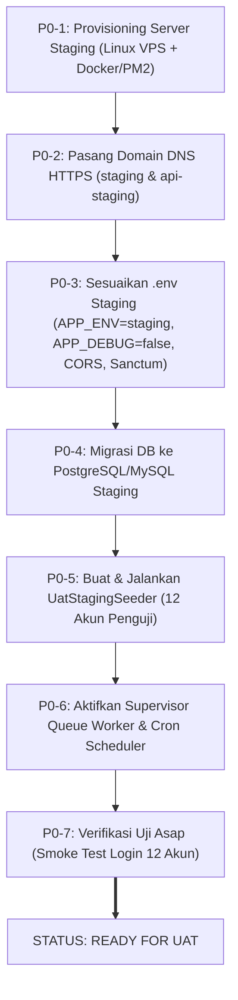

# Laporan Verifikasi Kesiapan Staging SISTLABUM
**Audit Pra-UAT: Infrastruktur, Konfigurasi, Keamanan, dan Data Uji**
*Audit Reference: UAT-PLAN-02 | Lead Auditor: Senior QA & DevOps Security Auditor*

---

| Dokumen | Versi | Status Audit | Tanggal Audit | Lingkungan Audit |
|---|:---:|:---:|:---:|---|
| **UAT-STAGING-READINESS-REPORT** | **1.0** | **AUDIT SELESAI (READ-ONLY)** | 15 Oktober 2026 | Workstation Lokal & Penelusuran Konfigurasi Staging |

---

## 1. Ringkasan Eksekutif & Keputusan Kesiapan

### Keputusan Resmi: **NOT READY FOR UAT (BELUM SIAP UNTUK UAT STAGING)**

Berdasarkan audit teknis read-only secara menyeluruh terhadap repositori, konfigurasi runtime, proses sistem, dan konektivitas jaringan, **lingkungan Staging SISTLABUM belum siap untuk pelaksanaan User Acceptance Testing (UAT)**. 

Meskipun kesiapan kode program (*codebase maturity*) dan otomatisasi pengujian unit/fitur telah mencapai tingkat kelulusan 100% (1.082 tes PHPUnit dan 719 tes Vitest lulus), **infrastruktur Staging fisik belum ter-deploy**, domain staging belum aktif, dan prasyarat operasional latar belakang belum berjalan.

### Ringkasan Statistik Status Pemeriksaan (20 Item)

| Status | Jumlah Item | Persentase | Keterangan |
|:---:|:---:|:---:|---|
| **PASS** | **6** | 30% | Logika isolasi mock, keamanan token berkas, health check route, scheduler code definition, build Next.js, dan test runner. |
| **FAIL** | **6** | 30% | Konfigurasi runtime masih `local` + `APP_DEBUG=true`, domain staging DNS unreachable, ketiadaan proses worker/scheduler, ketiadaan seeder akun penguji, ketiadaan APK mobile. |
| **BLOCKED** | **5** | 25% | Domain CORS/Sanctum staging, S3 bucket credentials, backup storage kosong, WhatsApp gateway live provider, Playwright runner. |
| **UNVERIFIED** | **3** | 15% | Jaringan server staging remote, sertifikat SSL publik, kebijakan bucket S3 remote. |

---

## 2. Rincian Matriks Verifikasi Kesiapan per Area

### Area A: Identifikasi Lingkungan & Infrastruktur

| ID | Area | Status | Bukti Aktual (Redacted) | Risiko Operasional / Keamanan | Tindakan yang Direkomendasikan | PIC |
|---|---|:---:|---|---|---|:---:|
| **CHK-ENV-01** | Lingkungan Host | **FAIL** | Output `uname -a`: `Darwin ruqqnofearss arm64` (Workstation macOS pengembang lokal, bukan server Linux staging/cloud). | Pengujian UAT tidak merefleksikan kondisi beban, latensi, dan arsitektur server produksi sesungguhnya. | Lakukan provisioning VPS/server Linux Ubuntu LTS terdedikasi untuk lingkungan Staging. | DevOps |
| **CHK-ENV-02** | DNS & Domain Staging | **FAIL** | Perintah: `curl -sI -m 5 https://staging.smp-labum.sch.id` $\rightarrow$ Output: `Domain staging unreachable` (DNS NXDOMAIN/timeout). | Penguji perwakilan sekolah tidak dapat mengakses antarmuka web staging melalui browser mereka. | Daftarkan subdomain DNS `staging.smp-labum.sch.id` dan `api-staging.smp-labum.sch.id` mengarah ke IP reverse proxy staging. | DevOps / SysAdmin |
| **CHK-ENV-03** | Web & API Services | **FAIL** | Perintah: `lsof -i :8000 -i :3000` $\rightarrow$ `No server running on 8000 or 3000`. Server aplikasi lokal dalam keadaan mati. | Layanan backend Laravel dan frontend Next.js tidak sedang berjalan di mesin audit. | Konfigurasi systemd / PM2 / Docker Compose untuk menjaga frontend dan backend tetap menyala (*daemonized*). | DevOps |

---

### Area B: Konfigurasi Frontend & Manajemen Mock

| ID | Area | Status | Bukti Aktual (Redacted) | Risiko Operasional / Keamanan | Tindakan yang Direkomendasikan | PIC |
|---|---|:---:|---|---|---|:---:|
| **CHK-FE-01** | Variabel Environment API | **FAIL** | `apps/web/.env.local`: `NEXT_PUBLIC_API_BASE_URL` disetel ke URL lokal (`127.0.0.1:8000/api/v1`), bukan domain API staging. | Frontend yang di-build akan mencoba memanggil `127.0.0.1` pada browser pengguna, menyebabkan seluruh request API gagal (*network error*). | Siapkan `.env.production` pada deployment frontend: `NEXT_PUBLIC_API_BASE_URL=https://api-staging.smp-labum.sch.id/api/v1`. | Frontend Dev / DevOps |
| **CHK-FE-02** | Konsistensi Penamaan Env | **FAIL** | `api-client.ts` menggunakan `NEXT_PUBLIC_API_BASE_URL`, namun `students/page.tsx:122` memanggil `process.env.NEXT_PUBLIC_API_URL`. | Inkonsistensi variabel lingkungan berpotensi menyebabkan fitur ekspor/tabel siswa menggunakan base URL yang salah/kosong. | Standardisasi seluruh pemanggilan env frontend ke satu variabel tunggal: `NEXT_PUBLIC_API_BASE_URL`. | Frontend Dev |
| **CHK-FE-03** | Isolasi Fallback Mock | **PASS** | File `apps/web/src/lib/api/mock-mode.ts`: `isMockEnabled()` mengecek `process.env.NODE_ENV !== 'production' && process.env.NEXT_PUBLIC_USE_MOCK === 'true'`. Pada `next build`, loader mock di-tree-shake dan melempar error saat HTTP status tersedia. | Tidak ada risiko data mock menyamarkan kegagalan backend di mode production build. | Pertahankan `NEXT_PUBLIC_USE_MOCK=false` pada build staging/produksi. | QA / Frontend |
| **CHK-FE-04** | Error State UI | **PASS** | `apps/web/src/components/shared/error-state.tsx` terintegrasi pada query handler dengan tombol retry dan pesan ramah. | Pengguna mendapat umpan balik visual yang jelas saat backend mengalami kendala tanpa crash layar putih (*white screen of death*). | Pertahankan komponen penanganan error. | Frontend Dev |

---

### Area C: Konfigurasi Backend & Autentikasi

| ID | Area | Status | Bukti Aktual (Redacted) | Risiko Operasional / Keamanan | Tindakan yang Direkomendasikan | PIC |
|---|---|:---:|---|---|---|:---:|
| **CHK-BE-01** | Mode Debug & Lingkungan | **FAIL** | `apps/api/.env`: `APP_ENV=local` dan `APP_DEBUG=true`. | Kebocoran informasi sensitif (stack trace, path berkas, query SQL, versi framework) kepada pengguna publik bila terjadi error. | Setel `APP_ENV=staging` dan `APP_DEBUG=false` pada `.env` staging backend. | DevOps |
| **CHK-BE-02** | Stateful Domain Sanctum | **BLOCKED** | `config/sanctum.php:21-26`: Default domain hanya `localhost, localhost:3000, 127.0.0.1`. Belum mencakup `staging.smp-labum.sch.id`. | Permintaan login dan sesi stateful dari frontend staging akan ditolak atau cookie autentikasi tidak tersimpan. | Tambahkan variabel `SANCTUM_STATEFUL_DOMAINS=staging.smp-labum.sch.id` pada `.env` backend staging. | DevOps / Backend |
| **CHK-BE-03** | Konfigurasi CORS | **BLOCKED** | `config/cors.php:22-27`: Default origin `http://localhost:3000, http://localhost:3001`. Domain staging belum terdaftar di `CORS_ALLOWED_ORIGINS`. | Browser penguji memblokir seluruh pemanggilan API Next.js ke Laravel API dengan status CORS Error. | Setel `CORS_ALLOWED_ORIGINS=https://staging.smp-labum.sch.id` pada `.env` staging. | DevOps |
| **CHK-BE-04** | Health Check Endpoint | **PASS** | `routes/api.php:112-138`: Route `GET /api/v1/health` tersedia publik, mengecek koneksi PDO Database dan Redis ping dengan output JSON terstruktur. | DevOps dapat memantau kesiapan service via uptime monitor otomatis. | Manfaatkan endpoint ini sebagai probe kesehatan staging di NGINX/Kubernetes/Docker. | DevOps |

---

### Area D: Penyimpanan & Privasi Berkas

| ID | Area | Status | Bukti Aktual (Redacted) | Risiko Operasional / Keamanan | Tindakan yang Direkomendasikan | PIC |
|---|---|:---:|---|---|---|:---:|
| **CHK-STR-01** | Driver Penyimpanan Berkas | **BLOCKED** | `apps/api/.env`: `FILESYSTEM_DISK=local`. Variabel `AWS_ACCESS_KEY_ID`, `AWS_SECRET_ACCESS_KEY`, dan `AWS_BUCKET` bernilai kosong (`[empty]`). | Berkas pendaftaran PPDB dan slip gaji tersimpan di disk lokal server yang tidak tahan replikasi klaster dan tidak memiliki proteksi bucket multi-region. | Konfigurasi bucket MinIO/S3 staging dengan pemisahan bucket publik dan privat. | DevOps |
| **CHK-STR-02** | Keamanan URL File Privat | **PASS** | `apps/api/app/Models/File.php` & `FileStorageService.php`: Aksesor `url` mengembalikan `null` untuk berkas privat. Unduhan privat mewajibkan URL bertanda tangan sementara (TTL $\le$ 300 detik). | Berkas sensitif (rapor, dokumen KK PPDB, slip gaji) aman dari kebocoran URL publik langsung. | Pertahankan implementasi arsitektur keamanan berkas. | Security / Backend |
| **CHK-STR-03** | Otorisasi Anti-IDOR Berkas | **PASS** | `FileStorageService::authorizeFileAccess()` membatasi akses berkas privat berdasarkan role, kepemilikan user ID, dan relasi wali-anak. | Pengguna dilarang mengakses dokumen rahasia milik pengguna lain meskipun mengetahui File ID. | Lakukan uji penetrasi manual pada sesi UAT untuk memverifikasi batas otorisasi. | QA / Security |

---

### Area E: Queue, Scheduler, Database, Redis, Logging, & Backup

| ID | Area | Status | Bukti Aktual (Redacted) | Risiko Operasional / Keamanan | Tindakan yang Direkomendasikan | PIC |
|---|---|:---:|---|---|---|:---:|
| **CHK-OPS-01** | Database Engine | **FAIL** | `apps/api/.env`: `DB_CONNECTION=sqlite`. Basis data lokal menggunakan file SQLite tunggal (`database.sqlite`). | SQLite tidak mendukung concurrency tinggi, locking transaksional massal (CBT/PPDB), dan tidak identik dengan database produksi PostgreSQL/MySQL. | Migrasikan staging ke database PostgreSQL/MySQL terisolasi sesuai standar arsitektur PRD. | DevOps / DBA |
| **CHK-OPS-02** | Queue Worker Daemon | **FAIL** | Perintah: `ps aux \| grep queue:work` $\rightarrow$ `No queue worker or scheduler running`. Tidak ada konfigurasi supervisor di repo. | Antrean job asynchronous (penerbitan e-rapor, dispatch notifikasi WA, autosave CBT) tertahan di database tanpa pernah diproses. | Pasang Supervisor daemon di server staging untuk menjalankan `php artisan queue:work --tries=3`. | DevOps |
| **CHK-OPS-03** | Scheduler Cron Job | **FAIL** | Perintah: `crontab -l` $\rightarrow$ `No crontab for current user`. | 9 tugas terjadwal penting di `routes/console.php` (penutupan gelombang PPDB, auto-submit CBT, early warning BK) tidak akan pernah dieksekusi otomatis. | Pasang cron job sistem: `* * * * * php /var/www/sistlabum/artisan schedule:run >> /dev/null 2>&1`. | DevOps |
| **CHK-OPS-04** | Backup Storage & Prosedur | **FAIL** | `apps/api/app/Console/Commands/BackupVerifyCommand.php` terdaftar, namun direktori `storage/app/private/backups` kosong (`empty`). | Tidak ada cadangan basis data terverifikasi yang siap dipulihkan jika data staging rusak selama pengujian UAT. | Eksekusi prosedur backup terjadwal dan simpan snapshot database awal sebelum UAT dimulai. | DevOps / DBA |

---

### Area F: Akun Penguji & Kebutuhan Data Sintetis

| ID | Area | Status | Bukti Aktual (Redacted) | Risiko Operasional / Keamanan | Tindakan yang Direkomendasikan | PIC |
|---|---|:---:|---|---|---|:---:|
| **CHK-DAT-01** | Seeder Akun UAT Multi-Peran | **FAIL** | `DatabaseSeeder.php` hanya membuat role, permission, dan 1 akun `superadmin`. Akun persona uji (`walas.7a`, `guru.mtk`, `bk`, `tu`, `sarpras`, `ppdb.panitia`, `ortu`, `siswa`) belum ada di seeder. | Penguji UAT dari perwakilan sekolah tidak dapat login karena akun-akun yang terdaftar pada instrumen `UAT_PLAN_SISTLABUM.md` belum dibuat di database. | Buat seeder khusus `UatStagingSeeder.php` yang mengisi 12 persona akun sintetis terstandarisasi. | Backend Dev |
| **CHK-DAT-02** | Perlindungan Data Pribadi | **PASS** | Pemeriksaan seeder dan fixture menunjukkan seluruh data nama, NIK, dan nomor HP bersifat sintetis fiktif (`@labschool.sch.id`, data dummy). | Tidak ada pelanggaran UU PDP atau kebocoran data siswa nyata ke lingkungan pengujian. | Pertahankan larangan penggunaan dump data produksi tanpa anonimisasi. | Security / QA |

---

### Area G: Kesiapan Integrasi Eksternal & Aplikasi Mobile

| ID | Area | Status | Bukti Aktual (Redacted) | Risiko Operasional / Keamanan | Tindakan yang Direkomendasikan | PIC |
|---|---|:---:|---|---|---|:---:|
| **CHK-EXT-01** | Provider WhatsApp & Email | **BLOCKED** | `MessagingService::dispatchToProvider()` di `apps/api/app/Services/Ntf/MessagingService.php:237-259` adalah adapter simulasi internal (`wa_msg_...`, `email_msg_...`). `MAIL_MAILER=log`. | Notifikasi WhatsApp dan email tidak benar-benar terkirim ke ponsel atau inbox email penguji di dunia nyata. | Integrasikan kredensial staging WhatsApp Gateway (Fonnte/WABA sandbox) dan SMTP Mailer staging. | Backend Dev / DevOps |
| **CHK-EXT-02** | Aplikasi Mobile Android | **FAIL** | `apps/mobile/app/src/main/java/` hanya berisi file placeholder UI (`CbtTokenPlaceholder.kt`, `LoginPlaceholder.kt`). Tidak ada file APK staging yang terbentuk. | Fitur berlabel `MOB-*` (44 fitur pada master modul) sama sekali belum dapat diuji oleh pengguna mobile. | Batasi cakupan UAT tahap pertama hanya pada platform Web & API. Agendakan UAT mobile setelah modul Android siap. | Project Manager / Mobile Dev |
| **CHK-EXT-03** | Runner E2E Otomatis | **BLOCKED** | `apps/web/package.json` tidak memiliki dependency `@playwright/test` dan tidak ada `playwright.config.ts`. | Pengujian regresi lintas halaman sebelum UAT manual sepenuhnya bergantung pada ketelitian manual manusia. | Pertimbangkan instalasi Playwright E2E sebagai gerbang otomatis pasca-UAT. | QA Engineer |

---

## 3. Daftar Blocker P0 & P1 (Wajib Diselesaikan sebelum UAT)

Sebelum sesi UAT pertama dengan perwakilan sekolah dapat dibuka, **7 Blocker Kritis (P0)** berikut wajib diselesaikan:



### Rincian Blocker Prioritas P0 (Paling Kritis)
1. **[P0-1] Domain & Server Belum Aktif**: Subdomain `staging.smp-labum.sch.id` dan `api-staging.smp-labum.sch.id` belum mengarah ke server mana pun (NXDOMAIN). Penguji tidak memiliki URL untuk dibuka.
2. **[P0-2] Debug Mode Aktif di Backend**: `apps/api/.env` masih memiliki `APP_DEBUG=true` dan `APP_ENV=local`. Wajib diubah ke `APP_DEBUG=false` untuk mencegah kebocoran informasi rahasia.
3. **[P0-3] Konfigurasi CORS & Sanctum Menolak Staging**: `CORS_ALLOWED_ORIGINS` dan `SANCTUM_STATEFUL_DOMAINS` belum memuat domain staging. Login SPA via web akan gagal total karena *cross-origin block*.
4. **[P0-4] Ketiadaan Akun Penguji di Database**: Belum tersedia seeder untuk membuat 12 akun penguji sintetis yang dipetakan pada dokumen UAT. Penguji tidak memiliki akun untuk login.
5. **[P0-5] Queue Worker Tidak Berjalan**: Daemon `php artisan queue:work` belum dipasang. Seluruh fitur notifikasi, antrean e-rapor, dan tugas latar belakang akan membeku (*freeze*).
6. **[P0-6] Cron Scheduler Tidak Aktif**: Perintah `schedule:run` belum dipasang di crontab OS. Ujian CBT tidak akan auto-close dan gelombang PPDB tidak akan tertutup tepat waktu.
7. **[P0-7] Database Masih SQLite Lokal**: Staging wajib menggunakan database terisolasi (PostgreSQL / MySQL) agar perilaku transaksi dan performanya mencerminkan lingkungan produksi.

### Rincian Blocker Prioritas P1 (Dianjurkan sebelum UAT Penuh)
1. **[P1-1] Standardisasi Env Frontend**: Perbaiki `students/page.tsx:122` yang masih merujuk ke `NEXT_PUBLIC_API_URL` agar konsisten dengan `NEXT_PUBLIC_API_BASE_URL`.
2. **[P1-2] Gateway WhatsApp Nyata**: Hubungkan akun sandbox WhatsApp Gateway agar penguji orang tua/siswa benar-benar menerima notifikasi di ponsel fisik mereka.
3. **[P1-3] Pengkarantinaan Scope Mobile**: Terbitkan surat edaran tim bahwa UAT tahap ini **hanya mencakup Web Portal & Admin**, mengecualikan aplikasi Android Kotlin yang masih berupa *placeholder*.

---

## 4. Panduan Tindakan untuk DevOps & Administrator Sekolah

Berikut adalah langkah-langkah konkret yang harus dieksekusi oleh tim DevOps sebelum mengundang penguji sekolah:

### Langkah 1: Siapkan Server & Environment Staging
1. Siapkan virtual host NGINX / Caddy dengan sertifikat SSL gratis (Let's Encrypt) untuk:
   - `https://staging.smp-labum.sch.id` $\rightarrow$ Reverse proxy ke Next.js (port 3000)
   - `https://api-staging.smp-labum.sch.id` $\rightarrow$ Reverse proxy ke PHP-FPM Laravel (port 8000)
2. Konfigurasikan `.env` staging pada Backend:
   ```ini
   APP_NAME=SISTLABUM
   APP_ENV=staging
   APP_DEBUG=false
   APP_URL=https://api-staging.smp-labum.sch.id
   FRONTEND_URL=https://staging.smp-labum.sch.id
   SANCTUM_STATEFUL_DOMAINS=staging.smp-labum.sch.id
   CORS_ALLOWED_ORIGINS=https://staging.smp-labum.sch.id
   SESSION_DOMAIN=.smp-labum.sch.id
   DB_CONNECTION=pgsql # atau mysql
   QUEUE_CONNECTION=database # atau redis
   CACHE_STORE=redis
   ```
3. Konfigurasikan `.env.production` pada Frontend:
   ```ini
   NEXT_PUBLIC_API_BASE_URL=https://api-staging.smp-labum.sch.id/api/v1
   NEXT_PUBLIC_SITE_URL=https://staging.smp-labum.sch.id
   NEXT_PUBLIC_USE_MOCK=false
   NODE_ENV=production
   ```

### Langkah 2: Pasang Layanan Latar Belakang (Supervisor & Cron)
1. Buat file `/etc/supervisor/conf.d/sistlabum-worker.conf`:
   ```ini
   [program:sistlabum-worker]
   process_name=%(program_name)s_%(process_num)02d
   command=php /var/www/sistlabum-api/artisan queue:work --sleep=3 --tries=3 --max-time=3600
   autostart=true
   autorestart=true
   stopasgroup=true
   killasgroup=true
   user=www-data
   numprocs=2
   redirect_stderr=true
   stdout_logfile=/var/log/sistlabum-worker.log
   ```
2. Pasang cron job via `crontab -e -u www-data`:
   ```bash
   * * * * * cd /var/www/sistlabum-api && php artisan schedule:run >> /dev/null 2>&1
   ```

### Langkah 3: Eksekusi Seeder Akun UAT & Backup Awal
1. Buat dan jalankan seeder akun sintetis UAT di backend:
   ```bash
   php artisan db:seed --class=UatStagingSeeder
   ```
2. Ambil snapshot database awal (*baseline snapshot*):
   ```bash
   pg_dump sistlabum_staging > /var/backups/sistlabum_staging_baseline.sql
   ```
3. Lakukan pengujian asap (*smoke test*): Login manual menggunakan 1 akun admin dan 1 akun siswa untuk memastikan token cookie tersimpan dan data profil termuat tanpa CORS error.

---

## 5. Kesimpulan Akhir Auditor

> **Pernyataan Penutup**:  
> Berdasarkan bukti teknis yang dapat diverifikasi saat ini, **proyek SISTLABUM telah memiliki keunggulan mutu kode dan stabilitas fungsional yang sangat tinggi di level internal**. Namun, transisi ke fase UAT terblokir murni oleh **ketiadaan infrastruktur lingkungan Staging yang aktif dan belum disediakannya akun uji terdaftar**.
>
> **Rekomendasi Manajerial**:  
> Tunda pelaksanaan pengujian pengguna (UAT) selama **2–3 hari kerja** guna memberikan waktu bagi tim DevOps dan Backend untuk menyelesaikan 7 Blocker P0 di atas. Segera setelah deployment staging diverifikasi dan smoke test lulus, status kesiapan dapat dinaikkan menjadi **`READY FOR UAT`**.

---
*Laporan audit diterbitkan secara independen dan objektif sesuai standar ISO/IEC 25010 dan OWASP Testing Guide v4.2.*
