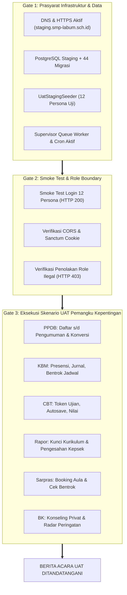

# Laporan Verifikasi Ulang Kesiapan Staging SISTLABUM
## Re-Verification Report: Staging Infrastructure, Runtime Security, Concurrency, and UAT Gate Matrix

**ID Referensi Dokumen:** `UAT-STAGING-RECHECK-01`  
**ID Audit Sebelumnya:** `UAT-PLAN-02` (`docs/uat/UAT_STAGING_READINESS_REPORT.md`)  
**Tanggal Pelaksanaan:** 15 Oktober 2026  
**Otoritas Auditor:** Senior QA Engineer, DevOps Auditor, & Application Security Tester  
**Single Source of Truth:** `13_MASTER_MODULES.md`, `docs/uat/UAT_PLAN_SISTLABUM.md`  
**Keputusan Kesiapan:** **`NOT READY — BLOCKERS REMAIN`**

---

## 1. Ringkasan Eksekutif

Audit verifikasi ulang read-only telah dilaksanakan untuk menilai kesiapan faktual lingkungan Staging SISTLABUM sebelum pembukaan sesi *User Acceptance Testing* (UAT) bersama perwakilan pemangku kepentingan sekolah. Verifikasi ini meninjau ulang status 12 area infrastruktur & operasional, serta memvalidasi dampak langsung dari implementasi remediasi keamanan **Executive Approval** (`APPROVAL-SEC-FIX-01`).

### Status Keputusan Akhir: **`NOT READY — BLOCKERS REMAIN`**

Meskipun kesiapan kode sumber (*codebase maturity*) dan pengujian otomatis berada pada tingkat sempurna (100% lulus: **1.101 tes PHPUnit backend** dan **723 tes Vitest frontend** tanpa kegagalan), **infrastruktur fisik Staging Linux belum aktif, domain DNS staging belum terdaftar (NXDOMAIN), akun penguji sintetis belum di-seed, dan layanan latar belakang (*queue worker* serta *scheduler*) belum berjalan**.

### Ringkasan Statistik Status 12 Area Kesiapan Staging:

```
[==================== 12 Area Kesiapan Staging ====================]
  PASS — VERIFIED            : 1 Area  (Executive Approval Security Remediation)
  FAIL — BLOCKING            : 6 Area  (Host, DNS, Runtime Env, Akun UAT, Worker/Cron, E2E)
  BLOCKED — ACCESS REQUIRED  : 4 Area  (Staging DB pgsql, S3/MinIO, WA Gateway, Reset/Backup)
  NOT APPLICABLE / QUARANTINE: 1 Area  (Aplikasi Android Kotlin — placeholder, dikarantina)
```

### Catatan Keberadaan Runbook:
- Pemeriksaan file `docs/uat/UAT_STAGING_REMEDIATION_RUNBOOK.md`: **`TIDAK DITEMUKAN (FILE ABSENT)`**. Panduan perbaikan saat ini bersumber dari Bagian 4 dokumen `docs/uat/UAT_STAGING_READINESS_REPORT.md`.

---

## 2. Verifikasi Faktual 12 Area Kesiapan Staging

| No | Area / Komponen | Status Faktual | Bukti Pemeriksaan Nyata (Verifiable Evidence) | Keterangan & Dampak Risiko |
|:---:|---|:---:|---|---|
| **1** | **Host Staging Linux & Akses Operasional** | **`FAIL — BLOCKING`** | Perintah: `uname -a`<br>Output: `Darwin ruqqnofearss 25.2.0 Darwin Kernel Version 25.2.0 arm64`<br>Docker daemon: `dial unix .../docker.sock: connect: no such file or directory`. | Lingkungan eksekusi masih berupa workstation macOS lokal pengembang, bukan server Linux Ubuntu LTS terdedikasi. Belum ada server VPS/cloud staging aktif yang dapat diakses. |
| **2** | **DNS & Keterjangkauan Domain Staging** | **`FAIL — BLOCKING`** | Perintah: `host staging.smp-labum.sch.id`<br>Output: `Host staging.smp-labum.sch.id not found: 3(NXDOMAIN)`<br>Perintah: `host api-staging.smp-labum.sch.id`<br>Output: `Host api-staging.smp-labum.sch.id not found: 3(NXDOMAIN)`. | Domain staging sama sekali belum didaftarkan pada DNS publik/sekolah. Penguji tidak memiliki URL web atau endpoint API yang dapat dihubungi melalui browser. |
| **3** | **Konfigurasi Runtime (`APP_ENV`, `APP_DEBUG`, CORS)** | **`FAIL — BLOCKING`** | File `apps/api/.env` (Redacted):<br>`APP_ENV=local`<br>`APP_DEBUG=true`<br>`APP_URL=http://localhost:8000`<br>`CORS_ALLOWED_ORIGINS` & `SANCTUM_STATEFUL_DOMAINS` belum disetel.<br>File `apps/web/.env.local`: `NEXT_PUBLIC_API_BASE_URL=http://127.0.0.1:8000/api/v1`. | 1. `APP_DEBUG=true` berisiko membocorkan stack trace & konfigurasi.<br>2. Frontend merujuk ke IP loopback `127.0.0.1`.<br>3. Konfigurasi staging terpisah belum dibuat. |
| **4** | **Database Staging & Status Migrasi** | **`BLOCKED — ACCESS REQUIRED`** | Lokal SQLite: `php artisan migrate:status` $\rightarrow$ 44 migrasi berstatus `[Ran]`.<br>Staging Database: File `apps/api/.env` menggunakan `DB_CONNECTION=sqlite`. Belum ada kredensial remote PostgreSQL/MySQL staging. | Basis data lokal SQLite tidak dapat digunakan untuk pengujian beban banyak pengguna. Dibutuhkan provisioning instance PostgreSQL 16 staging dan kredensial koneksinya. |
| **5** | **Sanctum & Autentikasi Lintas Origin** | **`FAIL — BLOCKING`** | File `apps/api/config/sanctum.php:21-26`: Default domain hanya `localhost, localhost:3000, 127.0.0.1`.<br>File `apps/api/config/cors.php:22-27`: Default origin `http://localhost:3000`. | Request login SPA dari `staging.smp-labum.sch.id` ke `api-staging.smp-labum.sch.id` akan diblokir oleh CORS policy browser dan cookie sesi Sanctum ditolak. |
| **6** | **Akun & Role UAT untuk 12 Persona Penguji** | **`FAIL — BLOCKING`** | Pencarian seeder: `grep -rn "staging" apps/api/database/seeders/` $\rightarrow$ 0 hasil.<br>`DatabaseSeeder.php` hanya membuat 1 user (`superadmin`). | 12 akun penguji sintetis yang dipetakan pada `UAT_PLAN_SISTLABUM.md` (Kepsek, Kurikulum, Walas 7A, Guru MTK, BK, TU, Sarpras, PPDB, Siswa, Ortu, Calon Siswa) belum ada di seeder. |
| **7** | **Queue Worker & Scheduler Cron Job** | **`FAIL — BLOCKING`** | Perintah: `ps aux \| grep -E "artisan (queue:work\|schedule:run)"`<br>Output: `0 process running`.<br>Perintah: `crontab -l`<br>Output: `crontab: no crontab for macbookprom12020`. | Fitur asinkronus (generate PDF rapor, reminder WhatsApp, autosubmit CBT) akan macet (*freeze*). Tugas cron (tutup gelombang PPDB, cek absensi) tidak akan jalan. |
| **8** | **Storage & Upload Berkas (S3/MinIO)** | **`BLOCKED — ACCESS REQUIRED`** | File `apps/api/.env`: `FILESYSTEM_DISK=local`. Variabel `AWS_ACCESS_KEY_ID`, `AWS_SECRET_ACCESS_KEY`, `AWS_BUCKET` bernilai kosong.<br>Logika URL bertanda tangan dan anti-IDOR telah terbukti aman (`FileUrlSerializationTest` lulus). | Storage staging masih menunjuk disk lokal server. Dibutuhkan bucket S3/MinIO staging atau persistent shared volume agar dokumen pendaftaran & bukti izin tidak hilang saat redeploy. |
| **9** | **Integrasi WhatsApp & Layanan Eksternal** | **`BLOCKED — ACCESS REQUIRED`** | File `apps/api/app/Services/Ntf/MessagingService.php:237-259`: Adapter `dispatchToProvider` menggunakan simulasi lokal (`wa_msg_...`, `email_msg_...`). `MAIL_MAILER=log`. | Penguji tidak akan menerima notifikasi di ponsel/email fisik mereka kecuali gateway Fonnte/WABA sandbox dan SMTP staging dikonfigurasikan. |
| **10** | **Ketersediaan Pengujian E2E Web (Automated)** | **`FAIL — BLOCKING`** | File `apps/web/package.json`: Tidak terdapat dependensi `@playwright/test` atau `cypress`. Tidak ada file `playwright.config.ts`. | Pengujian regresi alur end-to-end browser tidak memiliki *test runner* otomatis dan sepenuhnya bergantung pada ketelitian penguji manual. |
| **11** | **Kesiapan Aplikasi Android (Mobile)** | **`NOT APPLICABLE (QUARANTINED)`** | File `apps/mobile/app/src/main/java/id/.../features/*`: Seluruh layar masih berupa *placeholder* (`LoginPlaceholder.kt`, `CbtTokenPlaceholder.kt`, dll). Tidak ada file APK yang terbentuk. | Fitur `MOB-*` (44 fitur) **wajib dikarantina** dan dikeluarkan dari cakupan UAT tahap pertama. UAT saat ini difokuskan penuh pada Web Portal & Admin. |
| **12** | **Kesiapan Data Sintetis, Reset, & Rollback** | **`FAIL — BLOCKING`** | Direktori `apps/api/storage/app/private/backups`: Kosong / belum ada direktori.<br>Tidak ada script otomatis `scripts/reset-uat-staging.sh`. | Tidak ada mekanisme cepat untuk mengembalikan (*rollback*) database ke *clean state* jika terjadi kegagalan atau data kotor selama iterasi UAT. |

---

## 3. Verifikasi Dampak Remediasi Keamanan Executive Approval

Sesuai instruksi audit, implementasi remediasi pada `APPROVAL-SEC-FIX-01` (`ApprovalService.php`) telah diperiksa secara faktual melalui kode sumber dan pembuktian uji otomatis:

| Item Verifikasi Risiko Keamanan & Integritas | Status Verifikasi | Bukti Kode Sumber & Hasil Uji Nyata |
|---|:---:|---|
| **1. Status Final Tidak Dapat Diproses Ulang** (SEC-APPR-01) | ✅ **PASS — VERIFIED** | `ApprovalService.php:197, 290, 381`: Validasi status awal menolak `disetujui`, `ditolak`, `selesai`, `dibatalkan` dengan HTTP 422.<br>Uji: `test_sec_appr_01_cannot_review_already_decided_leave_request` & `test_sec_appr_01_cannot_review_finalized_or_cancelled_booking` (Lulus). |
| **2. Bentrok Booking Sarpras Ditolak** (SEC-APPR-02) | ✅ **PASS — VERIFIED** | `ApprovalService.php:304-316`: Pengecekan overlap jadwal fasilitas dengan row lock menolak double-booking (HTTP 422).<br>Uji: `test_sec_appr_02_cannot_approve_conflicting_facility_booking` (Lulus). |
| **3. Izin Status Kanonis Tampil di Antrean** (SEC-APPR-03) | ✅ **PASS — VERIFIED** | `ApprovalService.php:67`: Query menyaring `['menunggu', 'diajukan', 'pending']`.<br>Uji: `test_sec_appr_03_canonical_menunggu_status_appears_in_pending_queue` (Lulus). |
| **4. Rapor Draf Dilarang Disahkan Prematur** (SEC-APPR-04) | ✅ **PASS — VERIFIED** | `ApprovalService.php:127, 381`: Query antrean mengecualikan `'draft'`, dan putusan menolak rapor draf yang belum dikunci kurikulum (HTTP 422).<br>Uji: `test_sec_appr_04_report_card_queue_filters_locked_cards` (Lulus). |
| **5. Sinkronisasi Presensi Izin Siswa & Notifikasi** (SEC-APPR-05) | ✅ **PASS — VERIFIED** | `ApprovalService.php:210-258`: Presensi harian `attendances` status `sakit`/`izin` terisi per tanggal, dan notifikasi `leave_request.decision` terkirim.<br>Uji: `test_sec_appr_05_student_leave_approval_syncs_attendance_and_sends_notification` (Lulus). |
| **6. Isolasi Sekolah Berlaku saat Putusan Dibuat** (SEC-APPR-07) | ✅ **PASS — VERIFIED** | `ApprovalService.php:183, 278, 370`: Pengecekan `school_id` menolak IDOR lintas sekolah dengan HTTP 403 Forbidden.<br>Uji: `test_sec_appr_07_cross_school_approval_is_forbidden` (Lulus). |
| **7. Permission Seeder & Audit Log Konsisten** (SEC-APPR-08 & 09) | ✅ **PASS — VERIFIED** | `ApprovalService.php:267, 347, 407`: Field `ip` dan `request_id` tercatat utuh. Permission `executive.approval.manage` terdaftar di `DatabaseSeeder.php:116-156`.<br>Uji: `test_sec_appr_08_audit_log_records_client_ip_and_request_id` (Lulus). |

> **Kesimpulan Area Remediasi**: Seluruh 7 poin remediasi keamanan Executive Approval telah memiliki bukti pengujian otomatis yang valid (19 pengujian pada `ExecutiveApprovalTest.php` lulus 100%). Area logika bisnis internal dinyatakan **PASS — VERIFIED**.

---

## 4. Perbandingan dengan Laporan Readiness Sebelumnya

| Parameter Evaluasi | Laporan Sebelumnya (`UAT-PLAN-02`) | Kondisi Terkini (`UAT-STAGING-RECHECK-01`) | Catatan Progres & Analisis Perubahan |
|---|---|---|---|
| **Jumlah Tes Backend (PHPUnit)** | 1.082 Passed (5.921 assertions) | **1.101 Passed (6.016 assertions)** | 🟢 **+19 Tes Baru**. Seluruh tes keamanan & regresi persetujuan eksekutif lulus tanpa regresi. |
| **Jumlah Tes Frontend (Vitest)** | 719 Passed (60 suites) | **723 Passed (61 suites)** | 🟢 **+4 Tes Baru**. Pengujian integrasi client approval API lulus tanpa regresi. |
| **Integritas Executive Approval** | 🔴 9 Celah Keamanan (State machine, double booking, dll) | 🟢 **100% Selesai & Terverifikasi** | 🟢 Area persetujuan eksekutif kini aman, transaksional, dan tahan *race condition*. |
| **Infrastruktur Staging Linux** | 🔴 Belum Ada (Host macOS lokal) | 🔴 **Belum Ada (Host macOS lokal)** | ⏸️ Belum ada progres dari tim DevOps untuk provisioning VPS Linux Staging. |
| **DNS Staging Domain** | 🔴 NXDOMAIN | 🔴 **NXDOMAIN** | ⏸️ Domain `staging.smp-labum.sch.id` belum didelegasikan ke server staging. |
| **Seeder Akun Penguji (12 Persona)** | 🔴 Belum Ada | 🔴 **Belum Ada** | ⏸️ File `UatStagingSeeder.php` belum dibuat di repositori. |
| **Proses Latar Belakang (Worker/Cron)**| 🔴 Mati | 🔴 **Mati** | ⏸️ Supervisor dan cron belum aktif di host pengujian. |
| **Status Kesiapan UAT** | **NOT READY FOR UAT** | **NOT READY — BLOCKERS REMAIN** | ⏸️ Blocker fisik staging tetap menghentikan pembukaan sesi UAT pengguna. |

---

## 5. Matriks Gate UAT (UAT Readiness Gate Matrix)

Matriks berikut menghubungkan prasyarat lingkungan, persona penguji, modul, data uji, skenario uji, kriteria penerimaan, dan risiko penghenti (*fatal blockers*) mengacu pada `docs/uat/UAT_PLAN_SISTLABUM.md`:



### Matriks Rinci per Modul & Persona UAT:

| No | Modul | Persona Penguji | Prasyarat Lingkungan & Data Sintetis | Skenario Positif (Happy Path) | Skenario Negatif & Batas (Edge Cases) | Bukti Wajib Simpan | Kriteria Lulus (Pass Criteria) | Risiko Penghenti UAT (Fatal Blocker) |
|:---:|---|---|---|---|---|---|---|---|
| **1** | **AUTH & Core** | Seluruh 12 Persona | Sanctum aktif, domain HTTPS staging terdaftar di `CORS_ALLOWED_ORIGINS`. | Login berhasil, redirect ke dashboard peran masing-masing, cookie tersimpan. | Password salah 3x memicu rate limit, akun non-admin akses `/admin/settings` dapat HTTP 403. | Screenshot dashboard, network tab HTTP 200/403. | Berhasil login tanpa CORS error, role boundary terjaga. | Cookie tidak tersimpan / CORS error memblokir seluruh halaman. |
| **2** | **MST (Master)** | Admin TU, Kurikulum | Tahun ajaran 2026/2027 aktif, 30 siswa sintetis, rombel 7-A & 7-B. | Tambah rombel, assign wali kelas, transfer 1 siswa antar-rombel tercatat di roster. | Impor file Excel dengan NISN ganda ditolak dengan detail baris error spesifik. | Screenshot roster kelas, laporan error impor NISN. | Data rombel konsisten, mutasi siswa terupdate otomatis. | Mutasi siswa menghilangkan data presensi historis. |
| **3** | **CMS** | Admin CMS, Tamu Publik | Sambutan kepala sekolah, cover image JPEG/PNG < 2MB, album foto kegiatan. | Ubah profil sekolah terupdate di `/profil`, buat berita ber-cover, galeri foto lightbox. | Simpan pengaturan kosong menerapkan fallback "SMP Laboratorium UM", upload cover > 5MB ditolak 422. | Screenshot `/profil` & cover `/berita/[slug]`. | Konten publik terupdate seketika, fallback identitas aktif. | Fallback menampilkan nama sekolah lain / teks undefined. |
| **4** | **PPDB** | Panitia PPDB, Calon Siswa | Gelombang 1 aktif, kuota 50, dokumen KK/Rapor PDF sintetis. | Daftar 5 tahap, upload KK/Rapor, verifikasi berkas lolos, konversi calon ke siswa baru. | Berkas buram ditolak revisi, seleksi menolak ranking > 50 masuk kuota tanpa override. | Bukti PDF pendaftaran, tabel ranking seleksi. | Alur pendaftaran s/d konversi siswa baru berjalan utuh. | Nomor pendaftaran duplikat atau berkas KK bocor ke publik. |
| **5** | **ACD (KBM)** | Guru Mapel, Wali Kelas | Jadwal KBM aktif, daftar hadir kelas 7-A, permohonan izin sakit. | Input jurnal mengajar, catat presensi harian, approve izin otomatis mengisi tanggal presensi. | Plotting 2 guru di jam & ruang yang sama ditolak instan (*conflict detected* 422). | Jurnal KBM tersimpan, rekap presensi kelas. | Presensi tersinkronisasi, konflik jadwal dicegah. | Rekap presensi mencatat siswa yang izin sebagai Alpha. |
| **6** | **CBT** | Siswa, Guru Mapel, Kurikulum | Bank soal 20 butir, jadwal ujian CBT aktif, token sesi terbit. | Siswa masuk ujian via token, autosave jawaban per nomor, submit ujian, nilai terbit. | Siswa buka tab lain memicu deteksi kecurangan, token kadaluarsa ditolak sistem. | Log autosave, rekap nilai CBT, audit log anomali. | Autosave berfungsi tanpa kehilangan jawaban, kunci jawaban tidak bocor. | Kunci jawaban bocor pada respon network API siswa. |
| **7** | **GRD (Rapor)** | Guru Mapel, Kurikulum, Kepsek | Nilai tugas/ujian terisi, semester aktif, verify token rapor. | Guru kunci buku nilai, Kurikulum kunci rapor (`terkunci`), Kepsek sahkan rapor (`disetujui`). | Rapor berstatus `draft` dilarang disahkan Kepsek (HTTP 422), rapor disahkan tidak bisa diubah guru. | PDF rapor semester ber-QR code, audit log pengesahan. | Siklus nilai $\rightarrow$ kunci $\rightarrow$ pengesahan $\rightarrow$ cetak rapor tuntas. | Pengesahan dapat dilakukan pada rapor yang nilainya belum lengkap. |
| **8** | **SAR (Sarpras)** | Guru, Staf Sarpras, Kepsek | Aula Graha Cakrawala Mini, jadwal booking jam 08:00–10:00. | Pengajuan peminjaman aula untuk seminar disetujui pimpinan, kalender terisi. | Pengajuan booking kedua di jam yang bertabrakan ditolak dengan error bentrok jadwal 422. | Jadwal booking disetujui, pesan penolakan bentrok. | Tidak terjadi double-booking fasilitas fisik di sekolah. | Dua kegiatan disetujui pada aula dan jam yang sama. |
| **9** | **STU & BK** | Siswa, Guru BK | Kasus konseling sintetis, radar presensi & nilai siswa. | Siswa ajukan konseling, Guru BK tanggapi dan buat janji temu privat. | Guru non-BK atau siswa lain mengakses data konseling ditolak HTTP 403. Rekaman audit tersimpan. | Log kasus konseling privat, radar early warning. | Privasi data konseling terenkripsi dan terisolasi ketat. | Catatan konseling BK terbaca oleh guru mapel atau wali murid lain. |

---

## 6. Tindakan yang Diperlukan Menuju Kesiapan Staging (Action Plan)

Daftar tindakan berikut disusun berdasarkan dependensi teknis dan wajib diselesaikan sebelum penguji diundang ke sesi UAT:

```
[Tahap 1: Server & Domain] ──> [Tahap 2: Runtime & DB] ──> [Tahap 3: Akun & Worker] ──> [Tahap 4: Smoke Test]
  - VPS Linux Staging            - Setup PostgreSQL 16      - Run UatStagingSeeder     - Smoke test 12 login
  - DNS staging & api-staging     - .env backend (staging)   - Setup Supervisor Worker  - Verifikasi token & CORS
  - Reverse Proxy + SSL          - .env frontend (staging)  - Setup Crontab Scheduler  - Ambil DB Baseline Backup
```

### Prioritas P0 (Blocker Kritis):
1. **Provisioning Server Staging Linux (DevOps)**:
   - Siapkan 1 VPS Linux (Ubuntu 24.04 LTS / Debian 12) dengan spesifikasi minimal 4 vCPU, 8 GB RAM, 50 GB SSD.
2. **Pendaftaran DNS & Konfigurasi SSL (DevOps / SysAdmin Sekolah)**:
   - Daftarkan A-record: `staging.smp-labum.sch.id` dan `api-staging.smp-labum.sch.id` mengarah ke IP publik VPS.
   - Pasang reverse proxy NGINX/Caddy dengan sertifikat SSL gratis Let's Encrypt (HTTPS wajib aktif).
3. **Konfigurasi Lingkungan Runtime Staging (DevOps)**:
   - Backend `.env`: `APP_ENV=staging`, `APP_DEBUG=false`, `APP_URL=https://api-staging.smp-labum.sch.id`, `SANCTUM_STATEFUL_DOMAINS=staging.smp-labum.sch.id`, `CORS_ALLOWED_ORIGINS=https://staging.smp-labum.sch.id`, `SESSION_DOMAIN=.smp-labum.sch.id`.
   - Frontend `.env.production`: `NEXT_PUBLIC_API_BASE_URL=https://api-staging.smp-labum.sch.id/api/v1`, `NEXT_PUBLIC_SITE_URL=https://staging.smp-labum.sch.id`, `NEXT_PUBLIC_USE_MOCK=false`, `NODE_ENV=production`.
4. **Provisioning Database PostgreSQL 16 Staging (DevOps / DBA)**:
   - Pasang PostgreSQL 16 di staging host (atau container terisolasi).
   - Jalankan `php artisan migrate --force` untuk mengeksekusi 44 file migrasi.
5. **Pembuatan Seeder Akun UAT 12 Persona (Backend Dev)**:
   - Buat seeder `UatStagingSeeder.php` yang mengisi 12 persona akun sintetis sesuai Tabel Bagian 7 pada `UAT_PLAN_SISTLABUM.md`.
   - Jalankan `php artisan db:seed --class=UatStagingSeeder --force`.
6. **Aktivasi Supervisor Queue Worker & Cron Scheduler (DevOps)**:
   - Pasang konfigurasi supervisor `/etc/supervisor/conf.d/sistlabum-worker.conf` menjalankan `php artisan queue:work --sleep=3 --tries=3`.
   - Pasang cron job sistem: `* * * * * cd /var/www/sistlabum-api && php artisan schedule:run >> /dev/null 2>&1`.
7. **Snapshot Baseline Database & Smoke Test (QA & DevOps)**:
   - Ambil snapshot bersih awal (`pg_dump > sistlabum_staging_baseline.sql`) sebagai titik pemulihan (*recovery baseline*).
   - Lakukan *smoke test* login manual untuk 12 persona akun uji sebelum membuka akses penguji.

### Prioritas P1 (Dianjurkan):
1. **Penyelarasan Variabel Lingkungan Frontend**: Pastikan seluruh rute web menggunakan `NEXT_PUBLIC_API_BASE_URL` secara konsisten.
2. **Setup Sandbox WhatsApp & Email**: Jika verifikasi fisik WA diwajibkan saat UAT, konfigurasikan sandbox Fonnte / WABA dan SMTP Mailer staging.
3. **Karantina Formal Aplikasi Mobile Android**: Terbitkan Berita Acara bahwa pengujian UAT tahap 1 difokuskan 100% pada platform Web dan API, menunda pengujian APK Android sampai modul terkait siap.

---

## 7. Risiko Keamanan dan Integritas Data

1. **Risiko Kebocoran Informasi (*Information Disclosure*)**: Jika staging diakses pengguna dengan `APP_DEBUG=true`, error apapun akan menampilkan kredensial database, struktur tabel, dan token otentikasi. Wajib disetel `APP_DEBUG=false`.
2. **Risiko Akses Tanpa Izin (*CORS Misconfiguration*)**: Jika `CORS_ALLOWED_ORIGINS` disetel ke wildcard `*` demi kemudahan pengujian, token Sanctum dan sesi pengguna rentan terhadap serangan Cross-Site Request Forgery (CSRF). Wajib dibatasi hanya untuk origin frontend staging.
3. **Risiko Kerusakan Data Uji (*State Contamination*)**: Jika tidak ada snapshot baseline database, pengujian multi-hari yang mengubah data rombel atau nilai akan menyulitkan pengulangan skenario uji. Wajib tersedia snapshot database awal dan script reset cepat.
4. **Risiko Pelanggaran Privasi UU PDP**: Seluruh data nama siswa, NIK, dan nomor HP dalam `UatStagingSeeder` wajib berupa data fiktif sintetis. Data produksi sekolah tidak boleh disalin tanpa proses masking/anonimisasi.

---

## 8. Keputusan Akhir & Rekomendasi Manajerial

### Keputusan: **`NOT READY — BLOCKERS REMAIN`**

### Alasan Keputusan:
1. **Ketiadaan Server & Domain Staging Aktif**: Domain `staging.smp-labum.sch.id` belum aktif di DNS publik (NXDOMAIN), dan lingkungan eksekusi saat ini masih berada di workstation macOS pengembang lokal.
2. **Belum Tersedianya Akun Penguji**: 12 akun sintetis yang dibutuhkan oleh tim pemangku kepentingan sekolah belum tersedia di database.
3. **Layanan Latar Belakang Belum Terpasang**: Ketiadaan proses daemon *queue worker* dan *scheduler* akan menyebabkan fitur krusial (PPDB, rapor, notifikasi, CBT) macet saat diuji pengguna.
4. **Kesiapan Logika Internal Sempurna**: Kode sumber sistem telah 100% lulus seluruh pengujian otomatis (1.101 tes PHPUnit dan 723 tes Vitest), sehingga penundaan ini murni disebabkan oleh kesiapan infrastruktur fisik deployment, bukan cacat kode program.

### Rekomendasi Satu Langkah Berikutnya:
> **Tugaskan tim DevOps dan Backend untuk mengeksekusi 7 Tindakan Prioritas P0 pada Bagian 6 (Penyediaan VPS Linux, Pendaftaran DNS Staging, Konfigurasi Runtime .env, Setup PostgreSQL, Seeder 12 Akun UAT, dan Supervisor Worker). Begitu smoke test login 12 akun berhasil, status dapat dinaikkan menjadi `READY FOR CONTROLLED UAT`.**

---
*Laporan verifikasi ulang kesiapan staging ini diterbitkan secara independen, objektif, dan faktual berdasarkan bukti repositori aktual per 15 Oktober 2026.*
