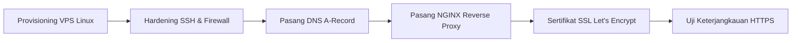

# Runbook Persiapan dan Remediasi Lingkungan Staging SISTLABUM
## Operational Runbook: Infrastructure Provisioning, Runtime Hardening, UAT Seeding, and Readiness Gates

**ID Referensi Dokumen:** `UAT-STAGING-REMEDIATION-RUNBOOK`  
**Target Modul:** Seluruh Modul Web & API SISTLABUM (`13_MASTER_MODULES.md`)  
**Status Dokumen:** **`READY FOR IMPLEMENTATION (WAITING FOR STAGING ACCESS)`**  
**Versi:** 1.0 — 15 Oktober 2026  
**Otoritas Penyusun:** Senior QA Engineer, DevOps Auditor, & Security Architect  
**Dokumen Rujukan Utama:**
- `docs/uat/UAT_STAGING_RECHECK_REPORT.md` (Hasil Audit Faktual Kesiapan Staging)
- `docs/uat/UAT_STAGING_READINESS_REPORT.md` (Inventaris Kesiapan Awal)
- `docs/uat/UAT_PLAN_SISTLABUM.md` (Matriks UAT 14 Modul & 12 Persona Penguji)
- `13_MASTER_MODULES.md` (Single Source of Truth Spesifikasi Fitur)

---

## 1. Tujuan dan Ruang Lingkup

### 1.1 Tujuan
Runbook ini menyediakan panduan operasional langkah demi langkah yang terstruktur, aman, berurutan, dan dapat diverifikasi secara objektif untuk mengubah status lingkungan Staging SISTLABUM dari **`NOT READY — BLOCKERS REMAIN`** menjadi **`READY FOR CONTROLLED UAT`**.

### 1.2 Ruang Lingkup
- **Komponen dalam Cakupan (In-Scope)**:
  1. Backend API Laravel 11/12 (`apps/api`) di lingkungan staging Linux.
  2. Frontend Web Portal & Web Admin Next.js 14 (`apps/web`) di lingkungan staging Linux.
  3. Basis data PostgreSQL 16 staging terisolasi.
  4. Layanan latar belakang (*Supervisor queue worker* dan *system crontab scheduler*).
  5. Penyimpanan berkas privat dan publik.
  6. Dataset sintetis dan 12 akun persona penguji UAT (`UatStagingSeeder`).
- **Komponen Dikarantina / Di Luar Cakupan (Quarantined / Out-of-Scope)**:
  - **Aplikasi Android Kotlin (`apps/mobile`)**: Seluruh antarmuka masih berupa *placeholder UI* (`LoginPlaceholder.kt`, `CbtTokenPlaceholder.kt`, dll) dan belum memiliki *build artifact* APK. Fitur berlabel `MOB-*` (44 fitur) **dikarantina penuh** dari UAT Tahap 1. UAT difokuskan 100% pada Web Portal dan Web Admin.

### 1.3 Batasan Keselamatan Operasional
- **Prinsip Read-Only pada Dokumen Ini**: Dokumen ini adalah rancangan rencana dan instruksi kerja teknis. Tidak ada eksekusi server nyata, modifikasi kode aplikasi, maupun manipulasi basis data pada task penyusunan runbook ini.
- **Perlindungan Kredensial**: Tidak ada rahasia (*secret*, *private key*, kata sandi) yang dituliskan secara mentah (*plaintext*). Seluruh parameter wajib menggunakan *placeholder* terstandarisasi.

---

## 2. Kondisi Awal dan Bukti Faktual Repositori

Berdasarkan audit faktual pada `docs/uat/UAT_STAGING_RECHECK_REPORT.md`:

```
========================= KONDISI FAKTUAL REPOSITORI =========================
1. Kematangan Kode Program:
   - Backend PHPUnit : 1.101 tes lulus (6.016 assertions, zero failure)
   - Frontend Vitest : 723 tes lulus (61 suites, zero failure)
   - Remediasi Eksekutif : SEC-APPR-01 s/d SEC-APPR-09 lulus 100%
2. Kesiapan Fisik Staging:
   - Host Lingkungan : macOS Darwin arm64 (workstation lokal pengembang)
   - Domain Staging  : staging.smp-labum.sch.id -> NXDOMAIN (Belum terdaftar)
   - Domain API      : api-staging.smp-labum.sch.id -> NXDOMAIN (Belum terdaftar)
   - Konfigurasi API : APP_ENV=local, APP_DEBUG=true, CORS default localhost
   - Konfigurasi Web : NEXT_PUBLIC_API_BASE_URL=http://127.0.0.1:8000/api/v1
   - Basis Data      : SQLite lokal (44 migrasi [Ran]), PostgreSQL staging belum ada
   - Akun Penguji    : Belum ada seeder 12 persona UAT
   - Background Job  : 0 worker aktif, 0 cron aktif
==============================================================================
```

---

## 3. Rekonsiliasi Daftar Blocker

### 3.1 Penjelasan Rekonsiliasi Jumlah Blocker
Laporan `UAT_STAGING_RECHECK_REPORT.md` mencatat **12 area evaluasi** (1 PASS, 6 FAIL, 4 BLOCKED, 1 QUARANTINED), sementara rekomendasi mencatat **7 Blocker P0**. Rekonsiliasi teknisnya adalah sebagai berikut:
- **12 Area Evaluasi** merupakan **analisis diagnostik cakupan sistem** (konektivitas, runtime, storage, messaging, mobile, E2E, dll).
- **7 Blocker P0** merupakan **paket tindakan operasional deployment** yang mengelompokkan area-area yang gagal (*FAIL*) dan terblokir (*BLOCKED*) menjadi urutan pekerjaan konkret:
  1. *Area 1 (Host Linux)* $\rightarrow$ Blocker `BLK-P0-01`
  2. *Area 2 (DNS & HTTPS)* $\rightarrow$ Blocker `BLK-P0-02`
  3. *Area 3 & Area 5 (Runtime Env, CORS, Sanctum)* $\rightarrow$ Blocker `BLK-P0-03`
  4. *Area 4 (PostgreSQL Staging DB)* $\rightarrow$ Blocker `BLK-P0-04`
  5. *Area 6 (Akun Persona UAT)* $\rightarrow$ Blocker `BLK-P0-05`
  6. *Area 7 (Queue Worker & Cron)* $\rightarrow$ Blocker `BLK-P0-06`
  7. *Area 12 (Snapshot Baseline & Smoke Test)* $\rightarrow$ Blocker `BLK-P0-07`
- Area 8 (Storage), Area 9 (WhatsApp), Area 10 (E2E), dan Area 11 (Mobile) berada pada klasifikasi **P1 / Akses Tambahan / Karantina**, sehingga tidak menghalangi *Controlled UAT* jika prosedur mitigasi diterapkan.

### 3.2 Matriks Inventaris Blocker Lengkap

| ID Blocker | Kategori | Masalah Faktual & Bukti | Dampak jika Tidak Diselesaikan | PIC | Prasyarat | Kebutuhan Kredensial / Izin Pemilik | Dependensi Blocker |
|---|---|---|---|:---:|---|:---:|:---:|
| **BLK-P0-01** | Infrastruktur | Host masih macOS lokal pengembang (`Darwin ruqqnofearss arm64`). Belum ada VPS Linux. | Pengujian tidak mencerminkan beban, OS, dan arsitektur server produksi sesungguhnya. | DevOps | Spesifikasi VPS disetujui. | **YA** (Penyediaan VPS / Akses SSH) | Tidak ada |
| **BLK-P0-02** | Infrastruktur | Domain `staging.smp-labum.sch.id` & `api-staging.smp-labum.sch.id` NXDOMAIN. | Penguji sekolah tidak dapat mengakses situs web melalui browser internet. | DevOps / SysAdmin | IP Publik VPS diketahui. | **YA** (Akses Pengelolaan DNS Domain) | `BLK-P0-01` |
| **BLK-P0-03** | Konfigurasi | `APP_DEBUG=true`, `APP_ENV=local`, CORS/Sanctum belum memuat domain staging, web menunjuk `127.0.0.1`. | Kebocoran rahasia via stack trace debug; login web ditolak oleh CORS browser. | Backend & Frontend | Domain staging terdaftar. | Tidak (Konfigurasi internal .env) | `BLK-P0-02` |
| **BLK-P0-04** | Database | Basis data lokal menggunakan SQLite. PostgreSQL 16 staging belum ada. | SQLite tidak mendukung konkurensi multi-user tinggi dan locking transaksional CBT/PPDB. | DevOps / DBA | Host Linux aktif. | **YA** (Kredensial database PostgreSQL) | `BLK-P0-01` |
| **BLK-P0-05** | Aplikasi | Seeder `DatabaseSeeder.php` hanya memuat 1 user. 12 persona UAT belum ada di database. | Penguji perwakilan sekolah tidak memiliki akun untuk login ke portal dan admin. | Backend Dev | Matriks hak akses disepakati. | Tidak (Pembuatan seeder di kode) | `BLK-P0-04` |
| **BLK-P0-06** | Infrastruktur | Tidak ada proses daemon `queue:work` dan crontab `schedule:run` yang berjalan. | Fitur rapor, CBT autosubmit, penutupan gelombang PPDB, dan notifikasi macet total. | DevOps | Host Linux aktif. | **YA** (Akses root/sudo di host Linux) | `BLK-P0-01`, `BLK-P0-03` |
| **BLK-P0-07** | QA & Backup | Belum ada snapshot database baseline awal dan prosedur verifikasi asap (*smoke test*). | Data staging tidak dapat dikembalikan ke titik awal jika terjadi kekacauan data saat uji. | QA & DevOps | Blocker P0-01 s/d P0-06 selesai. | Tidak (Operasional internal staging) | `BLK-P0-01` s/d `06` |
| **BLK-P1-01** | Akses / Storage| `FILESYSTEM_DISK=local`. Kredensial S3 staging kosong. | Berkas upload tersimpan di disk lokal server yang tidak tahan replikasi klaster. | DevOps | Bucket staging tersedia. | **YA** (Kredensial MinIO / S3 Bucket) | `BLK-P0-01` |
| **BLK-P1-02** | Akses / Integrasi | Provider WhatsApp beroperasi dalam mode simulasi internal (`wa_msg_...`). | Penguji orang tua/siswa tidak menerima pesan WhatsApp fisik di ponsel nyata. | DevOps / Backend | Akun provider disetujui. | **YA** (API Key WhatsApp Gateway / WABA) | `BLK-P0-03` |
| **BLK-P1-03** | Otomasi QA | `@playwright/test` belum terpasang di `apps/web/package.json`. | Otomasi regresi browser E2E belum ada; verifikasi staging mengandalkan smoke test manual. | QA Engineer | Node.js runtime aktif. | Tidak (Instalasi paket pengujian dev) | `BLK-P0-02` |
| **BLK-DEC-01**| Manajerial | Fitur mobile `MOB-*` (44 fitur) masih berupa kode placeholder Kotlin. | Kebingungan tim jika ada penguji yang mencoba menginstal aplikasi Android. | Project Manager | Surat edaran karantina. | **YA** (Persetujuan Formal Kepala Sekolah) | Tidak ada |

---

## 4. Pembagian Tanggung Jawab (RACI Matrix)

| Peran / Pihak | Kode | Tanggung Jawab Utama dalam Remediasi Staging |
|---|:---:|---|
| **Pemilik Sistem (Kepala Sekolah / Yayasan)** | **OWNER** | Menyediakan akses VPS, delegasi DNS, menyetujui karantina mobile dan kebijakan sandbox WA. |
| **DevOps / SysAdmin Engineer** | **DEVOPS** | Provisioning Linux VPS, konfigurasi DNS, SSL Let's Encrypt, PostgreSQL, Supervisor, Crontab. |
| **Backend Software Engineer** | **BE** | Pembuatan `UatStagingSeeder.php`, konfigurasi `.env` backend, verifikasi migrasi & health check. |
| **Frontend Software Engineer** | **FE** | Konfigurasi `.env.production` web, verifikasi nonaktifnya mock mode, build Next.js staging. |
| **Senior QA & Security Lead** | **QA** | Eksekusi checklist smoke test 12 langkah, verifikasi batas peran, audit trail, sign-off gate. |

### Matriks Tanggung Jawab RACI per Tahapan:

| Tahapan Remediasi | OWNER | DEVOPS | BE | FE | QA |
|---|:---:|:---:|:---:|:---:|:---:|
| **Tahap A — Prasyarat & Akses** | **Accountable** | Responsible | Consulted | Informed | Consulted |
| **Tahap B — Infrastruktur & DNS** | Informed | **Responsible** | Consulted | Informed | Consulted |
| **Tahap C — Database & Runtime Env** | Informed | Responsible | **Responsible** | Responsible | Consulted |
| **Tahap D — Queue, Cron, & Storage** | Informed | **Responsible** | Responsible | Informed | Consulted |
| **Tahap E — Akun UAT & Seeder** | Consulted | Informed | **Responsible** | Informed | Responsible |
| **Tahap F — E2E & Karantina Mobile** | **Accountable** | Informed | Informed | Informed | **Responsible** |
| **Tahap G — Smoke Test & Gate UAT** | Informed | Support | Support | Support | **Responsible** |

---

## 5. Tahap A — Prasyarat dan Kepemilikan Akses

### 5.1 Informasi yang Wajib Disediakan Pemilik Sistem
Sebelum tim teknis memulai instalasi server, Pemilik Sistem wajib melengkapi parameter berikut:

```ini
# ==============================================================================
# PARAMETER AKSES INFRASTRUKTUR STAGING (Disediakan oleh Pemilik Sistem / IT)
# DILARANG MENEMPELKAN PASSWORD, PRIVATE KEY, ATAU TOKEN RAHASIA KE DOKUMEN INI.
# Simpan nilai rahasia di Password Manager resmi / Vault sekolah.
# ==============================================================================

[INFRASTRUKTUR_HOST]
STAGING_SERVER_IP         = <PLACEHOLDER_IP_PUBLIK_VPS>
STAGING_SSH_USER          = <PLACEHOLDER_SSH_USER_MISAL_UBUNTU>
STAGING_SSH_PORT          = <PLACEHOLDER_SSH_PORT_DEFAULT_22>
STAGING_SSH_AUTH_METHOD   = SSH_KEY_ED25519 (Wajib Key-based, Password Auth dinonaktifkan)

[PENGELOLAAN_DNS]
DNS_PROVIDER_PANEL        = <PLACEHOLDER_PANEL_DNS_MISAL_CLOUDFLARE_ATAU_CPANEL>
DOMAIN_STAGING_FRONTEND   = staging.smp-labum.sch.id
DOMAIN_STAGING_BACKEND    = api-staging.smp-labum.sch.id

[BASIS_DATA_POSTGRESQL]
POSTGRES_HOST             = <PLACEHOLDER_DB_HOST_INTERNAL_ATAU_LOCALHOST>
POSTGRES_PORT             = 5432
POSTGRES_DB_NAME          = sistlabum_staging
POSTGRES_USER             = <PLACEHOLDER_DB_USERNAME>
POSTGRES_PASSWORD         = [STORED_IN_SECURE_VAULT]

[OBJECT_STORAGE_OPSIONAL]
STORAGE_TYPE              = S3_COMPATIBLE (MinIO lokal / Cloudflare R2 / AWS S3)
STORAGE_BUCKET_PUBLIC     = sistlabum-staging-public
STORAGE_BUCKET_PRIVATE    = sistlabum-staging-private
STORAGE_ACCESS_KEY        = [STORED_IN_SECURE_VAULT]
STORAGE_SECRET_KEY        = [STORED_IN_SECURE_VAULT]
```

### 5.2 Keputusan Manajerial yang Wajib Ditetapkan Tertulis
1. **Persetujuan Karantina Mobile Android**:
   - Status: **`WAITING FOR APPROVAL`**
   - Pernyataan: *"Menyetujui bahwa pelaksanaan User Acceptance Testing (UAT) Tahap 1 SISTLABUM difokuskan secara eksklusif pada Web Portal dan Web Admin, sementara pengujian aplikasi Android Kotlin ditunda hingga modul mobile selesai diimplementasikan."*
2. **Kebijakan Pengiriman Notifikasi WhatsApp**:
   - Status: **`WAITING FOR APPROVAL`**
   - Pilihan Keputusan:
     - **Opsi A (Direkomendasikan)**: Menggunakan simulator internal dan in-app notification dashboard (tanpa pulsa/biaya gateway WA eksternal, log tersimpan di `notification_logs`).
     - **Opsi B**: Mengintegrasikan akun Sandbox Fonnte/WABA dengan kuota terbatas khusus nomor penguji terdaftar.

---

## 6. Tahap B — Infrastruktur dan DNS (DevOps)

### 6.1 Alur Pelaksanaan


### 6.2 Prosedur Operasional
1. **Spesifikasi Minimum Host Linux**:
   - OS: Ubuntu 24.04 LTS x86_64
   - Kapasitas: 4 vCPU, 8 GB RAM, 60 GB NVMe SSD
   - Paket terpasang: `nginx`, `certbot`, `python3-certbot-nginx`, `supervisor`, `curl`, `git`, `unzip`, `ufw`.
2. **Hardening Akses SSH**:
   - Nonaktifkan login root dan password authentication di `/etc/ssh/sshd_config`:
     ```ini
     PermitRootLogin no
     PasswordAuthentication no
     PubkeyAuthentication yes
     ```
   - Firewall UFW: Buka hanya port SSH (`<STAGING_SSH_PORT>`), HTTP (80), dan HTTPS (443).
3. **Pendaftaran DNS**:
   - Daftarkan dua A-Record pada panel otoritatif DNS domain `smp-labum.sch.id`:
     - `staging.smp-labum.sch.id` $\rightarrow$ `<STAGING_SERVER_IP>` (TTL: 300 detik)
     - `api-staging.smp-labum.sch.id` $\rightarrow$ `<STAGING_SERVER_IP>` (TTL: 300 detik)
4. **Konfigurasi Reverse Proxy NGINX**:
   - Siapkan Virtual Host `/etc/nginx/sites-available/sistlabum-staging.conf`:
     ```nginx
     # Frontend Web (Next.js Standalone Port 3000)
     server {
         server_name staging.smp-labum.sch.id;
         location / {
             proxy_pass http://127.0.0.1:3000;
             proxy_http_version 1.1;
             proxy_set_header Upgrade $http_upgrade;
             proxy_set_header Connection 'upgrade';
             proxy_set_header Host $host;
             proxy_cache_bypass $http_upgrade;
             proxy_set_header X-Real-IP $remote_addr;
             proxy_set_header X-Forwarded-For $proxy_add_x_forwarded_for;
             proxy_set_header X-Forwarded-Proto $scheme;
         }
     }

     # Backend API (Laravel Octane / PHP-FPM Port 8000)
     server {
         server_name api-staging.smp-labum.sch.id;
         client_max_body_size 25M;
         location / {
             proxy_pass http://127.0.0.1:8000;
             proxy_set_header Host $host;
             proxy_set_header X-Real-IP $remote_addr;
             proxy_set_header X-Forwarded-For $proxy_add_x_forwarded_for;
             proxy_set_header X-Forwarded-Proto $scheme;
         }
     }
     ```
5. **Pemasangan Sertifikat SSL**:
   - Jalankan Certbot otomatis:
     ```bash
     certbot --nginx -d staging.smp-labum.sch.id -d api-staging.smp-labum.sch.id --non-interactive --agree-tos -m <ADMIN_EMAIL>
     ```

### 6.3 Cara Verifikasi
```bash
# Uji Resolusi DNS
host staging.smp-labum.sch.id
host api-staging.smp-labum.sch.id
# Kriteria Lulus: Mengembalikan <STAGING_SERVER_IP>, BUKAN NXDOMAIN.

# Uji Handshake SSL & HTTP Status
curl -sI https://staging.smp-labum.sch.id | grep -E "HTTP/|server"
curl -sI https://api-staging.smp-labum.sch.id | grep -E "HTTP/|server"
# Kriteria Lulus: HTTP/1.1 200 OK atau HTTP/2 200 OK, SSL valid Let's Encrypt.
```

---

## 7. Tahap C — Database dan Konfigurasi Runtime

### 7.1 Setup PostgreSQL 16 & Driver PHP
1. Pasang PostgreSQL 16 pada host staging (atau jalankan container `sistlabum-postgres` via `docker-compose.yml` terisolasi).
2. Pastikan ekstensi PHP `pdo_pgsql` aktif di lingkungan runtime Laravel:
   ```bash
   php -m | grep pdo_pgsql
   # Wajib menghasilkan: pdo_pgsql
   ```
3. Buat database dan user staging berwewenang terisolasi:
   ```sql
   CREATE DATABASE sistlabum_staging;
   CREATE USER sistlabum_user WITH ENCRYPTED PASSWORD '<DB_PASSWORD_PLACEHOLDER>';
   GRANT ALL PRIVILEGES ON DATABASE sistlabum_staging TO sistlabum_user;
   \c sistlabum_staging
   GRANT ALL ON SCHEMA public TO sistlabum_user;
   ```

### 7.2 Konfigurasi Environment Backend (`apps/api/.env`)
Pastikan variabel runtime disetel ketat untuk staging:
```ini
APP_NAME=SISTLABUM
APP_ENV=staging
APP_DEBUG=false
APP_KEY=<GENERATE_VIA_ARTISAN_KEY_GENERATE>
APP_URL=https://api-staging.smp-labum.sch.id
FRONTEND_URL=https://staging.smp-labum.sch.id

# Konfigurasi Keamanan CORS & Sanctum
SANCTUM_STATEFUL_DOMAINS=staging.smp-labum.sch.id
CORS_ALLOWED_ORIGINS=https://staging.smp-labum.sch.id
SESSION_DOMAIN=.smp-labum.sch.id
SESSION_SECURE_COOKIE=true

# Database PostgreSQL
DB_CONNECTION=pgsql
DB_HOST=127.0.0.1
DB_PORT=5432
DB_DATABASE=sistlabum_staging
DB_USERNAME=sistlabum_user
DB_PASSWORD=<DB_PASSWORD_PLACEHOLDER>

# Queue & Cache
QUEUE_CONNECTION=database
CACHE_STORE=database
SESSION_DRIVER=database
FILESYSTEM_DISK=local
MAIL_MAILER=log
```

### 7.3 Konfigurasi Environment Frontend (`apps/web/.env.production`)
```ini
NEXT_PUBLIC_API_BASE_URL=https://api-staging.smp-labum.sch.id/api/v1
NEXT_PUBLIC_API_URL=https://api-staging.smp-labum.sch.id/api/v1
NEXT_PUBLIC_SITE_URL=https://staging.smp-labum.sch.id
NEXT_PUBLIC_APP_NAME="SISTLABUM - SMP Laboratorium UM (Staging UAT)"
NEXT_PUBLIC_USE_MOCK=false
NODE_ENV=production
```

### 7.4 Eksekusi Migrasi Database
Setelah koneksi teruji, jalankan migrasi database di server staging:
```bash
cd /var/www/sistlabum/apps/api
php artisan migrate --force
```

### 7.5 Cara Verifikasi
```bash
# 1. Verifikasi status migrasi
php artisan migrate:status
# Kriteria Lulus: Seluruh 44 file migrasi berstatus [Ran].

# 2. Uji endpoint probe kesehatan
curl -s https://api-staging.smp-labum.sch.id/api/v1/health | jq .
# Kriteria Lulus: Output JSON:
# { "status": "ok", "services": { "database": "ok", ... }, "version": "1.1.0" }
```

---

## 8. Tahap D — Queue, Scheduler, Storage, dan Notifikasi

### 8.1 Manajemen Proses Latar Belakang (Supervisor)
**Mengapa Supervisor Dibutuhkan?**  
Laravel queue worker adalah proses *long-running*. Jika worker mengalami crash atau server mengalami reboot, Supervisor secara otomatis membangkitkan kembali worker tersebut dan menjaga jumlah konkurensi proses.

1. Buat file konfigurasi `/etc/supervisor/conf.d/sistlabum-worker.conf`:
   ```ini
   [program:sistlabum-worker]
   process_name=%(program_name)s_%(process_num)02d
   command=php /var/www/sistlabum/apps/api/artisan queue:work database --sleep=3 --tries=3 --max-time=3600
   autostart=true
   autorestart=true
   stopasgroup=true
   killasgroup=true
   user=www-data
   numprocs=2
   redirect_stderr=true
   stdout_logfile=/var/log/supervisor/sistlabum-worker.log
   ```
2. Aktifkan Supervisor:
   ```bash
   supervisorctl reread
   supervisorctl update
   supervisorctl start sistlabum-worker:*
   ```

### 8.2 Konfigurasi Crontab Scheduler
Pasang tugas scheduler Laravel pada crontab pengguna sistem `www-data`:
```bash
crontab -e -u www-data
```
Tambahkan baris berikut:
```cron
* * * * * cd /var/www/sistlabum/apps/api && php artisan schedule:run >> /dev/null 2>&1
```
*Tugas terjadwal mencakup: penutupan otomatis gelombang PPDB (`ppdb:close-wave`), auto-submit ujian CBT (`exam:auto-submit`), rekap presensi malam, dan evaluasi early warning BK.*

### 8.3 Prosedur Storage & Verifikasi Berkas
1. Buat symlink storage publik Laravel:
   ```bash
   php artisan storage:link
   ```
2. Pastikan direktori `storage/app/private` dan `storage/app/public` memiliki hak akses tulis untuk `www-data`:
   ```bash
   chown -R www-data:www-data storage bootstrap/cache
   chmod -R 775 storage bootstrap/cache
   ```

### 8.4 Cara Verifikasi
```bash
# Cek status proses worker
supervisorctl status sistlabum-worker:*
# Kriteria Lulus: Status 'RUNNING' untuk seluruh worker process.

# Cek log scheduler berjalan
php artisan schedule:list
# Kriteria Lulus: Menampilkan jadwal 9 task dengan next run time valid.
```

---

## 9. Tahap E — Akun UAT dan Data Sintetis (Backend Seeding)

### 9.1 Perencanaan Task Implementasi Seeder (`UatStagingSeeder.php`)
Di repositori saat ini, belum tersedia seeder akun penguji UAT. Task kode berikutnya harus membuat file:
`apps/api/database/seeders/UatStagingSeeder.php`.

### 9.2 Spesifikasi 12 Persona Penguji Sintetis
Seeder wajib bersifat **idempoten** (`firstOrCreate`), menggunakan data sintetis murni (tanpa NIK/HP nyata), dan mengisolasi wewenang sesuai prinsip *Least Privilege*:

| No | Persona Penguji | Username / Email | Role Terikat | Pembatasan Wewenang & Tenant | Data Sintetis Pendukung yang Dibuat |
|:---:|---|---|---|---|---|
| **1** | **Super Admin** | `admin.staging@smp-labum.sch.id` | `super_admin` | Global (seluruh sekolah). | Akun admin utama, akses penuh audit log & RBAC. |
| **2** | **Kepala Sekolah** | `kepsek.staging@smp-labum.sch.id` | `principal` | Terikat `school_id` SMP Lab UM. | Dashboard eksekutif, persetujuan sarpras, approve rapor. |
| **3** | **Admin Kurikulum**| `kurikulum.staging@smp-labum.sch.id` | `kurikulum`, `admin_tu` | Mengelola tahun ajaran, jadwal, mapel. | Tahun ajaran 2026/2027 aktif, 5 mapel, kunci rapor. |
| **4** | **Wali Kelas 7-A** | `walas.7a.staging@smp-labum.sch.id` | `homeroom`, `teacher` | Hanya mengelola siswa di Kelas 7-A. | Rombel 7-A (30 siswa sintetis), approval izin kelas. |
| **5** | **Guru Mapel** | `guru.mtk.staging@smp-labum.sch.id` | `teacher` | Hanya mengajar Matematika kelas 7-A & 7-B. | Teaching assignment, jurnal KBM, bank soal CBT 20 nomor. |
| **6** | **Guru BK** | `bk.staging@smp-labum.sch.id` | `counselor` | Akses privat catatan konseling BK. | 3 kasus konseling sintetis, radar early warning. |
| **7** | **Staf Tata Usaha** | `tu.staging@smp-labum.sch.id` | `admin_tu` | Master siswa, guru, cetak surat, slip gaji. | Template impor siswa, 5 berkas slip gaji terunggah. |
| **8** | **Staf Sarpras** | `sarpras.staging@smp-labum.sch.id`| `facility_staff` | Mengelola fasilitas, ruang, aset sarpras. | Fasilitas Aula Graha Cakrawala Mini & Lab Komputer. |
| **9** | **Panitia PPDB** | `ppdb.panitia@smp-labum.sch.id` | `ppdb_committee` | Verifikasi berkas & ranking seleksi PPDB. | Gelombang 1 Jalur Prestasi aktif (kuota 50). |
| **10**| **Siswa Aktif** | `siswa.lab.001@smp-labum.sch.id` | `student` | Hanya data profil & nilai miliknya sendiri. | NIS 26001, terdaftar di kelas 7-A, sesi CBT aktif. |
| **11**| **Orang Tua / Wali**| `ortu.siswa.001@smp-labum.sch.id` | `guardian` | Hanya terhubung ke `siswa.lab.001`. | Relasi guardian-student valid untuk pantau presensi & rapor. |
| **12**| **Calon Siswa PPDB**| `calon.ppdb.01@gmail.com` | `applicant` | Akun publik pendaftar gelombang PPDB. | Pendaftaran draft tahap 3 dengan berkas KK dummy. |

### 9.3 Perintah Eksekusi Seeder di Staging
```bash
php artisan db:seed --class=UatStagingSeeder --force
```

---

## 10. Tahap F — E2E dan Keputusan Cakupan UAT

### 10.1 Evaluasi Ketiadaan Browser E2E Otomatis (Playwright)
- **Status Audit**: Dependensi `@playwright/test` belum ada di `apps/web/package.json`.
- **Dampak terhadap UAT**: **BUKAN FATAL BLOCKER UNTUK UAT MANUAL**. UAT pada hakikatnya adalah validasi penerimaan oleh pengguna manusia (*human acceptance*). Ketiadaan Playwright tidak menghentikan jalannya pengujian fungsional oleh kepala sekolah, guru, atau siswa, asalkan **Checklist Smoke Test Manual (Tahap G)** dieksekusi tuntas oleh tim QA sebelum sesi dibuka.
- **Rekomendasi**: Pasang Playwright pada sprint pasca-UAT sebagai *continuous regression gate*.

### 10.2 Karantina Formal Scope Mobile Android
- **Status**: **`QUARANTINED BY DESIGN`**.
- **Tindakan**: Terbitkan lampiran Berita Acara UAT bahwa fitur mobile `MOB-*` dikecualikan dari kriteria kelulusan UAT rilis web saat ini.

---

## 11. Tahap G — Smoke Test dan Gate Penerimaan

### 11.1 Checklist Smoke Test Berurutan (12 Langkah Mandatori)
Sebelum mengundang penguji perwakilan sekolah ke ruangan UAT, tim QA dan DevOps wajib mengeksekusi dan mencentang ke-12 langkah berikut di lingkungan staging:

- [ ] **Langkah 1: Resolusi DNS & Sertifikat HTTPS**
  - Perintah: `curl -I https://staging.smp-labum.sch.id` & `curl -I https://api-staging.smp-labum.sch.id`
  - Kriteria Lulus: HTTP 200/308, SSL Let's Encrypt valid tanpa peringatan browser (*no insecure warning*).
- [ ] **Langkah 2: Probe Kesehatan API (`/health`)**
  - Endpoint: `GET https://api-staging.smp-labum.sch.id/api/v1/health`
  - Kriteria Lulus: JSON output `status: "ok"`, `database: "ok"`.
- [ ] **Langkah 3: Status Migrasi Basis Data**
  - Perintah: `php artisan migrate:status`
  - Kriteria Lulus: Seluruh 44 tabel berstatus `[Ran]`.
- [ ] **Langkah 4: Smoke Test Login & Logout (12 Persona)**
  - Aksi: Login manual berturut-turut menggunakan 12 akun sintetis di browser web.
  - Kriteria Lulus: Kredensial diterima, token Sanctum tersimpan di cookie HTTP-only, logout berhasil mencabut sesi.
- [ ] **Langkah 5: Penolakan Otorisasi Ilegal (Role Boundary)**
  - Aksi: Siswa mencoba buka `/admin/settings` atau panggil `GET /api/v1/audit-logs`.
  - Kriteria Lulus: Ditampilkan halaman *Access Denied* kanonis (HTTP 403 Forbidden).
- [ ] **Langkah 6: Dashboard Admin & Web Sekolah**
  - Aksi: Akses `/` publik, `/profil`, `/berita`, dan `/admin/dashboard`.
  - Kriteria Lulus: Data termuat tanpa error, footer menampilkan identitas resmi "SMP Laboratorium UM".
- [ ] **Langkah 7: Operasi CRUD Dasar Data Sintetis**
  - Aksi: Kurikulum menambahkan 1 jadwal KBM uji; Admin TU membuat 1 pengumuman uji.
  - Kriteria Lulus: Data tersimpan di database dan muncul di daftar tabel.
- [ ] **Langkah 8: Upload dan Download Berkas Privat**
  - Aksi: Calon siswa mengunggah berkas PDF KK di formulir PPDB; unduh kembali berkas tersebut.
  - Kriteria Lulus: File terunggah, URL unduhan bertanda tangan sementara (TTL $\le$ 300s), akses tanpa token ditolak.
- [ ] **Langkah 9: Pemrosesan Antrean Job & Scheduler**
  - Aksi: Trigger pengiriman notifikasi broadcast atau generate laporan antrean.
  - Kriteria Lulus: Baris tabel `queue_jobs` berkurang diproses oleh worker; `sistlabum-worker.log` mencatat job selesai.
- [ ] **Langkah 10: Uji Keamanan Executive Approval (Anti Double-Booking & Anti IDOR)**
  - Aksi: Setujui permohonan izin; coba setujui booking ruangan yang bentrok jamnya.
  - Kriteria Lulus: Booking pertama disetujui, booking kedua ditolak otomatis dengan HTTP 422 (*overlap detected*); presensi siswa otomatis tersinkronisasi status `sakit`/`izin`.
- [ ] **Langkah 11: Penerbitan Notifikasi In-App**
  - Aksi: Putuskan izin siswa; login sebagai pemohon di portal guru/ortu.
  - Kriteria Lulus: Notifikasi bel masuk dengan badge belum dibaca bertipe `leave_request.decision`.
- [ ] **Langkah 12: Audit Log & Error Tracking**
  - Aksi: Periksa menu `/admin/settings/audit-logs` dan file log `storage/logs/laravel.log`.
  - Kriteria Lulus: Seluruh aksi login dan putusan persetujuan tercatat lengkap dengan IP address dan Request ID; tidak ada unhandled exception fatal.

### 11.2 Kondisi Penghenti UAT (Fatal Stop Conditions)
Pelaksanaan UAT **wajib segera dihentikan** bila terjadi salah satu dari kondisi berikut:
1. Terjadi insiden kebocoran data pribadi (*IDOR breach*): Pengguna dapat melihat rapor, berkas pendaftaran, slip gaji, atau catatan konseling BK milik pengguna lain.
2. Token cookie tidak dapat disimpan (*CORS block* / *cookie mismatch*) sehingga pengguna terus ter-logout berulang kali.
3. Basis data staging mengalami *deadlock* atau kegagalan koneksi PDO saat diakses 5 penguji secara bersamaan.
4. Kunci jawaban ujian CBT bocor pada response network browser siswa.

---

## 12. Prosedur Pemulihan dan Rollback Data (Recovery Procedure)

### 12.1 Pembuatan Snapshot Baseline
Sebelum penguji pertama mulai memasukkan data uji pada hari UAT, buat snapshot bersih:
```bash
pg_dump -U sistlabum_user -h 127.0.0.1 sistlabum_staging > /var/backups/sistlabum_staging_baseline.sql
```

### 12.2 Prosedur Reset Data Cepat (*Quick Reset Script*)
Jika data uji mengalami kekacauan selama skenario pengujian, eksekusi pemulihan cepat ke kondisi bersih:
```bash
#!/bin/bash
# scripts/reset-staging-db.sh
set -e
echo "Mengembalikan database staging ke baseline..."
dropdb -U sistlabum_user -h 127.0.0.1 sistlabum_staging
createdb -U sistlabum_user -h 127.0.0.1 sistlabum_staging
psql -U sistlabum_user -h 127.0.0.1 sistlabum_staging < /var/backups/sistlabum_staging_baseline.sql
echo "Database staging berhasil dipulihkan ke kondisi awal."
```

---

## 13. Keputusan yang Menunggu Persetujuan Pemilik Sistem

Berikut adalah ringkasan hal-hal yang memerlukan tindakan dari Pemilik Sistem:

```
[ ] 1. Penyediaan akses VPS Linux staging dan user SSH berizin sudo.
[ ] 2. Pendelegasian DNS A-Record untuk staging.smp-labum.sch.id dan api-staging.smp-labum.sch.id.
[ ] 3. Penandatanganan persetujuan karantina aplikasi Android Kotlin dari cakupan UAT Tahap 1.
[ ] 4. Pemilihan mode pengiriman WhatsApp (Simulasi log internal vs Kredensial sandbox Fonnte/WABA).
```

---

## 14. Rekomendasi Task Implementasi Kode Berikutnya

Setelah dokumen runbook ini disetujui, **task implementasi kode berikutnya yang paling tepat dan dapat diselesaikan langsung di repositori tanpa menunggu akses server staging** adalah:

> ### **`UAT-SEED-01: Pembuatan Seeder Akun UAT 12 Persona (UatStagingSeeder.php)`**
> - **Tujuan**: Membuat seeder `apps/api/database/seeders/UatStagingSeeder.php` yang mengisi 12 persona penguji sintetis terstandarisasi, lengkap dengan relasi kelas 7-A, mata pelajaran Matematika, gelombang PPDB, dan data awal permohonan izin/sarpras/rapor.
> - **Kriteria**: Idempoten, data 100% fiktif sintetis, mematuhi matriks hak akses resmi SISTLABUM, dan dilengkapi dengan pengujian otomatis (`tests/Feature/Auth/UatSeederTest.php`).
